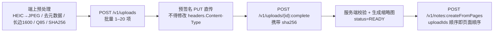
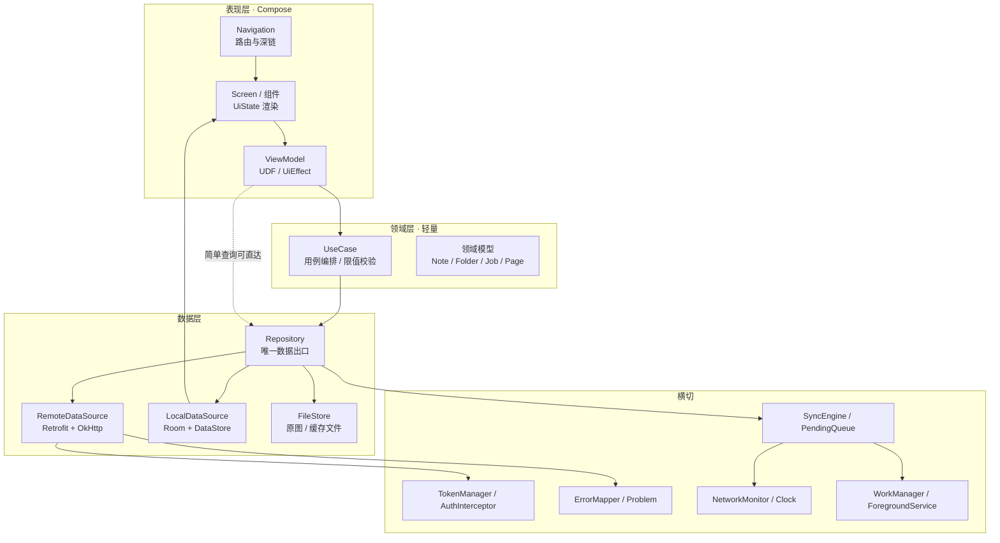
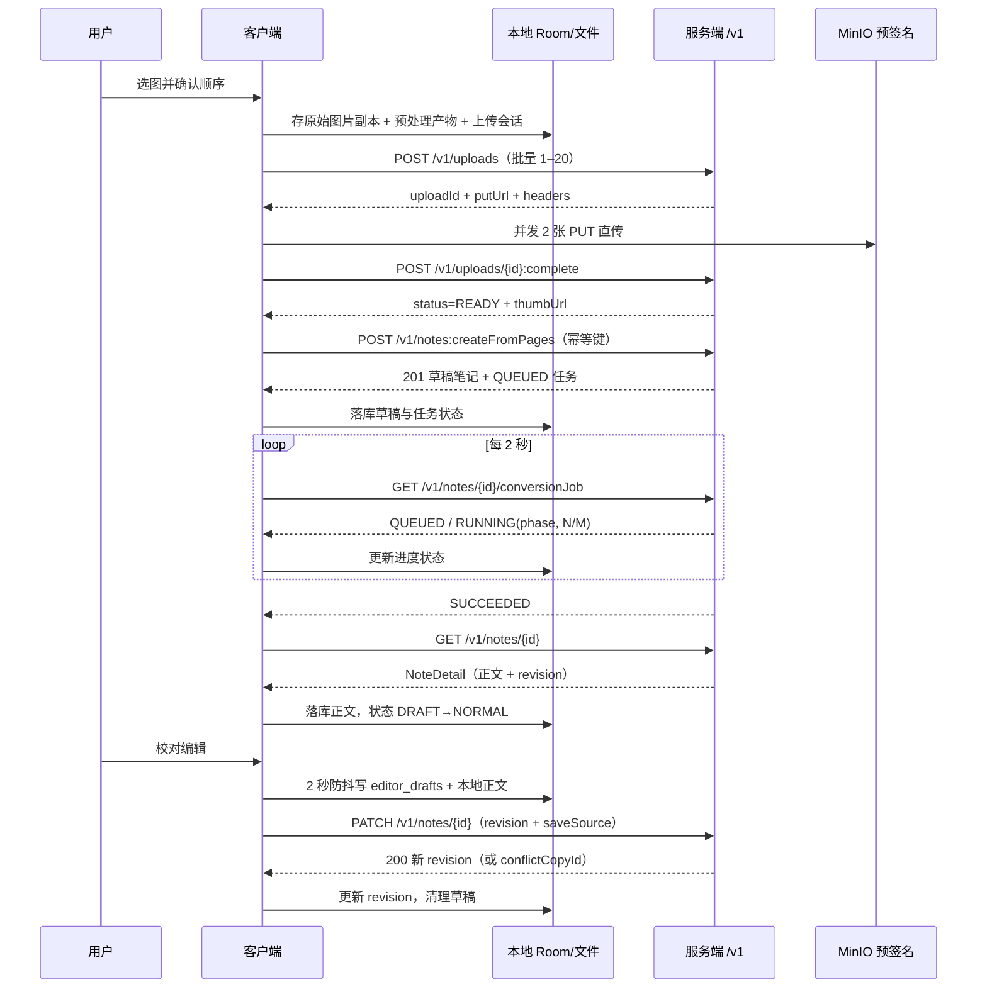
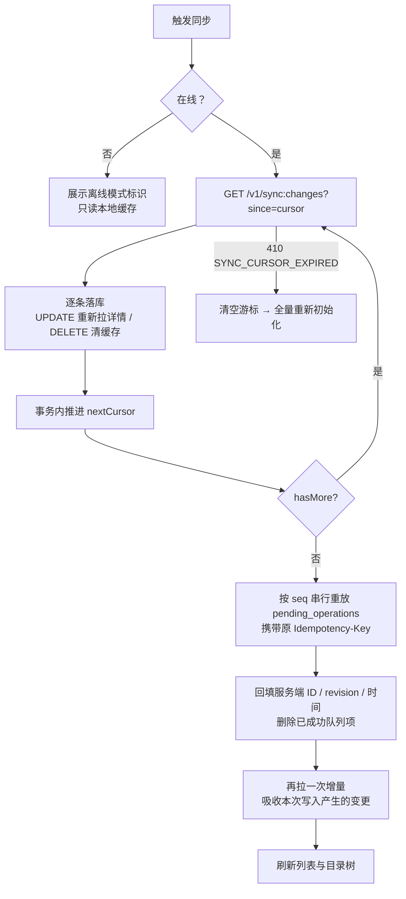
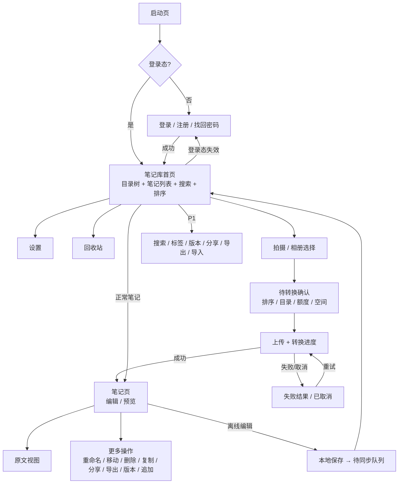

# 拾页笔记（GleanNote）Android 客户端开发主文档

> 架构与实施总纲 · 客户端 0 号文档（Master Document）

## 0. 文档信息

| 项目 | 内容 |
|---|---|
| 文档名称 | 拾页笔记 Android 客户端开发主文档 |
| 文档编号 | GN-CLIENT-001 |
| 版本 | v0.3 |
| 状态 | 草案（待评审） |
| 更新日期 | 2026-11-11 |
| 适用范围 | Android 客户端全部设计、实现、联调、测试与交付活动；不含服务端实现与像素级视觉规范 |
| 上级约束 | 产品行为唯一来源：[PRD v1.2](../../PRD-拾页笔记-GleanNote.md)；接口契约：[API.md v1.1](../../Server/docs/API.md) 与 [openapi.yaml 1.0.1](../../Server/docs/openapi.yaml)；服务端口径：[ARCHITECTURE.md v1.0](../../Server/docs/ARCHITECTURE.md)；工程与文档写作：[CONVENTIONS.md v1.0](../../Server/docs/CONVENTIONS.md) |
| 交付状态参照 | [TEST-REPORT.md](../../Server/docs/TEST-REPORT.md)（2026-11-01，服务端静态检查与单测全通过，E2E 与压测待重跑） |
| 环境基线 | [ENVIRONMENT.md](ENVIRONMENT.md)（GN-CLIENT-007，2026-11-11 本机实测；本文 4.3 与 9.3 以其为准） |
| 目标读者 | Android 客户端研发、测试、产品、设计、服务端联调接口人、架构评审人 |
| 平台范围 | Android（本期不含 iOS 与 Web，PRD 0 节） |

### 0.1 文档定位与职责边界

本文是客户端的 **0 号主文档**，统领后续所有客户端设计与实现。它只回答四个问题：**客户端由哪些部分构成**、**必须与服务端遵守哪些约定**、**核心链路如何在端上闭环**、**按什么顺序交付与验收**。

严格遵循 [CONVENTIONS.md](../../Server/docs/CONVENTIONS.md) 第 1 章的文档分工，禁止串位：

| 内容 | 归属 | 本文的做法 |
|---|---|---|
| 产品行为、界面规则、限值、异常话术 | PRD | 只引用章节号，不复述规则原文 |
| 接口字段、错误码、示例 | API.md / openapi.yaml | 只提取「客户端必须遵守」的约束，不复制字段表 |
| 服务端结构、决策、部署 | ARCHITECTURE.md | 只引用影响客户端的口径 |
| 客户端分层、模块、机制、选型、计划 | **本文** | 完整定义 |
| 像素级视觉、交互稿 | 设计稿（后续） | 不涉及 |

本文**不得**修改 PRD 已定的产品行为与限值。凡本文出现与 PRD 或接口契约不一致的判断，一律以 PRD 与契约为准，并按第 11 章登记为待确认项。

### 0.2 客户端文档体系

本期已产出主文档（001）、[开发环境基线](ENVIRONMENT.md)（007）、[详细开发计划](DEVELOPMENT-PLAN.md)（008）与四份规格文档（002–005）；仅 006「兼容与发布矩阵」待首个可发布版本前拆分。所有子文档必须与本文口径一致，编号与追溯关系以 008 为准：

| 编号 | 子文档 | 职责 | 触发拆分时机 |
|---|---|---|---|
| GN-CLIENT-002 | [接口封装与错误映射表](GN-CLIENT-002.md)（**已产出**） | 58 行端点索引、DTO 映射、错误码 → UI 行为逐条落地 | 已产出（2026-11-12） |
| GN-CLIENT-003 | [本地数据库字典](GN-CLIENT-003.md)（**已产出**） | Room 15 张表、索引、迁移的字段级定义 | 已产出（2026-11-12） |
| GN-CLIENT-004 | [界面规格与状态清单](GN-CLIENT-004.md)（**已产出**） | 17 界面的区域、状态、文案表与 10 张 SVG 线框 | 已产出（2026-11-12） |
| GN-CLIENT-005 | [测试计划与用例清单](GN-CLIENT-005.md)（**已产出**） | C-01~C-14、P1-01~P1-14、17 项验收记录 | 已产出（2026-11-12） |
| GN-CLIENT-006 | 兼容与发布矩阵（**本轮不补**） | Android 版本、设备、渠道、灰度口径 | 首个可发布版本前 |
| GN-CLIENT-007 | [开发环境基线](ENVIRONMENT.md)（**已产出**） | 本机工具链版本与路径、环境变量、构建配置、模拟器联调与排障 | 已实测（2026-11-11），工程搭建前必读 |
| GN-CLIENT-008 | [详细开发计划](DEVELOPMENT-PLAN.md)（**已产出**） | P0+P1 全量任务级 WBS（104 条任务）、九列追溯矩阵、甘特与验收口径 | 已产出（2026-11-12），编码执行依据 |
| GN-CLIENT-009 | [客户端测试报告](TEST-REPORT-CLIENT.md)（**已产出**） | 真实服务端联调的三层测试结果、缺陷清单与环境阻塞项 | 已产出（2026-11-13） |

### 0.3 术语与缩写

产品术语沿用 [PRD](../../PRD-拾页笔记-GleanNote.md) 0.1。补充客户端技术术语：

| 术语 | 定义 |
|---|---|
| 单一数据源（SSOT） | UI 只观察本地 Room 数据流；网络响应一律先落库再由 UI 观察，不直接渲染网络结果 |
| 服务端权威 | 服务端为数据与状态的最终依据，本地缓存仅用于离线展示与待同步暂存（ARCHITECTURE 4 章） |
| UDF | 单向数据流：UiState 向下、UiEvent 向上、一次性 Effect 单独通道 |
| 待同步队列 | 离线产生的变更在本地按发生顺序排队，联网后按序重放普通写接口（PRD FR-10、API.md 5.10 规则 5） |
| 同步游标 | `sync:changes` 的 `nextCursor`，客户端先落库再推进，不得先推进游标 |
| 墓碑事件 | `op=DELETE` 的增量事件，客户端据此清除本地缓存 |
| 幂等键 | `Idempotency-Key` 请求头，客户端生成并持久化，重试必须复用同一键值 |
| 短效 URL | 预签名 `thumbUrl` / `thumbnailUrl` / `originalUrl` / `downloadUrl`，有有效期，不得作为持久数据存储 |
| 草稿恢复 | 编辑内容在进程被回收后从本地恢复的能力（PRD FR-06、2.2） |
| 前台服务 | 上传与转换进行中用于维持后台网络任务的 Android 组件，见 6.12 与 11.1 |

### 0.4 标记约定

沿用 [PRD](../../PRD-拾页笔记-GleanNote.md) 0.2 的 `[Assumption]`，并新增两个标记：

| 标记 | 含义 |
|---|---|
| `[Assumption]` | PRD 已标注的先行采用口径，产品主决策已确认，可后续微调 |
| `[建议]` | 本文给出的实现选型或工程取值。PRD 0 节明确「只定义产品行为，不约束实现方式」，故此类取值可由客户端评审替换，替换时须更新本文与修订记录 |
| `[待确认]` | 产品规则与服务端契约之间存在歧义、或需要产品/服务端给出口径的事项，汇总于 11.3，不得由客户端单方面假定 |

### 0.5 修订记录

| 版本 | 日期 | 修订人 | 说明 |
|---|---|---|---|
| v0.1 | 2026-11-11 | 客户端架构组 | 首版草案：基于 PRD v1.2、API.md v1.1 / openapi.yaml 1.0.1、ARCHITECTURE.md v1.0 建立客户端总纲，含契约基线、分层与模块、本地数据模型、核心机制、追溯矩阵与交付里程碑 |
| v0.2 | 2026-11-11 | 客户端架构组 | 接入 [ENVIRONMENT.md](ENVIRONMENT.md) 的本机实测环境基线：4.3 构建口径改为已验证组合、9.3 补充工具链依赖、11.1 增补环境风险、新增附录 D 环境速查；修订记录口径同步 |
| v0.3 | 2026-11-12 | 客户端架构组 | 登记 002–005 与 008 五份新文档；修正 §2.1 端点总数 57→58 及分组计数（笔记 9→11、分享 4→5）；修正 §6.3 预签名地址落库与 1.5/5.3「短效 URL 不入库」的矛盾；§7.2 设置页状态按 PRD 第 6 章拆为 6 项；11.3 增加补充登记（API.md 错误码命名不一致，不占 Q 编号）；§12 补任务级追溯指引；附录 A/B/C 同步 |
| v0.4 | 2026-11-13 | 客户端实现 | 登记 GN-CLIENT-009 测试报告；联调实测修复启动登录态竞态、回收站缓存不刷新、刷新单飞竞态与注册验证码硬校验 |

---

## 1. 目标、范围与约束

### 1.1 客户端使命

产品核心承诺是「拍完即得可编辑 Markdown」（PRD 1.3）：识图、结构化、生成 Markdown 由服务端与 AI 完成，用户只做拍照与校对。客户端的使命是**把这条链路在端上做到零跳出、可恢复、可离线**，即 PRD 1.4 的四条可观察结果全部由客户端行为承载：

1. 选图到拿到可编辑 Markdown 全程不离开应用 —— 取图、压缩、上传、轮询、编辑在同一导航图内（第 7 章）；
2. 转换失败可在原草稿重试 —— 端上保留 `uploadId` 与页面图片映射，重试不重新选图（6.4）；
3. 任意 Android 设备登录可见相同结构 —— 增量同步与服务端权威（6.7）；
4. 误删可自行恢复 —— 回收站与恢复级联（6.8）。

### 1.2 交付范围

**P0 闭环**（PRD 2.1，本期必须完整可用）与客户端落点：

| # | 闭环条目 | 客户端落点 | 验收依据 |
|---|---|---|---|
| 1 | 注册、登录、退出登录 | `feature:auth`、TokenManager | PRD FR-01、API.md 4.1 |
| 2 | 目录与子目录创建、重命名、移动、删除 | `feature:library`、目录树组件 | PRD FR-02、API.md 4.2 |
| 3 | 相机拍摄或相册多选页面图片 | `feature:capture`、`core:media` | PRD FR-03 |
| 4 | 上传图片并提交 AI 转换，查看进度 | `core:sync` 上传管线、`feature:conversion` | PRD FR-04 / FR-05 |
| 5 | 结果校对与编辑、手动与自动保存 | `feature:editor`、`core:markdown` | PRD FR-06、API.md 5.3.6 |
| 6 | 笔记列表浏览、打开、移动、删除 | `feature:library`、`feature:trash` | PRD FR-07 / FR-08 / FR-09 |
| 7 | 多设备云端同步 | `core:sync` 同步引擎 | PRD FR-10、API.md 5.10 |
| 8 | 回收站恢复与彻底删除 | `feature:trash` | PRD FR-09、API.md 5.6 |

**P0 恢复路径**（PRD 2.2，缺失任意一条视为闭环未完成）与端上机制：

| 恢复能力 | 端上机制 | 章节 |
|---|---|---|
| 转换失败后原地重试，复用已上传图片 | 草稿笔记 + 页面图片本地映射 + `:retry` | 6.4 |
| 上传中断后仅重传失败图片 | 上传会话状态机 + 失败项列表 | 6.3 |
| 断网可读可编，联网自动同步 | 本地 SSOT + 待同步队列 + 网络监听 | 6.7 |
| 误删目录或笔记后可从回收站恢复 | 软删除标记 + `:undelete` | 6.8 |
| 应用被系统回收后未提交编辑可恢复 | `editor_drafts` 防抖落库 | 5.5、6.5 |

**P1 范围**（PRD 2.3、FR-12 至 FR-18）：全文搜索、标签、导出 Markdown/PDF、分享链接与公开分享、版本历史、批量导入、向已有笔记追加页面图片。服务端对应端点在 [API.md](../../Server/docs/API.md) 4.3–4.6 均已标注为 P1 且已实现（TEST-REPORT 第 2 节），客户端按 10.3 的顺序接入，**不得**为 P1 提前破坏 P0 的数据模型。

**明确不做**（PRD 2.4）：多人协作、评论、权限共享、iOS 与 Web 客户端、本地离线 OCR、OCR 原文对照、付费与会员体系。客户端额外不得做：所见即所得富文本编辑器（正文恒为 Markdown 纯文本，PRD FR-06）、应用内只读模式（分享链接除外，PRD FR-08）、应用内嵌网页（链接一律系统浏览器，PRD FR-08）。

### 1.3 技术背景与运行约束

| 类型 | 约束 | 出处 |
|---|---|---|
| 既定技术 | Kotlin + Jetpack Compose | PRD 0 节 |
| 平台 | 仅 Android，无 iOS / Web | PRD 0 节、2.4 |
| 传输 | 仅 HTTPS、TLS 1.2+；基础路径 `/v1`；请求/响应 JSON `camelCase` | API.md 2.1 |
| 请求体 | 最大 12MB（业务 API）；图片二进制走预签名直传，不经过应用 | API.md 2.1 / 2.9、ARCHITECTURE 3 章 |
| 服务端能力 | 单机 2C4G，单用户并发转换 1 个，写接口 120 次/分钟/用户，全局 600 请求/分钟/IP | ARCHITECTURE 8.7 |
| 轮询节奏 | 转换任务建议 2 秒 | API.md 5.5.1 |
| 端侧版本 | `minSdk` 建议 26；`targetSdk` 取当期上架要求的最新稳定版 `[建议]` | 本文 4.3 |
| 时间 | 服务端仅返回 RFC 3339 UTC；展示层统一按北京时间（UTC+8）换算 | API.md 2.1、PRD 5.8 |

客户端**必须**配合服务端的限流与轮询节奏：不得用高频轮询补偿状态刷新，不得在列表滚动时并发拉取全量原图，不得绕过 `pageToken` 自行跳页。

### 1.4 质量目标

按可验证口径描述，不使用未经验证的量化指标（沿用 PRD 1.4 的写法）：

| 优先级 | 目标 | 验证方式 |
|---|---|---|
| 1 | 任何离线编辑、进程回收、上传中断均不丢失用户已输入内容 | 恢复路径用例集（9.2） |
| 2 | 多设备同步后目录结构与正文一致，冲突不静默丢弃任何一方 | 双设备并发用例 |
| 3 | UI 只从本地数据源读取，界面在网络失败时不出现空白或内容回退 | 断网/弱网用例 |
| 4 | 20 万字符正文（PRD 5.2）在编辑与预览时不出现长时间白屏或崩溃 | 极限正文用例 |
| 5 | 20 张 / 50 张 / 200MB / 50 张日额度等限值在提交前即可拦截（PRD 5.2 / 5.3 / 5.3.1） | 边界用例 |
| 6 | 登录态失效后在任意页面跳登录，成功后回到原页面 | 全局路由用例 |
| 7 | 令牌、验证码、邮箱等敏感信息不进入日志与本地明文存储 | 安全用例与静态检查 |

### 1.5 技术非目标

- 不把本地缓存当作数据权威，不用本地时间戳裁决多设备冲突（服务端为准，PRD FR-10）。
- 不实现本地 OCR、不在端上做 AI 识别（PRD 2.4）。
- 不持久化任何预签名 URL 作为长期可用地址（API.md 5.4.4、ARCHITECTURE 8.16）。
- 不解析 `problem.detail` / `userMessage` 取业务变量，变量只从 `metadata` 读（API.md 2.8 约束 1）。
- 不依赖 `totalSize` 计算页数、不猜测未知枚举值语义（API.md 7.4）。

---

## 2. 与服务端协作的契约基线

本章是客户端网络层与数据层的**强制输入**，字段级定义以 [API.md](../../Server/docs/API.md) 与 [openapi.yaml](../../Server/docs/openapi.yaml) 为准；两者冲突时以契约文件与 API.md 修订记录为准（API.md 1 章）。

### 2.1 端点分组与阶段

契约基准地址为 `https://{host}/v1`（openapi.yaml `servers`；本地联调见 9.3）。API.md 第 4 章共 **58 行端点**（编号 1–57 加 v1.1 新增的 `50a GET /s/{token}`），构成为 55 个 `/v1` 端点、1 个公开 HTML 分享页、2 个运维探针（API.md 4.6）。客户端按组封装；分组计数以本表为准，端点逐行索引见 [GN-CLIENT-002.md](GN-CLIENT-002.md) 第 1 章：

| 组 | 端点数 | 阶段 | 客户端模块 |
|---|---|---|---|
| 账号与认证 | 10 | P0 | `core:network`、`feature:auth`、`feature:settings` |
| 目录 | 9 | P0 | `feature:library` |
| 笔记 | 11（含 P1 搜索、追加） | P0 9 / P1 2 | `feature:library`、`feature:editor` |
| 图片与转换 | 7 | P0 | `core:media`、`core:sync`、`feature:conversion` |
| 回收站 | 1 | P0 | `feature:trash` |
| 增量同步 | 1 | P0 | `core:sync` |
| 标签 | 5 | P1 | `feature:tags` |
| 版本 | 3 | P1 | `feature:version` |
| 分享 | 5（含匿名 JSON 与 HTML 页） | P1 | `feature:share` |
| 导出 / 导入 | 4 | P1 | `feature:export`、`feature:import` |
| 探针 | 2 | P0 | 联调工具，不进入用户态功能 |

匿名可访问端点仅：`/v1/auth:*`、`/v1/public/*`、`/s/{token}`、`/healthz`（ARCHITECTURE 8.6）。客户端不得为任何其他端点省略鉴权头。

### 2.2 请求侧强制约定

| 约定 | 客户端必须做的事 | 出处 |
|---|---|---|
| 鉴权 | 除 2.1 所列匿名端点外，统一 `Authorization: Bearer {accessToken}`，由拦截器注入 | API.md 2.2 |
| 幂等键 | 所有创建类 `POST` 携带 8–64 位可见 ASCII 的 `Idempotency-Key`，24 小时内唯一且重试复用同值 | API.md 2.6 / 8.4 |
| 设备标识 | 登录、刷新、登出、注册携带同一 `X-Device-Id`，并持久化到本机；用于刷新令牌绑定与登录态吊销 | API.md 2.3 / 5.1.3 |
| 版本与追踪 | 携带 `X-Client-Version`；发起 `X-Request-Id` 或透传服务端回显值用于问题定位 | API.md 2.3 |
| 乐观锁 | `PATCH /v1/notes/{id}` 必带 `revision`（或 `If-Match: "rev-{n}"`，二选一） | API.md 2.7 / 5.3.6 |
| 自定义方法 | 使用 `POST /v1/{collection}/{id}:{verb}`，动词小驼峰；不得改写路径风格 | API.md 2.1、ARCHITECTURE 8.1 |
| 空值 | 无值字段直接省略；`null` 只用于「显式清空」（如 `targetParentId: null` 表示移到根级） | API.md 2.1 / 5.2.6 |
| 枚举 | 发送 `UPPER_SNAKE_CASE`；接收时容忍未知值并落到安全默认分支 | API.md 2.1 / 7.4 |
| 时间 | 只发送 RFC 3339 UTC（如离线补录的 `clientCreatedAt`）；业务日期换算用 `Asia/Shanghai` | API.md 2.1、ARCHITECTURE 8.5 |
| 请求体 | `application/json; charset=utf-8`；单请求 ≤ 12MB；图片二进制不得走业务 API | API.md 2.1 / 2.9 |

### 2.3 响应侧强制约定

| 约定 | 客户端必须做的事 | 出处 |
|---|---|---|
| 分页 | 集合一律支持 `pageSize`（默认 20，上限 100）与不透明 `pageToken`；**`nextPageToken` 为空字符串是停止翻页的唯一依据** | API.md 2.4 |
| 总数 | `totalSize` 为估算值，仅用于展示，不得用于计算页数或跳页 | API.md 2.4 |
| 排序 | 只发送 `orderBy` 白名单值：`updateTime desc`、`createTime desc`、`title asc`（笔记），目录/回收站/版本/标签各有白名单 | API.md 2.5 |
| 过滤 | 使用显式强类型参数；多值用重复键（`tagIds=a&tagIds=b`），语义「同时包含」 | API.md 2.5 |
| 错误 | 统一 `application/problem+json`；按 `code` 分支，业务变量只从 `metadata` 取，`retryable` 决定是否提供重试 | API.md 2.8 |
| 限流 | `429` / `503` 读取 `Retry-After` 退避，不得立即自旋重试 | API.md 2.3 |
| 不存在 | 未找到或不属于当前用户一律 `404 RESOURCE_NOT_FOUND`，客户端按「内容不存在或已被删除」统一处理，不区分越权 | API.md 2.8 约束 4、ARCHITECTURE 8.2 |
| 短效 URL | `originalUrl` 10 分钟、`downloadUrl` 1 小时、预签名缺省 15 分钟；每次使用重新签发，不得跨会话复用 | API.md 5.4.4 / 5.11、ARCHITECTURE 8.16 |
| 搜索片段 | `snippet` 仅含 `<em>` 一种标记，渲染前剥离或转为高亮样式，不得当 HTML 直接渲染 | API.md 5.3.11 |

### 2.4 认证与令牌生命周期

| 事项 | 口径 | 客户端实现要点 |
|---|---|---|
| Access Token | JWT（EdDSA），有效期 15 分钟 | 内存缓存即可，进程重启后用 Refresh Token 换新 |
| Refresh Token | 不透明串，30 天，**每次使用即轮换**，旧值立即失效 | 加密持久化；写入新值必须与持久化成功绑定，避免丢失 |
| 刷新 | `401 AUTH_TOKEN_EXPIRED` → `POST /v1/auth:refresh` → 重放原请求 | 拦截器内做**并发单飞**：多请求同时 401 只发一次刷新，其余等待并复用结果 |
| 复用检测 | `401 AUTH_REFRESH_REUSED` 触发设备全部令牌吊销 | 立即清空本地登录态并跳登录页，不得自动重试 |
| 登录态失效 | `AUTH_TOKEN_INVALID`、`AUTH_REFRESH_REUSED`、任意页面 401 | 暂停同步，跳登录页，登录成功后**回到原页面**（PRD FR-01） |
| 密码重置 | 重置后原有登录态全部失效 | 找回密码成功后清本地令牌并回登录页（PRD FR-01、API.md 5.1.6） |
| 退出登录 | 二次确认；存在未同步内容时先提示「有内容尚未同步，退出后将丢失」 | 调用 `:logout` 后清除本机登录态与**该账号的本地笔记缓存**（Room + 图片文件 + 偏好），不做跨账号残留（PRD 5.7） |
| 注销账号 | 邮箱验证码 + 二次确认，立即生效不可恢复 | 同退出登录的本地清理范围（PRD FR-01） |
| 协议 | 首次登录/注册必须勾选用户协议与隐私政策，未勾选提交按钮不可用 | 校验在 UI 层，服务端仍有 `AUTH_AGREEMENT_REQUIRED` 兜底 |

**待确认**：[API.md](../../Server/docs/API.md) 5.1.1 的 `sendCode` 为 204 且「不区分邮箱是否已注册」，而 PRD FR-01 要求注册页对「邮箱已注册」即时置灰提示、登录页对「邮箱未注册」给跳转入口。错误码目录虽保留 `AUTH_EMAIL_ALREADY_EXISTS` / `AUTH_EMAIL_NOT_REGISTERED`，但服务端已统一账号枚举口径（ARCHITECTURE 8.6、TEST-REPORT 第 1 节）。客户端**不得**依赖发码接口做存在性预检，建议以 `register` / `login` 的返回码为准，具体交互见 11.3。

### 2.5 幂等与乐观锁

- 幂等键在**发起操作前**生成并写入本地待同步队列，随操作一并持久化；网络重试、进程恢复、离线重放均复用同一键值，禁止每次重试重新生成（API.md 2.6、5.10 规则 5）。
- 同键不同请求体返回 `409 IDEMPOTENCY_KEY_REUSED`：客户端按「操作冲突，请刷新」处理并重新拉取，不得自动改写请求体重试。
- 笔记 `revision`：本地必须持久化每次 `PATCH` 成功后返回的新 `revision`，否则下一次保存必然触发冲突副本。`AUTO_SAVE` / `MANUAL_SAVE` 通过 `saveSource` 区分，服务端据此决定是否生成版本（PRD FR-16、API.md 5.3.6）。
- 笔记 `revision` 落后时服务端**不返回 412**，而是 `200` + `conflictCopyId`，并把先提交的正文另存为冲突副本；客户端据此提示「检测到编辑冲突，已保留副本」（PRD 5.5、API.md 2.7）。目录改名、标签改名等无冲突语义的更新才会返回 `412 REVISION_MISMATCH`。
- 冲突副本标题由服务端生成（PRD 5.5「原标题（冲突副本 时间）」），客户端不自行拼接，只按 `conflictCopyId` 拉取并展示。

**待确认**：[API.md](../../Server/docs/API.md) 2.6 表述「所有创建类 `POST` 必须携带 `Idempotency-Key`」，但 4.4 接口总览中 `POST /v1/uploads`（申请上传会话）标注为 `I=否`，8.4 的列举也未包含它。客户端策略：对全部创建类 `POST` 一律携带幂等键（多带不违反契约），上传会话另依赖「预签名 `PUT` 幂等 + `:complete` 幂等」保证安全；口径见 11.3。

### 2.6 图片直传三步协议

严格按 [API.md](../../Server/docs/API.md) 2.9 实现，顺序不可调换：



| 约束 | 值 | 出处 |
|---|---|---|
| 单批申请 | 1–20 项 | API.md 5.4.1 |
| 声明格式 | `image/jpeg` / `image/png` / `image/webp`；HEIC 由客户端转 JPEG | API.md 2.9、PRD FR-03 |
| 单张上限 | 10MB，上传前压缩不阻断 | PRD 5.2、API.md 2.9 |
| 会话有效期 | 30 分钟，过期 `:complete` 返回 `410 UPLOAD_EXPIRED` | API.md 2.9、6.3 |
| 提交前置 | `uploadIds` 全部为 `READY`，1–20 个 | API.md 5.3.4 |
| 校验顺序 | 额度 → 存储容量 → 上传有效性 → 事务写入 | API.md 5.3.4、ARCHITECTURE 8.8 |

PRD FR-04 要求「上传前统一输出 JPEG 质量 85」，因此端上所有输入格式（JPG / PNG / HEIC / WEBP）统一转 JPEG 后上传；同时保留原始图片本地副本供原文视图使用（PRD FR-04 `[Assumption]`）。

### 2.7 转换任务契约

| 项 | 口径 | 出处 |
|---|---|---|
| 提交 | `createFromPages` 返回 `201`，含 `note`（`DRAFT`）、`conversionJob`（`QUEUED`）、`quota` | API.md 5.3.4 |
| 进度获取 | `GET /v1/notes/{id}/conversionJob`，**轮询间隔 2 秒** | API.md 5.5.1 |
| 阶段文案 | `JobPhase`：`QUEUED` / `RECOGNIZING` / `GENERATING` / `COMPLETED`；`processedPages`/`totalPages` 用于「正在识别第 N/M 页」 | API.md 3.2、PRD FR-05 |
| 终态 | `SUCCEEDED` / `FAILED` / `CANCELED`；终态后**再拉笔记详情** | API.md 5.5.1 |
| 客户端超时 | 5 分钟未完成按失败提示（PRD FR-05 `[Assumption]`）；本地不擅自改写任务状态，仍以服务端终态为准 | PRD FR-05 |
| 取消 | `QUEUED` / `RUNNING` 可取消，额度自动返还，页面图片保留 | API.md 5.5.2 |
| 重试 | `:retry` 创建新任务、复用已有页面；额度与容量重新校验 | API.md 5.5.3 |
| 未提交过 | 查询返回 `404 CONVERSION_NOT_FOUND`，客户端按「暂无转换任务」处理 | API.md 5.5.1 |
| 结算冲突 | `NOTE_MODIFIED`（转换期间用户改过笔记）→ 结算放弃写入，提示重试 | API.md 6.3、ARCHITECTURE 6.2 |

失败码到 UI 的映射见 6.10。同一用户同时最多 1 个 `RUNNING` 任务（ARCHITECTURE 8.7），客户端不并发提交多篇转换，批量导入按 P1 队列串行处理（PRD FR-17）。

### 2.8 增量同步契约

`GET /v1/sync:changes?since={cursor}&pageSize=200&resourceTypes=...`（API.md 5.10）：

1. `since=0` 表示全量初始化；`nextCursor` 严格单调，**客户端先落库再推进游标**。
2. `hasMore=true` 时立即拉下一页，`pageSize` 保持不变，不插入用户可感知的等待。
3. `op=DELETE` 为墓碑事件，`payload=null`，客户端据此清除本地缓存而非展示错误。
4. `410 SYNC_CURSOR_EXPIRED`（变更日志保留 90 天）→ 清空游标并全量重新初始化，提示「数据已更新，请重新同步」。
5. **离线变更不走该端点**：按发生顺序重放普通写接口并携带 `Idempotency-Key`（API.md 5.10 规则 5、ARCHITECTURE 6.5）。
6. `[建议]` 把增量事件视为「失效通知」：收到 `UPDATE` 后按 `resourceId` 重新 `GET` 详情回填本地，不依赖 `payload` 的字段完整性。理由是 `payload` 属可演进字段，全量详情才是稳定快照，且可避免目录路径、标签关联等派生字段在端上重算。

### 2.9 时间、额度与容量口径

| 项 | 口径 | 客户端动作 | 出处 |
|---|---|---|---|
| 时间基准 | 服务端一律 UTC；业务日期按 `Asia/Shanghai` | 全部时间存 UTC，展示时换算北京时间 | API.md 2.1、PRD 5.8 |
| 相对时间 | 刚刚 / N 分钟前 / N 小时前 / M月D日 / YYYY年M月D日 | 客户端计算，服务端只给绝对时间 | PRD 5.8、ARCHITECTURE 8.5 |
| 日额度 | 50 张/日，按提交张数扣减，失败/取消/超时自动返还，北京时间 0 点重置 | 确认页展示剩余张数；`remaining < 本次张数` 时禁用开始转换 | PRD 5.3、API.md 5.1.7 |
| 云端容量 | 200MB/账号，按页面原图 `bytes` 计，正文不计；回收站仍占配额 | 设置页进度条；90% 提示、100% 阻断新转换但允许编辑阅读 | PRD 5.3.1、ARCHITECTURE 8.8 |
| 重置时间 | `resetAt` 为北京时间次日 0 点对应的 UTC 时刻 | 直接换算展示，不用本地日期自行推算 | API.md 5.1.7 |
| 回收站 | 保留 30 天，`purgeAt` / `remainingDays` 由服务端给出 | 剩余天数按自然日展示，最少「今天到期」 | PRD 5.4 / 5.8、API.md 5.6 |

### 2.10 兼容策略

`v1` 冻结后只允许向后兼容变更（API.md 第 7 章、ARCHITECTURE 8.15）。客户端必须：

- 忽略未知响应字段、未知枚举值，不依赖字段顺序；
- 不依赖 `totalSize`，`nextPageToken` 为空即停止；
- 容忍错误 `metadata` 新增键；
- 客户端按 `code` 建立默认分支：未知错误码走通用提示 + 可重试判定，不得崩溃或空白页；
- 关注 `Deprecation` / `Sunset` 响应头并记录日志，为 `/v2` 迁移预留入口。

---

## 3. 客户端架构总览

### 3.1 架构风格与关键决策

| 决策 | 结论 | 理由 |
|---|---|---|
| 数据策略 | **离线优先 + 本地 SSOT + 服务端权威** | PRD 2.2 要求断网可读可编可新建，UI 必须只读本地；PRD FR-10 要求服务端为最终依据 |
| 界面范式 | Jetpack Compose + UDF（MVI 风格） | 既定技术背景（PRD 0 节）；状态集中便于覆盖 PRD 第 6 章的大量加载/空/错误/离线态 |
| 分层 | 表现层 / 领域层（轻量）/ 数据层三层，端口化 Repository | 与服务端六边形分层对称，便于契约变更时只改数据层 |
| 同步 | 待同步队列 + 增量游标拉取 | 直接对应 API.md 5.10 与 PRD FR-10，离线重放需要可去重与有序 |
| 后台 | WorkManager + 前台服务分工 | 上传/转换需切后台继续（PRD FR-04 / FR-05），转换完成需通知（PRD FR-05） |
| 图片 | 端上预处理 + 预签名直传 | 服务端不做二次压缩（ARCHITECTURE 5.6、ADR-015/016） |
| 正文 | Markdown 纯文本存储与编辑，预览端上渲染 | ARCHITECTURE 1.4 明确服务端不渲染富文本；分享页由服务端纯文本转义输出 |

### 3.2 分层视图



约束：UI 只观察 `LocalDataSource` 暴露的 `Flow`；网络响应写入 Room 后由 `Flow` 自动驱动界面刷新，**禁止**把网络响应直接作为界面状态返回（唯一例外是登录令牌与一次性下载地址）。

### 3.3 模块划分

`[建议]` 采用多模块 Gradle 工程；模块名可按评审调整，但职责边界与依赖规则不得放宽。

| 模块 | 职责 | 不负责 |
|---|---|---|
| `:app` | 应用入口、导航图、依赖装配、通知入口 | 业务逻辑 |
| `:core:model` | 领域模型与枚举（纯 Kotlin，无 Android 依赖） | 网络 DTO、数据库实体 |
| `:core:common` | Result/AppError、时间格式化、限额常量、日志脱敏 | 业务规则判断 |
| `:core:network` | Retrofit 接口、DTO、拦截器、Problem 解析、幂等键注入 | 数据落库 |
| `:core:database` | Room 实体/DAO/迁移、待同步队列、游标、编辑草稿 | 网络调用 |
| `:core:datastore` | 令牌、设置、设备 ID、搜索历史的偏好存储 | 笔记正文 |
| `:core:sync` | 上传管线、待同步重放、增量拉取、冲突处理、后台调度 | UI |
| `:core:media` | 相机/相册、HEIC 转换、去元数据、压缩、SHA256、本地文件管理 | 上传协议 |
| `:core:markdown` | Markdown 解析、预览渲染、轻量语法高亮、工具栏变换 | 保存策略 |
| `:feature:auth` | 启动、登录、注册、找回密码、协议勾选 | 令牌刷新实现 |
| `:feature:library` | 目录树、面包屑、笔记列表、排序、状态标签、同步状态 | 编辑正文 |
| `:feature:capture` | 拍摄、相册多选、待转换确认、额度/容量提示 | 压缩算法 |
| `:feature:conversion` | 转换进度、取消、失败与重试、完成通知 | 上传实现 |
| `:feature:editor` | 笔记页（标题、编辑/预览、保存状态、原文入口、更多操作） | Markdown 渲染实现 |
| `:feature:trash` | 回收站列表、恢复、彻底删除、剩余天数 | 删除语义实现 |
| `:feature:settings` | 账号、缓存、云端用量、额度、通知、关于 | 数据清理实现 |
| `:feature:search` (P1) | 搜索、历史、目录/标签筛选 | 检索实现 |
| `:feature:tags` / `:feature:version` / `:feature:share` / `:feature:export` / `:feature:import` (P1) | 对应 P1 界面 | 对应数据层实现 |

### 3.4 依赖规则

1. `feature` 之间**禁止**互相依赖；跨功能跳转经 `:app` 导航路由或深层链接完成。
2. `feature` 可依赖任意 `core`，`core` 不得反向依赖 `feature`，`core` 之间按 `model ← common ← network/database/media/markdown ← sync` 单向依赖。
3. `:core:model` 为纯 Kotlin 模块，不得出现 `android.*` / `androidx.*` 导入 `[建议]`。
4. UI 层不得直接引用 Retrofit 服务、Room DAO 或服务端 DTO；Repository 不得把 DTO 透传到 UI。
5. 所有跨进程/跨层调用传递 `CoroutineDispatcher` 由装配层注入，业务代码不得自行切换主线程 `[建议]`（对齐 CONVENTIONS G-04 的 context 精神）。
6. 新增顶层模块必须通过评审并更新本文 3.3 表格。

### 3.5 状态管理与数据流

统一 UDF：`UiState`（不可变数据类）+ `UiEvent`（密封接口）+ `UiEffect`（一次性副作用：导航、Toast、通知、打开文件保存器）。

| 界面 | 必须建模的状态 | 出处 |
|---|---|---|
| 笔记库首页 | 加载中（骨架屏）、内容、空库 / 空目录、加载失败、刷新失败、离线、同步中 / 失败 | PRD FR-07、第 6 章 |
| 待转换确认 | 默认、未选图片、额度不足、云端空间不足、上传中、部分失败 | PRD 第 6 章 |
| 转换进度 | 排队中、处理中、成功跳转、失败、已取消 | PRD FR-05 |
| 笔记页 | 编辑视图、预览视图、保存中、未保存、超限、离线待同步、笔记已删除 | PRD FR-06 |
| 保存状态 | 已保存 / 保存中 / 未保存 / 待同步（顶部指示） | PRD FR-06 / FR-10 |

`UiState` 中的 `isOffline`、`syncState`、`saveState` 为跨界面复用的公共字段，由 `NetworkMonitor` 与 `SyncEngine` 以全局流下发，避免每个 ViewModel 各自判断网络。

### 3.6 主链路运行时视图



---

## 4. 技术选型

PRD 0 节明确「只定义产品行为，不约束实现方式」，故本章全部为 `[建议]`：可由客户端评审替换，但替换后必须复核与第 2 章契约的兼容性并更新本文修订记录。

### 4.1 选型总表

| 类别 | 建议 | 备选 | 关键理由 / 约束 |
|---|---|---|---|
| 语言与 UI | Kotlin + Jetpack Compose + Material 3 | — | 既定背景（PRD 0 节） |
| 导航 | Navigation Compose | 自研路由 | 需支持登录态失效后「回到原页面」与通知深链（PRD FR-01 / FR-05） |
| 依赖注入 | Hilt | Koin | 编译期校验，模块较多时更稳 |
| 网络 | Retrofit + OkHttp | Ktor Client | 拦截器链便于实现令牌刷新单飞、幂等键注入、`X-Request-Id` |
| 序列化 | kotlinx.serialization | Moshi | 需容忍未知字段与未知枚举值（API.md 7.4），必须关闭「未知键报错」 |
| 本地库 | Room | — | SSOT + 迁移可审计 + `Flow` 驱动 Compose |
| 偏好存储 | DataStore（令牌等敏感项配合加密） | EncryptedSharedPreferences | 退出登录必须可彻底清除（PRD FR-01） |
| 后台任务 | WorkManager + 前台服务 | — | 上传/转换切后台继续（PRD FR-04 / FR-05），见 6.12 |
| 图片加载 | Coil | Glide | 短效预签名 URL 需每次重新签发后再加载，禁止长期缓存 URL |
| 相机 | CameraX | Camera2 | 连续拍摄、缩略图条、生命周期感知（PRD FR-03） |
| 选图 | Android 照片选择器（Photo Picker） | 自定义相册 | **不申请整个相册权限**（PRD FR-03） |
| 图片处理 | `ImageDecoder` / `BitmapFactory` + `ExifInterface` | 第三方压缩库 | HEIC→JPEG、去位置元数据、长边 1600 / Q85（PRD FR-04） |
| 摘要 | `MessageDigest` SHA-256 | — | 申请上传与 `:complete` 校验（API.md 5.4） |
| Markdown 解析 | commonmark-java（AST） | Markwon / 其它 Compose Markdown 库 | 见 4.2 |
| 导出 | 系统文件保存器（SAF）+ 服务端 `/v1/exports` | 端上本地打包 | 口径分歧见 11.3 |
| 网络状态 | `ConnectivityManager` + `NetworkCallback` | — | 断网/恢复触发同步（PRD FR-10） |
| 测试 | JUnit4/5、Turbine、MockWebServer、Compose Test、Room Migration Test | — | 见第 9 章 |
| 推送 | **不引入** | FCM | 服务端无推送通道，转换进度由端上轮询维持（见 11.1） |

### 4.2 Markdown 编辑与渲染口径

| 项 | 范围 | 出处 |
|---|---|---|
| 编辑态高亮 | 标题、加粗、斜体、列表、引用、代码块（轻量语法高亮） | PRD FR-06 |
| 工具栏 | H1–H3、加粗、斜体、无序/有序列表、待办、引用、代码块、分割线、撤销、重做 | PRD FR-06 |
| 表格 | 手写 Markdown 或预览确认，**不提供表格插入器** | PRD FR-06 `[Assumption]` |
| 预览渲染 | 标题、段落、加粗、斜体、列表、待办、引用、代码块、表格、图片、链接、公式 | PRD FR-08 `[Assumption]` |
| 交互 | 正文图片点击 → 原文视图并定位对应页；链接 → 系统浏览器 | PRD FR-08 |

实现约束：

1. 编辑与预览是**同一页面内的视图切换**，不存在独立阅读页与只读态（PRD FR-06 / FR-08）；默认打开为预览，转换完成后首次进入默认编辑（PRD FR-06）。
2. 20 万字符上限（PRD 5.2）下，`[建议]` 语法高亮只处理可视区文本缓冲区，预览按块懒渲染与渐进加载，避免首屏长时间白屏（PRD FR-08）。
3. 公式渲染能力属 `[Assumption]`，Compose 无原生公式组件；`[待确认]` 是否引入 WebView/KaTeX 或降级为源码展示，见 11.3。
4. 预览中的图片地址不得使用持久化的短效 URL，应按 `pageId` 重新调用 `GET /v1/notes/{id}/pages/{pageId}` 取 `originalUrl`。

### 4.3 构建与版本

**本节以 [ENVIRONMENT.md](ENVIRONMENT.md)（GN-CLIENT-007）的实测基线为准**，配置文件模板见 [`Client/build-config/`](../build-config/README.md)。本机已验证组合，速查见附录 D：

| 项 | 基线值 | 说明 |
|---|---|---|
| JDK | 21.0.10（`D:/DevelopmentTools/Java`） | 系统 `JAVA_HOME` 失效，由 `gradle.properties` 的 `org.gradle.java.home` 覆盖 |
| Gradle / AGP | 8.7 / 8.4.2 | 复刻本机已成功构建的参考工程 |
| Kotlin / Compose Compiler | 1.9.24 / 1.5.14 | 官方兼容配对，不得单独升级其一 |
| `compileSdk` / `targetSdk` | 34 / 34 | 本机仅安装 SDK Platform 34 与 Build Tools 34.0.0 |
| `minSdk` | 26 `[建议]` | 不沿用参考工程的 21；CameraX / Photo Picker / WorkManager 需要较新 API |
| 字节码目标 | Java 17 | `compileOptions` 与 `kotlinOptions.jvmTarget` 一致 |
| DSL | Groovy（`build.gradle`）`[建议]` | 与课程参考工程一致；Version Catalog 为 M0 可选增强，采用时须同步本节与 ENVIRONMENT.md 第 5 章 |

其余约束：

- **必须**保留阿里云镜像仓库（`settings.gradle` 的 `pluginManagement` 与 `dependencyResolutionManagement`），否则国内网络下 Kotlin / Compose 依赖首次解析大概率失败。
- `BuildConfig` 注入 `BASE_URL` 与 `X-Client-Version`；`debug` 指向本地联调地址（9.3），`release` 仅允许 HTTPS。
- `[建议]` `debug` 包通过 `network_security_config` 放开明文流量到 `10.0.2.2:8080`，`release` 包禁止明文（API.md 2.1 要求仅 HTTPS）。
- `local.properties` 含本机 SDK 绝对路径，**必须**加入 `.gitignore`；换机器只改该文件一行。
- `[建议]` 导出 Room schema 并纳入版本管理，任何实体变更必须提供显式迁移（5.7）。
- `[建议]` 提交信息沿用 [CONVENTIONS.md](../../Server/docs/CONVENTIONS.md) 5.1 的 Conventional Commits，保持服务端与客户端仓库口径一致。
- 本机未检测到 Android Studio，构建链路以命令行 `gradlew` 为准；若后续接入 IDE，需按 ENVIRONMENT.md 第 12 章指定 JDK 与 SDK 路径。

### 4.4 依赖引入约束

沿用 [CONVENTIONS.md](../../Server/docs/CONVENTIONS.md) G-12 的精神：新增第三方依赖必须在评审中说明用途与许可证，禁止引入 GPL / AGPL 许可依赖；涉及图片、正文、令牌的库必须核查其数据外发行为；新增依赖登记在本文 4.1 或子文档 GN-CLIENT-006。

---

## 5. 本地数据模型与持久化

### 5.1 单一数据源原则

1. UI 只观察 Room 的 `Flow`；网络响应先经 Repository 落库，再由 `Flow` 驱动界面。
2. 服务端为最终权威（PRD FR-10）；本地不产生「权威状态」，只产生「本地已确认」与「待同步」两种标记。
3. 任何列表刷新失败保留已有内容并提示「同步失败，点击重试」，不得清空本地后再等待网络（PRD FR-07）。
4. 退出登录、切换账号、注销账号时清除该账号全部本地数据（PRD 5.7）。

### 5.2 本地表设计

`[建议]` 表结构，字段级定义拆分到 GN-CLIENT-003。所有表按 `userId` 分区或携带归属字段，切换账号时整体清理。

| 表 | 关键列 | 约束 / 用途 | 对应服务端对象 |
|---|---|---|---|
| `folders` | id, userId, parentId, name, depth, revision, childCount, noteCount, displayPath, createdAt, updatedAt, deletedAt, purgeAt | `depth` 1–5（PRD 5.2）；`parentId` 为空表示根级 | `Folder` |
| `notes` | id, userId, folderId, folderPath, title, content, state, revision, charCount, pageCount, isConflictCopy, tagsJson, syncState, createdAt, updatedAt, deletedAt, purgeAt | `state` 存字符串并容忍未知值；`revision` 持久化供乐观锁 | `NoteSummary` / `NoteDetail` |
| `note_pages` | id, noteId, userId, pageIndex, width, height, bytes, localOriginalPath, localThumbPath, createdAt | **不存 `thumbUrl` / `originalUrl`**（短效），只存 `pageId` 用于重新签发 | `Page` |
| `tags` (P1) | id, userId, name, noteCount | 账号级共享 | `Tag` |
| `note_tag_cross_ref` (P1) | noteId, tagId | 多对多 | `PUT /notes/{id}/tags` |
| `conversion_jobs` | id, noteId, userId, kind, state, phase, totalPages, processedPages, failureCode, quotaCharged, createdAt, finishedAt | 只保留最近一次（PRD 3.2） | `ConversionJob` |
| `trash_items` | batchId, itemType, itemId, name, originalPath, folderCount, noteCount, deletedAt, purgeAt, remainingDays | 按批次聚合展示（PRD FR-09） | `TrashItem` |
| `upload_sessions` | uploadId, localFilePath, fileName, contentType, bytes, sha256, status, expiresAt, batchId, pageIndex | 支撑断点续传与进程回收恢复（6.3） | `Upload` |
| `pending_operations` | opId, seq, userId, resourceType, resourceId, method, endpoint, bodyJson, idempotencyKey, clientCreatedAt, state, retryCount, lastError | **待同步队列**，按 `seq` 严格有序（5.4） | — |
| `sync_state` | userId, cursor, lastSyncAt, lastError | 先落库再推进游标 | `sync:changes` |
| `editor_drafts` | noteId, userId, title, content, baseRevision, updatedAt | 进程回收恢复（5.5） | — |
| `quota_storage_cache` | userId, quotaDate, dailyLimit, remaining, resetAt, usedBytes, limitBytes, usedPercent | 确认页与设置页展示，提交前须刷新 | `/users/me/quota` |
| `search_history` (P1) | userId, keyword, createdAt | 最近 10 条（PRD FR-12） | — |
| `version_meta` / `share_link_cache` (P1) | 版本列表元数据 / enabled 状态 | 详情按需拉取，不长期缓存正文 | `Version` / `ShareLink` |

### 5.3 服务端 DTO 映射与短效 URL

| 规则 | 说明 |
|---|---|
| 枚举 | 以字符串持久化（如 `DRAFT` / `NORMAL` / `QUEUED`），未知值映射到「未知/待刷新」安全分支，不得抛异常（API.md 7.4） |
| 时间 | 统一存 UTC `Instant` / epoch millis；展示时按北京时区格式化（PRD 5.8） |
| 列表不返回正文 | `GET /v1/notes` 只给 `NoteSummary`，列表页不得请求详情；打开笔记时再 `GET /v1/notes/{id}`（API.md 5.3.1） |
| 派生字段 | `folderPath` / `displayPath` 由服务端给出，本地缓存仅用于展示，目录改名或移动后随刷新更新（PRD FR-02） |
| **短效 URL** | `thumbnailUrl` / `thumbUrl` / `originalUrl` / `downloadUrl` 一律**不入库作为可复用地址**；本地只存 `pageId` / `noteId` / `folderId`，展示前重新取签名地址。可缓存图片字节，但缓存 key 用资源 ID 而非 URL |
| 冲突副本 | 按 `conflictCopyId` 拉取并落库，列表展示 `isConflictCopy` 标记与顶部提示（PRD FR-10） |
| 空值 | 服务端省略字段即视为无值；`null` 仅在显式清空语义下写入（API.md 2.1） |

### 5.4 待同步队列

- 离线产生的每一条变更（新建目录/空白笔记、正文保存、标题、标签增删等）生成一条 `pending_operations` 记录，携带**生成时即固定**的 `idempotencyKey` 与 `clientCreatedAt`。
- 联网后按 `seq` **串行重放**到对应普通写接口（API.md 5.10 规则 5）；单条失败不阻塞后续读取，但按失败类型决定是否继续重放：`4xx` 业务错误标记该条失败并提示用户，`5xx` / 网络错误退避重试。
- 重放成功后删除该条，并触发一次 `sync:changes` 拉取，把服务端分配的 ID、`revision`、更新时间回填本地。
- 本地临时 ID 与服务端 UUIDv7 的映射在回填时完成；未回填前 UI 以「待同步」标签展示（PRD FR-07）。
- 退出登录前若队列非空，按 PRD FR-01 提示「有内容尚未同步，退出后将丢失」，用户确认后才清理。

### 5.5 编辑草稿恢复

编辑内容在停止输入 2 秒自动保存（PRD FR-06）的同时写入 `editor_drafts`；`[建议]` 采用更短的输入防抖（如 500ms）单独落 `editor_drafts`，与 2 秒的自动保存/同步解耦，以覆盖「应用被系统回收」的恢复要求（PRD 2.2、FR-06）：

1. 打开笔记时若 `editor_drafts` 存在且比服务端 `updatedAt` 新，恢复草稿并提示「已恢复未同步的编辑内容」；
2. 保存成功（本地或云端）后清理对应草稿；
3. 用户主动放弃或笔记被删除时清理草稿，避免下次误恢复；
4. `baseRevision` 用于恢复后判断是否需要走冲突分支。

### 5.6 图片文件与缓存

- 原始图片本地副本按 PRD FR-04 `[Assumption]` 保留，供原文视图与重试使用；预处理后的 JPEG 为上传产物，二者分别存放。
- `[建议]` 目录按 `userId / noteId 或 batchId /` 分层，退出登录时按用户目录整体清理，不做跨账号残留（PRD 5.7）。
- 设置页「本地缓存占用（含页面图片）」通过遍历上述目录统计；清理缓存前必须提示未同步内容影响，确认后执行（PRD FR-11）。
- 图片字节缓存与文件缓存分离：Coil 内存/磁盘缓存可清理，原始副本仅在退出登录、彻底删除、用户主动清理时删除。

### 5.7 迁移与兼容

- 禁止 `fallbackToDestructiveMigration`；每个 schema 变更提供显式 `Migration` 与迁移测试（9.1）。
- 新增列一律可空或带默认值，保证旧版本数据升级后不阻塞离线阅读。
- 本地模型与服务端 DTO 解耦：服务端新增字段不得要求本地强制升级，未知字段忽略（API.md 7.4）。

---

## 6. 核心机制设计

本章按 PRD 2.1 / 2.2 的闭环与恢复路径逐条给出端上实现口径，是 P0 验收的主要依据。

### 6.1 认证与登录态

| 环节 | 实现要点 | 依据 |
|---|---|---|
| 启动 | 检查本地令牌：无 → 登录页；有 → 用 Refresh Token 换新后进入笔记库首页；登录态长期保持 | PRD FR-01 |
| 注册 | 邮箱格式 + 密码 8–32 位且字母数字并存 + 协议勾选，全部满足才可用提交按钮；`agreements` 两项必须为 `true` | PRD FR-01、API.md 5.1.2 |
| 验证码 | 6 位数字，10 分钟有效，同邮箱 60 秒一次，连续错 5 次作废；端上做 60 秒倒计时并保留邮箱输入 | PRD FR-01、API.md 5.1.1 |
| 登录 | 邮箱 + 密码；密码错误统一提示「邮箱或密码不正确」；`AUTH_TOO_MANY_ATTEMPTS` 按 `retryAfterSeconds` 展示倒计时，期间可走去找回密码 | PRD FR-01、API.md 6.1 |
| 刷新 | 拦截器并发单飞，成功后重放原请求；失败按 2.4 处理 | API.md 2.2 |
| 失效 | 任意页面收到登录态失效 → 全局事件 → 暂停同步 → 跳登录页（记录当前路由）→ 登录成功回原页面 | PRD FR-01 |
| 找回密码 | 验证码重置成功后清空本地令牌并回登录页 | PRD FR-01、API.md 5.1.6 |
| 退出 / 注销 | 二次确认；队列非空时额外提示；执行后清 Room、图片文件、DataStore 与内存态 | PRD FR-01 / 5.7 |

注册成功后服务端自动创建根级目录「我的笔记」（API.md 5.1.2），客户端直接进入笔记库首页并触发一次全量同步初始化，不自行创建同名目录。

### 6.2 取图与预处理

| 步骤 | 规则 | 出处 |
|---|---|---|
| 入口 | 目录内「拍照创建」/「从相册选择」；相册走系统照片选择器，不申请整相册权限 | PRD FR-03 |
| 连续拍摄 | 每拍一张加入缩略图条；单张可重拍/删除；可查看大图左右滑动 | PRD FR-03 |
| 数量 | 单次最多 20 张，达上限后快门与选择入口置灰 | PRD 5.2 |
| 格式 | JPG / PNG / HEIC / WEBP；HEIC 等统一转 JPEG 后上传，用户无感知 | PRD FR-03、API.md 2.9 |
| 预处理 | 去位置等元数据 → 等比压缩长边 ≤ 1600px → JPEG 质量 85 → 计算 SHA-256 | PRD FR-04、API.md 5.4.1 |
| 本地副本 | 保留原始图片本地副本用于原文视图 | PRD FR-04 `[Assumption]` |
| 单图 > 10MB | 不阻断，压缩后上传 | PRD FR-03 / 5.2 |
| 顺序 | 缩略图顺序即页面顺序，确认页可拖拽调整 | PRD FR-03 |
| 目标目录 | 默认当前目录，允许切换 | PRD FR-03 |
| 确认页提示 | 本次张数、今日剩余额度、云端剩余空间；额度或空间不足禁用「开始转换」 | PRD FR-03、5.3 / 5.3.1 |
| 放弃 | 返回或取消时若已有图片，提示「放弃本次选择的 N 张图片？」 | PRD FR-03 |
| 异常 | 相机权限被拒给出说明页 + 「去设置开启」；拍摄中被切后台/来电保留已拍图片；图片损坏在缩略图标记「无法读取」并可单张删除 | PRD FR-03 |

`[待确认]` HEIC 解码依赖 `ImageDecoder`（API 28+），`minSdk 26` 下 26–27 设备的兼容方案见 11.1 / 11.3。

### 6.3 上传管线

按 2.6 的三步协议执行，端上状态机为 `PENDING → UPLOADING → COMPLETING → READY / FAILED`：

1. **申请**：一次 `POST /v1/uploads` 批量申请本次全部图片（1–20 项），把 `uploadId`、`expiresAt` 与本地文件路径绑定落 `upload_sessions`；**`putUrl` / `headers` 属短效预签名数据，只在内存持有，不得落库**（1.5、5.3、[GN-CLIENT-003.md](GN-CLIENT-003.md) 2.8）。进程回收后按 `uploadId` 重新申请会话或重新调用 `:complete`，不复用过期地址。
2. **直传**：按用户设定顺序，**最多同时 2 张**（PRD FR-04），其余排队；`PUT` 时**不得改动 `headers.Content-Type`**（API.md 2.9）。
3. **确认**：每张成功后立即 `:complete`（携带 `sha256`），服务端校验并生成缩略图；`READY` 才可被引用。
4. **提交**：**全部成功才**调用 `createFromPages`；任意一张未成功不提交（PRD FR-04）。
5. **进度**：展示「已完成 N / 总张数」与百分比；按钮进入加载态，禁止重复点击「开始转换」。
6. **失败**：单张自动重试 1 次；仍失败列入失败列表，提供「重传失败图片」，**仅重传失败项**，已成功项不重复上传（PRD FR-04）。
7. **断网**：暂停上传并提示「网络已断开，恢复后自动继续」；`NetworkMonitor` 检测到恢复后自动续传（PRD FR-04 `[Assumption]`）。
8. **会话过期**：`:complete` 返回 `410 UPLOAD_EXPIRED`（30 分钟）时，仅对过期项重新申请会话并直传，不要求重新选图。
9. **取消**：上传阶段取消不创建笔记、丢弃本次选择并清理本地临时产物，用户需重新选图（PRD 3.4 分支说明）。
10. **进程回收**：`upload_sessions` 支撑重新进入应用后恢复到该草稿的上传或转换状态（PRD FR-04 `[Assumption]`）；恢复时先按 `uploadId` 查询/重新 `:complete`，避免重复直传。

### 6.4 转换任务

| 状态 | UI | 可用操作 |
|---|---|---|
| `QUEUED` | 「排队中」+ 不确定进度动画 | 取消 |
| `RUNNING` / `RECOGNIZING` | 「正在识别第 N/M 页」 | 取消 |
| `RUNNING` / `GENERATING` | 「正在生成 Markdown」 | 取消 |
| `SUCCEEDED` | 拉取笔记详情 → 进入编辑视图（首次默认编辑，PRD FR-06） | 校对、保存 |
| `FAILED` | 失败结果页：原因 + 重试 | **原地重试**，复用已上传图片（`:retry`），不新建笔记 |
| `CANCELED` | 草稿保留，列表标签「已取消」 | 重新转换 |

- 轮询间隔 2 秒（API.md 5.5.1）；应用切后台时由前台服务维持，见 6.12。
- 单任务 5 分钟未完成按失败提示（PRD FR-05 `[Assumption]`），但**不改写本地任务状态**，最终以服务端终态为准；`[待确认]` 见 11.3。
- 「转换完成但正文为空」按失败处理，提示「未能识别到可用的文字内容」（`EMPTY_RESULT`）。
- 未识别页面在正文插入「（第 N 页未识别到文字）」占位，结果页提示未识别页数（PRD FR-05），客户端只展示不改写正文。
- 笔记标题默认取正文第一个标题；无标题时服务端用「未命名笔记 + 提交时间」（PRD FR-05 `[Assumption]`），客户端不自行生成标题。
- 应用在后台完成转换时发送系统通知，点击后进入对应笔记（PRD FR-05）；通知开关默认开启（PRD FR-11）。
- 重试同样受额度与容量限制（PRD 5.3 / FR-05），提交前刷新 `quota`。

### 6.5 编辑与保存

- 笔记页不区分阅读与编辑：编辑 / 预览为同一页的视图切换；打开默认预览，转换完成后首次进入默认编辑（PRD FR-06）。
- 标题在顶部独立编辑（1–100 字符，PRD 5.1）；为空保存后显示「未命名笔记」。
- 正文为 Markdown 纯文本，上限 20 万字符，达到上限禁止继续输入且已输入内容不丢失（PRD FR-06 / 5.2）。
- 保存触发：停止输入 2 秒自动保存、手动保存入口、离开页面自动保存（不弹确认）（PRD FR-06）。
- 保存流程 `[建议]`：先落本地 `notes` + `editor_drafts`（保证离线与回收可恢复）→ 在线时入待同步队列 → `PATCH /v1/notes/{id}` 带 `revision` 与 `saveSource`（`AUTO_SAVE` / `MANUAL_SAVE`）→ 成功后更新 `revision`、刷新 `updatedAt`、清理草稿。
- 顶部保存状态：已保存 / 保存中 / 未保存；离线本地保存成功后标识「待同步」（PRD FR-06 / FR-10）。
- 自动保存失败显示「未保存」并提供重试，不阻塞继续编辑（PRD FR-06）。
- `conflictCopyId` 出现时按 2.5 提示「检测到编辑冲突，已保留副本」，并刷新列表（PRD FR-10）。
- 编辑不改变所属目录，移动通过「移动到」完成（PRD FR-06）。

### 6.6 预览与原文视图

- 预览渲染范围与工具栏见 4.2；超长笔记首屏优先渲染、向下渐进加载（PRD FR-08）。
- 原文视图按用户选定顺序展示，支持左右滑动、双指缩放、双击放大、`第 N / M 页` 页码（PRD FR-08）。
- 原图地址按需调用 `GET /v1/notes/{id}/pages/{pageId}` 重新签发（有效期 10 分钟），加载失败展示占位图与「重试加载」（PRD FR-08、API.md 5.4.4）。
- 页面图片缺失时该页显示「图片不可用」，其余页面正常浏览（PRD FR-08）。
- 更多操作：重命名、移动到、删除、复制 Markdown 全文、分享 / 导出 / 版本历史 / 追加页面（PRD FR-08；后四项 P1）。
- 笔记已在其他设备被删除：展示「该笔记已被删除」，提供返回列表与前往回收站（PRD FR-08）。

### 6.7 离线与同步引擎

**触发时机**（PRD FR-10）：登录成功后、应用回前台、网络恢复、笔记保存后、用户下拉刷新、用户手动同步。



| 规则 | 实现 | 出处 |
|---|---|---|
| 同步范围 | 目录结构、笔记元数据、正文、页面图片可用性；列表只加载缩略图，打开笔记/原文视图才加载原图 | PRD FR-10 `[Assumption]` |
| 离线能力 | 可阅读/编辑已缓存笔记、新建目录与空白笔记、搜索已缓存笔记、增删标签 | PRD FR-10 / 5.6 |
| 离线禁止 | 发起 AI 转换（入口置灰提示「需要联网」）、登录、开启分享、导出 PDF 或目录 | PRD 5.6 |
| 冲突 | 后提交者覆盖，先提交内容由服务端另存冲突副本；客户端只提示不自行合并 | PRD 5.5、API.md 2.7 |
| 一端删除一端编辑 | 删除优先；编辑端刷新后提示「该笔记已被删除」，编辑内容不自动恢复 | PRD 5.5 `[Assumption]` |
| 状态展示 | 同步中 / 已同步 / 同步失败（可重试）；失败不阻塞本地编辑 | PRD FR-10 |
| 缓存清理 | 本地缓存被清理前必须提示未同步内容，确认后清理并重新从云端拉取 | PRD FR-10 |
| 登录态失效 | 暂停同步，跳登录页，成功后继续同步 | PRD FR-10 |

### 6.8 删除与回收站

- 删除笔记二次确认；删除目录二次确认且文案含「N 个子目录、M 篇笔记」（PRD FR-02 / FR-09），计数取服务端 `DELETE` 响应的 `folderCount` / `noteCount`（API.md 5.2.7）。
- 本地软删除：置 `deletedAt` / `purgeAt` 并从目录树与列表移除，回收站可见；删除不立即清除正文与页面图片文件（PRD FR-09）。
- 回收站按删除时间倒序，展示类型、名称、原所在路径、剩余保留天数（30 天，PRD 5.4）。
- 恢复：调用对应 `:undelete`；原目录仍在回收站时服务端级联恢复必要上级，原目录已彻底删除时恢复到根级并提示「原目录已删除，已恢复到根目录」（PRD FR-09、API.md 5.3.9）。
- 恢复时同名目录由服务端追加 ` (2)`，客户端刷新展示实际结果（PRD FR-09、ARCHITECTURE 8.10）。
- 彻底删除二次确认，文案明确「彻底删除后无法恢复」；成功后清理本地正文、图片文件、版本与标签缓存。
- 到期清理与用户恢复并发时**以服务端最终状态为准**，客户端刷新后展示实际结果（PRD FR-09）。
- 笔记进入回收站时分享链接立即失效，恢复后需重新开启分享（PRD 5.4）——客户端清掉本地「已分享」标识。

### 6.9 额度与容量前置校验

进入待转换确认页与追加页面确认页时刷新 `GET /v1/users/me/quota`（API.md 5.1.7）：

| 条件 | 行为 | 出处 |
|---|---|---|
| `remaining < 本次张数` | 「开始转换」不可用，提示剩余张数与减少图片入口 | PRD FR-03 / 5.3 |
| `conversionRunning = true` | 说明已有任务在处理中，新提交将排队（服务端单用户 1 个 `RUNNING`） | API.md 5.1.7、ARCHITECTURE 8.7 |
| 本次图片预计占用 + `usedBytes` > `limitBytes` | 阻止提交，提示前往回收站或删除笔记释放空间 | PRD FR-03 / 5.3.1 |
| `usedPercent ≥ 90` | 设置页提示「云端空间即将用尽」 | PRD 5.3.1 |
| 达 100% | 禁止新转换与追加页面，但编辑、阅读、删除不受影响 | PRD 5.3.1 |
| 失败 / 取消 / 超时 | 服务端自动返还额度，客户端在终态后刷新 `quota` 再展示 | PRD 5.3 |

端上校验只为体验，**不得作为最终裁决**；服务端按「额度 → 容量 → 上传有效性」顺序复核（API.md 5.3.4），返回 `QUOTA_EXCEEDED` / `STORAGE_EXCEEDED` 时按 6.10 提示。

### 6.10 统一错误与提示映射

统一入口：`Problem(code, metadata, retryable, requestId, userMessage)` → `AppError` → UI 行为。客户端**按 `code` 分支**，不解析 `detail` / `userMessage` 取变量；业务变量只从 `metadata` 读（API.md 2.8）。错误码目录完整清单见 [API.md](../../Server/docs/API.md) 第 6 章，下表列 P0 关键分支：

| `code` | HTTP | UI 行为 | 变量 |
|---|---|---|---|
| `AUTH_TOKEN_EXPIRED` | 401 | 静默刷新并重放，不打扰用户 | — |
| `AUTH_TOKEN_INVALID` / `AUTH_REFRESH_REUSED` | 401 | 清登录态 → 登录页 → 成功后回原页面 | — |
| `AUTH_INVALID_CREDENTIALS` | 401 | 「邮箱或密码不正确」，不区分具体错误项 | — |
| `AUTH_TOO_MANY_ATTEMPTS` / `AUTH_CODE_RATE_LIMITED` | 429 | 倒计时禁用提交 | `retryAfterSeconds` / `Retry-After` |
| `AUTH_CODE_INVALID` / `AUTH_CODE_EXPIRED` | 400 | 保留邮箱、清空验证码并提示 | — |
| `QUOTA_EXCEEDED` | 409 | 提示剩余张数 + 减少图片入口 | `remaining` / `requested` / `resetAt` |
| `STORAGE_EXCEEDED` | 409 | 提示清理回收站 / 删除笔记 | `metadata` 容量信息 |
| `NAME_DUPLICATED` | 409 | 输入框下方提示，保存按钮不可用 | — |
| `FOLDER_DEPTH_EXCEEDED` / `FOLDER_CYCLE` | 409 | 层级上限 / 目标置灰标「不可选择」 | — |
| `REVISION_MISMATCH` | 412 | 目录/标签：提示刷新后重试 | — |
| `NOTE_TOO_LARGE` / `NOTE_PAGE_LIMIT_EXCEEDED` | 413 / 409 | 输入位置提示上限，已输入内容不丢失 | — |
| `UPLOAD_*` | 4xx | 失败图片列表 + 仅重传失败项；`UPLOAD_EXPIRED` 重新申请会话 | `uploadId` |
| `CONVERSION_FAILED` / `PROVIDER_UNAVAILABLE` / `IMAGE_UNREADABLE` / `CONTENT_UNSUPPORTED` / `CONVERSION_TIMEOUT` / `EMPTY_RESULT` / `NOTE_MODIFIED` | 4xx / 5xx | 失败结果页按 `failureCode` 给原因 + 原地重试 | `metadata.failureCode` |
| `RESOURCE_NOT_FOUND` | 404 | 「内容不存在或已被删除」，返回列表或前往回收站 | — |
| `SYNC_CURSOR_EXPIRED` | 410 | 全量重新初始化 | — |
| `INVALID_PAGE_TOKEN` | 400 | 刷新列表并回到第一页 | — |
| `IDEMPOTENCY_KEY_REUSED` | 409 | 提示刷新后重试，不自动改写请求体 | — |
| `RATE_LIMITED` / `UNAVAILABLE` / `TIMEOUT` / `INTERNAL` | 429 / 5xx | 按 `Retry-After` 或退避重试；5xx 一律可重试 | `Retry-After` |
| 未知 `code` | — | 通用提示 + 依据 `retryable` 决定重试入口，不得崩溃 | — |

本地网络异常（无连接、DNS、TLS、超时）不在 Problem 体系内，统一映射为「网络异常，请检查网络」并进入待同步或可重试分支，不清空已输入内容（PRD FR-01）。`requestId` 与 `X-Request-Id` 写入本地日志用于联调定位，日志不得含令牌、密码、验证码、完整邮箱（CONVENTIONS G-10）。

### 6.11 时间、排序与展示

- 所有服务端时间按 UTC 解析，展示统一换算北京时间（UTC+8）；相对时间按 PRD 5.8 的四档规则计算。
- 列表排序默认 `updateTime desc`，可切换 `createTime desc` / `title asc`，选择在本次会话内保持（PRD FR-07 `[Assumption]`）；只发送 `orderBy` 白名单值。
- 分页 `pageSize=20`，滚动到底自动加载下一页，以 `nextPageToken` 为空结束（PRD FR-07 `[Assumption]`、API.md 2.4）。
- 状态标签：草稿 / 转换失败 / 已取消 / 待同步；「正常」且已同步不展示标签（PRD FR-07）。点击草稿/失败/已取消笔记进入对应进度页或失败页，不进入笔记页。
- 首次加载骨架屏、空目录空态插画 + 「拍摄第一页纸质材料」、加载失败错误态 + 重试（保留顶部目录信息）、刷新失败保留已有内容 + 顶部提示（PRD FR-07）。
- 离线时展示本地缓存内容并在顶部展示「离线模式」标识（PRD FR-07 `[Assumption]`、5.6）。

### 6.12 后台任务与通知

| 场景 | 机制 `[建议]` | 约束 |
|---|---|---|
| 上传 / 转换进行中切后台 | 前台服务（显示进行中通知）维持网络与 2 秒轮询 | PRD FR-04 / FR-05 要求切后台继续 |
| 转换完成通知 | 前台服务检测到终态后发系统通知，深链到对应笔记 | PRD FR-05 `[Assumption]`、FR-11 开关默认开 |
| 导入 / 导出（P1） | WorkManager + 网络约束，完成后通知 | PRD FR-14 / FR-17 `[Assumption]` |
| 待同步队列重放 | WorkManager（网络恢复约束）+ 前台触发 | PRD FR-10 |
| 缓存清理 / 到期数据清理 | WorkManager 低优先周期任务 | PRD FR-11 |

**关键风险**：WorkManager 最小周期约 15 分钟，无法满足 2 秒轮询；而服务端未提供推送通道（ARCHITECTURE 8.16 仅列出视觉、邮件、对象存储三种适配器）。因此转换期间的前台服务是必需组件，其权限、耗电与 OEM 后台限制需按 11.1 单独验证；`[待确认]` 若产品接受「退后台不实时通知、回前台再刷新」，可简化实现，见 11.3。

---

## 7. 界面与导航信息架构

### 7.1 导航图



登录态失效可在任意节点发生，由全局路由拦截器处理并记录当前路由，登录后回原页面（PRD FR-01）；转换完成通知点击后可直接进入 `EDITOR` 并定位对应笔记（PRD FR-05）。

### 7.2 界面清单与状态覆盖

界面区域职责与状态以 [PRD](../../PRD-拾页笔记-GleanNote.md) 第 6 章为准，本表补充客户端模块与主要接口，作为 UI 编码与测试的最小覆盖清单。

| 界面 | 必须覆盖的状态（PRD 第 6 章） | 主要接口 | 模块 |
|---|---|---|---|
| 启动 / 登录 | 默认、邮箱格式错误、已注册、未注册、验证码倒计时、验证码错误、密码错误、网络失败、协议未勾选 | `auth:sendCode` / `auth:register` / `auth:login` | `feature:auth` |
| 笔记库首页 | 空库、空目录、加载中、加载失败、离线、同步失败 | `folders` / `notes` / `sync:changes` | `feature:library` |
| 拍摄 | 权限被拒、达到 20 张上限、本地存储不足 | 端上能力 | `feature:capture` |
| 相册选择 | 无可选图片、超限提示 | 系统照片选择器 | `feature:capture` |
| 待转换确认 | 默认、未选图片、额度不足、云端空间不足、上传中、部分失败 | `users/me/quota` / `uploads` | `feature:capture` |
| 转换进度 | 排队中、处理中、成功跳转、失败、已取消 | `conversionJob` / `:cancel` / `:retry` | `feature:conversion` |
| 笔记页 | 编辑视图、预览视图、保存中、未保存、超限、离线待同步、笔记已删除 | `notes/{id}` / `PATCH notes/{id}` | `feature:editor` |
| 原文视图 | 正常、图片缺失 | `pages` / `pages/{pageId}` | `feature:editor` |
| 搜索 (P1) | 默认、无结果、离线仅缓存、搜索失败 | `notes:search` | `feature:search` |
| 标签管理 (P1) | 空态、数量超限、删除确认、同步失败 | `tags` / `PUT notes/{id}/tags` | `feature:tags` |
| 导出 (P1) | 进行中、中断失败、本地空间不足、离线缺图 | `exports` / `exports/{id}` / SAF | `feature:export` |
| 分享 (P1) | 未开启、已开启、生成失败、链接已失效 | `shareLink` / 系统分享 / 系统浏览器 | `feature:share` |
| 版本历史 (P1) | 空态、加载失败、恢复失败 | `versions` / `:restore` | `feature:version` |
| 批量导入 (P1) | 默认、额度或空间不足、部分失败、取消 | `uploads` / `imports` | `feature:import` |
| 追加页面 (P1) | 达到 50 张上限、部分未识别、失败重试 | `:appendPages` / `conversionJob` | `feature:editor` |
| 回收站 | 空态、恢复失败、到期清理后 | `trash` / `:undelete` / `:expunge` | `feature:trash` |
| 设置 | 默认、清理中、清理失败、云端空间即将用尽、云端空间已满、额度不足（6 项，PRD 第 6 章；见 [GN-CLIENT-004.md](GN-CLIENT-004.md) SCR-17） | `users/me` / `users/me/quota` | `feature:settings` |

### 7.3 全局状态与交互约定

- 需二次确认的操作：退出登录、注销账号、删除目录/笔记、彻底删除、开启分享（P1）、恢复版本（P1）、清理缓存（含未同步内容时）。
- 统一组件：骨架屏、空态、错误态（带「重试」）、离线标识、同步状态条、保存状态指示、二次确认弹窗、进度条。
- 下拉刷新只刷新当前目录与同步状态，不清空已有列表内容（PRD FR-07）。
- 排序选择本次会话内保持；搜索筛选条件离开搜索页即清除（PRD FR-07 / FR-12）。
- 链接点击一律在系统浏览器打开，应用内不内嵌网页（PRD FR-08）；分享链接的客户端处理口径见 11.3。

---

## 8. 权限、隐私与安全

### 8.1 权限矩阵

| 权限 / 能力 | 用途 | 拒绝后的处理 | 出处 |
|---|---|---|---|
| `CAMERA` | 拍摄页面图片 | 说明页 + 「去设置开启」，返回后重新检测 | PRD FR-03 |
| 系统照片选择器 | 相册多选，**不申请相册读取权限** | 提示改用选择器或前往设置 | PRD FR-03 |
| `POST_NOTIFICATIONS`（Android 13+） | 转换完成、导入导出完成通知 | 不阻断主流程；设置页可再次引导 | PRD FR-05 / FR-11 |
| `INTERNET` / `ACCESS_NETWORK_STATE` | 业务 API、直传、网络状态监听 | 系统必需权限 | API.md 2.1 |
| 前台服务（含 Android 14+ 类型声明）`[建议]` | 上传与转换切后台继续 | 降级为「回前台再刷新」，需产品确认（11.3） | PRD FR-04 / FR-05 |
| 存储访问 | **不申请**；导出通过系统文件保存器（SAF） | — | PRD FR-14 |

### 8.2 数据与隐私边界

1. 全部笔记数据按账号隔离，客户端不提供跨账号查看入口；退出登录与切换账号清除上一账号本地数据（PRD 5.7）。
2. 令牌、设备 ID、验证码相关输入不得写入日志；日志按 [CONVENTIONS.md](../../Server/docs/CONVENTIONS.md) G-10 精神对邮箱脱敏。
3. 上传前去除图片位置等元数据（PRD FR-04），不向服务端发送用户位置。
4. 仅 HTTPS / TLS 1.2+；客户端不持有 MinIO 凭证，只使用短期预签名地址（ARCHITECTURE 3 章、8.16）；`release` 包禁止明文流量。
5. 未登录状态仅可访问登录页与协议页面（PRD 3.1 / 5.7）；应用内不缓存上一账号的正文在登录页可见。
6. 开启分享后对外仅暴露单篇笔记的标题、正文与页面图片；标签、目录路径、其他笔记不随分享暴露（PRD 5.7）。客户端在开启确认文案中明确提示内容将对外公开（PRD FR-15）。
7. 注销账号后立即生效且不可恢复（PRD FR-01 `[Assumption]`），客户端在二次确认中明确说明。

### 8.3 客户端校验边界

- 端上校验（邮箱格式、密码强度、目录名、20 张 / 50 张 / 20 万字符 / 额度 / 容量）只为**即时反馈与减少无效请求**，服务端为最终裁决。
- 服务端返回 `4xx` 时必须以服务端错误码为准更新界面，不得沿用端上「已通过」的结论。
- 不得在端上自行裁决多设备冲突、不得用本地时间戳覆盖服务端 `updatedAt`（PRD FR-10、ARCHITECTURE 8.5）。

---

## 9. 测试策略与联调

### 9.1 分层测试

| 层次 | 范围 | 工具 `[建议]` | 依据 |
|---|---|---|---|
| 单元测试 | ViewModel / UseCase、`ErrorMapper`、时间格式化、限额与命名校验、压缩参数 | JUnit、Turbine、Truth | 对齐 CONVENTIONS T-01 |
| 契约测试 | Problem 解析、分页终止条件、401 刷新单飞、幂等键复用、未知字段/枚举容忍、`orderBy` 白名单 | MockWebServer + 固定 JSON 夹具（取自 openapi.yaml 示例） | API.md 第 7 章 |
| 数据层测试 | Room DAO、迁移、待同步队列顺序、游标推进、草稿恢复 | Room Migration Test、内存数据库 | CONVENTIONS T-02 精神 |
| UI 测试 | 7.2 表中每个界面的状态覆盖、二次确认、导航回原页面 | Compose Test | PRD 第 6 章 |
| 端到端 | 真机 + 本地服务端，跑 P0 闭环与恢复路径 | 手动 + 自动化冒烟 | PRD 2.1 / 2.2 |
| 安全与兼容 | 日志脱敏、退出登录清理、未知错误码不崩溃、不同 Android 版本取图 | 静态检查 + 设备矩阵 | PRD 5.7、API.md 7.4 |

契约夹具必须来自 [openapi.yaml](../../Server/docs/openapi.yaml) 与 [API.md](../../Server/docs/API.md) 示例，禁止手写「看起来像」的响应；契约变更时夹具随动更新。

### 9.2 必测用例集

对齐 [CONVENTIONS.md](../../Server/docs/CONVENTIONS.md) T-03「必测三件套」的精神，客户端把 PRD 2.2 的五条恢复路径列为**不可裁剪**用例：

| 编号 | 用例 | 期望 | 依据 |
|---|---|---|---|
| C-01 | 转换失败后原地重试 | 不新建笔记、不重新选图，复用已上传页面；额度重新扣减并在再次失败后返还 | PRD 2.2 / FR-05 |
| C-02 | 上传中断仅重传失败图片 | 已成功项不重复上传；断网恢复后自动续传；取消上传不创建笔记 | PRD 2.2 / FR-04 |
| C-03 | 断网阅读与编辑，联网自动同步 | 本地保存成功并标「待同步」；联网后按序重放，用户无需手动操作 | PRD 2.2 / FR-10 |
| C-04 | 误删目录或笔记后恢复 | 整棵子树层级与顺序还原；原目录已彻底删除时恢复到根级并提示 | PRD 2.2 / FR-09 |
| C-05 | 应用被系统回收后恢复编辑 | 重新进入恢复到最后一次本地保存内容并提示 | PRD 2.2 / FR-06 |
| C-06 | 多请求同时 401 | 只发起一次 `auth:refresh`，其余请求等待并成功重放 | API.md 2.2 |
| C-07 | Refresh Token 复用 / 吊销 | 清登录态跳登录页，不自动重试、不残留本地数据 | API.md 6.1 |
| C-08 | 两设备离线编辑同一笔记 | 后提交覆盖、先提交生成冲突副本，列表顶部提示，内容无静默丢失 | PRD 5.5、API.md 2.7 |
| C-09 | 增量同步游标 | 先落库再推进；`hasMore` 连续拉取；墓碑清本地；`410` 全量重初始化 | API.md 5.10 |
| C-10 | 分页与排序 | `nextPageToken` 空即停止；不依赖 `totalSize`；排序参数在白名单内 | API.md 2.4 / 2.5 |
| C-11 | 未知枚举 / 未知字段 / 未知错误码 | 界面不崩溃，落到安全默认分支与通用提示 | API.md 7.4 |
| C-12 | 边界限值 | 20 张 / 50 张 / 10MB / 20 万字符 / 5 层目录 / 10 个标签 / 200MB / 50 张日额度前置拦截 | PRD 5.1–5.3.1 |
| C-13 | 短效 URL 过期 | 不复用过期 `originalUrl` / `thumbUrl`，展示前重新签发；图片缺失仅影响该页 | API.md 5.4.4 |
| C-14 | 登录态失效回原页面 | 任意页面跳登录，成功后回到原路由；笔记已被删除时给出对应提示 | PRD FR-01 / FR-08 |

### 9.3 联调环境

按 [Server/README.md](../../Server/README.md) 启动服务端：

```bash
cp .env.example .env
docker compose up -d --build
```

| 项 | 口径 | 出处 |
|---|---|---|
| 服务地址 | 默认 `http://127.0.0.1:8080`；Android 模拟器用 `10.0.2.2:8080`，真机用局域网可达地址 | Server/README.md 快速开始 |
| 明文流量 | 仅 `debug` 包通过 `network_security_config` 放开；`release` 仅 HTTPS | API.md 2.1、本文 4.3 |
| 探针 | `/healthz` 存活、`/readyz` 就绪（`vision` / `mailer` / `objectStore`）；仅回环地址开放 | API.md 5.12、ARCHITECTURE 7.1 |
| 验证码 | 真实邮件供应商未接入，联调时用 `GN_FAKE_MAIL_REVEAL_CODE=true` 从服务端日志读取明文验证码 | ARCHITECTURE 8.16、TEST-REPORT 第 5 节 |
| 转换仿真 | `GN_FAKE_VISION_LATENCY` 模拟「处理中」；`GN_FAKE_VISION_FAILURE` 取值 `unavailable`、`unreadable`、`unsupported` 注入失败分支 | ARCHITECTURE 8.16 |
| 分享链接前缀 | `GN_PUBLIC_BASE_URL` 决定 `{base}/s/{token}`，联调需设为设备可达地址 | ARCHITECTURE 附录 A |
| 契约一致性 | DTO 与错误码以 openapi.yaml / API.md 为准；服务端任何字段改动必须同步两处 | API.md 7.5、CONVENTIONS 评审清单 |

客户端工具链的前置条件（JDK / Gradle / AGP / SDK 版本、失效的环境变量、阿里云镜像、AVD `hw2avd`、首次构建需联网下载 Kotlin 与 Compose 依赖）统一见 [ENVIRONMENT.md](ENVIRONMENT.md) 第 1、2、3、9 章；配置模板见 [`Client/build-config/`](../build-config/README.md)。联调前**必须**先按该文档第 8 章跑通构建验证序列，再启动服务端与服务端故障注入。

### 9.4 验收口径

P0 交付以 [PRD](../../PRD-拾页笔记-GleanNote.md) 1.4 的四条可观察结果、2.1 的八条闭环、2.2 的五条恢复路径逐条验收，全部通过方可视为闭环完成。客户端自测通过后，需与服务端在联调环境重跑端到端用例；[TEST-REPORT.md](../../Server/docs/TEST-REPORT.md) 第 5 节明确指出 E2E 与压测需在合并前重跑，客户端性能相关验收（列表首屏、20 万字符、批量图片）应与之同批执行。

---

## 10. 交付计划与里程碑

### 10.1 里程碑

按「先打通契约、再逐段闭环、最后离线与恢复」排序；每个里程碑的验收口径只引用 PRD 与契约章节，不使用估算工期。

| 里程碑 | 范围 | 依赖 | 验收口径 |
|---|---|---|---|
| M0 工程骨架与契约层 | Gradle 模块划分、网络层（拦截器 / Problem / 幂等键 / 刷新单飞）、Room 基础、登录与探针联调 | 服务端本地环境可启动 | 可注册、登录、刷新令牌；`GET /v1/folders` 拉到「我的笔记」；`/healthz` `/readyz` 可达 |
| M1 目录与笔记库 | 目录树 CRUD / 移动 / 面包屑、笔记列表分页排序与状态标签、全状态组件 | M0 | PRD FR-02、FR-07；2.1 #2、#6（列表部分） |
| M2 取图 → 上传 → 转换 | 相机与选图、预处理、三步直传、进度与失败重传、任务轮询 / 取消 / 重试、完成通知 | M1 + 上传端点 | PRD FR-03 / FR-04 / FR-05；2.1 #3、#4；2.2 前两条 |
| M3 编辑 / 预览 / 原文 | 编辑器与工具栏、语法高亮、预览渲染、原文视图、自动与手动保存、`revision` 与冲突提示 | M2 | PRD FR-06 / FR-08；2.1 #5；2.2「应用被回收可恢复」 |
| M4 离线同步 / 回收站 / 设置 | 待同步队列、增量拉取与游标、冲突副本、回收站、设置页额度容量通知、退出清理 | M3 | PRD FR-09 / FR-10 / FR-11；2.1 #7、#8；2.2 后三条 |
| M5 P0 回归与联调验收 | 全链路真机联调、9.2 全量用例、兼容与性能核对 | M4 | PRD 1.4 四条、2.1 八条、2.2 五条；TEST-REPORT 第 5 节重跑项 |
| M6+ P1 分批 | 按 10.3 顺序接入 | M5 | PRD FR-12 至 FR-18 |

### 10.2 联调前置条件与依赖

服务端现状（[TEST-REPORT.md](../../Server/docs/TEST-REPORT.md)、[Server/README.md](../../Server/README.md)）：

| 状态 | 内容 | 对客户端的影响 |
|---|---|---|
| 已就绪 | 58 行端点（P0 与 P1 均已实现）、Fake 视觉 / 邮件 / MinIO 适配器、探针、静态检查与 329 个测试函数全通过、真实 PG/Redis 集成 15/15 通过 | 客户端可全程联调，无需等待服务端开发 |
| 待补 | 真实邮件供应商未接入 | 验证码只能从 dev 日志读取（9.3） |
| 待补 | 真实 DeepSeek 识图未复测、E2E 与压测未重跑 | 客户端转换链路以 Fake 为准；真实识别效果与性能需另行验收 |
| 待补 | MinIO 适配器无独立单测，由 E2E 覆盖 | 图片直传联调需重点验证 |
| 口径差异 | PRD 与 API.md 若干不一致（见 11.3） | 联调前逐项确认，不得由客户端单方面假定 |

### 10.3 P1 交付顺序建议

`[建议]` 顺序：**搜索 → 标签 → 版本历史 → 导出 → 分享 → 追加页面 → 批量导入**。

理由：搜索与标签复用 M1 的列表与数据层；版本历史复用 M3 的编辑器与 `revision`；导出与分享复用现有笔记详情与文件能力；追加页面复用 M2 的上传与转换管线；批量导入是前者的队列化扩展，放最后风险最低。所有 P1 端点在契约中已标注阶段，客户端接入前需确认服务端该端点在目标环境可用（10.2）。

---

## 11. 风险、假设与未决问题

### 11.1 风险登记

| 编号 | 风险 | 影响 | 缓解 / 验证 |
|---|---|---|---|
| R-C01 | 20 万字符 Markdown 在 Compose 中编辑与渲染卡顿或 OOM | 高 | 可视区高亮、按块渐进渲染、首屏优先；C-12 极限正文用例 |
| R-C02 | 多张大图解码与原文视图内存峰值 | 高 | 按需解码、采样率、Coil 内存缓存上限；压缩后立即回收 Bitmap |
| R-C03 | 服务端无推送通道，2 秒轮询在后台受系统限制 | 高 | 转换期间前台服务 + 进行中通知；验证 OEM 省电策略；降级方案待产品确认（11.3） |
| R-C04 | 短效预签名 URL 被误当持久数据 | 中 | 本地只存资源 ID，展示前重新签发；C-13 |
| R-C05 | 离线队列重放顺序或幂等键丢失导致重复创建 / 内容覆盖 | 高 | 幂等键随操作持久化、`seq` 串行重放、成功后才删队列项；C-03 / C-08 |
| R-C06 | 2 秒自动保存与服务端 `revision` 竞争，频繁生成冲突副本 | 中 | 单笔记保存串行化、防抖合并、成功后立即更新 `revision`；C-08 |
| R-C07 | HEIC / 相机兼容差异（尤其低版本与部分厂商） | 中 | 统一转 JPEG；`minSdk` 与 `ImageDecoder` 兼容方案待确认（11.3）；真机矩阵 |
| R-C08 | 20 张图片压缩耗时造成确认页卡顿 | 中 | 后台线程并行处理 + 进度提示，不阻塞 UI |
| R-C09 | Markdown 公式 / 表格渲染库能力不足 | 中 | 明确降级口径（11.3）；预览渲染范围以 PRD FR-08 为验收 |
| R-C10 | 登录态失效与「回原页面」遇到笔记已被删除 | 中 | 回原路由前校验资源存在性，按 PRD FR-08 提示；C-14 |
| R-C11 | 客户端按本地时区计算额度重置与回收站剩余天数 | 中 | 只用服务端 `resetAt` / `remainingDays`，端上仅做 UTC+8 展示换算 |
| R-C12 | 真实 AI 与 Fake 行为差异（未识别占位、空正文、耗时） | 中 | 联调按 Fake 覆盖状态机，真实识别效果单独验收（10.2） |
| R-C13 | 本机仅装 SDK Platform 34 / Build Tools 34.0.0，且未检测到 Android Studio | 中 | 固定 `compileSdk` / `targetSdk` 34；升级前先装新平台；构建以命令行 `gradlew` 为准（ENVIRONMENT.md 第 1、12 章） |
| R-C14 | 系统 `JAVA_HOME` 失效、`ANDROID_HOME` 未生效，且 Kotlin/Compose 依赖未缓存 | 高 | 用 `gradle.properties` / `local.properties` 项目级覆盖；首次构建联网解析并保留阿里云镜像（ENVIRONMENT.md 第 2、9、11 章） |
| R-C15 | AVD 内存仅 1536M，图片压缩与长文预览易触发内存压力 | 中 | 提高到 2048M 或用真机验证图片链路（ENVIRONMENT.md 第 3 章、R-C01 / R-C02） |

### 11.2 `[Assumption]` 与 `[建议]` 汇总

PRD 已标注、且直接影响客户端实现的 `[Assumption]`（沿用 PRD 口径，不擅自更改）：

| 口径 | 出处 | 客户端落点 |
|---|---|---|
| 登录连续错 5 次暂停 15 分钟 | PRD FR-01 | 6.1 用 `retryAfterSeconds` 倒计时 |
| 压缩后仍保留原始图片本地副本 | PRD FR-04 | 5.6 / 6.2 |
| 上传断网恢复后自动续传、进程回收可恢复 | PRD FR-04 | 6.3 |
| 单任务 5 分钟判失败 | PRD FR-05 | 6.4 |
| 无标题时「未命名笔记 + 提交时间」 | PRD FR-05 | 6.4（由服务端生成） |
| 后台完成发系统通知、通知默认开启 | PRD FR-05 / FR-11 | 6.12 |
| 表格不提供插入器 | PRD FR-06 | 4.2 |
| 列表分页每页 20 条、排序会话内保持、离线标识位置 | PRD FR-07 | 6.11 |
| 预览支持公式 | PRD FR-08 | 4.2（待确认，11.3） |
| 恢复时同名目录追加序号、恢复必要上级目录 | PRD FR-09 | 6.8 |
| 冲突副本标题格式、删除优先 | PRD 5.5 | 2.5 / 6.7 |
| 单笔记累计 50 张页面、批量导入 50 张、版本 50 个 / 90 天、自动版本间隔 5 分钟 | PRD 5.2 / FR-16 / FR-17 | 6.9 / P1 |
| 200MB 按原图占用、正文不计 | PRD 5.3.1 | 2.9 / 6.9 |
| 注销立即生效不可恢复 | PRD FR-01 | 6.1 / 8.2 |

本文新增的 `[建议]`（可由客户端评审替换）：多模块划分（3.3）、`minSdk 26` 与构建口径（4.3）、具体第三方库（4.1）、前台服务实现（6.12）、增量事件按「失效通知 + 重新拉详情」处理（2.8 规则 6）、编辑草稿与主保存解耦的防抖（5.5）、P1 交付顺序（10.3）。替换时须更新本文与修订记录。

### 11.3 待确认清单

以下事项存在产品规则与服务端契约的歧义，或需产品 / 服务端给出口径，**客户端不得单方面假定**：

| # | 事项 | 冲突 / 疑问 | 客户端临时策略 |
|---|---|---|---|
| Q-01 | 邮箱是否已注册的即时提示 | PRD FR-01 要求注册页邮箱已注册时置灰提示、登录页未注册给跳转；API.md 5.1.1 发码 204 不区分、ARCHITECTURE 8.6 统一账号枚举口径 | 不依赖发码预检；以 `register` / `login` 返回码提示，具体交互待产品定 |
| Q-02 | `POST /v1/uploads` 是否需要幂等键 | API.md 2.6「所有创建类 POST 必须」vs 4.4 表 `I=否`、8.4 未列举 | 全部创建类 POST 一律携带（多带不违约），并依赖 PUT / `:complete` 幂等 |
| Q-03 | 5 分钟超时的判定归属 | PRD FR-05 客户端提示 vs 服务端 `CONVERSION_TIMEOUT` / `TIMEOUT` 终态 | 客户端只提示不改写状态，以服务端终态为准 |
| Q-04 | 导出由谁生成 | PRD FR-14 描述含「离线导出、本地空间、系统文件保存器」，服务端 `/v1/exports` 已实现 MARKDOWN_ZIP / PDF | 在线优先用服务端导出任务 + SAF 落盘；离线 Markdown ZIP 端上生成；统一口径待定 |
| Q-05 | 公式渲染 | PRD FR-08 `[Assumption]` 要求预览支持公式，Compose 无原生能力 | 暂按源码文本降级展示，是否引入 WebView/KaTeX 待产品与性能评审 |
| Q-06 | 后台转换通知的实现强度 | PRD FR-05 要求后台完成发通知，服务端无推送、WorkManager 最小周期 15 分钟 | 以前台服务维持轮询；若产品接受「回前台再刷新」可简化，需明确 |
| Q-07 | HEIC 在低版本设备 | `ImageDecoder` 需 API 28+，建议 `minSdk 26` | 26–27 用兼容解码或提示格式不支持，待定 |
| Q-08 | `X-Device-Id` 生成与重置 | API.md 2.3 用于令牌绑定与吊销，未定义端上生成与重装行为 | 首次启动生成并持久化，卸载重装视为新设备；待服务端确认 |
| Q-09 | 冲突副本标题 | PRD 5.5 给出「原标题（冲突副本 时间）」，API.md 只说「另存为冲突副本」 | 客户端不拼接标题，按 `conflictCopyId` 拉取展示；确认服务端命名 |
| Q-10 | 分享链接的打开方式 | PRD FR-08 链接走系统浏览器，FR-15 分享页在浏览器中访问 | 客户端只做复制与系统分享，不内嵌网页；确认无需应用内处理 |
| Q-11 | 搜索片段高亮 | API.md 5.3.11 `snippet` 含 `<em>`，客户端按纯文本渲染需剥离 | 剥离标签后按关键词重新高亮，确认是否保留服务端标记位置 |
| Q-12 | 转换完成通知深链 | PRD FR-05 要求点击进入对应笔记，未定义链接格式 | 客户端内部定义 `gleannote://note/{noteId}`，与服务端无关，记录于 GN-CLIENT-004 |
| Q-13 | P1 端点在目标环境的可用节奏 | 契约标注 P1 但服务端已实现（TEST-REPORT 第 2 节） | 按 10.3 接入，联调前逐端点确认可用 |
| Q-14 | 额度返还后的刷新时机 | PRD 5.3 服务端自动返还，未定义客户端刷新点 | 任务终态与设置页进入时刷新 `quota`，确认是否有并发偏差 |

补充登记（本轮规格落地时发现，不占用 Q-01 至 Q-14 编号，处理口径已闭环）：

- **API.md 错误码命名不一致**：5.2.8 写 `409 FAILED_PRECONDITION`，6.2 目录为 `PRECONDITION_FAILED`；另有 `JobFailureCode.TIMEOUT`（`metadata.failureCode`）、`CONVERSION_TIMEOUT`（504）与通用 `TIMEOUT`（504）三个近似名。客户端按 6.2 目录建分支并对未知 `code` 兜底，对照表见 [GN-CLIENT-002.md](GN-CLIENT-002.md) 6.4；命名统一待服务端确认，**不阻塞实现**。
- **预签名地址落库矛盾**：本文 6.3 原表述与 1.5 / 5.3「短效 URL 不入库」冲突，已在 v0.3 修正 6.3；[GN-CLIENT-003.md](GN-CLIENT-003.md) 2.8 按不落库落地。

---

## 12. 追溯矩阵

确保 PRD 每条功能与共享规则都有客户端模块、契约端点与交付阶段承接；本表是 M5 评审的里程碑级覆盖性检查表。**任务级映射（104 个任务 ID、用例 C-01~C-14 / P1-01~P1-14、风险 R-C01~R-C15、端点 58 行）见 [DEVELOPMENT-PLAN.md](DEVELOPMENT-PLAN.md) 第 6 章的九列追溯矩阵与三张反向表。**

| PRD 条目 | 客户端模块 / 机制 | 主要端点 | 里程碑 | 本文章节 |
|---|---|---|---|---|
| FR-01 账号与登录 | `feature:auth`、TokenManager | `auth:*`、`users/me` | M0 | 2.4、6.1 |
| FR-02 目录管理 | `feature:library` 目录树 | `folders*`（含 `:move`） | M1 | 6.8、7.2 |
| FR-03 取图 | `feature:capture`、`core:media` | 端上能力 | M2 | 6.2 |
| FR-04 图片上传与预处理 | `core:sync` 上传管线 | `uploads` / `:complete` | M2 | 2.6、6.3 |
| FR-05 AI 转换 | `feature:conversion` | `:createFromPages` / `conversionJob` / `:cancel` / `:retry` | M2 | 2.7、6.4 |
| FR-06 笔记编辑与校对 | `feature:editor`、`core:markdown` | `notes/{id}` / `PATCH notes/{id}` | M3 | 4.2、6.5 |
| FR-07 笔记列表与浏览 | `feature:library` | `notes` 分页 | M1 | 6.11、7.2 |
| FR-08 预览与原文视图 | `feature:editor` | `notes/{id}` / `pages*` | M3 | 6.6 |
| FR-09 删除与回收站 | `feature:trash` | `DELETE` / `trash` / `:undelete` / `:expunge` | M4 | 6.8 |
| FR-10 云端同步 | `core:sync`、待同步队列 | `sync:changes` + 全部写接口幂等 | M4 | 2.8、6.7 |
| FR-11 设置 | `feature:settings` | `users/me` / `users/me/quota` | M4 | 2.9、7.2 |
| FR-12 全文搜索 (P1) | `feature:search` | `notes:search` | M6 | 7.2 |
| FR-13 标签 (P1) | `feature:tags` | `tags*` / `PUT notes/{id}/tags` | M6 | 5.2 |
| FR-14 导出 (P1) | `feature:export` + SAF | `exports*` | M6 | 4.1、Q-04 |
| FR-15 分享 (P1) | `feature:share` + 系统分享 | `shareLink` / `public/shares` / `s/{token}` | M6 | 8.2、Q-10 |
| FR-16 版本历史 (P1) | `feature:version` | `versions*` / `:restore` | M6 | 2.5 |
| FR-17 批量导入 (P1) | `feature:import` | `imports*` | M6 | 6.12 |
| FR-18 追加页面 (P1) | `feature:editor` + 上传管线 | `:appendPages` | M6 | 2.7 |
| 2.2 转换失败原地重试 | 草稿 + `:retry` | `conversionJob:retry` | M2 / C-01 | 6.4 |
| 2.2 仅重传失败图片 | 上传会话状态机 | `uploads` / `:complete` | M2 / C-02 | 6.3 |
| 2.2 断网读编 + 自动同步 | 本地 SSOT + 待同步队列 | `sync:changes` + 写接口 | M4 / C-03 | 5.4、6.7 |
| 2.2 回收站恢复 | 本地软删除标记 + `:undelete` | `notes/{id}:undelete` / `folders/{id}:undelete` | M4 / C-04 | 6.8 |
| 2.2 应用回收后恢复编辑 | `editor_drafts` | 端上能力 | M3 / C-05 | 5.5 |
| 5.1 命名与标题 | `:core:common` 校验 | `folders` / `notes` | M1 / M3 | 6.5、8.3 |
| 5.2 内容与容量限制 | `core:common`、`core:media` | 提交前校验 | M2 / C-12 | 6.2、6.9 |
| 5.3 额度规则 | `quota_storage_cache` | `users/me/quota` | M2 / M4 | 2.9、6.9 |
| 5.3.1 云端存储规则 | 同上 | `users/me/quota` | M4 | 6.9 |
| 5.4 删除语义 | 本地软删除标记 | `trash` | M4 | 6.8 |
| 5.5 同步与冲突 | `SyncEngine` | `PATCH notes/{id}` / `sync:changes` | M4 / C-08 | 2.5、6.7 |
| 5.6 网络与离线行为 | `NetworkMonitor`、全局 `isOffline` | 全局 | M4 | 6.7、6.11 |
| 5.7 权限与数据边界 | 本地清理、日志脱敏 | 全局 | M0 / M4 | 8.2 |
| 5.8 时间与展示 | `:core:common` 格式化 | 全局 | M1 | 2.9、6.11 |

---

## 附录 A 文档引用索引

| 文档 | 相对路径 | 在本文中的用途 |
|---|---|---|
| 产品需求文档 v1.2 | [../../PRD-拾页笔记-GleanNote.md](../../PRD-拾页笔记-GleanNote.md) | 产品行为、限值、界面状态、异常话术的唯一来源 |
| 服务端接口文档 v1.1 | [../../Server/docs/API.md](../../Server/docs/API.md) | 端点、字段、错误码、分页/幂等/同步契约 |
| 机器可读契约 | [../../Server/docs/openapi.yaml](../../Server/docs/openapi.yaml) | DTO 与测试夹具来源、base URL |
| 服务端架构 v1.0 | [../../Server/docs/ARCHITECTURE.md](../../Server/docs/ARCHITECTURE.md) | 服务端权威口径、限流、短效 URL、后台任务约束 |
| 工程规范 v1.0 | [../../Server/docs/CONVENTIONS.md](../../Server/docs/CONVENTIONS.md) | 文档写作、提交、测试与日志规范 |
| 交付验证报告 | [../../Server/docs/TEST-REPORT.md](../../Server/docs/TEST-REPORT.md) | 服务端就绪状态与联调前置条件 |
| 服务端快速开始 | [../../Server/README.md](../../Server/README.md) | 联调环境启动方式 |
| 客户端开发环境基线 | [ENVIRONMENT.md](ENVIRONMENT.md) | 本机工具链实测值、环境变量、构建配置、模拟器与排障 |
| 构建配置模板 | [../build-config/README.md](../build-config/README.md) | M0 建工程时可直接复制的 Gradle 配置 |
| 详细开发计划 GN-CLIENT-008 | [DEVELOPMENT-PLAN.md](DEVELOPMENT-PLAN.md) | P0+P1 全量任务级 WBS、追溯矩阵、甘特与验收口径 |
| 客户端测试报告 GN-CLIENT-009 | [TEST-REPORT-CLIENT.md](TEST-REPORT-CLIENT.md) | 32 个 JVM 用例、72 项接口断言、17 界面走查与阻塞项 |
| 接口封装与错误映射 GN-CLIENT-002 | [GN-CLIENT-002.md](GN-CLIENT-002.md) | 58 行端点、29 个 schema、50 个错误码的逐条落地 |
| 本地数据库字典 GN-CLIENT-003 | [GN-CLIENT-003.md](GN-CLIENT-003.md) | Room 15 张表字段、索引、迁移与状态机 |
| 界面规格与状态清单 GN-CLIENT-004 | [GN-CLIENT-004.md](GN-CLIENT-004.md) | 17 界面四件套与 10 张 SVG 线框 / 状态机 / 甘特 |
| 测试计划与用例清单 GN-CLIENT-005 | [GN-CLIENT-005.md](GN-CLIENT-005.md) | C-01~C-14、P1-01~P1-14 与 17 项验收记录 |

## 附录 B 关键数值速查

| 数值 | 含义 | 出处 |
|---|---|---|
| 20 | 单次转换 / 追加页面最多图片数 | PRD 5.2 |
| 50 | 单笔记累计页面图片上限、每日免费额度张数 | PRD 5.2 / 5.3 |
| 10MB | 单张图片大小上限（压缩后上传，不阻断） | PRD 5.2 |
| 1600px / Q85 | 上传前压缩长边与 JPEG 质量 | PRD FR-04 |
| 5 层 | 目录层级上限 | PRD 5.2 |
| 20 万字符 | 笔记正文上限 | PRD 5.2 |
| 200MB | 每账号云端容量（按页面原图 bytes） | PRD 5.3.1 |
| 90% / 100% | 容量提示 / 阻断新转换阈值 | PRD 5.3.1 |
| 15 分钟 / 30 天 | Access Token / Refresh Token 有效期 | ARCHITECTURE 8.6 |
| 2 秒 | 转换任务轮询间隔、编辑自动保存防抖 | API.md 5.5.1 / PRD FR-06 |
| 5 分钟 | 单任务超时判定、自动版本最小间隔 | PRD FR-05 / FR-16 |
| 30 分钟 | 上传会话有效期 | API.md 2.9 |
| 10 分钟 | 页面原图预签名 URL 有效期、验证码有效期 | API.md 5.4.4 / PRD FR-01 |
| 30 天 | 回收站保留期 | PRD 5.4 |
| 200 / 500 | 增量同步默认 / 最大 `pageSize` | API.md 5.10 |
| 20 / 100 | 集合分页默认 / 最大 `pageSize` | API.md 2.4 |
| 34 / 26 | 本机 `compileSdk` / `targetSdk` 与 `minSdk` | ENVIRONMENT.md 第 1、7 章 |
| 8.7 / 8.4.2 / 21 | 本机 Gradle / AGP / JDK 版本 | ENVIRONMENT.md 第 1 章 |
| 1.9.24 / 1.5.14 | Kotlin / Compose Compiler 配对 | ENVIRONMENT.md 第 1 章 |
| 58 | API.md 第 4 章端点行数（55 个 `/v1` + 1 个公开分享页 + 2 探针） | API.md 4 章（v1.1 新增 50a） |

## 附录 C 后续动作

1. 评审本文与 002–005 / 008，逐项关闭 11.3 的待确认清单（Q-01 至 Q-14）及补充登记，关闭结果写入后续版本修订记录。
2. 四份规格文档与开发计划已按 0.2 产出（2026-11-12）；编码启动前逐份评审，确认 58 行端点、17 界面状态与 104 个任务 ID 无冲突。
3. 按 [ENVIRONMENT.md](ENVIRONMENT.md) 第 8 章跑通本机构建验证序列，再复制 [`Client/build-config/`](../build-config/README.md) 建立 M0 工程骨架，用服务端 `/healthz` `/readyz` 验证连通性后开始 M1。
4. 与服务端约定契约变更通知机制：openapi.yaml 或 API.md 变更时同步通知客户端更新夹具（API.md 7.5）。
5. 工具链升级按 ENVIRONMENT.md 第 12 章联动执行，并同步本文 4.3 与附录 B，禁止两处口径分叉。
6. 按 [DEVELOPMENT-PLAN.md](DEVELOPMENT-PLAN.md) 的任务 ID 顺序推进 M0–M6+，每完成一条任务回填验收结果与用例编号。

## 附录 D 本机开发环境基线速查

完整实测数据与排障见 [ENVIRONMENT.md](ENVIRONMENT.md)；本附录仅列工程搭建时必须知道的事实。

| 项 | 实测值 / 位置 |
|---|---|
| JDK | Oracle 21.0.10，`D:\DevelopmentTools\Java` |
| Gradle | 8.7，`D:\DevelopmentTools\Gradle\gradle-8.7`（另有离线 zip） |
| AGP / Kotlin / Compose Compiler | 8.4.2 / 1.9.24 / 1.5.14（后两者为建议配对，本机未缓存） |
| Android SDK | `D:\DevelopmentTools\Android\Sdk`；仅 Platform 34、Build Tools 34.0.0 |
| 模拟器 | AVD `hw2avd`，API 34 / x86_64 / Pixel 5 / 1536M |
| 环境变量 | 系统 `JAVA_HOME` 指向不存在的 `jdk-25.0.2`；`ANDROID_HOME` 未生效；`C:\Users\Rui\.android` 为指向 D 盘的符号链接 |
| 覆盖方式 | `gradle.properties` → `org.gradle.java.home`；`local.properties` → `sdk.dir` |
| 依赖仓库 | 阿里云 google / public / gradle-plugin 镜像（必须保留） |
| 联调地址 | 模拟器内 `http://10.0.2.2:8080` |
| IDE | 未检测到 Android Studio，构建用命令行 `gradlew` |

