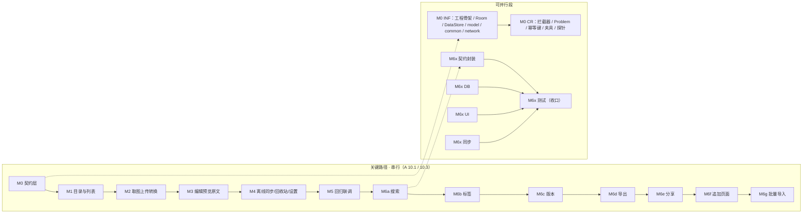

# 拾页笔记（GleanNote）Android 客户端开发计划与 WBS

> 客户端 8 号文档 · 任务分解、追溯、里程碑与验收（GN-CLIENT-008）

## 0. 文档信息

| 项目 | 内容 |
|---|---|
| 文档名称 | 拾页笔记 Android 客户端开发计划与 WBS |
| 文档编号 | GN-CLIENT-008 |
| 版本 | v0.1 |
| 状态 | 草案（待评审） |
| 更新日期 | 2026-11-12 |
| 适用范围 | Android 客户端 P0 闭环与 P1 分批交付的任务分解、编号登记、追溯矩阵、里程碑顺序与验收口径；不含服务端实现、不含任何 Android 源码 |
| 上级约束 | 产品行为唯一来源：[PRD v1.2](../../PRD-拾页笔记-GleanNote.md)；接口契约：[API.md v1.1](../../Server/docs/API.md) 与 [openapi.yaml 1.0.1](../../Server/docs/openapi.yaml)；客户端总纲：[CLIENT-ARCHITECTURE.md v0.2](CLIENT-ARCHITECTURE.md)（下称「主文档 A」）；工程与文档写作：[CONVENTIONS.md v1.0](../../Server/docs/CONVENTIONS.md) 第 6 章 D-01 至 D-09；环境基线：[ENVIRONMENT.md v0.1](ENVIRONMENT.md)；交付状态：[TEST-REPORT.md](../../Server/docs/TEST-REPORT.md) |
| 目标读者 | Android 客户端研发、测试、产品、设计、服务端联调接口人、架构与计划评审人 |
| 平台范围 | Android（本期不含 iOS 与 Web，PRD 0 节） |

### 0.1 文档定位与职责边界

本文是客户端开发计划的**唯一载体**，回答四个问题：**要做哪些任务**、**任务如何编号与填写**、**任务之间如何依赖与追溯**、**按什么顺序交付与验收**。本文与主文档 [A](CLIENT-ARCHITECTURE.md) 分工严格按 [CONVENTIONS.md](../../Server/docs/CONVENTIONS.md) 第 1 章文档体系，禁止串位：

| 内容 | 归属 | 本文的做法 |
|---|---|---|
| 产品行为、界面规则、限值、异常话术 | [PRD](../../PRD-拾页笔记-GleanNote.md) | 只引用章节号，不复述规则原文，数值一律标出处 |
| 接口字段、错误码、端点编号 | [API.md](../../Server/docs/API.md) / [openapi.yaml](../../Server/docs/openapi.yaml) | 只引用端点编号与阶段，不复制字段表 |
| 分层、模块、机制、选型、里程碑定义 | 主文档 [A](CLIENT-ARCHITECTURE.md) | 只引用章节号作为任务落点依据 |
| 任务分解、WBS 编码、追溯矩阵、甘特、验收清单 | **本文** | 完整定义 |
| 逐端点 DTO 与错误映射 | [GN-CLIENT-002](GN-CLIENT-002.md) | 只引用，不展开 |
| Room 表字段级定义 | [GN-CLIENT-003](GN-CLIENT-003.md) | 只引用，不展开 |
| 逐界面状态与文案 | [GN-CLIENT-004](GN-CLIENT-004.md) | 只引用，不展开 |
| 用例数据与测试环境 | [GN-CLIENT-005](GN-CLIENT-005.md) | 只引用编号段，不展开 |

本文**不得**修改 [PRD](../../PRD-拾页笔记-GleanNote.md) 已定的产品行为与限值，**不得**修改 [A](CLIENT-ARCHITECTURE.md) 的架构结论。凡本文出现与产品规则或接口契约不一致的判断，一律以 [PRD](../../PRD-拾页笔记-GleanNote.md) 与契约为准，并按第 8 章登记为待确认项。本文端点口径统一按 [API.md](../../Server/docs/API.md) 第 4 章的 **58 行**执行（编号 1 至 57 及 v1.1 新增的 50a）；主文档 [A](CLIENT-ARCHITECTURE.md) 2.1 曾记「57 个端点」，该旧口径已在 [A](CLIENT-ARCHITECTURE.md) v0.3 回写为 58 行（2026-11-12），本文不改 A。

### 0.2 修订记录

| 版本 | 日期 | 修订人 | 说明 |
|---|---|---|---|
| v0.1 | 2026-11-12 | 客户端架构 / WBS 角色 | 首版草案：基于 [PRD v1.2](../../PRD-拾页笔记-GleanNote.md)、[API.md v1.1](../../Server/docs/API.md)、主文档 [A v0.2](CLIENT-ARCHITECTURE.md)、[ENVIRONMENT.md v0.1](ENVIRONMENT.md)、[TEST-REPORT.md](../../Server/docs/TEST-REPORT.md) 建立 M0 至 M6g 的 WBS、12 列任务表、追溯矩阵、甘特与依赖图、未决问题影响清单与验收口径；本轮仅产出 Markdown 文档 |
| v0.2 | 2026-11-12 | 客户端实现 | 追加第 11 章「实现进度与偏差」：记录已落地代码、简化实现、未实现项与构建验证结果；计划状态由「仅文档」转为「可构建实现」 |
| v0.3 | 2026-11-12 | 客户端实现 | 补齐前台服务轮询、通知深链定位、版本只读预览、导入进度轮询、搜索 tagIds 重复键；契约测试由 12 增至 22 个用例；同步更新第 11 章偏差清单 |
| v0.4 | 2026-11-13 | 客户端实现 | 接入真实服务端 `192.168.10.4:8080` 完成联调：新增 10 个 MockWebServer 契约用例（合计 32）、接口级 E2E 脚本与界面走查脚本；修复 5 个实测缺陷；记录 2 项服务端环境阻塞，详见 [TEST-REPORT-CLIENT.md](TEST-REPORT-CLIENT.md) |
| v0.5 | 2026-11-14 | 客户端实现 | 服务端整改后复测 77/77；补齐 12 项 PRD 缺口（注销/改昵称、目录与笔记重命名移动删除、打标签、搜索筛选与历史、手动保存与撤销重做、原文缩放、导入队列、设置项），详见 [TEST-REPORT-CLIENT.md](TEST-REPORT-CLIENT.md) 5.1 |
| v0.6 | 2026-11-15 | 客户端实现 | 取图链路由系统相机 Intent 改为 CameraX 应用内取景（连拍/缩略图条/大图滑动/权限页），确认页支持长按拖拽排序；新增 6 个排序用例（合计 38） |
| v0.7 | 2026-11-15 | 客户端实现 | 相册导入提为并列主入口（拍摄页底部常驻「相册」、取景区顶部「从相册导入」、确认页「＋ 从相册添加」），修复无相机权限时相册选完被截断的缺陷（D-07） |
| v0.8 | 2026-11-15 | 客户端实现 | 服务端恢复后完成端到端全链路实测（相册→上传→转换→编辑→预览→原文→分享→导出→版本→标签→搜索→回收站→设置→导入→追加）；补齐首图缩略图、目录导出、上传重试、单张重拍；修复 D-08 时间未转北京时间；接口断言 77/77、单测 38/38 |

---

## 1. 范围、粒度与不做的事

### 1.1 计划范围

本计划覆盖 [PRD](../../PRD-拾页笔记-GleanNote.md) 2.1 的 P0 闭环（八条）、2.2 的 P0 恢复路径（五条）、2.3 的 P1 功能（FR-12 至 FR-18，七项），并承接主文档 [A](CLIENT-ARCHITECTURE.md) 1.2 交付范围与 10.1 里程碑、10.3 P1 交付顺序。范围矩阵如下：

| 范围 | PRD 依据 | 客户端落点（A 章节） | 本计划章节 |
|---|---|---|---|
| P0 闭环 8 条 | [PRD](../../PRD-拾页笔记-GleanNote.md) 2.1 | A 1.2、A 10.1 M0 至 M5 | 第 4 章 |
| P0 恢复路径 5 条 | [PRD](../../PRD-拾页笔记-GleanNote.md) 2.2 | A 1.2、A 6.3 / 6.7 / 6.8 / 5.5 | 第 4 章、§9.3 |
| P1 七项 | [PRD](../../PRD-拾页笔记-GleanNote.md) 2.3、FR-12 至 FR-18 | A 1.2、A 10.3 | 第 5 章 |
| 明确不做 | [PRD](../../PRD-拾页笔记-GleanNote.md) 2.4 | A 1.2 | §1.3 |

### 1.2 WBS 粒度定义

计划采用「里程碑 → 任务」两级分解，**不**引入子任务层，以保持 12 列任务表可被自动校验（主文档 [A](CLIENT-ARCHITECTURE.md) 10.1 亦以里程碑为交付单位）。粒度约定：

| 层级 | 定义 | 编号 | 数量 |
|---|---|---|---|
| 里程碑 | 一段可独立验收的交付范围 | `M0` 至 `M5`、`M6a` 至 `M6g`（A 10.3） | 13 段 |
| 任务 | 一个可指派、可验证、有明确文件落点的工作单元 | `T-<里程碑>-<类别>-<两位序号>`（§3.1） | 约 100 条 |

每个任务**必须**满足：有唯一任务 ID、有 FR 或横切类别映射、有前置依赖、有规划文件落点、有可观察验收口径、有用例编号、有风险与未决登记。不满足任一条件的条目**不得**进入第 4 章与第 5 章任务表。

### 1.3 明确不做的事

本轮及本计划范围内**必须**遵守以下排除项：

1. 本轮**只写 Markdown 文档**，**不得**创建任何 `.kt` 文件、业务 Gradle 脚本、Android 工程骨架或修改任何源码；本文所有「文件落点」均为**规划路径**，仅用于说明未来编码阶段的模块归属。
2. 本轮**不补** `GN-CLIENT-006`（兼容与发布矩阵），该编号保留在统一登记表中（§3.4），由后续版本处理。
3. **不得**修改主文档 [A](CLIENT-ARCHITECTURE.md)、[PRD](../../PRD-拾页笔记-GleanNote.md)、[API.md](../../Server/docs/API.md) 及任何服务端文档；发现口径冲突只登记、不就地改（§2.1、第 8 章）。
4. **不得**为 P1 提前破坏 P0 的本地数据模型（A 1.2、A 10.3）；P1 数据表扩展**必须**走显式 Room 迁移（A 5.7）。
5. [PRD](../../PRD-拾页笔记-GleanNote.md) 2.4 明确不做：多人协作、评论、权限共享、iOS 与 Web 客户端、本地离线 OCR、OCR 原文对照、付费与会员体系；客户端额外不得做所见即所得富文本编辑器、应用内只读模式（分享链接除外）、应用内嵌网页（A 1.2）。
6. **不得**使用估算工期表达里程碑（A 10.1「不使用估算工期」）；第 7 章甘特图横轴只表达交付顺序与并行关系，**不**表达日历时长。

---

## 2. 输入基线与环境前置

### 2.1 输入基线文档清单

| 文档 | 版本 / 编号 | 用途 | 相对链接 |
|---|---|---|---|
| 产品需求文档 | v1.2 | FR-01 至 FR-18、1.4 可观察结果、2.1 至 2.4 范围、第 5 章限值与异常 | [PRD](../../PRD-拾页笔记-GleanNote.md) |
| 服务端接口文档 | v1.1 / GN-API-001 | 第 4 章 58 行端点、错误码、分页 / 幂等 / 同步契约 | [API.md](../../Server/docs/API.md) |
| 机器可读契约 | 1.0.1 | DTO 与测试夹具来源、`servers` 基础路径 | [openapi.yaml](../../Server/docs/openapi.yaml) |
| 客户端开发主文档 | v0.2 / GN-CLIENT-001 | 分层与模块（A 3.3）、机制（A 6 章）、用例（A 9.2）、里程碑（A 10.1 / 10.3）、风险与未决（A 11.1 / 11.3）、追溯（A 12） | [A](CLIENT-ARCHITECTURE.md) |
| 开发环境基线 | v0.1 / GN-CLIENT-007 | 工具链实测值、环境变量、构建配置、模拟器与排障 | [ENVIRONMENT.md](ENVIRONMENT.md) |
| 构建配置模板 | — | M0 建工程时可直接复制的 Gradle 配置 | [build-config/README.md](../build-config/README.md) |
| 服务端架构 | v1.0 | 服务端权威、限流、短效 URL、后台任务约束 | [ARCHITECTURE.md](../../Server/docs/ARCHITECTURE.md) |
| 工程规范 | v1.0 / GN-CONV-001 | 第 6 章 D-01 至 D-09 文档写作规范 | [CONVENTIONS.md](../../Server/docs/CONVENTIONS.md) |
| 交付验证报告 | 2026-11-01 | 服务端就绪状态、第 5 节联调遗留 | [TEST-REPORT.md](../../Server/docs/TEST-REPORT.md) |
| 服务端快速开始 | — | `docker compose` 联调环境启动方式 | [Server/README.md](../../Server/README.md) |
| 接口封装与错误映射表 | GN-CLIENT-002（本轮并行产出） | 逐端点 DTO 与错误码 → UI 行为 | [GN-CLIENT-002](GN-CLIENT-002.md) |
| 本地数据库字典 | GN-CLIENT-003（本轮并行产出） | Room 表、索引、迁移脚本字段级定义 | [GN-CLIENT-003](GN-CLIENT-003.md) |
| 界面规格与状态清单 | GN-CLIENT-004（本轮并行产出） | 逐界面区域、状态、文案与交互 | [GN-CLIENT-004](GN-CLIENT-004.md) |
| 测试计划与用例清单 | GN-CLIENT-005（本轮并行产出） | 用例、数据、环境、验收记录 | [GN-CLIENT-005](GN-CLIENT-005.md) |

> 口径冲突登记（一）：主文档 [A](CLIENT-ARCHITECTURE.md) 2.1 与 10.2 记「57 个端点」，而 [API.md](../../Server/docs/API.md) 第 4 章 v1.1 实际为 **58 行**（编号 1 至 57 加 50a `GET /s/{token}`），其中 55 个 `/v1` 端点、1 个公开 HTML 分享页、2 个探针（56 `GET /healthz`、57 `GET /readyz`）。本计划第 6.2 节统一按 58 行登记，该口径已由主文档维护方在 [A](CLIENT-ARCHITECTURE.md) v0.3 回写（2026-11-12），本文不改 A。

> 口径冲突登记（二）：[PRD](../../PRD-拾页笔记-GleanNote.md) FR-01 要求注册页对「邮箱已注册」即时置灰、登录页对「邮箱未注册」给跳转入口，而 [API.md](../../Server/docs/API.md) 5.1.1 `sendCode` 为 204 且统一账号枚举口径（ARCHITECTURE 8.6）。此类冲突共 14 项，已由主文档 [A](CLIENT-ARCHITECTURE.md) 11.3 登记为 Q-01 至 Q-14，本计划第 8 章逐条给出受影响任务与临时口径，不在本文自行裁决。

### 2.2 平台专家检索留痕

本条为执行阶段的客观留痕，**必须**原样保留，供评审追溯，不得改写为「已命中专家」：

> 2026-11-12 执行阶段按 S0 重试 `search_plugins(type=expert)` 2 次均返回 `search_failed`，`skill_management list` 返回空，判定未命中，回退本地四角色并行专家团（架构/WBS、契约与数据、UI 设计、测试）；不得无限重试。

| 项 | 留痕内容 |
|---|---|
| 检索日期 | 2026-11-12 |
| 检索动作 | `search_plugins(type=expert)`，按 S0 重试 2 次 |
| 检索结果 | 2 次均返回 `search_failed` |
| 辅助确认 | `skill_management list` 返回空 |
| 判定 | 未命中平台专家 |
| 回退方案 | 本地四角色并行专家团：架构 / WBS、契约与数据、UI 设计、测试 |
| 约束 | 不得无限重试；本轮产出以本地专家团并行结果为准 |
| 本角色 | 架构 / WBS（产出本文 GN-CLIENT-008） |

### 2.3 环境前置

以下前置条件来自 [ENVIRONMENT.md](ENVIRONMENT.md) 第 1、2、3、9、12 章与主文档 [A](CLIENT-ARCHITECTURE.md) 4.3、9.3、附录 D，**必须**在 M0 建工程前逐项就绪；版本号与路径均标注出处，禁止无来源取值。

| 项 | 基线值 / 要求 | 出处 |
|---|---|---|
| JDK | 21（Oracle 21.0.10，`D:/DevelopmentTools/Java`）；系统 `JAVA_HOME` 指向不存在的 `jdk-25.0.2`，**必须**由 `gradle.properties` 的 `org.gradle.java.home` 覆盖 | [ENVIRONMENT.md](ENVIRONMENT.md) 第 1、2 章；A 附录 D |
| Gradle / AGP | 8.7 / 8.4.2 | [ENVIRONMENT.md](ENVIRONMENT.md) 第 1 章；A 4.3 |
| Kotlin / Compose Compiler | 1.9.24 / 1.5.14（官方兼容配对，**不得**单独升级其一） | [ENVIRONMENT.md](ENVIRONMENT.md) 1.1；A 4.3 |
| `compileSdk` / `targetSdk` | 34 / 34；本机**仅**安装 SDK Platform 34 与 Build Tools 34.0.0 | [ENVIRONMENT.md](ENVIRONMENT.md) 第 1 章；A 4.3 |
| `minSdk` | 26（**不**沿用参考工程的 21） | [ENVIRONMENT.md](ENVIRONMENT.md) 1.1、第 5 章；A 4.3 |
| 字节码目标 | Java 17 | [ENVIRONMENT.md](ENVIRONMENT.md) 第 5 章；A 4.3 |
| 依赖仓库 | 阿里云 google / public / gradle-plugin 三镜像，**必须**保留 | [ENVIRONMENT.md](ENVIRONMENT.md) 第 4、7 章；A 4.3 |
| `android.useAndroidX` | `true`（参考工程为 `false`，**必须**调整） | [ENVIRONMENT.md](ENVIRONMENT.md) 第 5 章 |
| 模拟器 | AVD `hw2avd`（Pixel 5 / API 34 / x86_64 / RAM 1536M） | [ENVIRONMENT.md](ENVIRONMENT.md) 第 3 章；A 附录 D |
| 首次构建 | Kotlin / Compose 依赖本机未缓存，首次构建**必须联网**解析，且**必须**保留阿里云镜像 | [ENVIRONMENT.md](ENVIRONMENT.md) 第 9 章；A 4.3 |
| IDE | 未检测到 Android Studio，构建以命令行 `gradlew` 为准 | [ENVIRONMENT.md](ENVIRONMENT.md) 第 1、12 章；A 4.3 |
| 联调地址（宿主） | `http://127.0.0.1:8080`（`docker compose up -d --build`） | [Server/README.md](../../Server/README.md)；A 9.3 |
| 联调地址（模拟器） | `http://10.0.2.2:8080`；`debug` 包经 `network_security_config` 放开明文，`release` 仅 HTTPS | [ENVIRONMENT.md](ENVIRONMENT.md) 第 3 章；A 9.3、[API.md](../../Server/docs/API.md) 2.1 |
| 探针 | `/healthz` 存活、`/readyz` 就绪；仅回环地址开放 | [API.md](../../Server/docs/API.md) 5.12、端点 56 / 57 |
| 故障注入 | `GN_FAKE_VISION_LATENCY` 模拟处理中；`GN_FAKE_VISION_FAILURE` 取 `unavailable` / `unreadable` / `unsupported` 注入失败分支 | A 9.3；[ARCHITECTURE.md](../../Server/docs/ARCHITECTURE.md) 8.16 |
| 验证码 | `GN_FAKE_MAIL_REVEAL_CODE=true` 后从服务端日志读取明文验证码（真实邮件供应商未接入） | A 9.3；[TEST-REPORT.md](../../Server/docs/TEST-REPORT.md) 第 5 节 |
| 分享链接前缀 | `GN_PUBLIC_BASE_URL` 决定 `{base}/s/{token}`，联调需设为设备可达地址 | A 9.3；[ARCHITECTURE.md](../../Server/docs/ARCHITECTURE.md) 附录 A |

### 2.4 服务端联调状态与遗留

服务端现状以 [TEST-REPORT.md](../../Server/docs/TEST-REPORT.md) 与主文档 [A](CLIENT-ARCHITECTURE.md) 10.2 为准。已就绪：静态检查、构建与 329 个测试函数全部通过（[TEST-REPORT.md](../../Server/docs/TEST-REPORT.md) 第 2 节），真实 PostgreSQL / Redis 集成 15/15 通过（同报告第 3 节），58 行端点 P0 与 P1 均已实现（A 10.2）。客户端**可以**全程联调，**不得**等待服务端开发。

[TEST-REPORT.md](../../Server/docs/TEST-REPORT.md) 第 5 节列出的 **4 项服务端遗留**及其对客户端任务的影响：

| # | 遗留（TEST-REPORT §5） | 对客户端的影响 | 关联任务 |
|---|---|---|---|
| 1 | 未重跑真实依赖的 HTTP E2E 与性能压测（修复改动了认证、限流、事务与任务状态机，旧基线不再适用） | 客户端性能相关验收（列表首屏、20 万字符、批量图片）**必须**与服务端重跑同批执行 | `T-M5-INF-01`、`T-M5-CR-02` |
| 2 | 真实 DeepSeek 识图仅有修复前历史基线，本次未消耗外部调用额度 | 转换链路正确性由 Fake 提供者 + 用例覆盖，真实识别效果须另行验收 | `T-M2-FR05-04`、`T-M5-INF-01` |
| 3 | 真实邮件供应商仍未接入，邮件链路仅 `fake` 适配器 | 验证码只能配 `GN_FAKE_MAIL_REVEAL_CODE=true` 从 dev 日志读取（§2.3） | `T-M0-FR01-01`、`T-M0-CR-04` |
| 4 | MinIO 适配器无独立单测，由真实依赖 E2E 覆盖 | 预签名三步直传联调**必须**重点验证 | `T-M2-FR04-03`、`T-M5-CR-02` |

> 另据 [TEST-REPORT.md](../../Server/docs/TEST-REPORT.md) 第 5 节第 5 条，`internal/config` 覆盖率 25.3% 属服务端内部质量指标，不影响客户端联调门禁，仅登记备查。

### 2.5 本轮产出物与并行关系

| 产出物 | 编号 | 角色 | 与本文关系 |
|---|---|---|---|
| 开发计划与 WBS | GN-CLIENT-008 | 架构 / WBS（本角色） | 本文，引用其余三份规格文档编号 |
| 接口封装与错误映射表 | GN-CLIENT-002 | 契约与数据 | 本文 §6.1「规格文档」列引用 |
| 本地数据库字典 | GN-CLIENT-003 | 契约与数据 | 本文「文件落点」与 §6.1 引用 |
| 界面规格与状态清单 | GN-CLIENT-004 | UI 设计 | 本文「验收口径」与 §6.1 引用 |
| 测试计划与用例清单 | GN-CLIENT-005 | 测试 | 本文「用例编号」列 P1 段引用（P1-01 至 P1-14） |

本文**只引用**上述编号段，**不复制**其内容；四份规格文档在本轮并行产出，相对链接指向同目录文件（[GN-CLIENT-002](GN-CLIENT-002.md) 等）。

---

## 3. WBS 编码与字段规范

### 3.1 任务 ID 编码规则

任务 ID 格式固定为 `T-<里程碑>-<类别>-<两位序号>`，各段取值**必须**来自统一编号登记表（§3.4），**不得**自造：

| 段 | 取值 | 说明 |
|---|---|---|
| 前缀 | `T` | 任务（Task）固定前缀 |
| `<里程碑>` | `M0`、`M1`、`M2`、`M3`、`M4`、`M5`、`M6a`、`M6b`、`M6c`、`M6d`、`M6e`、`M6f`、`M6g` | 13 段，顺序依据 A 10.3 |
| `<类别>` | `FR01` 至 `FR18`、`CR`、`INF` | `FRxx` 为功能需求映射；`CR` 为契约层横切；`INF` 为工程 / 数据 / 基建 |
| `<两位序号>` | `01` 至 `99` | 同一「里程碑 + 类别」组合内的两位流水号，从 `01` 起连续编号 |

编码示例：`T-M2-FR04-03` 表示 M2 里程碑下 FR-04 类别第 3 号任务（即 §3.3 的示例任务）。任务 ID 中的数字为**编号**，不是数值型约束，故按 [CONVENTIONS.md](../../Server/docs/CONVENTIONS.md) D-05 不标注出处；本文其余所有限值型数值**必须**标注出处（§10 附录 A 为集中速查）。

FR 到里程碑的映射**必须**固定为（依据任务登记表与 A 12 追溯矩阵）：

| FR | 里程碑 | FR | 里程碑 | FR | 里程碑 |
|---|---|---|---|---|---|
| FR-01 | M0 / M1 | FR-07 | M1 | FR-13 | M6b |
| FR-02 | M1 | FR-08 | M3 | FR-14 | M6d |
| FR-03 | M2 | FR-09 | M4 | FR-15 | M6e |
| FR-04 | M2 | FR-10 | M4 | FR-16 | M6c |
| FR-05 | M2 | FR-11 | M4 | FR-17 | M6g |
| FR-06 | M3 | FR-12 | M6a | FR-18 | M6f |

> 注意 M6 批次字母顺序依据 [A](CLIENT-ARCHITECTURE.md) 10.3「搜索 → 标签 → 版本历史 → 导出 → 分享 → 追加页面 → 批量导入」，因此 FR-16（版本）落 `M6c`、FR-14（导出）落 `M6d`、FR-17（批量导入）落 `M6g`、FR-18（追加页面）落 `M6f`，**不得**按 FR 编号大小重排。

### 3.2 12 列字段模板

第 4 章与第 5 章所有任务表**必须**采用下表固定 12 列，列数、列名、列序严格一致（后续自动校验项），**不得**增删或合并列：

| # | 列名 | 填写规范 |
|---|---|---|
| 1 | 任务ID | §3.1 编码，全表唯一 |
| 2 | 任务名 | 动宾短语，说明交付物，不含数值型限值断言 |
| 3 | 里程碑 | `M0` 至 `M6g` 之一，与任务 ID 中段一致 |
| 4 | 模块 | 主文档 A 3.3 模块名（如 `core:network`、`feature:editor`），可多模块用 `+` 连接 |
| 5 | FR映射 | `FR-xx`，或 `CR` / `INF` 对应的横切说明；可多值 |
| 6 | 端点 | [API.md](../../Server/docs/API.md) 第 4 章端点编号或端点名（如 `31 uploads`、`22 notes:createFromPages`）；端上能力写「端上能力」；探针写 `56` / `57` |
| 7 | 前置依赖 | 同表或跨表任务 ID，`+` 连接；无依赖写「—」 |
| 8 | 文件落点 | **规划中**的模块路径（如 `core/network/...`、`feature/editor/...`），并统一注明「本轮不产代码」（§1.3 第 1 条） |
| 9 | 验收口径 | 可观察结果，逐条可验证；出现限值**必须**内联标注出处（如 `PRD 5.2`、`API 2.9`、`A 6.3`） |
| 10 | 用例编号 | `C-01` 至 `C-14`（A 9.2，P0）、`P1-01` 至 `P1-14`（[GN-CLIENT-005](GN-CLIENT-005.md)，P1 增量）；无对应用例写「—」 |
| 11 | 风险 | `R-C01` 至 `R-C15`（A 11.1），可多值 |
| 12 | 未决 | `Q-01` 至 `Q-14`（A 11.3），可多值 |

「文件落点」列**必须**写规划模块路径，且每张任务表后**必须**附统一注记「本轮不产代码，文件落点仅为未来编码阶段的模块归属规划」。任务表内出现的全部限值（20 张、50 张、200MB、20 万字符、5 层、10 标签、1–20 张、10MB、Q85、1600、2s、5min、30min、30 天、90 天、12MB、北京时间）出处集中列于 §10 附录 A，表内以 `PRD x.x` / `API x.x` / `A x.x` 内联标注。

### 3.3 示例任务（完整 12 列）

下表以 `T-M2-FR04-03`「预签名三步上传与 JPEG Q85 预处理」示范 12 列完整填写，第 4.3 节 M2 任务表中该行**必须**与本表一致：

| 任务ID | 任务名 | 里程碑 | 模块 | FR映射 | 端点 | 前置依赖 | 文件落点 | 验收口径 | 用例编号 | 风险 | 未决 |
|---|---|---|---|---|---|---|---|---|---|---|---|
| `T-M2-FR04-03` | 预签名三步上传与 JPEG Q85 预处理 | M2 | `core:sync` + `core:media` | FR-04（承接 FR-03 取图产物） | `31 uploads` / `32 uploads/{id}:complete` / `22 notes:createFromPages` | `T-M0-CR-01` + `T-M2-FR03-02` | `core/sync/UploadPipeline.kt`、`core/media/ImagePreprocessor.kt`（规划路径，本轮不产代码） | HEIC 等输入统一转 JPEG；长边 ≤ 1600px、JPEG 质量 85（Q85）、单图 ≤ 10MB（PRD FR-04、PRD 5.2、API 2.9）；上传会话有效期 30min，过期 `410 UPLOAD_EXPIRED` 仅重申请过期项（API 2.9 / 6.3）；失败保留 `uploadId` 与页面映射，可在原草稿重试、不重新选图（A 6.3 / PRD 2.2）；顺序不可调换：申请 → 预签名 `PUT` 直传（不改 `headers.Content-Type`）→ `:complete`（携 `sha256`）→ `createFromPages`（A 2.6） | C-02、C-05 | R-C07、R-C08 | Q-02、Q-07 |

> 本轮不产代码，文件落点仅为未来编码阶段的模块归属规划。

### 3.4 编号登记表索引

本表是全文编号的**唯一登记表**（全团共用），所有章节引用**必须**以此为准，禁止自造编号：

| 类别 | 编号段 / 取值 | 数量 | 出处 / 说明 |
|---|---|---|---|
| 文档 001 | 主文档 [A](CLIENT-ARCHITECTURE.md)（GN-CLIENT-001） | 1 | A 0.2 |
| 文档 002 | 接口封装与错误映射表 [GN-CLIENT-002](GN-CLIENT-002.md) | 1 | A 0.2，本轮并行产出 |
| 文档 003 | 本地数据库字典 [GN-CLIENT-003](GN-CLIENT-003.md) | 1 | A 0.2，本轮并行产出 |
| 文档 004 | 界面规格与状态清单 [GN-CLIENT-004](GN-CLIENT-004.md) | 1 | A 0.2，本轮并行产出 |
| 文档 005 | 测试计划与用例清单 [GN-CLIENT-005](GN-CLIENT-005.md) | 1 | A 0.2，本轮并行产出 |
| 文档 006 | 兼容与发布矩阵 | 0（本轮不补） | A 0.2，保留编号（§1.3 第 2 条） |
| 文档 007 | [ENVIRONMENT.md](ENVIRONMENT.md)（GN-CLIENT-007，已产出） | 1 | A 0.2 |
| 文档 008 | **本文**（GN-CLIENT-008） | 1 | 本轮产出 |
| 里程碑 | `M0` 契约层、`M1` 目录与列表、`M2` 取图上传转换、`M3` 编辑预览原文、`M4` 离线同步 / 回收站 / 设置、`M5` 回归联调 | 6 | A 10.1；本计划重述命名 |
| 里程碑 P1 | `M6a` 搜索、`M6b` 标签、`M6c` 版本、`M6d` 导出、`M6e` 分享、`M6f` 追加页面、`M6g` 批量导入 | 7 | 顺序依据 A 10.3 |
| 任务 ID | `T-<里程碑>-<FRxx\|CR\|INF>-<两位序号>` | 约 100 条（P0 64 / P1 40） | §3.1、第 4 章、第 5 章 |
| 端点 | [API.md](../../Server/docs/API.md) 第 4 章 1 至 57 及 50a | 58 行 | 分组 4.1:1–10、4.2:11–19、4.3:20–30、4.4:31–37、4.5:38–51 及 50a、4.6:52–57；55 个 `/v1` 端点 + 1 个公开 HTML 分享页 + 2 探针 |
| 用例 P0 | `C-01` 至 `C-14` | 14 | A 9.2，P0 不可裁剪 |
| 用例 P1 | `P1-01` 至 `P1-14` | 14 | [GN-CLIENT-005](GN-CLIENT-005.md)，P1 增量，由测试角色定义 |
| 风险 | `R-C01` 至 `R-C15` | 15 | A 11.1 |
| 未决 | `Q-01` 至 `Q-14` | 14 | A 11.3；口径见 A 11.3 与本文第 8 章 |

---

## 4. M0–M5 P0 任务分解

本章按主文档 [A](CLIENT-ARCHITECTURE.md) 10.1 的 M0 至 M5 六段交付，逐段给出 12 列任务表。全部任务表**必须**固定 12 列（§3.2），列序为 `任务ID | 任务名 | 里程碑 | 模块 | FR映射 | 端点 | 前置依赖 | 文件落点 | 验收口径 | 用例编号 | 风险 | 未决`；每张表后统一注明「本轮不产代码」。任务表内联的 `PRD x.x` / `API x.x` / `A x.x` 为数值出处，集中速查见 §10 附录 A。

P0 共 **64 条**任务，分布：M0 12 条、M1 11 条、M2 13 条、M3 11 条、M4 12 条、M5 5 条（数值出处：本计划 §3.4 编号登记表与本节任务计数）。

### 4.1 M0 契约层（12 条）

M0 范围：Gradle 模块划分、网络层（拦截器 / Problem / 幂等键 / 刷新单飞）、Room 基础、登录与探针联调（A 10.1）。验收：可注册、登录、刷新令牌；`GET /v1/folders` 拉到「我的笔记」；`/healthz` `/readyz` 可达。

| 任务ID | 任务名 | 里程碑 | 模块 | FR映射 | 端点 | 前置依赖 | 文件落点 | 验收口径 | 用例编号 | 风险 | 未决 |
|---|---|---|---|---|---|---|---|---|---|---|---|
| `T-M0-INF-01` | 建立多模块 Gradle 工程骨架与构建基线 | M0 | `:app` + 全部 `core` 模块 | INF（工程基建，全部 FR 前置） | 56 / 57（探针联调前置） | — | `build.gradle`、`settings.gradle`、`gradle.properties`、`gradle/wrapper/`（规划路径，本轮不产代码） | 工程按 [ENVIRONMENT.md](ENVIRONMENT.md) 第 8 章验证序列可构建；JDK 21 / Gradle 8.7 / AGP 8.4.2 / Kotlin 1.9.24 / Compose Compiler 1.5.14 固定（A 4.3、[ENVIRONMENT.md](ENVIRONMENT.md) 第 1 章）；`compileSdk` / `targetSdk` 34、`minSdk` 26（A 4.3）；阿里云三镜像保留（[ENVIRONMENT.md](ENVIRONMENT.md) 第 4 章）；`local.properties` 入库忽略（[ENVIRONMENT.md](ENVIRONMENT.md) 7.4） | — | R-C13、R-C14 | — |
| `T-M0-INF-02` | 搭建 `:app` 导航图、依赖装配与深层链接 | M0 | `:app` | INF（承接 FR-01 路由） | 端上能力 | `T-M0-INF-01` | `app/navigation/`、`app/di/`（规划路径，本轮不产代码） | 导航图覆盖 A 7.1 全部节点；登录态失效在任意节点记录当前路由、登录后回原页面（PRD FR-01 / A 7.1）；`feature` 之间禁止互相依赖，跨功能跳转经 `:app` 路由（A 3.4 规则 1） | C-14 | R-C10 | Q-12 |
| `T-M0-INF-03` | `core:common` 限值常量、日志脱敏与北京时间换算 | M0 | `:core:common` | INF（承接 FR-11 / 5.8） | 端上能力 | `T-M0-INF-01` | `core/common/Limits.kt`、`core/common/TimeFormatter.kt`、`core/common/Log.kt`（规划路径，本轮不产代码） | 全部限值常量集中定义且带出处（§10 附录 A）；服务端 UTC 时间统一换算北京时间（UTC+8，PRD 5.8 / API 2.1）；相对时间四档（PRD 5.8）；日志不得含令牌、密码、验证码、完整邮箱（A 8.2 / CONVENTIONS G-10） | C-12 | R-C11 | — |
| `T-M0-INF-04` | `core:model` 领域模型与枚举未知值安全默认 | M0 | `:core:model` | INF（承接全部 FR） | 端上能力 | `T-M0-INF-01` | `core/model/`（规划路径，本轮不产代码） | 纯 Kotlin 模块，不得出现 `android.*` / `androidx.*` 导入（A 3.4 规则 3）；未知枚举值映射「未知 / 待刷新」安全分支、不抛异常（API 7.4）；忽略未知响应字段、不依赖字段顺序（A 2.10） | C-11 | — | — |
| `T-M0-INF-05` | `core:network` Retrofit / OkHttp 基础与请求头注入 | M0 | `:core:network` | CR（契约层网络底座） | 1 至 55（全部 `/v1` 端点） | `T-M0-INF-01` + `T-M0-INF-04` | `core/network/`、`core/network/interceptor/`（规划路径，本轮不产代码） | 基础路径 `/v1`、仅 HTTPS / TLS 1.2+（API 2.1）；注入 `X-Client-Version`、`X-Request-Id`、`X-Device-Id`（API 2.3）；`debug` 指向 `10.0.2.2:8080`、`release` 仅 HTTPS（A 4.3 / 9.3）；`BuildConfig` 注入 `BASE_URL`（A 4.3） | C-11 | R-C14 | Q-08 |
| `T-M0-INF-06` | `core:database` Room 基础、迁移框架与 schema 导出 | M0 | `:core:database` | INF（承接全部 FR 落库） | 端上能力 | `T-M0-INF-01` | `core/database/`、`core/database/migration/`、`schemas/`（规划路径，本轮不产代码） | 禁止 `fallbackToDestructiveMigration`、每个 schema 变更提供显式 `Migration` 与迁移测试（A 5.7）；导出 Room schema 纳入版本管理（A 4.3）；表按 `userId` 分区或携带归属字段（A 5.2） | — | — | — |
| `T-M0-INF-07` | `core:datastore` 令牌 / 设置 / 设备 ID 加密存储与退出清理 | M0 | `:core:datastore` | CR（承接 FR-01 令牌生命周期） | 4 / 5 / 9 | `T-M0-INF-01` | `core/datastore/`（规划路径，本轮不产代码） | Refresh Token 加密持久化、写入新值与持久化成功绑定（A 2.4）；`X-Device-Id` 首次启动生成并持久化（API 2.3 / Q-08）；退出登录 / 注销 / 切换账号清除该账号 Room、图片文件、偏好与内存态（PRD FR-01 / 5.7 / A 6.1） | C-07 | R-C05 | Q-08 |
| `T-M0-CR-01` | 契约层横切：鉴权拦截器 + 刷新令牌并发单飞 + Problem 解析 + 幂等键注入 | M0 | `:core:network` + `:core:datastore` | CR（契约层横切，M2 上传前置） | 4 / 全部写接口 | `T-M0-INF-05` + `T-M0-INF-07` | `core/network/interceptor/AuthInterceptor.kt`、`core/network/Problem.kt`、`core/network/Idempotency.kt`（规划路径，本轮不产代码） | `401 AUTH_TOKEN_EXPIRED` 静默刷新并重放，多请求同时 401 只发一次刷新、其余等待复用（API 2.2 / A 2.4，C-06）；`AUTH_TOKEN_INVALID` / `AUTH_REFRESH_REUSED` 清登录态跳登录页、不自动重试（A 2.4 / API 6.1，C-07）；`application/problem+json` 按 `code` 分支、变量只从 `metadata` 读（API 2.8）；创建类 `POST` 携带 8–64 位可见 ASCII 幂等键、重试复用同值（API 2.6 / 8.4） | C-06、C-07、C-14 | R-C05 | Q-02 |
| `T-M0-CR-02` | Problem → AppError → UI 错误映射与未知码默认分支 | M0 | `:core:network` + `:core:common` | CR（错误映射，[GN-CLIENT-002](GN-CLIENT-002.md) 骨架） | 全部端点 | `T-M0-CR-01` | `core/common/AppError.kt`、`core/common/ErrorMapper.kt`（规划路径，本轮不产代码） | 统一入口 `Problem(code, metadata, retryable, requestId, userMessage)` → `AppError` → UI 行为（A 6.10）；未知 `code` 走通用提示 + 依据 `retryable` 决定重试入口、不得崩溃或空白页（A 6.10 / API 7.4）；`429` / `503` 读 `Retry-After` 退避、不得自旋重试（API 2.3） | C-11 | — | Q-03 |
| `T-M0-CR-03` | 契约测试夹具：分页终止、orderBy 白名单、未知字段 / 枚举容忍 | M0 | `:core:network` + `:core:model` | CR（契约测试，[GN-CLIENT-005](GN-CLIENT-005.md) 夹具） | 20 / 11 / 51 | `T-M0-CR-01` + `T-M0-INF-04` | `core/network/testing/`、[GN-CLIENT-005](GN-CLIENT-005.md) 夹具目录（规划路径，本轮不产代码） | 夹具**必须**取自 [openapi.yaml](../../Server/docs/openapi.yaml) 与 [API.md](../../Server/docs/API.md) 示例，禁止手写「看起来像」的响应（A 9.1）；`nextPageToken` 空为停止翻页唯一依据、不依赖 `totalSize`（API 2.4，C-10）；`orderBy` 仅白名单值（API 2.5）；未知字段 / 枚举 / 错误码容忍（API 7.4，C-11） | C-10、C-11 | — | — |
| `T-M0-CR-04` | 探针联调：`/healthz` `/readyz` 连通性与 docker compose 环境基线 | M0 | `:app` + 联调工具 | CR（联调前置，非用户态功能） | 56 / 57 | `T-M0-INF-01` + `T-M0-INF-05` | `app/debug/`、`build-config/`（规划路径，本轮不产代码） | 按 [Server/README.md](../../Server/README.md) 启动 `docker compose up -d --build`，宿主 `127.0.0.1:8080`、模拟器 `10.0.2.2:8080`（A 9.3）；`/healthz` `200 {"status":"ok"}`、`/readyz` 含 `vision` / `mailer` / `objectStore` 检查（API 5.12）；探针仅回环开放（API 5.12）；`GN_FAKE_MAIL_REVEAL_CODE=true` 可读明文验证码（A 9.3） | — | R-C12 | — |
| `T-M0-FR01-01` | 登录 / 注册 / 找回密码 / 退出注销 UI 与 TokenManager | M0 | `:feature:auth` + `:core:datastore` | FR-01（`auth:*` 闭环） | 1 / 2 / 3 / 4 / 5 / 6 / 7 / 8 / 9 | `T-M0-CR-01` + `T-M0-INF-02` + `T-M0-INF-07` | `feature/auth/`、`core/datastore/TokenManager.kt`（规划路径，本轮不产代码） | 注册邮箱 + 密码 8–32 位且字母数字并存 + 协议勾选（PRD FR-01 / API 5.1.2）；验证码 6 位、10min 有效、同邮箱 60 秒一次、连错 5 次作废（PRD FR-01）；密码错统一「邮箱或密码不正确」（PRD FR-01）；登录态长期保持（PRD FR-01）；退出 / 注销二次确认、队列非空提示「有内容尚未同步，退出后将丢失」（PRD FR-01 / A 6.1） | C-07、C-14 | R-C14 | Q-01、Q-08 |

> 本轮不产代码，文件落点仅为未来编码阶段的模块归属规划。

### 4.2 M1 目录与列表（11 条）

M1 范围：目录树 CRUD / 移动 / 面包屑、笔记列表分页排序与状态标签、全状态组件（A 10.1）。验收：[PRD](../../PRD-拾页笔记-GleanNote.md) FR-02、FR-07；2.1 第 2 条、第 6 条（列表部分）。

| 任务ID | 任务名 | 里程碑 | 模块 | FR映射 | 端点 | 前置依赖 | 文件落点 | 验收口径 | 用例编号 | 风险 | 未决 |
|---|---|---|---|---|---|---|---|---|---|---|---|
| `T-M1-FR02-01` | 目录树与面包屑展示 | M1 | `:feature:library` + `:core:database` | FR-02 | 11 / 13 / 14 | `T-M0-INF-06` + `T-M1-INF-01` | `feature/library/FolderTree.kt`、`core/database/FolderDao.kt`（规划路径，本轮不产代码） | 目录层级 ≤ 5 层、第 1 层为根级（PRD 5.2 / FR-02）；面包屑与 `displayPath` 由服务端给出、本地仅缓存展示（A 5.3 / API 5.2.4）；集合分页 `pageSize` 默认 20（API 2.4）；`orderBy` 仅 `createTime asc` / `name asc`（API 2.5） | C-10、C-12 | — | — |
| `T-M1-FR02-02` | 新建目录与命名 / 层级校验 | M1 | `:feature:library` + `:core:common` | FR-02 | 12 | `T-M1-FR02-01` | `feature/library/CreateFolder.kt`、`core/common/Validator.kt`（规划路径，本轮不产代码） | 名称 1–50 字符、禁 `/ \ : * ? " < > \|`、无首尾空格、同父级唯一（PRD 5.1 / FR-02）；第 5 层不再显示「新建子目录」并提示「最多支持 5 层目录」（PRD FR-02 / 5.2）；`NAME_DUPLICATED` / `FOLDER_DEPTH_EXCEEDED` 按 A 6.10 分支 | C-12 | — | — |
| `T-M1-FR02-03` | 目录重命名与 revision 乐观锁 | M1 | `:feature:library` | FR-02 | 15 | `T-M1-FR02-01` | `feature/library/RenameFolder.kt`（规划路径，本轮不产代码） | 请求带 `revision`；不匹配返回 `412 REVISION_MISMATCH`、提示刷新后重试（API 2.7 / A 6.10）；重命名后该目录下笔记路径随刷新更新（PRD FR-02 / A 5.3） | — | — | — |
| `T-M1-FR02-04` | 目录移动（拖拽与「移动到」选择器） | M1 | `:feature:library` | FR-02 | 17 | `T-M1-FR02-01` | `feature/library/MoveFolder.kt`（规划路径，本轮不产代码） | 目标为自身或子孙时置灰「不可选择」（PRD FR-02）；`targetParentId: null` 表示移到根级（API 2.1 / 5.2.6）；`FOLDER_CYCLE` / `NAME_DUPLICATED` 按 A 6.10 分支 | — | — | — |
| `T-M1-FR02-05` | 目录删除软删除与计数二次确认 | M1 | `:feature:library` + `:feature:trash` | FR-02 / FR-09 | 16 | `T-M1-FR02-01` | `feature/library/DeleteFolder.kt`（规划路径，本轮不产代码） | 二次确认文案含「N 个子目录、M 篇笔记」，计数取 `DELETE` 响应 `folderCount` / `noteCount`（PRD FR-02 / API 5.2.7 / A 6.8）；整棵子树软删除、合并为一条回收站记录（PRD FR-09）；删除失败目录保留原位（PRD FR-02） | C-04 | — | — |
| `T-M1-FR07-01` | 笔记列表分页与详情按需加载 | M1 | `:feature:library` + `:core:database` | FR-07 | 20 / 23 | `T-M0-INF-06` | `feature/library/NoteList.kt`、`core/database/NoteDao.kt`（规划路径，本轮不产代码） | `pageSize=20`（API 2.4 / PRD FR-07）；`nextPageToken` 空即停止、不依赖 `totalSize`（API 2.4）；列表只返回 `NoteSummary`、不请求正文，打开笔记才 `GET /v1/notes/{id}`（A 5.3 / API 5.3.1） | C-10 | — | — |
| `T-M1-FR07-02` | 笔记列表排序与状态标签 | M1 | `:feature:library` | FR-07 | 20 | `T-M1-FR07-01` | `feature/library/NoteListState.kt`（规划路径，本轮不产代码） | 只发送 `orderBy` 白名单 `updateTime desc` / `createTime desc` / `title asc`（API 2.5）；排序选择本次会话内保持（PRD FR-07 `[Assumption]`）；状态标签草稿 / 转换失败 / 已取消 / 待同步，「正常」且已同步不展示（PRD FR-07 / A 6.11） | C-10 | — | — |
| `T-M1-FR07-03` | 笔记列表全状态组件与离线标识 | M1 | `:feature:library` + `:app` | FR-07 | 20 | `T-M1-INF-01` | `feature/library/NoteListStates.kt`、`app/ui/components/`（规划路径，本轮不产代码） | 首次加载骨架屏、空目录空态 + 「拍摄第一页纸质材料」、加载失败错误态 + 重试（保留顶部目录信息）、刷新失败保留已有内容 + 顶部提示、离线展示本地缓存 + 顶部「离线模式」标识（PRD FR-07 / A 3.5 / 6.11） | C-11 | — | — |
| `T-M1-FR07-04` | 草稿 / 失败 / 已取消笔记跳转进度页 | M1 | `:feature:library` + `:app` | FR-07 | 20 / 35 | `T-M1-FR07-01` | `feature/library/NoteRoute.kt`（规划路径，本轮不产代码） | 点击草稿 / 失败 / 已取消笔记进入对应进度页或失败页，**不**进入笔记页（PRD FR-07 / A 6.11）；点击正常笔记进入笔记页（PRD FR-08） | — | — | — |
| `T-M1-FR01-01` | 登录后全量同步初始化与「我的笔记」根目录 | M1 | `:feature:library` + `:core:sync` | FR-01 / FR-10 | 7 / 11 / 51 | `T-M0-FR01-01` + `T-M0-INF-06` | `feature/library/HomeInit.kt`、`core/sync/InitSync.kt`（规划路径，本轮不产代码） | 注册成功后服务端自动创建根级「我的笔记」，客户端**不**自建同名目录（A 6.1 / API 5.1.2）；登录后 `since=0` 全量初始化（API 5.10 / A 2.8）；登录态失效暂停同步、成功后继续（PRD FR-10 / A 6.7） | C-09、C-14 | — | Q-01 |
| `T-M1-INF-01` | 全局 UDF / UiState 公共字段与通用组件 | M1 | `:app` + 全部 `feature` | INF（承接 FR-07 全状态） | 端上能力 | `T-M0-INF-02` | `app/ui/state/`、`app/ui/components/`（规划路径，本轮不产代码） | `UiState` 不可变 + `UiEvent` 密封接口 + `UiEffect` 一次性副作用（A 3.5）；`isOffline` / `syncState` / `saveState` 由 `NetworkMonitor` 与 `SyncEngine` 全局流下发（A 3.5）；统一骨架屏、空态、错误态、离线标识、同步状态条、保存状态指示、二次确认弹窗、进度条（A 7.3） | C-11 | — | — |

> 本轮不产代码，文件落点仅为未来编码阶段的模块归属规划。

### 4.3 M2 取图 → 上传 → 转换（13 条）

M2 范围：相机与选图、预处理、三步直传、进度与失败重传、任务轮询 / 取消 / 重试、完成通知（A 10.1）。验收：[PRD](../../PRD-拾页笔记-GleanNote.md) FR-03 / FR-04 / FR-05；2.1 第 3、4 条；2.2 前两条。本表 `T-M2-FR04-03` 行与 §3.3 示例任务逐列一致。

| 任务ID | 任务名 | 里程碑 | 模块 | FR映射 | 端点 | 前置依赖 | 文件落点 | 验收口径 | 用例编号 | 风险 | 未决 |
|---|---|---|---|---|---|---|---|---|---|---|---|
| `T-M2-FR03-01` | CameraX 连续拍摄、缩略图条与权限拒绝说明页 | M2 | `:feature:capture` + `:core:media` | FR-03 | 端上能力 | `T-M1-INF-01` | `feature/capture/CameraScreen.kt`（规划路径，本轮不产代码） | 连续拍摄每拍一张加缩略图条、单张可重拍 / 删除、可查看大图左右滑动（PRD FR-03）；`CAMERA` 权限被拒给说明页 + 「去设置开启」（PRD FR-03 / A 8.1）；拍摄中切后台或来电保留已拍图片（PRD FR-03） | C-12 | R-C02 | Q-07 |
| `T-M2-FR03-02` | 相册系统照片选择器多选、20 张上限、拖拽排序与损坏标记 | M2 | `:feature:capture` | FR-03 | 端上能力 | `T-M1-INF-01` | `feature/capture/PhotoPicker.kt`、`feature/capture/ConfirmOrder.kt`（规划路径，本轮不产代码） | 走系统照片选择器、**不申请整相册权限**（PRD FR-03 / A 8.1）；单次最多 20 张、达上限快门与选择入口置灰（PRD 5.2 / FR-03）；缩略图顺序即页面顺序、确认页可拖拽（PRD FR-03）；图片损坏标「无法读取」并可单张删除（PRD FR-03） | C-12 | R-C02、R-C08 | Q-07 |
| `T-M2-INF-01` | `core:media` HEIC → JPEG 预处理（去元数据 / 1600 / Q85 / SHA256 / 本地副本） | M2 | `:core:media` | INF（承接 FR-03 / FR-04） | 端上能力 | `T-M2-FR03-01` + `T-M2-FR03-02` | `core/media/ImagePreprocessor.kt`、`core/media/FileStore.kt`（规划路径，本轮不产代码） | HEIC 等格式统一转 JPEG 后上传（PRD FR-03 / API 2.9）；去位置等元数据、等比压缩长边 ≤ 1600px、JPEG 质量 85（Q85）（PRD FR-04 / 5.2）；计算 SHA-256（API 5.4）；保留原始图片本地副本供原文视图（PRD FR-04 `[Assumption]` / A 5.6） | C-12、C-13 | R-C07、R-C08 | Q-07 |
| `T-M2-FR04-01` | 待转换确认页额度与容量前置校验 | M2 | `:feature:capture` + `:core:common` | FR-04 / FR-03 | 10 | `T-M2-FR03-02` + `T-M0-INF-03` | `feature/capture/ConfirmCapture.kt`（规划路径，本轮不产代码） | 展示本次张数、今日剩余额度（50 张/日，PRD 5.3）、云端剩余空间（200MB，PRD 5.3.1）；`remaining < 本次张数` 禁用「开始转换」并给减少图片入口（A 6.9）；`usedPercent ≥ 90` 提示、达 100% 阻断新转换但允许编辑阅读（PRD 5.3.1 / A 6.9）；端上校验**不得**作为最终裁决（A 6.9） | C-12 | R-C11 | Q-14 |
| `T-M2-FR04-02` | `upload_sessions` 状态机、断点续传与进程回收恢复 | M2 | `:core:sync` + `:core:database` | FR-04 | 31 | `T-M0-INF-06` + `T-M2-FR04-01` | `core/sync/UploadSessionManager.kt`、`core/database/UploadSessionDao.kt`（规划路径，本轮不产代码） | 状态机 `PENDING → UPLOADING → COMPLETING → READY / FAILED`（A 6.3）；断网暂停并提示「网络已断开，恢复后自动继续」、恢复后自动续传（PRD FR-04 `[Assumption]`）；进程回收后按 `uploadId` 查询 / 重新 `:complete`，避免重复直传（A 6.3） | C-02、C-05 | R-C05 | Q-02 |
| `T-M2-FR04-03` | 预签名三步上传与 JPEG Q85 预处理 | M2 | `core:sync` + `core:media` | FR-04（承接 FR-03 取图产物） | `31 uploads` / `32 uploads/{id}:complete` / `22 notes:createFromPages` | `T-M0-CR-01` + `T-M2-FR03-02` | `core/sync/UploadPipeline.kt`、`core/media/ImagePreprocessor.kt`（规划路径，本轮不产代码） | HEIC 等输入统一转 JPEG；长边 ≤ 1600px、JPEG 质量 85（Q85）、单图 ≤ 10MB（PRD FR-04、PRD 5.2、API 2.9）；上传会话有效期 30min，过期 `410 UPLOAD_EXPIRED` 仅重申请过期项（API 2.9 / 6.3）；失败保留 `uploadId` 与页面映射，可在原草稿重试、不重新选图（A 6.3 / PRD 2.2）；顺序不可调换：申请 → 预签名 `PUT` 直传（不改 `headers.Content-Type`）→ `:complete`（携 `sha256`）→ `createFromPages`（A 2.6） | C-02、C-05 | R-C07、R-C08 | Q-02、Q-07 |
| `T-M2-FR04-04` | 上传并发 2 张、进度、失败仅重传失败项与断网续传 | M2 | `:core:sync` + `:feature:conversion` | FR-04 | 31 / 32 | `T-M2-FR04-03` + `T-M2-FR04-02` | `core/sync/UploadScheduler.kt`、`feature/conversion/UploadProgress.kt`（规划路径，本轮不产代码） | 最多同时上传 2 张、其余排队（PRD FR-04 / A 6.3）；展示「已完成 N / 总张数」与百分比、按钮加载态禁止重复点击（PRD FR-04）；单张失败自动重试 1 次、仍失败列入失败列表「重传失败图片」仅重传失败项（PRD FR-04 / A 6.3）；`410 UPLOAD_EXPIRED`（30min，API 2.9）仅重申请过期项 | C-02 | R-C08 | Q-02 |
| `T-M2-FR04-05` | `createFromPages` 提交与幂等键 | M2 | `:core:sync` | FR-04 / FR-05 | 22 | `T-M2-FR04-03` + `T-M2-FR04-04` | `core/sync/CreateFromPages.kt`（规划路径，本轮不产代码） | 全部 `uploadIds` 为 `READY` 才提交、任意一张未成功不提交（PRD FR-04 / A 2.6 / 6.3）；`uploadIds` 1–20 个、顺序即页面顺序（API 5.3.4）；创建类 `POST` 携带 `Idempotency-Key`（API 2.6，Q-02）；服务端校验顺序额度 → 容量 → 上传有效性 → 事务写入（API 5.3.4 / A 2.6） | C-02 | R-C05 | Q-02 |
| `T-M2-FR05-01` | 转换进度轮询 2s、阶段文案与 5min 超时提示 | M2 | `:feature:conversion` + `:core:sync` | FR-05 | 35 | `T-M2-FR04-05` | `feature/conversion/ConversionProgress.kt`、`core/sync/JobPoller.kt`（规划路径，本轮不产代码） | 轮询间隔 2s（API 5.5.1）；`JobPhase` 文案「排队中」「正在识别第 N/M 页」「正在生成 Markdown」「已完成」（API 3.2 / PRD FR-05）；单任务 5min 未完成按失败提示但**不**改写本地任务状态、以服务端终态为准（PRD FR-05 `[Assumption]` / A 6.4 / Q-03） | C-01 | R-C03 | Q-03、Q-06 |
| `T-M2-FR05-02` | 转换取消与额度返还 | M2 | `:feature:conversion` | FR-05 | 36 | `T-M2-FR05-01` | `feature/conversion/CancelConversion.kt`（规划路径，本轮不产代码） | 仅 `QUEUED` / `RUNNING` 可取消、额度自动返还、页面图片保留（API 5.5.2 / A 2.7）；取消后草稿保留、列表标签「已取消」（PRD FR-05 / A 6.4）；终态后刷新 `quota` 再展示（PRD 5.3 / A 6.9） | C-01 | R-C11 | Q-14 |
| `T-M2-FR05-03` | 失败结果页与 `:retry` 原地重试 | M2 | `:feature:conversion` | FR-05 | 37 | `T-M2-FR05-01` | `feature/conversion/ConversionFailure.kt`（规划路径，本轮不产代码） | `FAILED` 原地重试复用已上传页面、不新建笔记、不重新选图（PRD 2.2 / FR-05 / A 6.4 / C-01）；失败原因按 `metadata.failureCode` 映射（A 6.10 / API 6.3）；重试创建新任务、额度与容量重新校验（API 5.5.3 / A 6.4） | C-01 | R-C12 | Q-03 |
| `T-M2-FR05-04` | 终态后拉详情、DRAFT → NORMAL、标题与未识别占位 | M2 | `:core:sync` + `:feature:editor` | FR-05 | 23 / 22 | `T-M2-FR05-01` | `core/sync/SettleConversion.kt`（规划路径，本轮不产代码） | 终态后再拉笔记详情（API 5.5.1）；标题默认取正文第一个标题、无标题由服务端生成「未命名笔记 + 提交时间」、客户端不自行生成（PRD FR-05 `[Assumption]` / A 6.4）；未识别页占位由服务端插入、客户端只展示（PRD FR-05 / A 6.4）；空正文按 `EMPTY_RESULT` 失败（A 6.4） | C-01 | R-C12 | Q-12 |
| `T-M2-INF-02` | 前台服务维持后台上传 / 2s 轮询与转换完成通知深链 | M2 | `:core:sync` + `:app` | INF（承接 FR-05 / FR-11 后台能力） | 35 | `T-M2-FR05-01` | `core/sync/ConversionForegroundService.kt`、`app/notification/`（规划路径，本轮不产代码） | 前台服务维持 2s 轮询（A 6.12；WorkManager 最小周期约 15min 不满足 2s 轮询）；后台完成发系统通知、点击深链进入对应笔记（PRD FR-05 `[Assumption]` / A 6.12）；通知开关默认开启（PRD FR-11）；深链 `gleannote://note/{noteId}` 内部定义（Q-12） | C-01 | R-C03 | Q-06、Q-12 |

> 本轮不产代码，文件落点仅为未来编码阶段的模块归属规划。

### 4.4 M3 编辑 / 预览 / 原文（11 条）

M3 范围：编辑器与工具栏、语法高亮、预览渲染、原文视图、自动与手动保存、`revision` 与冲突提示（A 10.1）。验收：[PRD](../../PRD-拾页笔记-GleanNote.md) FR-06 / FR-08；2.1 第 5 条；2.2「应用被系统回收后可恢复编辑」。

| 任务ID | 任务名 | 里程碑 | 模块 | FR映射 | 端点 | 前置依赖 | 文件落点 | 验收口径 | 用例编号 | 风险 | 未决 |
|---|---|---|---|---|---|---|---|---|---|---|---|
| `T-M3-FR06-01` | 笔记页编辑 / 预览同页视图切换 | M3 | `:feature:editor` | FR-06 / FR-08 | 23 | `T-M2-FR05-04` + `T-M1-INF-01` | `feature/editor/NoteScreen.kt`（规划路径，本轮不产代码） | 编辑与预览为同一页面内视图切换、不存在独立阅读页与只读态（PRD FR-06 / A 4.2 规则 1）；打开默认预览、转换完成后首次进入默认编辑（PRD FR-06 / A 6.5） | — | R-C01 | — |
| `T-M3-FR06-02` | Markdown 轻量语法高亮与工具栏 | M3 | `:feature:editor` + `:core:markdown` | FR-06 | 端上能力 | `T-M3-FR06-01` | `feature/editor/MarkdownToolbar.kt`、`core/markdown/Highlighter.kt`（规划路径，本轮不产代码） | 轻量语法高亮覆盖标题 / 加粗 / 斜体 / 列表 / 引用 / 代码块（PRD FR-06）；工具栏 H1–H3、加粗、斜体、无序 / 有序列表、待办、引用、代码块、分割线、撤销、重做（PRD FR-06）；表格不提供插入器（PRD FR-06 `[Assumption]` / A 4.2）；20 万字符下只处理可视区文本缓冲区（PRD 5.2 / A 4.2 规则 2） | C-12 | R-C01 | Q-05 |
| `T-M3-FR06-03` | 标题独立编辑与 20 万字符正文上限 | M3 | `:feature:editor` + `:core:common` | FR-06 | 端上能力 | `T-M3-FR06-01` | `feature/editor/TitleEditor.kt`（规划路径，本轮不产代码） | 标题在顶部独立编辑、长度 1–100 字符、为空保存后显示「未命名笔记」（PRD 5.1 / FR-06）；正文为 Markdown 纯文本、上限 20 万字符、达上限禁止继续输入且已输入内容不丢失（PRD 5.2 / FR-06） | C-12 | R-C01 | — |
| `T-M3-FR06-04` | 自动保存 2s / 手动 / 离开保存与保存状态指示 | M3 | `:feature:editor` + `:core:sync` | FR-06 / FR-10 | 24 | `T-M3-FR06-01` + `T-M0-INF-06` | `feature/editor/SaveController.kt`（规划路径，本轮不产代码） | 停止输入 2s 自动保存到本地、联网随后同步、手动保存入口、离开页面自动保存不弹确认（PRD FR-06）；顶部「已保存 / 保存中 / 未保存」、离线本地保存成功后标「待同步」（PRD FR-06 / FR-10 / A 6.5）；自动保存失败显示「未保存」并提供重试、不阻塞继续编辑（PRD FR-06） | C-03、C-05 | R-C06 | — |
| `T-M3-FR06-05` | `PATCH notes/{id}` revision 乐观锁与 saveSource | M3 | `:core:network` + `:core:sync` | FR-06 / FR-16 | 24 | `T-M3-FR06-04` + `T-M0-CR-01` | `core/sync/SaveNote.kt`（规划路径，本轮不产代码） | 必带 `revision`（或 `If-Match: "rev-{n}"`，二选一，API 2.7）；`saveSource` 区分 `AUTO_SAVE` / `MANUAL_SAVE`（API 5.3.6 / PRD FR-16）；成功后持久化新 `revision`、否则下次保存必冲突（A 2.5）；`revision` 落后服务端返回 `200` + `conflictCopyId`、**不**返回 412（API 2.7 / A 2.5） | C-08 | R-C06 | Q-09 |
| `T-M3-FR06-06` | `editor_drafts` 短防抖落库与进程回收恢复 | M3 | `:core:database` + `:feature:editor` | FR-06 | 端上能力 | `T-M0-INF-06` + `T-M3-FR06-04` | `core/database/EditorDraftDao.kt`、`feature/editor/DraftRestore.kt`（规划路径，本轮不产代码） | 编辑草稿与 2s 主保存解耦、采用更短输入防抖（如 500ms）单独落 `editor_drafts`（A 5.5）；打开时草稿比服务端 `updatedAt` 新则恢复并提示「已恢复未同步的编辑内容」（PRD 2.2 / FR-06 / A 5.5）；保存成功后清理草稿、`baseRevision` 用于冲突判断（A 5.5） | C-05 | R-C06 | — |
| `T-M3-FR06-07` | conflictCopyId 冲突副本提示与列表刷新 | M3 | `:feature:editor` + `:core:sync` | FR-06 / FR-10 | 24 | `T-M3-FR06-05` | `core/sync/ConflictCopyHandler.kt`（规划路径，本轮不产代码） | 按 `conflictCopyId` 拉取落库、提示「检测到编辑冲突，已保留副本」并刷新列表（PRD FR-10 / A 2.5 / 6.5）；冲突副本标题由服务端生成、客户端不自行拼接（A 2.5 / Q-09）；冲突副本与普通笔记同等对待（PRD FR-10） | C-08 | R-C05 | Q-09 |
| `T-M3-FR08-01` | 预览渲染与超长首屏渐进加载 | M3 | `:core:markdown` + `:feature:editor` | FR-08 | 端上能力 | `T-M3-FR06-01` | `core/markdown/MarkdownRenderer.kt`（规划路径，本轮不产代码） | 预览渲染标题 / 段落 / 加粗 / 斜体 / 列表 / 待办 / 引用 / 代码块 / 表格 / 图片 / 链接 / 公式（PRD FR-08 `[Assumption]`）；公式暂按源码文本降级展示（A 4.2 规则 3 / Q-05）；超长笔记首屏优先渲染、向下渐进加载、不出现长时间白屏（PRD FR-08 / A 4.2 规则 2） | C-12 | R-C01、R-C09 | Q-05 |
| `T-M3-FR08-02` | 原文视图与 originalUrl 按需重签 | M3 | `:feature:editor` + `:core:media` | FR-08 | 33 / 34 | `T-M3-FR06-01` + `T-M2-INF-01` | `feature/editor/OriginalPages.kt`（规划路径，本轮不产代码） | 按用户选定顺序展示、左右滑动 / 双指缩放 / 双击放大 / 「第 N / M 页」页码（PRD FR-08）；原图地址按 `pageId` 重新调用 `GET /v1/notes/{id}/pages/{pageId}`，`originalUrl` 有效期 10min、不得缓存超期地址（API 5.4.4 / A 4.2 规则 4 / C-13）；加载失败展示占位图与「重试加载」（PRD FR-08） | C-13 | R-C02、R-C04 | — |
| `T-M3-FR08-03` | 预览图片定位原文页、链接系统浏览器与图片缺失占位 | M3 | `:feature:editor` | FR-08 | 33 / 34 | `T-M3-FR08-01` + `T-M3-FR08-02` | `feature/editor/PreviewInteraction.kt`（规划路径，本轮不产代码） | 正文图片点击进原文视图并定位对应页（PRD FR-08 / A 4.2）；链接一律系统浏览器打开、应用内不内嵌网页（PRD FR-08 / A 7.3）；页面图片缺失该页显示「图片不可用」、其余页面正常浏览（PRD FR-08） | C-13 | R-C04 | Q-10 |
| `T-M3-FR08-04` | 更多操作（重命名 / 移动 / 删除 / 复制）与笔记已删除提示 | M3 | `:feature:editor` + `:feature:library` | FR-08 / FR-07 | 23 / 25 / 26 | `T-M3-FR08-01` | `feature/editor/MoreActions.kt`（规划路径，本轮不产代码） | 更多操作含重命名、移动到、删除、复制 Markdown 全文到剪贴板 `[Assumption]`（PRD FR-08）；编辑不改变所属目录、移动通过「移动到」（PRD FR-06）；笔记已在其他设备被删除展示「该笔记已被删除」+ 返回列表 / 前往回收站（PRD FR-08 / A 6.6） | C-14 | R-C10 | Q-10 |

> 本轮不产代码，文件落点仅为未来编码阶段的模块归属规划。

### 4.5 M4 离线同步 / 回收站 / 设置（12 条）

M4 范围：待同步队列、增量拉取与游标、冲突副本、回收站、设置页额度容量通知、退出清理（A 10.1）。验收：[PRD](../../PRD-拾页笔记-GleanNote.md) FR-09 / FR-10 / FR-11；2.1 第 7、8 条；2.2 后三条。

| 任务ID | 任务名 | 里程碑 | 模块 | FR映射 | 端点 | 前置依赖 | 文件落点 | 验收口径 | 用例编号 | 风险 | 未决 |
|---|---|---|---|---|---|---|---|---|---|---|---|
| `T-M4-FR10-01` | `pending_operations` 待同步队列 | M4 | `:core:database` | FR-10 | 端上能力 | `T-M0-INF-06` | `core/database/PendingOperationDao.kt`（规划路径，本轮不产代码） | 每条离线变更生成一条记录、携带**生成时即固定**的 `idempotencyKey` 与 `clientCreatedAt`（A 5.4）；按 `seq` 严格有序（A 5.4）；本地临时 ID 与服务端 UUIDv7 映射在回填时完成、未回填前 UI 标「待同步」（A 5.4） | C-03 | R-C05 | — |
| `T-M4-FR10-02` | 离线变更串行重放与服务端 ID / revision 回填 | M4 | `:core:sync` + `:core:network` | FR-10 | 21 / 24 / 12 等全部写接口 | `T-M4-FR10-01` + `T-M0-CR-01` | `core/sync/PendingReplayer.kt`（规划路径，本轮不产代码） | 联网后按 `seq` 串行重放普通写接口、复用原 `Idempotency-Key`（API 5.10 规则 5 / A 5.4）；`4xx` 业务错误标记该条失败、`5xx` / 网络错误退避重试（A 5.4）；成功后删队列项并触发一次 `sync:changes` 回填服务端 ID / `revision` / 时间（A 5.4 / 6.7） | C-03、C-08 | R-C05 | — |
| `T-M4-FR10-03` | `sync:changes` 增量拉取、先落库再推进游标 | M4 | `:core:sync` + `:core:database` | FR-10 | 51 | `T-M4-FR10-01` + `T-M0-INF-06` | `core/sync/IncrementalPull.kt`、`core/database/SyncStateDao.kt`（规划路径，本轮不产代码） | `since=0` 全量初始化（API 5.10）；`nextCursor` 严格单调、客户端**先落库再推进游标**（A 0.3 / 2.8 规则 1 / C-09）；`hasMore=true` 立即拉下一页、`pageSize` 保持 200 不变、`sync:changes` 默认 200 / 最大 500（API 5.10 / A 2.8 规则 2） | C-09 | R-C05 | — |
| `T-M4-FR10-04` | 墓碑事件、UPDATE 重拉详情与 410 全量重初始化 | M4 | `:core:sync` | FR-10 | 51 + 全部 `GET` 详情 | `T-M4-FR10-03` | `core/sync/ChangeApplier.kt`（规划路径，本轮不产代码） | `op=DELETE` 为墓碑事件、`payload=null` 清本地缓存而非展示错误（API 5.10 规则 3 / A 2.8 规则 3）；`UPDATE` 视为失效通知、按 `resourceId` 重新 `GET` 详情回填、不依赖 `payload` 字段完整性（A 2.8 规则 6）；`410 SYNC_CURSOR_EXPIRED`（变更日志保留 90 天，API 5.10）清游标全量重新初始化（A 2.8 规则 4） | C-09 | R-C05 | — |
| `T-M4-FR10-05` | NetworkMonitor 全局离线态与同步触发时机编排 | M4 | `:core:common` + `:app` | FR-10 | 端上能力 | `T-M1-INF-01` + `T-M4-FR10-03` | `core/common/NetworkMonitor.kt`、`app/sync/SyncTrigger.kt`（规划路径，本轮不产代码） | `ConnectivityManager` + `NetworkCallback` 监听断网 / 恢复（A 4.1）；触发时机：登录成功后、应用回前台、网络恢复、笔记保存后、用户下拉刷新、用户手动同步（PRD FR-10 / A 6.7）；全局 `isOffline` 由 `NetworkMonitor` 下发（A 3.5） | C-03 | R-C11 | — |
| `T-M4-FR10-06` | 同步状态展示与冲突副本顶部提示 | M4 | `:feature:library` + `:app` | FR-10 | 端上能力 | `T-M4-FR10-03` + `T-M3-FR06-07` | `feature/library/SyncStatusBar.kt`（规划路径，本轮不产代码） | 同步中 / 已同步 / 同步失败（可重试）、失败不阻塞本地编辑（PRD FR-10 / A 6.7）；冲突副本在列表顶部提示「检测到编辑冲突，已保留副本」（PRD FR-10）；同步失败保留本地内容、不出现内容回退（PRD FR-10） | C-08 | R-C05 | — |
| `T-M4-FR09-01` | 回收站列表（批次聚合与剩余天数） | M4 | `:feature:trash` + `:core:database` | FR-09 | 38 | `T-M1-INF-01` + `T-M0-INF-06` | `feature/trash/TrashList.kt`、`core/database/TrashDao.kt`（规划路径，本轮不产代码） | 按删除时间倒序、展示类型（目录 / 笔记）、名称、原所在路径、剩余保留天数（PRD FR-09）；保留期 30 天、`purgeAt` / `remainingDays` 由服务端给出（PRD 5.4 / A 2.9）；剩余天数按自然日、最少显示「今天到期」（PRD 5.8） | C-04 | R-C11 | — |
| `T-M4-FR09-02` | 恢复 `:undelete`（级联上级 / 根级提示 / 同名序号） | M4 | `:feature:trash` | FR-09 | 18 / 27 | `T-M4-FR09-01` | `feature/trash/RestoreItem.kt`（规划路径，本轮不产代码） | 原目录仍在回收站时服务端级联恢复必要上级，原目录已彻底删除恢复到根级并提示「原目录已删除，已恢复到根目录」（PRD FR-09 / API 5.3.9）；恢复时同名目录由服务端追加 ` (2)`、客户端刷新展示实际结果（PRD FR-09 / A 6.8）；恢复失败项目保留在回收站并提示重试（PRD FR-09） | C-04 | — | — |
| `T-M4-FR09-03` | 彻底删除 `:expunge` 二次确认与本地缓存清理 | M4 | `:feature:trash` + `:core:media` | FR-09 | 19 / 28 | `T-M4-FR09-01` | `feature/trash/ExpungeItem.kt`（规划路径，本轮不产代码） | 二次确认文案明确「彻底删除后无法恢复」（PRD FR-09）；成功后清本地正文、图片文件、版本与标签缓存（A 6.8）；到期清理与用户手动恢复并发时以服务端最终状态为准（PRD FR-09） | C-04 | — | — |
| `T-M4-FR11-01` | 设置页账号区与退出 / 注销本地数据清理 | M4 | `:feature:settings` + `:core:datastore` | FR-11 / FR-01 | 7 / 8 / 9 / 5 | `T-M0-INF-07` | `feature/settings/AccountSection.kt`（规划路径，本轮不产代码） | 展示昵称与脱敏邮箱、支持修改昵称 `[Assumption]`、找回密码、退出登录、注销账号（PRD FR-11）；退出 / 注销二次确认、队列非空额外提示（PRD FR-01 / A 6.1）；执行后清 Room、图片文件、DataStore 与内存态、不做跨账号残留（PRD 5.7 / A 6.1） | C-07 | R-C14 | Q-01 |
| `T-M4-FR11-02` | 云端用量 200MB 进度条与 50 张/日额度重置展示 | M4 | `:feature:settings` + `:core:common` | FR-11 | 10 | `T-M0-INF-03` | `feature/settings/QuotaSection.kt`（规划路径，本轮不产代码） | 云端用量「已用容量 / 200MB」进度条（PRD FR-11 / 5.3.1）；额度区展示今日剩余可转换张数与重置时间（次日 0 点，PRD FR-11 / 5.3）；`resetAt` 为北京时间次日 0 点对应 UTC 时刻、直接换算展示不用本地日期推算（API 5.1.7 / A 2.9）；`usedPercent ≥ 90` 提示「云端空间即将用尽」、达 100% 阻断新转换但允许编辑阅读（PRD 5.3.1 / A 6.9） | C-12 | R-C11 | Q-14 |
| `T-M4-FR11-03` | 本地缓存统计 / 清理、通知开关与关于 / 协议 | M4 | `:feature:settings` + `:core:media` | FR-11 | 端上能力 | `T-M0-INF-07` + `T-M2-INF-02` | `feature/settings/StorageSection.kt`（规划路径，本轮不产代码） | 本地缓存占用（含页面图片）遍历 `userId / noteId 或 batchId /` 目录统计（PRD FR-11 / A 5.6）；清理前提示未同步内容影响、确认后执行、清理失败保留原缓存并提示重试（PRD FR-11）；转换完成通知开关默认开启（PRD FR-11 `[Assumption]`）；关于区版本号 / 用户协议 / 隐私政策 / 意见反馈（PRD FR-11） | C-03 | R-C02 | Q-06 |

> 本轮不产代码，文件落点仅为未来编码阶段的模块归属规划。

### 4.6 M5 P0 回归与联调验收（5 条）

M5 范围：全链路真机联调、A 9.2 全量用例、兼容与性能核对（A 10.1）。验收：[PRD](../../PRD-拾页笔记-GleanNote.md) 1.4 四条、2.1 八条、2.2 五条；[TEST-REPORT.md](../../Server/docs/TEST-REPORT.md) 第 5 节重跑项。

| 任务ID | 任务名 | 里程碑 | 模块 | FR映射 | 端点 | 前置依赖 | 文件落点 | 验收口径 | 用例编号 | 风险 | 未决 |
|---|---|---|---|---|---|---|---|---|---|---|---|
| `T-M5-CR-01` | C-01 至 C-14 全量必测用例执行与记录 | M5 | 全模块 | CR（P0 回归，承接 FR-01 至 FR-11） | 1 至 57 及 50a | M0 至 M4 全部任务 | [GN-CLIENT-005](GN-CLIENT-005.md) 用例记录（规划路径，本轮不产代码） | C-01 至 C-14 逐条通过（A 9.2）；五条恢复路径列为**不可裁剪**用例（A 9.2 / CONVENTIONS T-03）；用例数据与环境按 [GN-CLIENT-005](GN-CLIENT-005.md) | C-01 至 C-14 | R-C01 至 R-C15 | Q-01 至 Q-14 |
| `T-M5-CR-02` | 真机 + 本地服务端全链路 E2E 联调（含故障注入） | M5 | 全模块 | CR（联调验收，承接 FR-01 至 FR-11） | 1 至 57 及 50a | `T-M5-CR-01` | [GN-CLIENT-005](GN-CLIENT-005.md) 联调记录（规划路径，本轮不产代码） | 按 [Server/README.md](../../Server/README.md) 起服务端、模拟器 `10.0.2.2:8080` 联调（A 9.3）；`GN_FAKE_VISION_LATENCY` 模拟处理中、`GN_FAKE_VISION_FAILURE` 取 `unavailable` / `unreadable` / `unsupported` 注入失败分支（A 9.3）；`GN_FAKE_MAIL_REVEAL_CODE=true` 读明文验证码（A 9.3）；重点验证预签名三步直传（[TEST-REPORT.md](../../Server/docs/TEST-REPORT.md) §5 第 4 项） | C-01 至 C-14 | R-C12 | Q-13 |
| `T-M5-CR-03` | PRD 1.4 四条 / 2.1 八条 / 2.2 五条逐条验收记录 | M5 | 全模块 | CR（交付验收，承接 FR-01 至 FR-11） | 1 至 57 及 50a | `T-M5-CR-01` + `T-M5-CR-02` | [GN-CLIENT-005](GN-CLIENT-005.md) 验收记录（规划路径，本轮不产代码） | 逐条记录可观察结果、全部通过方可视为闭环完成（PRD 1.4 / 2.1 / 2.2、A 9.4）；客户端自测通过后与服务端在联调环境重跑端到端用例（A 9.4）；逐条清单见本文 §9.1 至 §9.3 | C-01 至 C-14 | — | — |
| `T-M5-INF-01` | 性能核对与 TEST-REPORT §5 重跑项同批执行 | M5 | 全模块 | INF（性能与联调，承接 FR-07 / FR-06） | 20 / 23 / 31 / 35 | `T-M5-CR-02` | [GN-CLIENT-005](GN-CLIENT-005.md) 性能记录（规划路径，本轮不产代码） | 列表首屏、20 万字符（PRD 5.2）、批量 20 张图片（PRD 5.2）不出现长时间白屏或崩溃（A 1.4）；AVD RAM 1536M 下内存压力核对、建议提高到 2048M 或用真机（[ENVIRONMENT.md](ENVIRONMENT.md) 第 3 章 / R-C15）；E2E 与压测重跑、重新采样读 p95 ≤ 300ms / 写 p95 ≤ 500ms / 100 RPS（[TEST-REPORT.md](../../Server/docs/TEST-REPORT.md) §5 第 1 项） | C-12 | R-C01、R-C02、R-C15 | — |
| `T-M5-INF-02` | 兼容与安全核对（未知码 / 枚举、日志脱敏、退出清理、取图矩阵） | M5 | 全模块 | INF（兼容与安全，承接全部 FR） | 端上能力 | `T-M5-CR-01` | [GN-CLIENT-005](GN-CLIENT-005.md) 兼容记录（规划路径，本轮不产代码） | 未知错误码 / 未知枚举 / 未知字段界面不崩溃、落安全默认分支（API 7.4 / C-11）；日志不含令牌、密码、验证码、完整邮箱（CONVENTIONS G-10 / A 8.2）；退出登录清理核查（PRD 5.7）；不同 Android 版本取图（A 9.1 / Q-07） | C-11、C-14 | R-C07、R-C13 | Q-07 |

> 本轮不产代码，文件落点仅为未来编码阶段的模块归属规划。

---

## 5. M6+ P1 任务分解

本章按主文档 [A](CLIENT-ARCHITECTURE.md) 10.3 的顺序 **搜索 → 标签 → 版本历史 → 导出 → 分享 → 追加页面 → 批量导入** 分七批交付（§3.1 已固定字母顺序）。每批**必须**统一含 **契约封装 / DB / UI / 同步 / 测试** 5 类任务；部分批次按复杂度增补 1 条边界任务，但 5 类不得缺失。所有任务表仍为固定 12 列（§3.2），每张表后统一注明「本轮不产代码」。

P1 共 **40 条**任务，分布：M6a 6 条、M6b 6 条、M6c 5 条、M6d 6 条、M6e 6 条、M6f 5 条、M6g 6 条（数值出处：本计划 §3.4 编号登记表与本节任务计数）。用例编号 `P1-01` 至 `P1-14` 由测试角色在 [GN-CLIENT-005](GN-CLIENT-005.md) 定义，本文直接引用该编号段。P1 数据表扩展**必须**走显式 Room 迁移、**不得**破坏 P0 数据模型（A 1.2 / 5.7 / 10.3）；接入前**必须**确认服务端该端点在目标环境可用（A 10.2 / Q-13）。

### 5.1 M6a 搜索（6 条 · FR-12 · P1-01 / P1-02）

| 任务ID | 任务名 | 里程碑 | 模块 | FR映射 | 端点 | 前置依赖 | 文件落点 | 验收口径 | 用例编号 | 风险 | 未决 |
|---|---|---|---|---|---|---|---|---|---|---|---|
| `T-M6a-CR-01` | 契约封装：`GET /v1/notes:search` DTO 与错误映射 | M6a | `:core:network` | FR-12 / CR（契约封装） | 30 | `T-M0-CR-02` | `core/network/SearchApi.kt`（规划路径，本轮不产代码） | `query` 1–100 字符、`folderId` 含子树、`tagIds` 可重复且语义「同时包含」（API 5.3.11 / 2.5）；按 [GN-CLIENT-002](GN-CLIENT-002.md) 落地 DTO 与 `snippet` `<em>` 处理；接入前确认端点 30 在目标环境可用（A 10.2 / Q-13） | P1-01 | — | Q-11、Q-13 |
| `T-M6a-INF-01` | DB：`search_history` 最近 10 条 | M6a | `:core:database` | FR-12 / INF（DB） | 端上能力 | `T-M0-INF-06` | `core/database/SearchHistoryDao.kt`（规划路径，本轮不产代码） | 搜索历史保留最近 10 条、支持单条删除与一键清空（PRD FR-12）；显式 Room 迁移、不得破坏 P0 数据模型（A 5.7 / 10.3） | P1-02 | — | — |
| `T-M6a-FR12-01` | UI：搜索页（关键词 / 历史 / 目录标签筛选 / 结果 / 高亮 / 定位） | M6a | `:feature:search` | FR-12 / UI | 30 | `T-M6a-CR-01` + `T-M6a-INF-01` | `feature/search/SearchScreen.kt`（规划路径，本轮不产代码） | 输入至少 1 个字符、停止输入 300ms 自动搜索（PRD FR-12）；结果展示标题、命中片段（关键词高亮、前后各约 20 字）、所属目录路径与更新时间（PRD FR-12）；点击结果打开笔记页并定位到正文中第一次出现关键词的位置 `[Assumption]`（PRD FR-12）；筛选条件离开搜索页即清除（PRD FR-12 / A 7.3） | P1-01 | — | Q-11 |
| `T-M6a-FR12-02` | 同步：离线仅缓存搜索与 `snippet` `<em>` 剥离 | M6a | `:core:sync` + `:core:common` | FR-12 / 同步 | 30 | `T-M6a-CR-01` + `T-M4-FR10-05` | `core/sync/OfflineSearch.kt`（规划路径，本轮不产代码） | 离线仅搜索本地已缓存笔记、顶部提示「离线模式，仅搜索已缓存内容」（PRD FR-12 / PRD 5.6）；`snippet` 仅含 `<em>` 一种标记、渲染前剥离或转为高亮样式、**不得**当 HTML 直接渲染（API 2.3 / 5.3.11 / Q-11）；草稿与回收站内容不参与搜索（PRD FR-12） | P1-02 | R-C04 | Q-11 |
| `T-M6a-CR-02` | 测试：搜索命中、无结果、离线与失败用例 | M6a | 测试 | CR（测试） | 30 | `T-M6a-FR12-01` + `T-M6a-FR12-02` | [GN-CLIENT-005](GN-CLIENT-005.md) 用例记录（规划路径，本轮不产代码） | 无结果展示「没有找到相关笔记」与清除筛选入口（PRD FR-12）；搜索失败展示错误态 + 「重试」、保留已输入关键词（PRD FR-12）；结果中的笔记已被删除点击后提示「该笔记已被删除」（PRD FR-12） | P1-01、P1-02 | — | Q-13 |
| `T-M6a-FR12-03` | 补充：300ms 防抖、100 字符上限与标题命中优先排序校验 | M6a | `:feature:search` + `:core:common` | FR-12 / UI | 30 | `T-M6a-FR12-01` | `feature/search/SearchInput.kt`（规划路径，本轮不产代码） | 关键词最长 100 字符、超出部分不参与匹配（PRD FR-12）；中文按连续字符匹配、英文不区分大小写（PRD FR-12）；排序标题命中优先于正文命中、同一层级按更新时间倒序（PRD FR-12 / API 5.3.11） | P1-01 | — | — |

> 本轮不产代码，文件落点仅为未来编码阶段的模块归属规划。

### 5.2 M6b 标签（6 条 · FR-13 · P1-03 / P1-04）

| 任务ID | 任务名 | 里程碑 | 模块 | FR映射 | 端点 | 前置依赖 | 文件落点 | 验收口径 | 用例编号 | 风险 | 未决 |
|---|---|---|---|---|---|---|---|---|---|---|---|
| `T-M6b-CR-01` | 契约封装：`tags*` 与 `PUT notes/{id}/tags` | M6b | `:core:network` | FR-13 / CR（契约封装） | 39 / 40 / 41 / 42 / 43 | `T-M0-CR-02` | `core/network/TagApi.kt`（规划路径，本轮不产代码） | 按 [GN-CLIENT-002](GN-CLIENT-002.md) 落地；`PUT /v1/notes/{noteId}/tags` 整体覆盖、超过 10 个返回 `409 TAG_LIMIT_EXCEEDED`、不存在 `tagId` 返回 `404`（API 5.7 / 6.2）；接入前确认端点 39 至 43 可用（A 10.2 / Q-13） | P1-03 | — | Q-13 |
| `T-M6b-INF-01` | DB：`tags` 与 `note_tag_cross_ref` | M6b | `:core:database` | FR-13 / INF（DB） | 端上能力 | `T-M0-INF-06` | `core/database/TagDao.kt`、`core/database/NoteTagCrossRef.kt`（规划路径，本轮不产代码） | 标签账号级共享、与笔记多对多交叉表（A 5.2 / PRD 3.2）；显式 Room 迁移、不得破坏 P0 数据模型（A 5.7 / 10.3） | P1-03 | — | — |
| `T-M6b-FR13-01` | UI：标签区 / 联想 / 管理页 / 重命名 / 删除确认 / 筛选 | M6b | `:feature:tags` | FR-13 / UI | 39 / 40 / 41 / 42 / 43 | `T-M6b-CR-01` + `T-M6b-INF-01` | `feature/tags/TagScreen.kt`（规划路径，本轮不产代码） | 输入即联想已有标签、选择即复用、输入不存在名称则新建（PRD FR-13）；标签管理页按关联笔记数倒序展示、支持重命名与删除（PRD FR-13 / API 2.5）；删除二次确认提示关联笔记数、解除全部关联不删除笔记（PRD FR-13）；侧栏点击标签进筛选、多选取同时包含的交集（PRD FR-13） | P1-03、P1-04 | — | — |
| `T-M6b-FR13-02` | 同步：离线增删标签、REVISION_MISMATCH 与标签失效提示 | M6b | `:core:sync` | FR-13 / FR-10 / 同步 | 41 / 43 | `T-M6b-CR-01` + `T-M4-FR10-02` | `core/sync/TagSync.kt`（规划路径，本轮不产代码） | 标签随笔记参与云端同步、离线可添加或移除、联网后同步（PRD FR-13 / PRD 5.6）；标签改名 `revision` 不匹配返回 `412 REVISION_MISMATCH`、提示刷新后重试（API 2.7 / A 6.10）；标签已被其他设备删除同步后自动移除并提示「部分标签已失效」（PRD FR-13） | P1-04 | R-C05 | — |
| `T-M6b-CR-02` | 测试：标签增删改、10 标签上限与离线同步用例 | M6b | 测试 | CR（测试） | 39 至 43 | `T-M6b-FR13-01` + `T-M6b-FR13-02` | [GN-CLIENT-005](GN-CLIENT-005.md) 用例记录（规划路径，本轮不产代码） | 每篇笔记最多 10 个标签、超出禁止继续添加并提示（PRD FR-13 / API 6.2）；离线操作失败保留本地变更并进入待同步队列（PRD FR-13） | P1-03、P1-04 | — | Q-13 |
| `T-M6b-FR13-03` | 补充：标签名称 1–20 字符、唯一与首尾空格校验 | M6b | `:core:common` + `:feature:tags` | FR-13 / UI | 40 / 41 | `T-M6b-FR13-01` | `core/common/TagValidator.kt`（规划路径，本轮不产代码） | 名称 1–20 个字符、不允许首尾空格、同一账号内名称唯一（PRD FR-13 / API 5.7）；名称超长或含首尾空格输入框内提示并禁止保存（PRD FR-13） | P1-03 | — | — |

> 本轮不产代码，文件落点仅为未来编码阶段的模块归属规划。

### 5.3 M6c 版本历史（5 条 · FR-16 · P1-05 / P1-06）

| 任务ID | 任务名 | 里程碑 | 模块 | FR映射 | 端点 | 前置依赖 | 文件落点 | 验收口径 | 用例编号 | 风险 | 未决 |
|---|---|---|---|---|---|---|---|---|---|---|---|
| `T-M6c-CR-01` | 契约封装：`versions*` 与 `:restore` | M6c | `:core:network` | FR-16 / CR（契约封装） | 44 / 45 / 46 | `T-M0-CR-02` | `core/network/VersionApi.kt`（规划路径，本轮不产代码） | 版本列表 / 版本正文 / 恢复（API 5.8）；恢复生成新版本 `source=RESTORE`、不删除历史版本、只替换正文（PRD FR-16 / API 5.8）；接入前确认端点 44 至 46 可用（A 10.2 / Q-13） | P1-05 | — | Q-13 |
| `T-M6c-INF-01` | DB：`version_meta` 元数据缓存 | M6c | `:core:database` | FR-16 / INF（DB） | 端上能力 | `T-M0-INF-06` | `core/database/VersionMetaDao.kt`（规划路径，本轮不产代码） | 只缓存版本列表元数据、详情按需拉取、不长期缓存正文（A 5.2）；显式 Room 迁移、不得破坏 P0 数据模型（A 5.7 / 10.3） | P1-05 | — | — |
| `T-M6c-FR16-01` | UI：版本列表 / 只读预览 / 恢复二次确认 | M6c | `:feature:version` | FR-16 / UI | 44 / 45 / 46 | `T-M6c-CR-01` + `T-M6c-INF-01` | `feature/version/VersionScreen.kt`（规划路径，本轮不产代码） | 版本列表按时间倒序、展示时间 / 来源 / 字数（PRD FR-16）；点击进只读预览、不提供逐行对比 `[Assumption]`（PRD FR-16）；恢复需二次确认（PRD FR-16 / A 7.3）；恢复失败保留当前正文不变、不出现内容丢失（PRD FR-16） | P1-05、P1-06 | — | — |
| `T-M6c-FR16-02` | 同步：恢复生成新版本、saveSource 联动与 50 个 / 90 天口径 | M6c | `:core:sync` | FR-16 / FR-10 / 同步 | 46 / 24 | `T-M6c-CR-01` + `T-M3-FR06-05` | `core/sync/VersionRestore.kt`（规划路径，本轮不产代码） | 版本在转换完成 / 手动保存 / 自动保存（同笔记两次自动版本间隔不少于 5min） / 冲突副本生成 / 从历史版本恢复时生成（PRD FR-16 `[Assumption]` / API 5.3.6）；每个笔记保留最近 50 个版本且仅保留 90 天内版本（PRD FR-16 `[Assumption]`）；恢复只替换正文、不改标题 / 标签 / 所属目录（PRD FR-16） | P1-06 | R-C06 | — |
| `T-M6c-CR-02` | 测试：版本列表、只读预览与恢复失败用例 | M6c | 测试 | CR（测试） | 44 / 45 / 46 | `T-M6c-FR16-01` + `T-M6c-FR16-02` | [GN-CLIENT-005](GN-CLIENT-005.md) 用例记录（规划路径，本轮不产代码） | 版本列表加载失败展示错误态 + 「重试」；版本预览内容缺失提示该版本不可用、可返回列表；恢复失败保留当前正文不变（PRD FR-16） | P1-05、P1-06 | — | Q-13 |

> 本轮不产代码，文件落点仅为未来编码阶段的模块归属规划。

### 5.4 M6d 导出（6 条 · FR-14 · P1-07 / P1-08）

| 任务ID | 任务名 | 里程碑 | 模块 | FR映射 | 端点 | 前置依赖 | 文件落点 | 验收口径 | 用例编号 | 风险 | 未决 |
|---|---|---|---|---|---|---|---|---|---|---|---|
| `T-M6d-CR-01` | 契约封装：`exports*` 与 downloadUrl | M6d | `:core:network` | FR-14 / CR（契约封装） | 52 / 53 | `T-M0-CR-02` | `core/network/ExportApi.kt`（规划路径，本轮不产代码） | `POST /v1/exports` 发起、`GET /v1/exports/{exportId}` 查结果与下载地址（API 5.11）；`downloadUrl` 有效期 1 小时、短效 URL **不得**持久化（A 2.3 / API 5.11）；格式 `MARKDOWN_ZIP` / `PDF`（API 3.2）；接入前确认端点 52 / 53 可用（A 10.2 / Q-13） | P1-07 | R-C04 | Q-04、Q-13 |
| `T-M6d-INF-01` | DB：导出任务状态与本地路径记录 | M6d | `:core:database` | FR-14 / INF（DB） | 端上能力 | `T-M0-INF-06` | `core/database/ExportTaskDao.kt`（规划路径，本轮不产代码） | 记录 `exportId` / `state` 与 SAF 保存路径、**不缓存** `downloadUrl`（A 5.2 / 5.3）；显式 Room 迁移、不得破坏 P0 数据模型（A 5.7 / 10.3） | P1-07 | R-C04 | Q-04 |
| `T-M6d-FR14-01` | UI：格式选择 / 目录进度 / SAF 文件保存器 / 取消 | M6d | `:feature:export` | FR-14 / UI | 52 / 53 | `T-M6d-CR-01` + `T-M6d-INF-01` | `feature/export/ExportScreen.kt`（规划路径，本轮不产代码） | 单篇 Markdown 生成 `.md` + `images` zip、PDF 保留 A4 版式、目录导出 zip 保留子目录层级（PRD FR-14）；导出通过系统文件保存器 SAF 选位置、**不申请存储权限**（PRD FR-14 / A 8.1）；目录导出展示「已处理篇数 / 总篇数」、支持取消、取消后已生成部分不保留（PRD FR-14）；仅「正常」笔记可导出（PRD FR-14） | P1-07 | — | Q-04 |
| `T-M6d-FR14-02` | 同步：WorkManager 后台继续与完成通知 | M6d | `:core:sync` + `:app` | FR-14 / FR-11 / 同步 | 52 / 53 | `T-M6d-CR-01` + `T-M2-INF-02` | `core/sync/ExportWorker.kt`、`app/notification/`（规划路径，本轮不产代码） | 目录内含大量笔记时导出过程可切后台继续、完成后发通知 `[Assumption]`（PRD FR-14 / A 6.12）；导出不消耗转换额度、不受 200MB 云端容量限制（PRD FR-14）；离线 PDF 或目录导出需全部图片可用、缺图提示联网后重试或取消（PRD FR-14） | P1-08 | R-C03 | Q-04、Q-06 |
| `T-M6d-CR-02` | 测试：导出进度、中断失败、空间不足与离线缺图用例 | M6d | 测试 | CR（测试） | 52 / 53 | `T-M6d-FR14-01` + `T-M6d-FR14-02` | [GN-CLIENT-005](GN-CLIENT-005.md) 用例记录（规划路径，本轮不产代码） | 本地空间不足导出前提示所需空间、不足禁止开始；导出中断提示失败原因、可重新导出（PRD FR-14）；导出不修改笔记内容与更新时间、导出记录不写入版本历史（PRD FR-14） | P1-07、P1-08 | — | Q-04、Q-13 |
| `T-M6d-FR14-03` | 补充：Q-04 在线服务端导出优先与离线 Markdown ZIP 端上生成口径 | M6d | `:feature:export` + `:core:sync` | FR-14 / UI | 52 / 53 | `T-M6d-CR-01` | `feature/export/ExportStrategy.kt`（规划路径，本轮不产代码） | 临时口径：在线优先用服务端导出任务 + SAF 落盘、离线 Markdown ZIP 端上生成、PDF 与目录导出以服务端为准（A 11.3 Q-04 / A 4.1）；关闭 Q-04 后统一实现口径并更新 [GN-CLIENT-002](GN-CLIENT-002.md) 与 [GN-CLIENT-004](GN-CLIENT-004.md) | P1-08 | — | Q-04 |

> 本轮不产代码，文件落点仅为未来编码阶段的模块归属规划。

### 5.5 M6e 分享（6 条 · FR-15 · P1-09 / P1-10）

| 任务ID | 任务名 | 里程碑 | 模块 | FR映射 | 端点 | 前置依赖 | 文件落点 | 验收口径 | 用例编号 | 风险 | 未决 |
|---|---|---|---|---|---|---|---|---|---|---|---|
| `T-M6e-CR-01` | 契约封装：shareLink / public/shares / /s/{token} | M6e | `:core:network` | FR-15 / CR（契约封装） | 47 / 48 / 49 / 50 / 50a | `T-M0-CR-02` | `core/network/ShareApi.kt`（规划路径，本轮不产代码） | `GET shareLink` 从未开启返回 `200 {enabled:false}` 而非 404（API 5.9）；`POST` 仅 `state=NORMAL` 可开启、否则 `409 SHARE_NOTE_NOT_READY`（API 5.9）；匿名端点 50 / 50a 限流 60 次/分钟/IP、返回 `Cache-Control: no-store`（API 5.9 / TEST-REPORT 第 3 节）；接入前确认端点可用（A 10.2 / Q-13） | P1-09 | R-C04 | Q-10、Q-13 |
| `T-M6e-INF-01` | DB：`share_link_cache` enabled 状态 | M6e | `:core:database` | FR-15 / INF（DB） | 端上能力 | `T-M0-INF-06` | `core/database/ShareLinkDao.kt`（规划路径，本轮不产代码） | 只缓存 `enabled` 状态、详情按需拉取、不长期缓存正文（A 5.2）；显式 Room 迁移、不得破坏 P0 数据模型（A 5.7 / 10.3） | P1-09 | — | — |
| `T-M6e-FR15-01` | UI：分享面板（开关 / 复制 / 系统分享 / 系统浏览器）与已分享标识 | M6e | `:feature:share` | FR-15 / UI | 47 / 48 / 49 / 50a | `T-M6e-CR-01` + `T-M6e-INF-01` | `feature/share/SharePanel.kt`（规划路径，本轮不产代码） | 首次开启二次确认、说明「开启后任何获得链接的人都可以查看本篇内容与页面图片」（PRD FR-15）；链接可复制到剪贴板或通过系统分享面板发送（PRD FR-15）；开启后笔记页显示「已分享」标识、关闭后标识消失（PRD FR-15）；访问失效链接展示失效提示页、不泄露笔记标题与内容（PRD FR-15） | P1-09、P1-10 | — | Q-10 |
| `T-M6e-FR15-02` | 同步：删除 / 关闭即时失效清标识与恢复后重开分享 | M6e | `:core:sync` | FR-15 / FR-09 / 同步 | 49 / 25 / 27 | `T-M6e-CR-01` + `T-M4-FR09-02` | `core/sync/ShareInvalidation.kt`（规划路径，本轮不产代码） | 关闭分享立即生效、已打开链接再次访问展示「内容已失效」（PRD FR-15）；笔记进入回收站时分享链接立即失效、客户端清掉本地「已分享」标识（PRD 5.4 / A 6.8）；恢复后需重新开启分享（PRD 5.4） | P1-10 | — | — |
| `T-M6e-CR-02` | 测试：开启 / 关闭、失效链接、草稿不可分享与隐私确认用例 | M6e | 测试 | CR（测试） | 47 至 50a | `T-M6e-FR15-01` + `T-M6e-FR15-02` | [GN-CLIENT-005](GN-CLIENT-005.md) 用例记录（规划路径，本轮不产代码） | 链接生成失败提示重试、不改变原有分享状态（PRD FR-15）；笔记仍为草稿不允许分享、提示先完成转换（PRD FR-15）；分享不消耗转换额度、不计入导出（PRD FR-15） | P1-09、P1-10 | — | Q-10、Q-13 |
| `T-M6e-FR15-03` | 补充：不内嵌网页、公开范围提示与匿名端点口径 | M6e | `:feature:share` + `:core:common` | FR-15 / UI | 50 / 50a | `T-M6e-FR15-01` | `feature/share/ShareNotice.kt`（规划路径，本轮不产代码） | 客户端只做复制与系统分享、不内嵌网页、链接一律系统浏览器（PRD FR-08 / A 7.3 / Q-10）；分享页仅暴露标题 / 正文 / 页面图片、不暴露目录路径 / 标签 / 其他笔记（PRD 5.7 / A 8.2）；公开内容涉及个人隐私由开启确认文案明确提示、由用户自行确认（PRD FR-15） | P1-10 | — | Q-10 |

> 本轮不产代码，文件落点仅为未来编码阶段的模块归属规划。

### 5.6 M6f 追加页面（5 条 · FR-18 · P1-11 / P1-12）

| 任务ID | 任务名 | 里程碑 | 模块 | FR映射 | 端点 | 前置依赖 | 文件落点 | 验收口径 | 用例编号 | 风险 | 未决 |
|---|---|---|---|---|---|---|---|---|---|---|---|
| `T-M6f-CR-01` | 契约封装：`:appendPages` | M6f | `:core:network` | FR-18 / CR（契约封装） | 29 | `T-M0-CR-02` + `T-M2-FR04-03` | `core/network/AppendPagesApi.kt`（规划路径，本轮不产代码） | 请求 `{uploadIds}`，约束笔记 `state=NORMAL`、单次 ≤ 20、累计 ≤ 50（PRD FR-18 / API 5.3.10）；响应 `202` 含 `conversionJob`（API 5.3.10）；接入前确认端点 29 可用（A 10.2 / Q-13） | P1-11 | — | Q-13 |
| `T-M6f-INF-01` | DB：追加页面与转换任务状态持久化 | M6f | `:core:database` | FR-18 / INF（DB） | 端上能力 | `T-M2-FR04-02` + `T-M0-INF-06` | `core/database/AppendPageDao.kt`（规划路径，本轮不产代码） | 复用 M2 `upload_sessions` 与 `conversion_jobs`、新增图片按 `pageIndex` 追加、原有页面顺序不变（A 5.2 / PRD FR-18）；显式 Room 迁移、不得破坏 P0 数据模型（A 5.7 / 10.3） | P1-11 | R-C05 | — |
| `T-M6f-FR18-01` | UI：追加选图 / 确认 / 50 张上限 / 进度 / 部分未识别占位 | M6f | `:feature:editor` + `:feature:capture` | FR-18 / UI | 29 / 10 | `T-M6f-CR-01` + `T-M2-FR03-02` | `feature/editor/AppendPages.kt`（规划路径，本轮不产代码） | 仅「正常」笔记可追加、草稿 / 失败 / 已取消需先完成转换（PRD FR-18）；单次最多 20 张、笔记累计页面图片上限 50 张 `[Assumption]`（PRD FR-18 / 5.2）；确认页额度与空间提示（PRD FR-18 / 5.3）；追加期间笔记保持可编辑（PRD FR-18） | P1-11、P1-12 | R-C08 | — |
| `T-M6f-FR18-02` | 同步：复用上传转换管线、结果追加正文末尾与冲突副本 | M6f | `:core:sync` | FR-18 / FR-10 / 同步 | 29 / 35 / 24 | `T-M6f-CR-01` + `T-M2-INF-02` + `T-M3-FR06-05` | `core/sync/AppendSettlement.kt`（规划路径，本轮不产代码） | 追加任务只处理新增图片、结果追加到当时最新正文末尾、不覆盖不重排已有内容（PRD FR-18 / A 2.7）；追加期间多设备同时编辑按 5.5 冲突规则生成冲突副本、不静默覆盖正文（PRD FR-18 / 5.5）；追加失败已有正文不变、新增图片保留可原地重试（PRD FR-18） | P1-12 | R-C05 | — |
| `T-M6f-CR-02` | 测试：追加成功、50 张上限、部分未识别与被删除用例 | M6f | 测试 | CR（测试） | 29 / 35 | `T-M6f-FR18-01` + `T-M6f-FR18-02` | [GN-CLIENT-005](GN-CLIENT-005.md) 用例记录（规划路径，本轮不产代码） | 达到 50 张上限禁止追加并提示（PRD FR-18）；部分新增页面未识别插入「（第 N 页未识别到文字）」占位并提示未识别页数（PRD FR-18）；追加期间笔记被删除任务取消、不写入任何内容（PRD FR-18） | P1-11、P1-12 | — | Q-13 |

> 本轮不产代码，文件落点仅为未来编码阶段的模块归属规划。

### 5.7 M6g 批量导入（6 条 · FR-17 · P1-13 / P1-14）

| 任务ID | 任务名 | 里程碑 | 模块 | FR映射 | 端点 | 前置依赖 | 文件落点 | 验收口径 | 用例编号 | 风险 | 未决 |
|---|---|---|---|---|---|---|---|---|---|---|---|
| `T-M6g-CR-01` | 契约封装：`imports*` 与 uploads | M6g | `:core:network` | FR-17 / CR（契约封装） | 54 / 55 / 31 | `T-M0-CR-02` + `T-M2-FR04-03` | `core/network/ImportApi.kt`（规划路径，本轮不产代码） | `POST /v1/imports` 的 `mode` 为 `PER_IMAGE` / `MERGE`、`uploadIds` ≤ 50（API 5.11 / 3.2 / PRD FR-17）；`GET /v1/imports/{importId}` 返回逐篇 `items` 状态（API 5.11）；接入前确认端点 54 / 55 可用（A 10.2 / Q-13） | P1-13 | — | Q-13 |
| `T-M6g-INF-01` | DB：导入队列与逐篇状态持久化 | M6g | `:core:database` | FR-17 / INF（DB） | 端上能力 | `T-M0-INF-06` + `T-M2-FR04-02` | `core/database/ImportQueueDao.kt`（规划路径，本轮不产代码） | 记录 `importId` / 逐篇 `uploadId` / `noteId` / `state` / `failureCode`、应用被系统回收后可查看导入结果（PRD FR-17 / A 5.2）；显式 Room 迁移、不得破坏 P0 数据模型（A 5.7 / 10.3） | P1-13 | R-C05 | — |
| `T-M6g-FR17-01` | UI：选图 50 张 / 两种模式 / 目标目录 / 队列页 | M6g | `:feature:import` | FR-17 / UI | 54 / 55 / 10 | `T-M6g-CR-01` + `T-M6g-INF-01` + `T-M2-FR03-02` | `feature/import/ImportScreen.kt`（规划路径，本轮不产代码） | 一次最多选择 50 张、超限提示并截断到上限 `[Assumption]`（PRD FR-17）；两种模式逐张（默认）/ 按选择顺序合并（合并单篇最多 20 张，PRD FR-17 / 5.2）；导入前选目标目录、默认当前目录（PRD FR-17）；队列页逐篇状态、整体进度、取消、重试（PRD FR-17） | P1-13、P1-14 | R-C08 | — |
| `T-M6g-FR17-02` | 同步：串行队列、WorkManager 后台与完成通知 | M6g | `:core:sync` + `:app` | FR-17 / FR-11 / 同步 | 54 / 55 / 31 | `T-M6g-CR-01` + `T-M2-INF-02` | `core/sync/ImportWorker.kt`、`app/notification/`（规划路径，本轮不产代码） | 导入队列串行处理、每篇独立创建草稿并执行转换、已完成部分不受后续失败影响（PRD FR-17）；单篇失败可单独重试、不重新上传该篇已成功图片（PRD FR-17）；导入可切后台继续、全部完成发通知 `[Assumption]`（PRD FR-17 / A 6.12）；同一用户同时最多 1 个 `RUNNING` 任务、批量导入按队列串行（A 2.7 / PRD FR-17） | P1-14 | R-C03 | Q-06 |
| `T-M6g-CR-02` | 测试：导入模式、部分失败、取消与进程回收用例 | M6g | 测试 | CR（测试） | 54 / 55 | `T-M6g-FR17-01` + `T-M6g-FR17-02` | [GN-CLIENT-005](GN-CLIENT-005.md) 用例记录（规划路径，本轮不产代码） | 部分图片无法读取在队列中标记跳过、其余继续（PRD FR-17）；额度或空间耗尽剩余任务转「失败」、已完成项保留（PRD FR-17）；中途取消已完成笔记保留、未开始任务移除（PRD FR-17）；应用被回收后未完成项按草稿状态展示（PRD FR-17） | P1-13、P1-14 | — | Q-13 |
| `T-M6g-FR17-03` | 补充：额度 / 容量预校验按可用张数截断与部分图片跳过 | M6g | `:core:common` + `:feature:import` | FR-17 / UI | 10 / 54 | `T-M6g-FR17-01` | `feature/import/ImportPrecheck.kt`（规划路径，本轮不产代码） | 导入前校验当日剩余额度（50 张/日，PRD 5.3）与云端剩余容量（200MB，PRD 5.3.1）、按可支持张数限制本次可选图片数量、不足提示实际可导入张数与原因（PRD FR-17）；端上校验**不得**作为最终裁决（A 6.9） | P1-14 | R-C11 | Q-14 |

> 本轮不产代码，文件落点仅为未来编码阶段的模块归属规划。

---

## 6. 追溯矩阵

本章确保 [PRD](../../PRD-拾页笔记-GleanNote.md) 每条功能需求、[API.md](../../Server/docs/API.md) 第 4 章 58 行端点、A 9.2 与 [GN-CLIENT-005](GN-CLIENT-005.md) 的用例编号、A 11.1 / 11.3 的风险与未决，均有任务承接。本表是 M5 评审的覆盖性检查表（A 12）。规格文档列简写：`002` = [GN-CLIENT-002](GN-CLIENT-002.md)、`003` = [GN-CLIENT-003](GN-CLIENT-003.md)、`004` = [GN-CLIENT-004](GN-CLIENT-004.md)、`005` = [GN-CLIENT-005](GN-CLIENT-005.md)。

### 6.1 九列主矩阵（FR-01 至 FR-18 全覆盖）

固定 9 列：`FR | 任务ID(可多) | 模块 | 端点 | 里程碑 | 用例 | 风险 | 规格文档 | A章节`。18 条 FR 逐条覆盖，**不得**出现无任务的 FR。

| FR | 任务ID(可多) | 模块 | 端点 | 里程碑 | 用例 | 风险 | 规格文档 | A章节 |
|---|---|---|---|---|---|---|---|---|
| FR-01 账号与登录 | `T-M0-FR01-01`、`T-M1-FR01-01`、`T-M0-CR-01`、`T-M4-FR11-01` | `feature:auth`、`core:datastore`、`core:network` | 1 至 9、7 | M0 / M1 / M4 | C-06、C-07、C-14 | R-C05、R-C14 | 002 / 004 / 005 | A 2.4、6.1、8.2 |
| FR-02 目录管理 | `T-M1-FR02-01` 至 `T-M1-FR02-05` | `feature:library`、`core:database` | 11 至 19 | M1 | C-10、C-12 | — | 002 / 003 / 004 / 005 | A 6.8、7.2 |
| FR-03 取图 | `T-M2-FR03-01`、`T-M2-FR03-02`、`T-M2-INF-01` | `feature:capture`、`core:media` | 端上能力（为 31 前置） | M2 | C-12 | R-C02、R-C07、R-C08 | 003 / 004 / 005 | A 6.2、8.1 |
| FR-04 图片上传与预处理 | `T-M2-FR04-01` 至 `T-M2-FR04-05`、`T-M2-INF-01` | `core:sync`、`core:media`、`feature:conversion` | 10、31、32、22 | M2 | C-02、C-05、C-12 | R-C05、R-C07、R-C08 | 002 / 003 / 004 / 005 | A 2.6、6.3 |
| FR-05 AI 转换 | `T-M2-FR05-01` 至 `T-M2-FR05-04`、`T-M2-INF-02` | `feature:conversion`、`core:sync`、`app` | 22、23、35、36、37 | M2 | C-01 | R-C03、R-C12 | 002 / 004 / 005 | A 2.7、6.4、6.12 |
| FR-06 笔记编辑与校对 | `T-M3-FR06-01` 至 `T-M3-FR06-07` | `feature:editor`、`core:markdown`、`core:database` | 23、24 | M3 | C-05、C-08、C-12 | R-C01、R-C06 | 002 / 003 / 004 / 005 | A 4.2、6.5 |
| FR-07 笔记列表与浏览 | `T-M1-FR07-01` 至 `T-M1-FR07-04`、`T-M1-INF-01` | `feature:library`、`app` | 20、23 | M1 | C-10、C-11 | — | 003 / 004 / 005 | A 3.5、6.11、7.2 |
| FR-08 预览与原文视图 | `T-M3-FR08-01` 至 `T-M3-FR08-04` | `feature:editor`、`core:markdown`、`core:media` | 23、25、26、33、34 | M3 | C-13、C-14 | R-C01、R-C02、R-C04、R-C09 | 002 / 004 / 005 | A 4.2、6.6 |
| FR-09 删除与回收站 | `T-M1-FR02-05`、`T-M4-FR09-01` 至 `T-M4-FR09-03` | `feature:trash`、`core:database`、`core:media` | 16、18、19、25、27、28、38 | M1 / M4 | C-04 | R-C11 | 002 / 003 / 004 / 005 | A 6.8 |
| FR-10 云端同步 | `T-M4-FR10-01` 至 `T-M4-FR10-06`、`T-M3-FR06-05` | `core:sync`、`core:database`、`core:common` | 51、全部写接口 | M4 | C-03、C-08、C-09 | R-C05 | 002 / 003 / 005 | A 2.8、6.7 |
| FR-11 设置 | `T-M4-FR11-01` 至 `T-M4-FR11-03`、`T-M2-INF-02` | `feature:settings`、`core:media` | 5、7、8、9、10 | M4 | C-03、C-07、C-12 | R-C02、R-C11、R-C14 | 003 / 004 / 005 | A 2.9、7.2 |
| FR-12 全文搜索 (P1) | `T-M6a-CR-01`、`T-M6a-INF-01`、`T-M6a-FR12-01` 至 `T-M6a-FR12-03`、`T-M6a-CR-02` | `feature:search`、`core:network`、`core:database` | 30 | M6a | P1-01、P1-02 | R-C04 | 002 / 003 / 004 / 005 | A 7.2、12 |
| FR-13 标签 (P1) | `T-M6b-CR-01`、`T-M6b-INF-01`、`T-M6b-FR13-01` 至 `T-M6b-FR13-03`、`T-M6b-CR-02` | `feature:tags`、`core:network`、`core:database` | 39 至 43 | M6b | P1-03、P1-04 | R-C05 | 002 / 003 / 004 / 005 | A 5.2、12 |
| FR-14 导出 (P1) | `T-M6d-CR-01`、`T-M6d-INF-01`、`T-M6d-FR14-01` 至 `T-M6d-FR14-03`、`T-M6d-CR-02` | `feature:export`、`core:network`、`core:sync` | 52、53 | M6d | P1-07、P1-08 | R-C03、R-C04 | 002 / 003 / 004 / 005 | A 4.1、12、Q-04 |
| FR-15 分享 (P1) | `T-M6e-CR-01`、`T-M6e-INF-01`、`T-M6e-FR15-01` 至 `T-M6e-FR15-03`、`T-M6e-CR-02` | `feature:share`、`core:network`、`core:database` | 47 至 50、50a | M6e | P1-09、P1-10 | R-C04 | 002 / 003 / 004 / 005 | A 8.2、12、Q-10 |
| FR-16 版本历史 (P1) | `T-M6c-CR-01`、`T-M6c-INF-01`、`T-M6c-FR16-01`、`T-M6c-FR16-02`、`T-M6c-CR-02`、`T-M3-FR06-05` | `feature:version`、`core:network`、`core:database` | 44 至 46、24 | M6c | P1-05、P1-06 | R-C06 | 002 / 003 / 004 / 005 | A 2.5、12 |
| FR-17 批量导入 (P1) | `T-M6g-CR-01`、`T-M6g-INF-01`、`T-M6g-FR17-01` 至 `T-M6g-FR17-03`、`T-M6g-CR-02` | `feature:import`、`core:network`、`core:sync` | 10、31、54、55 | M6g | P1-13、P1-14 | R-C03、R-C05、R-C08、R-C11 | 002 / 003 / 004 / 005 | A 6.12、12 |
| FR-18 追加页面 (P1) | `T-M6f-CR-01`、`T-M6f-INF-01`、`T-M6f-FR18-01`、`T-M6f-FR18-02`、`T-M6f-CR-02` | `feature:editor`、`core:network`、`core:sync` | 10、29、35 | M6f | P1-11、P1-12 | R-C05、R-C08 | 002 / 003 / 004 / 005 | A 2.7、12 |

> 覆盖结论：FR-01 至 FR-18 共 18 条，每条至少一个任务；M0 至 M5 与 M6a 至 M6g 共 13 段全覆盖（A 10.1 / 10.3）。「风险」列无对应风险时标「—」，不代表无风险，仅表示 A 11.1 未单列该 FR 的专属风险。

### 6.2 端点 → 任务（58 行全覆盖）

本表按 [API.md](../../Server/docs/API.md) 第 4 章逐行登记，**必须**覆盖 58 行（编号 1 至 57 及 50a），无孤儿端点、无虚构端点。分组口径：4.1 为 1 至 10、4.2 为 11 至 19、4.3 为 20 至 30、4.4 为 31 至 37、4.5 为 38 至 51 及 50a、4.6 为 52 至 57。其中 55 个 `/v1` 端点、1 个公开 HTML 分享页、2 个探针（§2.1 口径冲突登记一）。

| # | 方法与路径 | 分组 | 阶段 | 承接任务ID |
|---|---|---|---|---|
| 1 | `POST /v1/auth:sendCode` | 4.1 | P0 | `T-M0-FR01-01` |
| 2 | `POST /v1/auth:register` | 4.1 | P0 | `T-M0-FR01-01` |
| 3 | `POST /v1/auth:login` | 4.1 | P0 | `T-M0-FR01-01` |
| 4 | `POST /v1/auth:refresh` | 4.1 | P0 | `T-M0-CR-01` |
| 5 | `POST /v1/auth:logout` | 4.1 | P0 | `T-M0-FR01-01`、`T-M4-FR11-01` |
| 6 | `POST /v1/auth:resetPassword` | 4.1 | P0 | `T-M0-FR01-01` |
| 7 | `GET /v1/users/me` | 4.1 | P0 | `T-M0-FR01-01`、`T-M1-FR01-01`、`T-M4-FR11-01` |
| 8 | `PATCH /v1/users/me` | 4.1 | P0 | `T-M4-FR11-01` |
| 9 | `DELETE /v1/users/me` | 4.1 | P0 | `T-M4-FR11-01` |
| 10 | `GET /v1/users/me/quota` | 4.1 | P0 | `T-M2-FR04-01`、`T-M4-FR11-02`、`T-M6f-FR18-01`、`T-M6g-FR17-03` |
| 11 | `GET /v1/folders` | 4.2 | P0 | `T-M1-FR02-01`、`T-M1-FR01-01` |
| 12 | `POST /v1/folders` | 4.2 | P0 | `T-M1-FR02-02` |
| 13 | `GET /v1/folders/{folderId}` | 4.2 | P0 | `T-M1-FR02-01` |
| 14 | `GET /v1/folders/{folderId}/path` | 4.2 | P0 | `T-M1-FR02-01` |
| 15 | `PATCH /v1/folders/{folderId}` | 4.2 | P0 | `T-M1-FR02-03` |
| 16 | `DELETE /v1/folders/{folderId}` | 4.2 | P0 | `T-M1-FR02-05` |
| 17 | `POST /v1/folders/{folderId}:move` | 4.2 | P0 | `T-M1-FR02-04` |
| 18 | `POST /v1/folders/{folderId}:undelete` | 4.2 | P0 | `T-M4-FR09-02` |
| 19 | `POST /v1/folders/{folderId}:expunge` | 4.2 | P0 | `T-M4-FR09-03` |
| 20 | `GET /v1/notes` | 4.3 | P0 | `T-M1-FR07-01`、`T-M1-FR07-02`、`T-M1-FR07-03`、`T-M1-FR07-04` |
| 21 | `POST /v1/notes` | 4.3 | P0 | `T-M4-FR10-02` |
| 22 | `POST /v1/notes:createFromPages` | 4.3 | P0 | `T-M2-FR04-03`、`T-M2-FR04-05` |
| 23 | `GET /v1/notes/{noteId}` | 4.3 | P0 | `T-M2-FR05-04`、`T-M3-FR08-04`、`T-M1-FR07-01` |
| 24 | `PATCH /v1/notes/{noteId}` | 4.3 | P0 | `T-M3-FR06-05`、`T-M4-FR10-02`、`T-M6c-FR16-02` |
| 25 | `DELETE /v1/notes/{noteId}` | 4.3 | P0 | `T-M3-FR08-04` |
| 26 | `POST /v1/notes/{noteId}:move` | 4.3 | P0 | `T-M3-FR08-04` |
| 27 | `POST /v1/notes/{noteId}:undelete` | 4.3 | P0 | `T-M4-FR09-02` |
| 28 | `POST /v1/notes/{noteId}:expunge` | 4.3 | P0 | `T-M4-FR09-03` |
| 29 | `POST /v1/notes/{noteId}:appendPages` | 4.3 | P1 | `T-M6f-CR-01`、`T-M6f-FR18-01` |
| 30 | `GET /v1/notes:search` | 4.3 | P1 | `T-M6a-CR-01`、`T-M6a-FR12-01` |
| 31 | `POST /v1/uploads` | 4.4 | P0 | `T-M2-FR04-02`、`T-M2-FR04-03`、`T-M2-FR04-04`、`T-M6g-CR-01` |
| 32 | `POST /v1/uploads/{uploadId}:complete` | 4.4 | P0 | `T-M2-FR04-03`、`T-M2-FR04-04` |
| 33 | `GET /v1/notes/{noteId}/pages` | 4.4 | P0 | `T-M3-FR08-02` |
| 34 | `GET /v1/notes/{noteId}/pages/{pageId}` | 4.4 | P0 | `T-M3-FR08-02`、`T-M3-FR08-03` |
| 35 | `GET /v1/notes/{noteId}/conversionJob` | 4.4 | P0 | `T-M2-FR05-01`、`T-M2-INF-02`、`T-M1-FR07-04` |
| 36 | `POST /v1/notes/{noteId}/conversionJob:cancel` | 4.4 | P0 | `T-M2-FR05-02` |
| 37 | `POST /v1/notes/{noteId}/conversionJob:retry` | 4.4 | P0 | `T-M2-FR05-03` |
| 38 | `GET /v1/trash` | 4.5 | P0 | `T-M4-FR09-01` |
| 39 | `GET /v1/tags` | 4.5 | P1 | `T-M6b-CR-01` |
| 40 | `POST /v1/tags` | 4.5 | P1 | `T-M6b-CR-01` |
| 41 | `PATCH /v1/tags/{tagId}` | 4.5 | P1 | `T-M6b-CR-01`、`T-M6b-FR13-02` |
| 42 | `DELETE /v1/tags/{tagId}` | 4.5 | P1 | `T-M6b-CR-01` |
| 43 | `PUT /v1/notes/{noteId}/tags` | 4.5 | P1 | `T-M6b-CR-01`、`T-M6b-FR13-01` |
| 44 | `GET /v1/notes/{noteId}/versions` | 4.5 | P1 | `T-M6c-CR-01` |
| 45 | `GET /v1/notes/{noteId}/versions/{versionId}` | 4.5 | P1 | `T-M6c-CR-01` |
| 46 | `POST /v1/notes/{noteId}/versions/{versionId}:restore` | 4.5 | P1 | `T-M6c-CR-01`、`T-M6c-FR16-01` |
| 47 | `GET /v1/notes/{noteId}/shareLink` | 4.5 | P1 | `T-M6e-CR-01` |
| 48 | `POST /v1/notes/{noteId}/shareLink` | 4.5 | P1 | `T-M6e-CR-01` |
| 49 | `DELETE /v1/notes/{noteId}/shareLink` | 4.5 | P1 | `T-M6e-CR-01`、`T-M6e-FR15-02` |
| 50 | `GET /v1/public/shares/{token}` | 4.5 | P1 | `T-M6e-CR-01` |
| 50a | `GET /s/{token}` | 4.5 | P1 | `T-M6e-FR15-01`、`T-M6e-FR15-03` |
| 51 | `GET /v1/sync:changes` | 4.5 | P0 | `T-M4-FR10-03`、`T-M4-FR10-04`、`T-M1-FR01-01` |
| 52 | `POST /v1/exports` | 4.6 | P1 | `T-M6d-CR-01` |
| 53 | `GET /v1/exports/{exportId}` | 4.6 | P1 | `T-M6d-CR-01`、`T-M6d-FR14-01` |
| 54 | `POST /v1/imports` | 4.6 | P1 | `T-M6g-CR-01` |
| 55 | `GET /v1/imports/{importId}` | 4.6 | P1 | `T-M6g-CR-01`、`T-M6g-FR17-01` |
| 56 | `GET /healthz` | 4.6 | P0 | `T-M0-CR-04` |
| 57 | `GET /readyz` | 4.6 | P0 | `T-M0-CR-04` |

> 覆盖结论：58 行端点全部有承接任务，无孤儿端点；表内未出现 [API.md](../../Server/docs/API.md) 第 4 章以外的端点，无虚构端点。端点 50a `GET /s/{token}` 为 v1.1 新增的公开 HTML 分享页，端点 56 / 57 为探针、不进入用户态功能（A 2.1）。

### 6.3 用例 → 任务（C-01 至 C-14、P1-01 至 P1-14）

P0 用例编号 `C-01` 至 `C-14` 来自 A 9.2（不可裁剪），P1 用例编号 `P1-01` 至 `P1-14` 由测试角色在 [GN-CLIENT-005](GN-CLIENT-005.md) 定义，本文直接引用该编号段。

| 用例编号 | 期望（简述，出自 A 9.2 / GN-CLIENT-005） | 承接任务ID | 里程碑 |
|---|---|---|---|
| C-01 | 转换失败后原地重试，不新建笔记、不重新选图，复用已上传页面 | `T-M2-FR05-03`、`T-M2-FR05-04` | M2 |
| C-02 | 上传中断仅重传失败图片，已成功项不重复上传，断网恢复后自动续传 | `T-M2-FR04-02`、`T-M2-FR04-03`、`T-M2-FR04-04` | M2 |
| C-03 | 断网阅读与编辑，联网自动同步，本地保存成功并标「待同步」 | `T-M3-FR06-04`、`T-M4-FR10-01`、`T-M4-FR10-02`、`T-M4-FR10-05` | M3 / M4 |
| C-04 | 误删目录或笔记后恢复，整棵子树层级与顺序还原，原目录已删恢复根级 | `T-M1-FR02-05`、`T-M4-FR09-01`、`T-M4-FR09-02`、`T-M4-FR09-03` | M1 / M4 |
| C-05 | 应用被系统回收后恢复到最后一次本地保存内容并提示 | `T-M2-FR04-02`、`T-M2-FR04-03`、`T-M3-FR06-06` | M2 / M3 |
| C-06 | 多请求同时 401 只发起一次 `auth:refresh`，其余等待并成功重放 | `T-M0-CR-01` | M0 |
| C-07 | Refresh Token 复用 / 吊销时清登录态跳登录页，不自动重试、不残留本地数据 | `T-M0-CR-01`、`T-M0-INF-07`、`T-M0-FR01-01` | M0 |
| C-08 | 两设备离线编辑同一笔记，后提交覆盖、先提交生成冲突副本，内容无静默丢失 | `T-M3-FR06-05`、`T-M3-FR06-07`、`T-M4-FR10-02`、`T-M4-FR10-06` | M3 / M4 |
| C-09 | 增量同步游标先落库再推进，`hasMore` 连续拉取，墓碑清本地，410 全量重初始化 | `T-M4-FR10-03`、`T-M4-FR10-04`、`T-M1-FR01-01` | M1 / M4 |
| C-10 | 分页 `nextPageToken` 空即停止，不依赖 `totalSize`，排序参数在白名单内 | `T-M0-CR-03`、`T-M1-FR02-01`、`T-M1-FR07-01`、`T-M1-FR07-02` | M0 / M1 |
| C-11 | 未知枚举 / 未知字段 / 未知错误码界面不崩溃，落安全默认分支与通用提示 | `T-M0-INF-04`、`T-M0-CR-02`、`T-M0-CR-03`、`T-M1-FR07-03` | M0 / M1 |
| C-12 | 边界限值（20 张、50 张、10MB、20 万字符、5 层、10 标签、200MB、50 张日额度）前置拦截 | `T-M0-INF-03`、`T-M1-FR02-02`、`T-M2-FR03-02`、`T-M2-INF-01`、`T-M2-FR04-01`、`T-M3-FR06-03` | M0 / M1 / M2 / M3 |
| C-13 | 短效 URL 过期不复用 `originalUrl` / `thumbUrl`，展示前重新签发，图片缺失仅影响该页 | `T-M2-INF-01`、`T-M3-FR08-02`、`T-M3-FR08-03` | M2 / M3 |
| C-14 | 登录态失效任意页面跳登录，成功后回原路由；笔记已被删除时给对应提示 | `T-M0-INF-02`、`T-M0-CR-01`、`T-M0-FR01-01`、`T-M3-FR08-04` | M0 / M3 |
| P1-01 | 搜索命中、关键词高亮、结果定位与默认 / 无结果态 | `T-M6a-FR12-01`、`T-M6a-FR12-03`、`T-M6a-CR-02` | M6a |
| P1-02 | 搜索历史 10 条、离线仅缓存搜索与 `snippet` `<em>` 剥离 | `T-M6a-INF-01`、`T-M6a-FR12-02`、`T-M6a-CR-02` | M6a |
| P1-03 | 标签增删改、每篇 10 标签上限、名称 1–20 字符与唯一校验 | `T-M6b-FR13-01`、`T-M6b-FR13-03`、`T-M6b-CR-02` | M6b |
| P1-04 | 标签离线增删同步、`REVISION_MISMATCH` 与标签失效提示 | `T-M6b-FR13-02`、`T-M6b-CR-02` | M6b |
| P1-05 | 版本列表、只读预览与加载失败 / 内容缺失态 | `T-M6c-FR16-01`、`T-M6c-CR-02` | M6c |
| P1-06 | 恢复版本生成新版本、只替换正文、50 个 / 90 天口径 | `T-M6c-FR16-02`、`T-M6c-CR-02` | M6c |
| P1-07 | 导出格式选择、SAF 落盘、目录进度与空间不足 | `T-M6d-FR14-01`、`T-M6d-CR-02` | M6d |
| P1-08 | 导出后台继续、离线缺图与 Q-04 在线 / 离线口径 | `T-M6d-FR14-02`、`T-M6d-FR14-03`、`T-M6d-CR-02` | M6d |
| P1-09 | 分享开启 / 关闭、失效链接与草稿不可分享 | `T-M6e-FR15-01`、`T-M6e-CR-02` | M6e |
| P1-10 | 分享删除 / 关闭即时失效、隐私确认与不内嵌网页 | `T-M6e-FR15-02`、`T-M6e-FR15-03`、`T-M6e-CR-02` | M6e |
| P1-11 | 追加页面、单次 20 张 / 累计 50 张上限与部分未识别占位 | `T-M6f-FR18-01`、`T-M6f-CR-02` | M6f |
| P1-12 | 追加结果只追加正文末尾、冲突副本与失败原地重试 | `T-M6f-FR18-02`、`T-M6f-CR-02` | M6f |
| P1-13 | 批量导入 50 张、两种模式、队列页与进程回收恢复 | `T-M6g-FR17-01`、`T-M6g-INF-01`、`T-M6g-CR-02` | M6g |
| P1-14 | 导入串行队列、额度 / 容量预校验、后台通知与部分失败 | `T-M6g-FR17-02`、`T-M6g-FR17-03`、`T-M6g-CR-02` | M6g |

> 覆盖结论：C-01 至 C-14（14 条，A 9.2）与 P1-01 至 P1-14（14 条，[GN-CLIENT-005](GN-CLIENT-005.md)）共 28 条用例全部有承接任务，五条恢复路径（C-01、C-02、C-03、C-04、C-05）为不可裁剪项（A 9.2 / CONVENTIONS T-03）。

### 6.4 Q / R → 缓解任务

#### 6.4.1 风险 → 缓解任务（R-C01 至 R-C15）

风险编号与摘要来自 A 11.1；「缓解任务」为第 4 / 5 章中承载缓解动作的任务，验证用例见 §6.3。

| 风险 | 摘要（A 11.1） | 缓解任务ID | 验证用例 |
|---|---|---|---|
| R-C01 | 20 万字符 Markdown 在 Compose 中编辑与渲染卡顿或 OOM | `T-M3-FR06-02`、`T-M3-FR08-01`、`T-M5-INF-01` | C-12 |
| R-C02 | 多张大图解码与原文视图内存峰值 | `T-M2-INF-01`、`T-M3-FR08-02`、`T-M5-INF-01` | C-12、C-13 |
| R-C03 | 服务端无推送通道，2s 轮询在后台受系统限制 | `T-M2-INF-02`、`T-M6d-FR14-02`、`T-M6g-FR17-02` | C-01 |
| R-C04 | 短效预签名 URL 被误当持久数据 | `T-M0-INF-03`、`T-M3-FR08-02`、`T-M6a-FR12-02` | C-13 |
| R-C05 | 离线队列重放顺序或幂等键丢失导致重复创建 / 内容覆盖 | `T-M0-CR-01`、`T-M4-FR10-01`、`T-M4-FR10-02` | C-03、C-08、C-09 |
| R-C06 | 2s 自动保存与服务端 `revision` 竞争，频繁生成冲突副本 | `T-M3-FR06-04`、`T-M3-FR06-05`、`T-M3-FR06-06`、`T-M6c-FR16-02` | C-08、P1-06 |
| R-C07 | HEIC / 相机兼容差异（尤其低版本与部分厂商） | `T-M2-INF-01`、`T-M2-FR04-03`、`T-M5-INF-02` | C-12 |
| R-C08 | 20 张图片压缩耗时造成确认页卡顿 | `T-M2-FR03-02`、`T-M2-FR04-04`、`T-M6g-FR17-01` | C-12、P1-13 |
| R-C09 | Markdown 公式 / 表格渲染库能力不足 | `T-M3-FR08-01` | C-12 |
| R-C10 | 登录态失效与「回原页面」遇到笔记已被删除 | `T-M0-INF-02`、`T-M3-FR08-04` | C-14 |
| R-C11 | 客户端按本地时区计算额度重置与回收站剩余天数 | `T-M0-INF-03`、`T-M2-FR04-01`、`T-M4-FR11-02`、`T-M6g-FR17-03` | C-12 |
| R-C12 | 真实 AI 与 Fake 行为差异（未识别占位、空正文、耗时） | `T-M2-FR05-04`、`T-M5-CR-02`、`T-M5-INF-01` | C-01 |
| R-C13 | 本机仅装 SDK Platform 34 / Build Tools 34.0.0，且未检测到 Android Studio | `T-M0-INF-01`、`T-M5-INF-02` | — |
| R-C14 | 系统 `JAVA_HOME` 失效、`ANDROID_HOME` 未生效，且 Kotlin / Compose 依赖未缓存 | `T-M0-INF-01`、`T-M0-INF-05`、`T-M0-FR01-01` | — |
| R-C15 | AVD 内存仅 1536M，图片压缩与长文预览易触发内存压力 | `T-M5-INF-01` | C-12 |

#### 6.4.2 未决 → 受影响任务（Q-01 至 Q-14）

未决编号与临时口径来自 A 11.3；本表给出受影响任务 ID，逐条的临时口径与关闭后动作见第 8 章。

| 未决 | 事项（A 11.3） | 受影响任务ID | 详见 |
|---|---|---|---|
| Q-01 | 邮箱是否已注册的即时提示 | `T-M0-FR01-01`、`T-M1-FR01-01`、`T-M4-FR11-01` | §8 |
| Q-02 | `POST /v1/uploads` 是否需要幂等键 | `T-M0-CR-01`、`T-M2-FR04-02`、`T-M2-FR04-03`、`T-M2-FR04-04`、`T-M2-FR04-05` | §8 |
| Q-03 | 5 分钟超时的判定归属 | `T-M0-CR-02`、`T-M2-FR05-01`、`T-M2-FR05-03` | §8 |
| Q-04 | 导出由谁生成 | `T-M6d-CR-01`、`T-M6d-INF-01`、`T-M6d-FR14-01`、`T-M6d-FR14-02`、`T-M6d-CR-02`、`T-M6d-FR14-03` | §8 |
| Q-05 | 公式渲染 | `T-M3-FR06-02`、`T-M3-FR08-01` | §8 |
| Q-06 | 后台转换通知的实现强度 | `T-M2-FR05-01`、`T-M2-INF-02`、`T-M4-FR11-03`、`T-M6d-FR14-02`、`T-M6g-FR17-02`、`T-M5-INF-01` | §8 |
| Q-07 | HEIC 在低版本设备 | `T-M2-FR03-01`、`T-M2-FR03-02`、`T-M2-INF-01`、`T-M2-FR04-03`、`T-M5-INF-02` | §8 |
| Q-08 | `X-Device-Id` 生成与重置 | `T-M0-INF-05`、`T-M0-INF-07`、`T-M0-FR01-01` | §8 |
| Q-09 | 冲突副本标题 | `T-M3-FR06-05`、`T-M3-FR06-07` | §8 |
| Q-10 | 分享链接的打开方式 | `T-M3-FR08-03`、`T-M3-FR08-04`、`T-M6e-CR-01`、`T-M6e-FR15-01`、`T-M6e-CR-02`、`T-M6e-FR15-03` | §8 |
| Q-11 | 搜索片段高亮 | `T-M6a-CR-01`、`T-M6a-FR12-01`、`T-M6a-FR12-02` | §8 |
| Q-12 | 转换完成通知深链 | `T-M0-INF-02`、`T-M2-FR05-04`、`T-M2-INF-02` | §8 |
| Q-13 | P1 端点在目标环境的可用节奏 | 全部 M6 批次 `CR-01` 任务：`T-M6a-CR-01`、`T-M6b-CR-01`、`T-M6c-CR-01`、`T-M6d-CR-01`、`T-M6e-CR-01`、`T-M6f-CR-01`、`T-M6g-CR-01`、`T-M5-CR-02` | §8 |
| Q-14 | 额度返还后的刷新时机 | `T-M2-FR04-01`、`T-M2-FR05-02`、`T-M4-FR11-02`、`T-M6g-FR17-03` | §8 |

---

## 7. 甘特与依赖图

> **横轴口径声明**：主文档 [A](CLIENT-ARCHITECTURE.md) 10.1 明确「不使用估算工期」，故本节甘特图横轴刻度为**交付顺序序号**（1 至 13），**不**表示日历日期或工期；所有里程碑以 `milestone` 类型（零工期）表达。第 7.3 节的关键路径与并行段说明为权威口径，图仅作结构示意（CONVENTIONS D-06）。

### 7.1 里程碑顺序甘特图

```mermaid
gantt
    title GleanNote 客户端里程碑交付顺序（横轴为顺序序号，非工期）
    dateFormat X
    axisFormat %s
    section P0 关键路径
    M0 契约层                :milestone, m0, 1, 0d
    M1 目录与列表             :milestone, m1, 2, 0d
    M2 取图上传转换           :milestone, m2, 3, 0d
    M3 编辑预览原文           :milestone, m3, 4, 0d
    M4 离线同步/回收站/设置   :milestone, m4, 5, 0d
    M5 回归联调              :milestone, m5, 6, 0d
    section P1 顺序批次
    M6a 搜索                :milestone, m6a, 7, 0d
    M6b 标签                :milestone, m6b, 8, 0d
    M6c 版本历史             :milestone, m6c, 9, 0d
    M6d 导出                :milestone, m6d, 10, 0d
    M6e 分享                :milestone, m6e, 11, 0d
    M6f 追加页面             :milestone, m6f, 12, 0d
    M6g 批量导入             :milestone, m6g, 13, 0d
```



### 7.2 依赖与并行 flowchart



### 7.3 关键路径与并行段说明

| 段 | 类型 | 依据 | 说明 |
|---|---|---|---|
| `M0 → M1 → M2 → M3 → M4 → M5` | 关键路径（串行） | A 10.1 | 按「先打通契约、再逐段闭环、最后离线与恢复」排序；每段验收口径只引用 PRD 与契约章节 |
| `M5 → M6a → M6b → M6c → M6d → M6e → M6f → M6g` | P1 顺序批次（串行） | A 10.3 | 搜索 / 标签复用 M1 列表；版本复用 M3 编辑器与 `revision`；导出 / 分享复用笔记详情与文件能力；追加页面复用 M2 上传转换管线；批量导入为队列化扩展放最后 |
| M0 内 `INF` 与 `CR` | 并行段 | A 3.3 / 3.4、本计划 §4.1 | `INF` 类（工程骨架、Room、DataStore、model、common、network 基础）先行；`CR` 类（拦截器 / Problem / 幂等键 / 夹具 / 探针）依赖 `T-M0-INF-05` + `T-M0-INF-07`，同一里程碑内可并行推进 |
| M1 内 FR-02 与 FR-07 | 并行段 | 本计划 §4.2 | 目录树与笔记列表共享 `T-M1-INF-01` 全局状态组件，两个 FR 段可并行 |
| 每个 `M6x` 批内 5 类 | 并行段 | 本计划第 5 章 | 契约封装 / DB / UI / 同步 4 类在批内并行，测试类收口；均依赖前一批次完成，批次之间保持 A 10.3 顺序 |
| M2 `core:media` 与 `core:sync` | 并行段 | A 3.3、本计划 §4.3 | 预处理与上传协议解耦；`T-M2-FR04-03` 汇合两侧，依赖 `T-M0-CR-01` + `T-M2-FR03-02` |
| M5 回归 | 汇聚点 | A 9.4 / 10.1 | 依赖 M0 至 M4 全部任务完成；[TEST-REPORT.md](../../Server/docs/TEST-REPORT.md) §5 重跑项与客户端性能验收同批执行 |

---

## 8. 未决问题对任务的影响

A 11.3 登记了 Q-01 至 Q-14 共 14 项产品规则与服务端契约的歧义，客户端**不得**单方面假定（A 0.4 `[待确认]`）。本章逐条给出**受影响任务 ID**、**临时口径**（沿用 A 11.3，不自造）与**关闭后的动作**。临时口径在评审关闭前即为对应任务的实施依据；关闭后**必须**按「关闭后的动作」更新任务验收口径与相关规格文档，并在本文修订记录登记。

| 未决 | 事项 | 受影响任务 ID | 临时口径（A 11.3） | 关闭后的动作 |
|---|---|---|---|---|
| Q-01 | 邮箱是否已注册的即时提示 | `T-M0-FR01-01`、`T-M1-FR01-01`、`T-M4-FR11-01` | 不依赖 `sendCode` 发码预检；以 `register` / `login` 返回码提示，具体交互待产品定 | 按产品定稿补注册页置灰提示与登录页未注册跳转入口，更新 [GN-CLIENT-004](GN-CLIENT-004.md) 登录 / 注册界面状态清单 |
| Q-02 | `POST /v1/uploads` 是否需要幂等键 | `T-M0-CR-01`、`T-M2-FR04-02`、`T-M2-FR04-03`、`T-M2-FR04-04`、`T-M2-FR04-05` | 全部创建类 `POST` 一律携带幂等键（多带不违约），并依赖预签名 `PUT` / `:complete` 幂等 | 按服务端定稿调整 [GN-CLIENT-002](GN-CLIENT-002.md) 幂等键注入清单与 `T-M0-CR-01` 验收口径 |
| Q-03 | 5 分钟超时的判定归属 | `T-M0-CR-02`、`T-M2-FR05-01`、`T-M2-FR05-03` | 客户端只提示不改写状态，以服务端终态为准 | 确认超时归属后调整 `T-M2-FR05-01` 的 UI 计时与 [GN-CLIENT-002](GN-CLIENT-002.md) 的 `CONVERSION_TIMEOUT` / `TIMEOUT` 映射 |
| Q-04 | 导出由谁生成 | `T-M6d-CR-01`、`T-M6d-INF-01`、`T-M6d-FR14-01`、`T-M6d-FR14-02`、`T-M6d-CR-02`、`T-M6d-FR14-03` | 在线优先用服务端导出任务 + SAF 落盘；离线 Markdown ZIP 端上生成；统一口径待定 | 定稿后统一导出实现，更新 [GN-CLIENT-002](GN-CLIENT-002.md) 与 [GN-CLIENT-004](GN-CLIENT-004.md)，并同步 P1-07 / P1-08 验收 |
| Q-05 | 公式渲染 | `T-M3-FR06-02`、`T-M3-FR08-01` | 暂按源码文本降级展示，是否引入 WebView / KaTeX 待产品与性能评审 | 评审后定稿渲染方案，更新 [GN-CLIENT-004](GN-CLIENT-004.md) 预览渲染范围与 C-12 用例期望 |
| Q-06 | 后台转换通知的实现强度 | `T-M2-FR05-01`、`T-M2-INF-02`、`T-M4-FR11-03`、`T-M6d-FR14-02`、`T-M6g-FR17-02`、`T-M5-INF-01` | 以前台服务维持 2s 轮询；若产品接受「回前台再刷新」可简化，需明确 | 若接受降级则简化前台服务实现，更新 A 6.12 对应任务验收与 [GN-CLIENT-004](GN-CLIENT-004.md) 通知状态 |
| Q-07 | HEIC 在低版本设备 | `T-M2-FR03-01`、`T-M2-FR03-02`、`T-M2-INF-01`、`T-M2-FR04-03`、`T-M5-INF-02` | 26–27 用兼容解码或提示格式不支持，待定（配合 `minSdk 26`） | 定稿 `minSdk` 与解码方案后补真机矩阵，更新 [GN-CLIENT-005](GN-CLIENT-005.md) 兼容用例与 C-12 |
| Q-08 | `X-Device-Id` 生成与重置 | `T-M0-INF-05`、`T-M0-INF-07`、`T-M0-FR01-01` | 首次启动生成并持久化，卸载重装视为新设备；待服务端确认 | 服务端确认后固化设备 ID 生成与重置规则，更新 [GN-CLIENT-003](GN-CLIENT-003.md) 偏好存储字段 |
| Q-09 | 冲突副本标题 | `T-M3-FR06-05`、`T-M3-FR06-07` | 客户端不拼接标题，按 `conflictCopyId` 拉取展示；确认服务端命名 | 确认服务端命名后更新 C-08 期望与 [GN-CLIENT-004](GN-CLIENT-004.md) 冲突提示文案 |
| Q-10 | 分享链接的打开方式 | `T-M3-FR08-03`、`T-M3-FR08-04`、`T-M6e-CR-01`、`T-M6e-FR15-01`、`T-M6e-CR-02`、`T-M6e-FR15-03` | 客户端只做复制与系统分享，不内嵌网页；确认无需应用内处理 | 确认无需应用内处理后固化 [GN-CLIENT-004](GN-CLIENT-004.md) 分享面板交互与 P1-10 验收 |
| Q-11 | 搜索片段高亮 | `T-M6a-CR-01`、`T-M6a-FR12-01`、`T-M6a-FR12-02` | 剥离 `<em>` 标签后按关键词重新高亮，确认是否保留服务端标记位置 | 确认标记位置口径后更新 [GN-CLIENT-002](GN-CLIENT-002.md) `snippet` 解析与 P1-01 / P1-02 验收 |
| Q-12 | 转换完成通知深链 | `T-M0-INF-02`、`T-M2-FR05-04`、`T-M2-INF-02` | 客户端内部定义 `gleannote://note/{noteId}`，与服务端无关，记录于 [GN-CLIENT-004](GN-CLIENT-004.md) | 评审固化路由格式，更新 `:app` 导航图（A 7.1）与 [GN-CLIENT-004](GN-CLIENT-004.md) 深链清单 |
| Q-13 | P1 端点在目标环境的可用节奏 | 全部 M6 批次 `CR-01` 任务及 `T-M5-CR-02`：`T-M6a-CR-01`、`T-M6b-CR-01`、`T-M6c-CR-01`、`T-M6d-CR-01`、`T-M6e-CR-01`、`T-M6f-CR-01`、`T-M6g-CR-01`、`T-M5-CR-02` | 按 A 10.3 顺序接入，联调前逐端点确认可用 | 逐端点确认可用后解除该批次接入门禁，并在 [GN-CLIENT-005](GN-CLIENT-005.md) 联调记录登记确认结果 |
| Q-14 | 额度返还后的刷新时机 | `T-M2-FR04-01`、`T-M2-FR05-02`、`T-M4-FR11-02`、`T-M6g-FR17-03` | 任务终态与设置页进入时刷新 `quota`，确认是否有并发偏差 | 确认并发偏差后定稿刷新点，更新 [GN-CLIENT-002](GN-CLIENT-002.md) `quota` 调用时机与 C-12 验收 |

> 约束：Q-01 至 Q-14 **不得**由客户端单方面假定（A 11.3）；临时口径在关闭前即为任务实施依据，关闭结果**必须**写入本文后续版本修订记录（A 附录 C 第 1 条）。

---

## 9. 验收与回归口径

本章把 [PRD](../../PRD-拾页笔记-GleanNote.md) 1.4 的四条可观察结果、2.1 的八条 P0 闭环、2.2 的五条 P0 恢复路径逐条展开为**可观察的验收结果**（PRD 1.4 明确「不使用未经验证的量化指标」），并给出承载任务、用例与判定。全部通过方可视为闭环完成（A 9.4）；客户端自测通过后**必须**与服务端在联调环境重跑端到端用例（A 9.4）。

### 9.1 PRD 1.4 四条可观察结果

| # | 可观察结果（PRD 1.4） | 承载任务 ID | 用例 | 可观察的验收判定 |
|---|---|---|---|---|
| 1 | 从选图到拿到可编辑 Markdown 全程不离开应用，不需借助其他工具转格式 | `T-M2-FR03-01`、`T-M2-FR03-02`、`T-M2-FR04-03`、`T-M2-FR04-05`、`T-M2-FR05-04`、`T-M3-FR06-01` | C-01、C-02 | 取图、压缩、上传、轮询、编辑在同一导航图内完成，无跳出应用或外部格式转换步骤 |
| 2 | 转换失败时可在原草稿上重试，无需重新拍照或重新上传 | `T-M2-FR04-02`、`T-M2-FR04-03`、`T-M2-FR05-03` | C-01、C-05 | 失败结果页点击重试复用 `uploadId` 与页面映射，不新建笔记、不重新选图；额度重新扣减并在再次失败后返还 |
| 3 | 同一账号任意 Android 设备登录可见相同目录结构与笔记内容 | `T-M1-FR01-01`、`T-M4-FR10-03`、`T-M4-FR10-04`、`T-M4-FR10-06` | C-03、C-08、C-09 | 双设备登录后目录树与正文一致，冲突不静默丢弃任何一方；登录失效回原页面 |
| 4 | 误删笔记后可在回收站内自行恢复，无需联系支持 | `T-M1-FR02-05`、`T-M4-FR09-01`、`T-M4-FR09-02`、`T-M4-FR09-03` | C-04 | 回收站可见被删项，恢复后回到原位置并重新出现在列表，整棵子树层级与顺序还原 |

### 9.2 PRD 2.1 八条 P0 闭环

| # | 闭环条目（PRD 2.1） | 承载任务 ID | 用例 | 可观察的验收判定 |
|---|---|---|---|---|
| 1 | 注册、登录、退出登录 | `T-M0-FR01-01`、`T-M0-CR-01`、`T-M0-INF-07` | C-06、C-07、C-14 | 可注册（含验证码与协议勾选）、登录、刷新令牌；退出二次确认后清本机登录态与该账号缓存 |
| 2 | 创建目录与子目录、重命名、移动、删除 | `T-M1-FR02-01` 至 `T-M1-FR02-05` | C-10、C-12、C-04 | 目录树 CRUD 与移动即时更新；层级 ≤ 5 层（PRD 5.2）；删除整棵子树进回收站 |
| 3 | 相机拍摄或相册多选页面图片 | `T-M2-FR03-01`、`T-M2-FR03-02` | C-12 | 连续拍摄 / 系统照片选择器多选，单次最多 20 张（PRD 5.2），顺序可拖拽调整 |
| 4 | 上传图片并提交 AI 转换，查看转换进度 | `T-M2-FR04-03`、`T-M2-FR04-05`、`T-M2-FR05-01` | C-01、C-02 | 三步直传（API 2.9）后 `createFromPages`（API 5.3.4）；进度页按 2s 轮询（API 5.5.1）展示阶段文案 |
| 5 | 转换结果校对与编辑，手动保存与自动保存 | `T-M3-FR06-01` 至 `T-M3-FR06-05` | C-05、C-08 | 转换完成后首次进入默认编辑（PRD FR-06）；2s 自动保存 / 手动 / 离开保存均落地（PRD FR-06），顶部保存状态可见 |
| 6 | 笔记列表浏览、打开、移动、删除 | `T-M1-FR07-01` 至 `T-M1-FR07-04`、`T-M3-FR08-04` | C-10、C-11、C-14 | 列表分页 20 条 / 排序 / 状态标签（PRD FR-07）；打开、移动、删除后列表即时更新 |
| 7 | 多设备云端同步 | `T-M4-FR10-01` 至 `T-M4-FR10-06` | C-03、C-08、C-09 | 离线变更按 `seq` 串行重放、增量游标先落库再推进（API 5.10），同步状态可见且失败不阻塞本地编辑 |
| 8 | 回收站恢复与彻底删除 | `T-M4-FR09-01` 至 `T-M4-FR09-03` | C-04 | 回收站按删除时间倒序、剩余天数（30 天，PRD 5.4）；恢复 / 彻底删除二次确认后结果正确 |

### 9.3 PRD 2.2 五条 P0 恢复路径（不可裁剪）

| # | 恢复能力（PRD 2.2） | 承载任务 ID | 用例 | 可观察的验收判定 |
|---|---|---|---|---|
| 1 | 转换失败后原地重试，复用已上传图片 | `T-M2-FR04-02`、`T-M2-FR04-03`、`T-M2-FR05-03` | C-01 | 复用 `uploadId` 与页面图片映射，重试不重新选图；额度重新扣减并在再次失败后返还 |
| 2 | 上传中断后仅重传失败图片，不必重新选图 | `T-M2-FR04-02`、`T-M2-FR04-04` | C-02 | 已成功项不重复上传；断网恢复后自动续传（PRD FR-04 `[Assumption]`）；取消上传不创建笔记 |
| 3 | 断网时可阅读与编辑已缓存笔记，联网后自动同步 | `T-M3-FR06-04`、`T-M4-FR10-01`、`T-M4-FR10-02`、`T-M4-FR10-05` | C-03 | 本地保存成功并标「待同步」；联网后按序重放，用户无需手动操作；离线入口置灰「需要联网」（PRD FR-10） |
| 4 | 误删目录或笔记后可从回收站恢复 | `T-M4-FR09-01`、`T-M4-FR09-02` | C-04 | 整棵子树层级与顺序还原；原目录已彻底删除时恢复到根级并提示「原目录已删除，已恢复到根目录」 |
| 5 | 应用被系统回收后，未提交的编辑内容可恢复 | `T-M2-FR04-02`、`T-M3-FR06-06` | C-05 | 重新进入恢复到最后一次本地保存内容并提示「已恢复未同步的编辑内容」（PRD 2.2 / FR-06） |

### 9.4 回归口径与重跑项

| 项 | 口径 | 出处 | 关联任务 |
|---|---|---|---|
| P0 交付门禁 | 1.4 四条、2.1 八条、2.2 五条逐条验收，全部通过方可视为闭环完成 | [PRD](../../PRD-拾页笔记-GleanNote.md) 1.4 / 2.1 / 2.2、A 9.4 | `T-M5-CR-03` |
| 必测用例 | C-01 至 C-14 全量执行，五条恢复路径不可裁剪 | A 9.2、CONVENTIONS T-03 | `T-M5-CR-01` |
| 联调重跑 | 客户端自测通过后与服务端在联调环境重跑端到端用例 | A 9.4 | `T-M5-CR-02` |
| 服务端 E2E / 压测 | 真实依赖 HTTP E2E 与性能压测需重跑；重新采样读 p95 ≤ 300ms / 写 p95 ≤ 500ms / 100 RPS | [TEST-REPORT.md](../../Server/docs/TEST-REPORT.md) §5 第 1 项 | `T-M5-INF-01` |
| 真实识图效果 | 真实 DeepSeek 识图仅有修复前历史基线，需另行验收；转换正确性由 Fake 覆盖 | [TEST-REPORT.md](../../Server/docs/TEST-REPORT.md) §5 第 2 项 | `T-M2-FR05-04`、`T-M5-INF-01` |
| 邮件 / 验证码 | 真实邮件供应商未接入，联调用 `GN_FAKE_MAIL_REVEAL_CODE=true` 从日志读明文验证码 | [TEST-REPORT.md](../../Server/docs/TEST-REPORT.md) §5 第 3 项、A 9.3 | `T-M0-FR01-01`、`T-M0-CR-04` |
| 图片直传 | MinIO 适配器无独立单测，预签名三步直传需重点联调验证 | [TEST-REPORT.md](../../Server/docs/TEST-REPORT.md) §5 第 4 项 | `T-M2-FR04-03`、`T-M5-CR-02` |
| 客户端性能验收 | 列表首屏、20 万字符（PRD 5.2）、批量 20 张图片（PRD 5.2）不出现长时间白屏或崩溃 | A 1.4、A 9.4 | `T-M5-INF-01` |
| 兼容与安全 | 未知码 / 枚举不崩溃、日志脱敏、退出清理、不同 Android 版本取图 | A 9.1 / 9.4、CONVENTIONS G-10 | `T-M5-INF-02` |

---

## 10. 附录 A 关键数值与出处速查

本附录集中登记本文及任务表内出现的全部限值型数值及其出处（[CONVENTIONS.md](../../Server/docs/CONVENTIONS.md) D-05），供评审与后续自动校验核对。任务 ID 中的两位序号、端点编号、用例编号属**编号**而非数值约束，不在此列（§3.1）。

| 数值 | 含义 | 出处 |
|---|---|---|
| 50 张 / 日 | 每日免费转换额度，按提交张数扣减，北京时间 0 点重置 | [PRD](../../PRD-拾页笔记-GleanNote.md) 5.3、FR-03、A 2.9 |
| 50 张（50 页） | 单笔记累计页面图片上限；同名表述「50 页」指累计页面图片张数 | [PRD](../../PRD-拾页笔记-GleanNote.md) 5.2、FR-18、A 附录 B |
| 200MB | 每账号云端存储上限，按页面图片原图 `bytes` 计，正文不计 | [PRD](../../PRD-拾页笔记-GleanNote.md) 5.3.1、A 2.9 |
| 20 万字符 | 笔记正文上限，达上限禁止继续输入 | [PRD](../../PRD-拾页笔记-GleanNote.md) 5.2、FR-06、A 1.4 |
| 1–20 张 | 单次上传会话申请项数、`uploadIds` 提交个数、单次转换 / 追加图片数 | [API.md](../../Server/docs/API.md) 5.4.1 / 5.3.4、[PRD](../../PRD-拾页笔记-GleanNote.md) FR-03 / FR-04、A 2.6 |
| 5 层 | 目录层级上限，第 1 层为根级 | [PRD](../../PRD-拾页笔记-GleanNote.md) 5.2 / FR-02、A 5.2 |
| 10 标签 | 每篇笔记最多标签数 | [PRD](../../PRD-拾页笔记-GleanNote.md) FR-13、[API.md](../../Server/docs/API.md) 5.7 / 6.2 |
| 12MB | 业务 API 单请求体上限，图片二进制走预签名直传 | [API.md](../../Server/docs/API.md) 2.1 / 2.9、A 1.3 |
| 30 天 | 回收站保留期；亦为 Refresh Token 有效期 | [PRD](../../PRD-拾页笔记-GleanNote.md) 5.4、A 2.4 / 6.8（Refresh Token 见 ARCHITECTURE 8.6） |
| 90 天 | 变更日志保留期（`410 SYNC_CURSOR_EXPIRED`）；版本历史保留期 | [API.md](../../Server/docs/API.md) 5.10、[PRD](../../PRD-拾页笔记-GleanNote.md) FR-16 |
| 2s（2 秒） | 转换任务轮询间隔；编辑自动保存防抖 | [API.md](../../Server/docs/API.md) 5.5.1、[PRD](../../PRD-拾页笔记-GleanNote.md) FR-06、A 附录 B |
| 5min（5 分钟） | 单任务超时判定；同一笔记两次自动版本最小间隔 | [PRD](../../PRD-拾页笔记-GleanNote.md) FR-05 / FR-16、[API.md](../../Server/docs/API.md) 5.3.6 |
| 30min（30 分钟） | 上传会话有效期，过期 `:complete` 返回 `410 UPLOAD_EXPIRED` | [API.md](../../Server/docs/API.md) 2.9 / 6.3、A 2.6 |
| 10MB | 单张图片大小上限（压缩后上传，不阻断） | [PRD](../../PRD-拾页笔记-GleanNote.md) 5.2 / FR-03、[API.md](../../Server/docs/API.md) 2.9 |
| Q85（JPEG 质量 85） | 上传前统一输出 JPEG 质量 | [PRD](../../PRD-拾页笔记-GleanNote.md) FR-04 / 5.2、A 2.6 |
| 1600（长边 ≤ 1600px） | 上传前等比压缩长边上限 | [PRD](../../PRD-拾页笔记-GleanNote.md) FR-04 / 5.2、A 2.6 |
| 北京时间（UTC+8） | 全部服务端 UTC 时间的展示换算基准，额度重置与回收站保留期均按此口径 | [PRD](../../PRD-拾页笔记-GleanNote.md) 5.8、[API.md](../../Server/docs/API.md) 2.1 / 5.1.7、A 2.9 |
| 15 分钟 | Access Token 有效期 | [API.md](../../Server/docs/API.md) 2.2、A 2.4 / 附录 B |
| 10 分钟 | 页面原图 `originalUrl` 预签名有效期；验证码有效期 | [API.md](../../Server/docs/API.md) 5.4.4、[PRD](../../PRD-拾页笔记-GleanNote.md) FR-01 |
| 1 小时 | `downloadUrl` 有效期 | [API.md](../../Server/docs/API.md) 5.11、A 2.3 |
| 90% / 100% | 容量提示 / 阻断新转换阈值 | [PRD](../../PRD-拾页笔记-GleanNote.md) 5.3.1、A 6.9 |
| 20 / 100 | 集合分页默认 / 最大 `pageSize` | [API.md](../../Server/docs/API.md) 2.4、A 2.3 |
| 200 / 500 | 增量同步默认 / 最大 `pageSize` | [API.md](../../Server/docs/API.md) 5.10、A 2.8 |
| 34 / 26 | 本机 `compileSdk` / `targetSdk` 与 `minSdk` | [ENVIRONMENT.md](ENVIRONMENT.md) 第 1 章、A 4.3 / 附录 B |
| 8.7 / 8.4.2 / 21 | 本机 Gradle / AGP / JDK 版本 | [ENVIRONMENT.md](ENVIRONMENT.md) 第 1 章、A 4.3 |
| 1.9.24 / 1.5.14 | Kotlin / Compose Compiler 兼容配对 | [ENVIRONMENT.md](ENVIRONMENT.md) 1.1、A 4.3 |
| 58 行（1–57 + 50a） | [API.md](../../Server/docs/API.md) 第 4 章端点总览行数 | [API.md](../../Server/docs/API.md) 4 章、本计划 §2.1 / §6.2 |
| 1536M / 2048M | AVD `hw2avd` 实测 RAM 与建议提高值 | [ENVIRONMENT.md](ENVIRONMENT.md) 第 3 章、A 11.1 R-C15 |
| 60 次/分钟/IP | 公开分享匿名端点限流 | [API.md](../../Server/docs/API.md) 5.9、[TEST-REPORT.md](../../Server/docs/TEST-REPORT.md) 第 3 节 |
| 120 次/分钟/用户 | 写接口限流 | [ARCHITECTURE.md](../../Server/docs/ARCHITECTURE.md) 8.7、A 1.3 |
| 600 请求/分钟/IP | 全局限流 | [ARCHITECTURE.md](../../Server/docs/ARCHITECTURE.md) 8.7、A 1.3 |
| 10 条 | 搜索历史保留条数 | [PRD](../../PRD-拾页笔记-GleanNote.md) FR-12 |
| 300ms | 搜索输入停止后自动搜索防抖 | [PRD](../../PRD-拾页笔记-GleanNote.md) FR-12 |
| 100 字符 | 搜索关键词最长长度，超出不参与匹配 | [PRD](../../PRD-拾页笔记-GleanNote.md) FR-12、[API.md](../../Server/docs/API.md) 5.3.11 |
| 1–50 / 1–100 / 1–20 字符 | 目录名 / 笔记标题 / 标签名长度 | [PRD](../../PRD-拾页笔记-GleanNote.md) 5.1 / FR-13、[API.md](../../Server/docs/API.md) 5.7 |
| 6 位 / 10 分钟 / 60 秒 / 5 次 | 验证码位数 / 有效期 / 同邮箱发送间隔 / 连错作废次数 | [PRD](../../PRD-拾页笔记-GleanNote.md) FR-01 |
| 8–32 位 | 密码长度且必须字母数字并存 | [PRD](../../PRD-拾页笔记-GleanNote.md) FR-01、[API.md](../../Server/docs/API.md) 5.1.2 |
| 24 小时 | `Idempotency-Key` 唯一窗口，重试复用同值 | [API.md](../../Server/docs/API.md) 2.6 / 8.4 |
| 15 分钟 / 30 天 | Access Token / Refresh Token 有效期 | [API.md](../../Server/docs/API.md) 2.2、A 2.4 / 附录 B |

### 10.1 评审自查清单

本表供 M5 评审与后续自动校验逐项核对，任一项不满足则**不得**进入评审（沿用 [CONVENTIONS.md](../../Server/docs/CONVENTIONS.md) 第 7 章 Definition of Done 精神）。

| 检查项 | 判定口径 | 依据 |
|---|---|---|
| 任务表列数 | 第 4 / 5 章全部任务表固定 12 列，列序与列名严格一致 | 本计划 §3.2 |
| 任务总数 | P0 64 条、P1 40 条，合计 104 条 | 本计划 §3.4、§4、§5 |
| FR 覆盖 | FR-01 至 FR-18 每条至少一个任务 | 本计划 §6.1 |
| 端点覆盖 | [API.md](../../Server/docs/API.md) 第 4 章 58 行端点无孤儿、无虚构 | 本计划 §6.2 |
| 用例覆盖 | `C-01` 至 `C-14`、`P1-01` 至 `P1-14` 全部有承接任务 | 本计划 §6.3 |
| 未决覆盖 | Q-01 至 Q-14 逐条给出受影响任务、临时口径与关闭动作 | 本计划 §8 |
| 数值出处 | 全部限值型数值标注出处 | [CONVENTIONS.md](../../Server/docs/CONVENTIONS.md) D-05、本计划 §10 |
| 相对链接 | 全部指向真实存在文件 | [CONVENTIONS.md](../../Server/docs/CONVENTIONS.md) D-07 |
| 本轮边界 | 仅产出 Markdown，未创建 `.kt` / 业务 Gradle / 工程骨架 | 本计划 §1.3 |
| 规范用词 | 全文使用「必须 / 应当 / 可以 / 不得」 | [CONVENTIONS.md](../../Server/docs/CONVENTIONS.md) D-04 |
| 标题编号 | 标题从 `##` 开始，一、二级标题均编号 | [CONVENTIONS.md](../../Server/docs/CONVENTIONS.md) D-03 |

### 10.2 WBS 12 列填写正误对照

下表列出常见填写错误与正确写法，供后续任务表扩展时参照；**不得**据此改动第 4 / 5 章既有任务。

| 列 | 常见错误 | 正确写法 | 依据 |
|---|---|---|---|
| 任务ID | 自造里程碑或类别段 | 严格取 `T-<里程碑>-<FRxx\|CR\|INF>-<两位序号>` | §3.1 |
| 里程碑 | 与任务 ID 中段不一致 | 与任务 ID 中段一致，且取自 13 段登记表 | §3.4 |
| FR映射 | 按 FR 编号大小重排 M6 批次 | 按 A 10.3 顺序映射（如 FR-16 落 `M6c`、FR-14 落 `M6d`） | §3.1 |
| 端点 | 虚构端点或使用旧口径「57 个」 | 只引用 [API.md](../../Server/docs/API.md) 第 4 章 58 行端点编号 | §2.1、§6.2 |
| 前置依赖 | 忽略实际依赖写「无」 | 写具体任务 ID；确无依赖写「—」 | §3.2 |
| 文件落点 | 写成已存在的源码文件 | 写规划模块路径并注明本轮不产代码 | §1.3、§3.2 |
| 验收口径 | 出现无出处限值 | 内联标注 `PRD x.x` / `API x.x` / `A x.x` | [CONVENTIONS.md](../../Server/docs/CONVENTIONS.md) D-05 |
| 用例编号 | 自造 P1 用例号 | 直接引用 `C-01` 至 `C-14`、`P1-01` 至 `P1-14` | §3.4 |
| 风险 / 未决 | 自造编号 | 只取 `R-C01` 至 `R-C15`、`Q-01` 至 `Q-14` | §3.4 |

### 10.3 里程碑与任务分布速查

| 里程碑 | 阶段 | 任务条数 | 承接 FR | 验收依据 |
|---|---|---|---|---|
| M0 契约层 | P0 | 12 | FR-01（及全部 FR 前置） | A 10.1 |
| M1 目录与列表 | P0 | 11 | FR-02 / FR-07 / FR-01 补 | [PRD](../../PRD-拾页笔记-GleanNote.md) 2.1 第 2、6 条 |
| M2 取图上传转换 | P0 | 13 | FR-03 / FR-04 / FR-05 | [PRD](../../PRD-拾页笔记-GleanNote.md) 2.1 第 3、4 条 |
| M3 编辑预览原文 | P0 | 11 | FR-06 / FR-08 | [PRD](../../PRD-拾页笔记-GleanNote.md) 2.1 第 5 条 |
| M4 离线同步 / 回收站 / 设置 | P0 | 12 | FR-09 / FR-10 / FR-11 | [PRD](../../PRD-拾页笔记-GleanNote.md) 2.1 第 7、8 条 |
| M5 回归联调 | P0 | 5 | FR-01 至 FR-11 回归 | A 9.4 |
| M6a 搜索 | P1 | 6 | FR-12 | A 10.3 |
| M6b 标签 | P1 | 6 | FR-13 | A 10.3 |
| M6c 版本 | P1 | 5 | FR-16 | A 10.3 |
| M6d 导出 | P1 | 6 | FR-14 | A 10.3 |
| M6e 分享 | P1 | 6 | FR-15 | A 10.3 |
| M6f 追加页面 | P1 | 5 | FR-18 | A 10.3 |
| M6g 批量导入 | P1 | 6 | FR-17 | A 10.3 |
| 合计 | — | 104（P0 64 / P1 40） | FR-01 至 FR-18 全覆盖 | 本计划 §3.4 |

### 10.4 里程碑门禁与退出条件

门禁条件只引用 [PRD](../../PRD-拾页笔记-GleanNote.md) 与契约章节，**不得**使用估算工期（A 10.1）。

| 里程碑 | 进入前置 | 退出（可观察） | 依据 |
|---|---|---|---|
| M0 | 服务端本地环境可启动（§2.3） | 可注册 / 登录 / 刷新；`GET /v1/folders` 拉到「我的笔记」；`/healthz` `/readyz` 可达 | A 10.1 |
| M1 | M0 | 目录树 CRUD / 移动 / 面包屑与列表分页排序可用 | A 10.1 |
| M2 | M1 + 上传端点 | 相机 / 选图 → 三步直传 → 轮询 / 取消 / 重试 → 完成通知闭环 | A 10.1 |
| M3 | M2 | 编辑 / 预览 / 原文与自动手动保存可用，进程回收可恢复 | A 10.1 |
| M4 | M3 | 离线队列、增量同步、回收站、设置页可用 | A 10.1 |
| M5 | M4 | [PRD](../../PRD-拾页笔记-GleanNote.md) 1.4 四条 / 2.1 八条 / 2.2 五条逐条通过 | A 9.4 / 10.1 |
| M6a | M5 + 端点 30 可用（Q-13） | FR-12 搜索闭环，`P1-01` / `P1-02` 通过 | A 10.3 |
| M6b | M6a + 端点 39 至 43 可用 | FR-13 标签闭环，`P1-03` / `P1-04` 通过 | A 10.3 |
| M6c | M6b + 端点 44 至 46 可用 | FR-16 版本闭环，`P1-05` / `P1-06` 通过 | A 10.3 |
| M6d | M6c + 端点 52 / 53 可用 | FR-14 导出闭环，`P1-07` / `P1-08` 通过 | A 10.3 |
| M6e | M6d + 端点 47 至 50a 可用 | FR-15 分享闭环，`P1-09` / `P1-10` 通过 | A 10.3 |
| M6f | M6e + 端点 29 可用 | FR-18 追加页面闭环，`P1-11` / `P1-12` 通过 | A 10.3 |
| M6g | M6f + 端点 54 / 55 可用 | FR-17 批量导入闭环，`P1-13` / `P1-14` 通过 | A 10.3 |

### 10.5 验收记录模板

[GN-CLIENT-005](GN-CLIENT-005.md) 记录 §9 逐条验收时**应当**至少包含以下字段；本表只定义格式，**不**定义用例数据（[CONVENTIONS.md](../../Server/docs/CONVENTIONS.md) D-09，示例只用于说明格式）。

| 字段 | 内容 | 出处 |
|---|---|---|
| 验收条目 | [PRD](../../PRD-拾页笔记-GleanNote.md) 1.4 / 2.1 / 2.2 的条目编号 | 本计划 §9 |
| 承载任务 | 对应任务 ID（可多） | 本计划 §6 |
| 用例编号 | `C-xx` / `P1-xx` | A 9.2、[GN-CLIENT-005](GN-CLIENT-005.md) |
| 环境 | 工具链版本、服务端地址、Fake 开关 | [ENVIRONMENT.md](ENVIRONMENT.md)、A 9.3 |
| 可观察结果 | 通过 / 未通过 + 实际行为描述 | [PRD](../../PRD-拾页笔记-GleanNote.md) 1.4 |
| 重跑项 | 关联 [TEST-REPORT.md](../../Server/docs/TEST-REPORT.md) §5 项编号 | [TEST-REPORT.md](../../Server/docs/TEST-REPORT.md) §5 |
| 结论与签字 | 评审人、日期 | A 9.4 |

### 10.6 基线版本一致性核对

本表核对本文引用的上游版本与文件实际版本，防止跨版本引用失配（[CONVENTIONS.md](../../Server/docs/CONVENTIONS.md) D-07）。

| 文档 | 本文引用 | 实际版本 | 一致性 |
|---|---|---|---|
| 产品需求文档 | v1.2 | v1.2 | 一致 |
| 服务端接口文档 | v1.1 / GN-API-001 | v1.1 | 一致 |
| 机器可读契约 | 1.0.1 | 1.0.1 | 一致 |
| 客户端主文档 | v0.2 / GN-CLIENT-001 | v0.2 | 一致 |
| 开发环境基线 | v0.1 / GN-CLIENT-007 | v0.1 | 一致 |
| 工程规范 | v1.0 / GN-CONV-001 | v1.0 | 一致 |
| 服务端架构 | v1.0 | v1.0 | 一致 |
| 交付验证报告 | 2026-11-01 | 2026-11-01 | 一致 |
| 本文 | v0.1 / GN-CLIENT-008 | v0.1 | 一致 |
| 端点口径 | 58 行（1 至 57 + 50a） | [API.md](../../Server/docs/API.md) 第 4 章 58 行 | 一致（A v0.3 已回写为 58 行，见 §2.1） |

---

> 文档结束 · GN-CLIENT-008 v0.1（草案（待评审））· 2026-11-12 · 本轮仅产出 Markdown 文档，未创建任何 `.kt`、业务 Gradle 或工程骨架。

---

## 11. 实现进度与偏差

本章记录 2026-11-12 的实际落地情况，是计划与代码之间的对照表；未在此列出的任务视为未开始。

### 11.1 已实现并通过构建

| 维度 | 结果 |
|---|---|
| 工程形态 | 单 Gradle 模块 `:app` + 包分层（`core/*`、`feature/*`），包边界与 3.3 一致 |
| 工具链 | AGP 8.4.2 / Gradle 8.7 / Kotlin 1.9.24 / Compose Compiler 1.5.14 / JDK 21 / compileSdk 34 / minSdk 26 |
| 源码规模 | 26 个 Kotlin 源文件、4936 行（不含测试；测试 5 个文件 466 行） |
| 构建结果 | `assembleDebug` 成功，产物 `app-debug.apk` 约 13 MB |
| 单元测试 | **38 个用例全部通过**（Validators 8、MarkdownRenderer 4、ProblemMapper 6、HttpUrls 4、ApiClientContract 10、ListReorder 6） |
| 契约测试 | `ApiClientContractTest` 用 MockWebServer 覆盖幂等键、预签名 PUT、并发 401 只刷新一次、刷新失败清会话、204 空体、网络异常映射 |
| 接口级 E2E | `Client/tools/e2e/api_e2e.py` 对 58 行端点执行 **77 项断言，全部通过**（2026-11-15 最终轮复跑） |
| 界面走查 | 模拟器实测全链路：相册选图 → 上传 → 转换 → 编辑 → 预览 → 原文 → 分享 → 导出 → 版本 → 标签 → 搜索 → 回收站 → 设置 → 批量导入 → 追加，截图存 `.workbuddy-ai/shots/` |
| 联调地址 | `BASE_URL` 由 `gradle.properties` 的 `GN_BASE_URL` 覆盖，当前指向 `http://192.168.10.4:8080/v1` |
| 契约层 | `Contracts.kt` 模型与接口、`OkHttpApiClient`（Problem 解析、刷新单飞、幂等键、预签名直传）、`TokenStore`、`RoomLocalStore`（9 张表）、`DefaultRepository`（Repository 全部方法、离线队列、增量同步、上传管线） |
| 支撑模块 | `ImageProcessor`（HEIC→JPEG / 1600 / Q85 / SHA-256）、`MarkdownRenderer`、`Validators`、`Notifications`、`ProblemMapper`、`HttpUrls`、`SyncWorker` + `SyncScheduler`、`ConversionWatchService` |
| 界面 | 17 个界面全部有实现：Splash / Login / Register / Reset、Library、Capture、Confirm、Conversion、Editor、Original、Trash、Settings、Search、Tags、Versions、Share、Export、Import、Append |
| 核心机制 | 前台服务维持 2 秒轮询与 5 分钟提示、取消与原地重试、2 秒防抖保存与草稿恢复、冲突副本提示、`sync:changes` 先落库再推游标、待同步队列串行重放、回收站剩余天数、额度与容量展示、退出清理、转换完成通知、**通知深链定位笔记**、15 分钟后台同步、**版本只读预览**、**导入进度轮询**、**搜索 tagIds 重复键** |

### 11.2 简化实现（与计划的偏差）

| 计划口径 | 实际实现 | 原因 |
|---|---|---|
| 多 Gradle 模块（3.3） | 单模块 + 同构包分层 | 降低首次构建解析成本；包边界不变，后续可平移为模块 |
| 上传断点续传 | 并发 2 张已实现；进程被杀后仍需整批重传 | 需服务端按 `uploadId` 重签 `putUrl`（当前 404） |
| 离线新建本地临时笔记 + ID 回填 | 网络失败时入待同步队列，本地保留待同步标记 | 完整临时 ID 映射未实现 |
| 导出支持离线 Markdown ZIP | 仅调用 `/v1/exports` 并打开下载链接 | 端上打包未实现（Q-04） |
| Compose UI 测试 | 未补；界面验证改用 adb + uiautomator 脚本走查 | Compose 测试框架需要额外依赖与稳定模拟器 |

### 11.3 未实现（后续）

1. 进程被杀后的断点续传（需服务端提供按 `uploadId` 重签 `putUrl` 的接口，当前 404）。
2. Compose UI 测试框架用例；当前用 adb + uiautomator 脚本走查替代。
3. 20 万字符长正文的真机渲染压测。

### 11.4 构建与验证命令

```bash
cd Client
JAVA_HOME="D:/DevelopmentTools/Java" \
  "D:/DevelopmentTools/Gradle/gradle-8.7/bin/gradle.bat" testDebugUnitTest assembleDebug --no-daemon
```

联调前先按 [ENVIRONMENT.md](ENVIRONMENT.md) 第 8 章启动服务端与模拟器。当前联调地址为
`http://192.168.10.4:8080`；若改用本机 docker compose，则设 `GN_BASE_URL=http://10.0.2.2:8080/v1`。

联调测试脚本：

```bash
# 接口级：58 行端点 + 横切约定
python Client/tools/e2e/api_e2e.py --base http://192.168.10.4:8080 --code 000000

# 界面走查：注册 → 笔记库（需先启动 AVD）
python Client/tools/e2e/ui_e2e.py --scenario all
```

### 11.5 服务端环境阻塞项

| 编号 | 现象 | 根因 | 整改 |
|---|---|---|---|
| S-01 | `putUrl` 指向 `http://minio:9000`，客户端 PUT 返回 502 | `GN_S3_ENDPOINT` 为容器内网名，且 MinIO 仅绑 `127.0.0.1:9000` | **已解决（2026-11-14）**：服务端暴露 9000 并改为对外地址，实测 PUT 200 → READY |
| S-02 | 分享链接为 `http://127.0.0.1:8080/s/{token}`，外部设备打不开 | `GN_PUBLIC_BASE_URL` 取默认回环地址 | **已解决**：现返回 `http://192.168.10.4:8080/s/{token}`，公开页 200 |

两项整改后 `api_e2e.py` 复测 **77/77**，SCR-03~06、SCR-08、SCR-14、SCR-15 的界面验证同步解锁。
