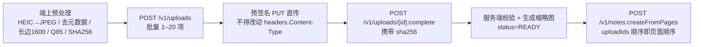
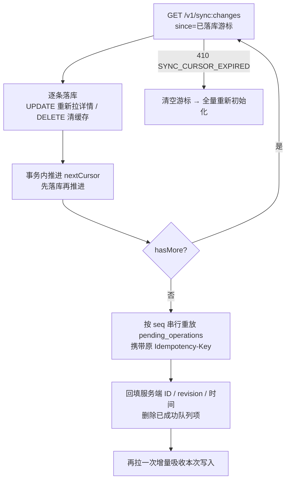

# 拾页笔记（GleanNote）Android 客户端接口封装与错误映射表

> 客户端契约与数据角色产出 · 网络层编码输入（GN-CLIENT-002）

## 0. 文档信息

| 项目 | 内容 |
|---|---|
| 文档名称 | 拾页笔记 Android 客户端接口封装与错误映射表 |
| 文档编号 | GN-CLIENT-002 |
| 版本 | v0.1 |
| 状态 | 草案（待评审） |
| 更新日期 | 2026-11-12 |
| 适用范围 | Android 客户端 `:core:network` 的接口封装、DTO 定义、Problem 解析、错误码到 UI 行为的映射、契约夹具；不含服务端实现与像素级视觉规范 |
| 上级约束 | 接口契约：[API.md v1.1](../../Server/docs/API.md)、[openapi.yaml 1.0.1](../../Server/docs/openapi.yaml)；产品行为：[PRD v1.2](../../PRD-拾页笔记-GleanNote.md)；服务端横切：[ARCHITECTURE.md v1.0](../../Server/docs/ARCHITECTURE.md) 第 8 章；客户端总纲：[A](CLIENT-ARCHITECTURE.md) v0.2 第 2、5、6.10 章；写作规范：[CONVENTIONS.md v1.0](../../Server/docs/CONVENTIONS.md) 第 6 章 D-01~D-09 |
| 目标读者 | Android 客户端网络层与数据层研发、测试（契约夹具）、服务端联调接口人、架构评审人 |
| 关联文档 | [主文档 A](CLIENT-ARCHITECTURE.md)（GN-CLIENT-001）、[数据库字典 003](GN-CLIENT-003.md)、[环境基线 ENVIRONMENT.md](ENVIRONMENT.md)（GN-CLIENT-007） |

### 0.1 文档定位与边界

本文是 [A](CLIENT-ARCHITECTURE.md) 0.2 登记的「网络层编码启动前」拆分文档，只回答三个问题：**有哪些端点、每个字段如何映射到客户端 DTO 与本地实体、每个错误码触发什么 UI 行为**。字段级定义以 [API.md](../../Server/docs/API.md) 与 [openapi.yaml](../../Server/docs/openapi.yaml) 为准，两者冲突时以契约文件与 API.md 修订记录为准（API.md 1 章）。

严格遵循 [CONVENTIONS.md](../../Server/docs/CONVENTIONS.md) 第 1 章的文档分工，**不得**串位：本文不复制 PRD 的产品规则原文、不定义 Room 表结构（归 [003](GN-CLIENT-003.md)）、不定义界面状态清单（归 GN-CLIENT-004）、不定义测试用例数据（归 GN-CLIENT-005）。本文出现的字段、错误码、数值一律标注出处，凡与 PRD 或契约不一致的判断以 PRD 与契约为准并登记为口径差异（第 9 章）。

本文沿用统一编号登记表，**不新增**任何文档编号、里程碑编号、任务 ID、用例编号、风险编号或未决编号：端点编号沿用 API.md 第 4 章（1–57 与 50a），用例编号沿用 A 9.2 的 `C-01`~`C-14`，风险编号沿用 A 11.1 的 `R-C01`~`R-C15`，未决编号沿用 A 11.3 的 `Q-01`~`Q-14`，模块名沿用 A 3.3。

### 0.2 修订记录

| 版本 | 日期 | 修订人 | 说明 |
|---|---|---|---|
| v0.1 | 2026-11-12 | 客户端契约与数据角色 | 首版草案：按 API.md v1.1 / openapi.yaml 1.0.1 建立 58 行端点索引、29 个 schema 的 DTO 映射、50 个错误码到 UI 行为的逐条落地，以及分页 / 上传 / 同步 / 夹具 / 短效 URL 的强制约定 |

## 1. 端点索引

本章逐条覆盖 [API.md](../../Server/docs/API.md) 第 4 章的全部端点行。计数口径统一为 **58 行**：编号 1–57 共 57 行，加上 v1.1 新增的 `50a GET /s/{token}`，合计 58 行（API.md 4.5、9 章修订记录）。其中 55 个 `/v1` 端点（编号 1–50、51–55）、1 个公开 HTML 分享页（`50a`）、2 个运维探针（`56 /healthz`、`57 /readyz`）。[A](CLIENT-ARCHITECTURE.md) 2.1 的旧「57 个」口径已在 A v0.3 回写为 58 行（2026-11-12），本文**不得**改动 A。

表头说明：`A` = 需鉴权；`I` = 需 `Idempotency-Key`；阶段列 `P0` / `P1` 取自 API.md 4 章标注；主要 schema 列为 [openapi.yaml](../../Server/docs/openapi.yaml) `components.schemas` 名称，无响应体或非 JSON 响应记 `—`。

### 1.1 端点索引表（58 行）

| 编号 | 方法与路径 | 用途 | 鉴权 `A` | 幂等键 `I` | 阶段 | 客户端模块 | 主要 schema |
|---|---|---|---|---|---|---|---|
| 1 | `POST /v1/auth:sendCode` | 发送邮箱验证码 | 否 | 否 | P0 | `:feature:auth`、`:core:network` | `—`（204） |
| 2 | `POST /v1/auth:register` | 注册并登录 | 否 | 是 | P0 | `:feature:auth`、`:core:network` | `AuthSession` |
| 3 | `POST /v1/auth:login` | 登录 | 否 | 否 | P0 | `:feature:auth`、`:core:network` | `AuthSession` |
| 4 | `POST /v1/auth:refresh` | 刷新令牌 | 否 | 否 | P0 | `:core:network`（拦截器单飞） | `AuthSession` |
| 5 | `POST /v1/auth:logout` | 退出登录 | 是 | 否 | P0 | `:feature:settings`、`:core:network` | `—`（204） |
| 6 | `POST /v1/auth:resetPassword` | 通过验证码重置密码 | 否 | 是 | P0 | `:feature:auth`、`:core:network` | `—`（204） |
| 7 | `GET /v1/users/me` | 当前用户 | 是 | 否 | P0 | `:feature:settings`、`:core:network` | `User` |
| 8 | `PATCH /v1/users/me` | 修改昵称 | 是 | 否 | P0 | `:feature:settings`、`:core:network` | `User` |
| 9 | `DELETE /v1/users/me` | 注销账号（验证码二次确认） | 是 | 否 | P0 | `:feature:settings`、`:core:network` | `—`（204） |
| 10 | `GET /v1/users/me/quota` | 额度与云端容量 | 是 | 否 | P0 | `:feature:capture`、`:feature:settings` | `Quota` |
| 11 | `GET /v1/folders` | 列出某父级下的子目录（分页） | 是 | 否 | P0 | `:feature:library` | `FolderList` |
| 12 | `POST /v1/folders` | 新建目录 | 是 | 是 | P0 | `:feature:library` | `Folder` |
| 13 | `GET /v1/folders/{folderId}` | 目录详情 | 是 | 否 | P0 | `:feature:library` | `Folder` |
| 14 | `GET /v1/folders/{folderId}/path` | 面包屑与原路径 | 是 | 否 | P0 | `:feature:library` | `FolderPath` |
| 15 | `PATCH /v1/folders/{folderId}` | 重命名 | 是 | 否 | P0 | `:feature:library` | `Folder` |
| 16 | `DELETE /v1/folders/{folderId}` | 删除目录（整棵子树软删除） | 是 | 否 | P0 | `:feature:library`、`:feature:trash` | `DeleteResult` |
| 17 | `POST /v1/folders/{folderId}:move` | 移动到目标父级 | 是 | 否 | P0 | `:feature:library` | `FolderMoveResult` |
| 18 | `POST /v1/folders/{folderId}:undelete` | 从回收站恢复 | 是 | 否 | P0 | `:feature:trash` | `Folder` |
| 19 | `POST /v1/folders/{folderId}:expunge` | 彻底删除 | 是 | 否 | P0 | `:feature:trash` | `—`（204） |
| 20 | `GET /v1/notes` | 目录内笔记列表 | 是 | 否 | P0 | `:feature:library` | `NoteList` |
| 21 | `POST /v1/notes` | 新建空白笔记（含离线创建补录） | 是 | 是 | P0 | `:feature:library`、`:feature:editor` | `NoteDetail` |
| 22 | `POST /v1/notes:createFromPages` | 由已上传图片创建草稿并提交转换 | 是 | 是 | P0 | `:feature:capture`、`:feature:conversion` | `NoteDetail` / `ConversionJob` / `Quota` |
| 23 | `GET /v1/notes/{noteId}` | 笔记详情（含正文与标签） | 是 | 否 | P0 | `:feature:editor` | `NoteDetail` |
| 24 | `PATCH /v1/notes/{noteId}` | 保存标题 / 正文（乐观锁） | 是 | 是 | P0 | `:feature:editor`、`:core:sync` | `NoteDetail` |
| 25 | `DELETE /v1/notes/{noteId}` | 删除到回收站 | 是 | 否 | P0 | `:feature:editor`、`:feature:trash` | `DeleteResult` |
| 26 | `POST /v1/notes/{noteId}:move` | 移动笔记 | 是 | 否 | P0 | `:feature:library` | `NoteSummary` |
| 27 | `POST /v1/notes/{noteId}:undelete` | 从回收站恢复 | 是 | 否 | P0 | `:feature:trash` | `NoteDetail` |
| 28 | `POST /v1/notes/{noteId}:expunge` | 彻底删除 | 是 | 否 | P0 | `:feature:trash` | `—`（204） |
| 29 | `POST /v1/notes/{noteId}:appendPages` | 追加页面并提交追加转换 | 是 | 是 | P1 | `:feature:editor`、`:core:sync` | `ConversionJob` |
| 30 | `GET /v1/notes:search` | 全文搜索 | 是 | 否 | P1 | `:feature:search` | `SearchResultList` |
| 31 | `POST /v1/uploads` | 申请上传会话与预签名地址 | 是 | 否 | P0 | `:core:media`、`:core:sync` | `UploadSession` |
| 32 | `POST /v1/uploads/{uploadId}:complete` | 确认上传并生成缩略图 | 是 | 否 | P0 | `:core:sync` | `UploadedPage` |
| 33 | `GET /v1/notes/{noteId}/pages` | 页面图片列表（缩略图） | 是 | 否 | P0 | `:feature:editor` | `Page` |
| 34 | `GET /v1/notes/{noteId}/pages/{pageId}` | 单页原图地址 | 是 | 否 | P0 | `:feature:editor` | `PageOriginal` |
| 35 | `GET /v1/notes/{noteId}/conversionJob` | 最近一次转换任务 | 是 | 否 | P0 | `:feature:conversion`、`:core:sync` | `ConversionJob` |
| 36 | `POST /v1/notes/{noteId}/conversionJob:cancel` | 取消任务 | 是 | 否 | P0 | `:feature:conversion` | `ConversionJob` |
| 37 | `POST /v1/notes/{noteId}/conversionJob:retry` | 重试（复用已上传图片） | 是 | 是 | P0 | `:feature:conversion`、`:core:sync` | `ConversionJob` |
| 38 | `GET /v1/trash` | 回收站列表（批次聚合） | 是 | 否 | P0 | `:feature:trash` | `TrashEntry` |
| 39 | `GET /v1/tags` | 标签列表 | 是 | 否 | P1 | `:feature:tags` | `Tag` |
| 40 | `POST /v1/tags` | 新建标签 | 是 | 是 | P1 | `:feature:tags` | `Tag` |
| 41 | `PATCH /v1/tags/{tagId}` | 重命名标签 | 是 | 否 | P1 | `:feature:tags` | `Tag` |
| 42 | `DELETE /v1/tags/{tagId}` | 删除标签 | 是 | 否 | P1 | `:feature:tags` | `—`（204） |
| 43 | `PUT /v1/notes/{noteId}/tags` | 覆盖设置笔记标签（≤10） | 是 | 否 | P1 | `:feature:tags`、`:feature:editor` | `—`（整体覆盖） |
| 44 | `GET /v1/notes/{noteId}/versions` | 版本列表 | 是 | 否 | P1 | `:feature:version` | `Version` |
| 45 | `GET /v1/notes/{noteId}/versions/{versionId}` | 版本正文 | 是 | 否 | P1 | `:feature:version` | `VersionDetail` |
| 46 | `POST /v1/notes/{noteId}/versions/{versionId}:restore` | 恢复版本 | 是 | 是 | P1 | `:feature:version`、`:feature:editor` | `NoteDetail` |
| 47 | `GET /v1/notes/{noteId}/shareLink` | 查询分享状态 | 是 | 否 | P1 | `:feature:share` | `ShareLink` |
| 48 | `POST /v1/notes/{noteId}/shareLink` | 开启分享 | 是 | 是 | P1 | `:feature:share` | `ShareLink` |
| 49 | `DELETE /v1/notes/{noteId}/shareLink` | 关闭分享 | 是 | 否 | P1 | `:feature:share` | `—`（204） |
| 50 | `GET /v1/public/shares/{token}` | 公开读取被分享笔记（JSON） | 否 | 否 | P1 | `:feature:share` | `PublicShare` |
| 50a | `GET /s/{token}` | 公开分享页（服务端渲染只读 HTML） | 否 | 否 | P1 | `:feature:share`（系统浏览器） | `—`（`text/html`） |
| 51 | `GET /v1/sync:changes` | 增量同步 | 是 | 否 | P0 | `:core:sync` | `SyncResponse` / `SyncChange` |
| 52 | `POST /v1/exports` | 发起导出任务 | 是 | 是 | P1 | `:feature:export` | `Export` |
| 53 | `GET /v1/exports/{exportId}` | 查询导出结果与下载地址 | 是 | 否 | P1 | `:feature:export` | `Export` |
| 54 | `POST /v1/imports` | 发起批量导入任务 | 是 | 是 | P1 | `:feature:import` | `Import` |
| 55 | `GET /v1/imports/{importId}` | 查询导入进度 | 是 | 否 | P1 | `:feature:import` | `Import` |
| 56 | `GET /healthz` | 存活探针 | 否 | 否 | P0 | 联调工具（不入用户态） | `—`（`{"status":"ok"}`） |
| 57 | `GET /readyz` | 就绪探针（含依赖检查） | 否 | 否 | P0 | 联调工具（不入用户态） | `ReadyStatus` |

### 1.2 分组与计数核对

按 API.md 4 章分组核对：账号与认证 10 行（1–10）、目录 9 行（11–19）、笔记 11 行（20–30）、图片与转换 7 行（31–37）、回收站 / 标签 / 版本 / 分享 / 同步 15 行（38–51 含 `50a`）、导出导入与运维 6 行（52–57），合计 **58 行**。匿名可访问端点仅 `/v1/auth:*`、`/v1/public/*`、`/s/{token}`、`/healthz`（ARCHITECTURE 8.6）；`/readyz` 仅对回环地址开放（API.md 5.12），客户端**不得**为其他端点省略鉴权头（A 2.1）。`POST /v1/uploads` 的 `I=否` 与 API.md 2.6「所有创建类 `POST` 必须携带幂等键」存在口径差异，策略见 [A](CLIENT-ARCHITECTURE.md) 11.3 的 `Q-02`：一律携带，多带不违约。

## 2. DTO 与 schema 映射

[openapi.yaml](../../Server/docs/openapi.yaml) `components.schemas` 共 **29 个**定义（第 1298–1666 行）；另有 `components.parameters` 5 项（`NoteId`、`FolderId`、`PageSize`、`PageToken`、`IdempotencyKey`）、`components.responses.Problem` 1 项、`components.securitySchemes.bearerAuth` 1 项。客户端 DTO **必须**与网络层同处 `:core:network`，**不得**透传到 UI 层（A 3.4 规则 4）。

### 2.1 schemas 清单与落点（29 项）

| schema | 用途 | 客户端 DTO `[建议]` | 本地落点 / 去向 | 关键约束 |
|---|---|---|---|---|
| `ReadyStatus` | `/readyz` 就绪响应 | `ReadyStatusDto` | 不落库，联调工具读取 | `checks` 为 `additionalProperties`，新增键必须容忍（ARCHITECTURE 8.16） |
| `Problem` | 统一错误响应 | `ProblemDto` | `:core:network` 解析为 `AppError`，不落库 | 按 `code` 分支，变量只取 `metadata`（API.md 2.8） |
| `User` | 用户基础信息 | `UserDto` | `:core:datastore`（展示用），不进业务表 | `email` 脱敏后方可入日志（CONVENTIONS G-10） |
| `AuthSession` | 注册 / 登录 / 刷新响应 | `AuthSessionDto` | TokenManager（加密 DataStore），不进 Room | `accessToken` 仅内存缓存，`refreshToken` 加密持久化（A 2.4） |
| `Quota` | 额度与云端容量 | `QuotaDto` | `quota_storage_cache` | `resetAt` 为北京时间次日 0 点对应 UTC（API.md 5.1.7） |
| `Folder` | 目录对象 | `FolderDto` | `folders` | `depth` 1–5（PRD 5.2）；`parentId` 可 `null` 表示根级 |
| `FolderList` | 目录集合 | `FolderListDto` | `folders`（逐项 upsert） | `totalSize` 仅展示，不得跳页（API.md 2.4） |
| `FolderPath` | 面包屑 | `FolderPathDto` | `folders.displayPath`（派生展示） | `displayPath` 为服务端派生字段，本地只缓存展示（A 5.3） |
| `FolderMoveResult` | 目录移动结果 | `FolderMoveResultDto` | `folders` + 删除确认弹窗计数 | `movedFolderCount` / `movedNoteCount`（API.md 5.2.6） |
| `DeleteResult` | 删除响应 | `DeleteResultDto` | `trash_items`、本地软删除标记 | `purgeAt` 由服务端给出（API.md 5.2.7） |
| `Tag` | 标签对象（P1） | `TagDto` | `tags`、`note_tag_cross_ref` | 账号级共享（API.md 5.7） |
| `NoteSummary` | 笔记列表项 | `NoteSummaryDto` | `notes` | **不含 `content`**（API.md 5.3.1）；含 `thumbnailUrl` 短效地址 |
| `NoteDetail` | 笔记详情 | `NoteDetailDto` | `notes`（含正文） | `allOf` 继承 `NoteSummary` + `content` + `shareEnabled`（openapi.yaml 1457） |
| `NoteList` | 笔记集合 | `NoteListDto` | `notes` | `nextPageToken` 为空是唯一停止依据（API.md 2.4） |
| `SearchResultList` | 搜索结果（P1） | `SearchResultListDto` | 不落库；`search_history` 只存关键词 | `snippet` 仅含 `<em>`，渲染前必须剥离（API.md 5.3.11） |
| `UploadSession` | 上传会话与预签名地址 | `UploadSessionDto` | `upload_sessions` | `putUrl` / `headers` 为短效数据，**不得**作为持久地址入库（A 5.3） |
| `UploadedPage` | `:complete` 结果 | `UploadedPageDto` | `upload_sessions.status` | `status` ∈ `PENDING` / `UPLOADED` / `READY` / `EXPIRED` |
| `Page` | 页面图片（缩略图） | `PageDto` | `note_pages` | `index` 从 1 开始（API.md 5.4.3）；`thumbUrl` 短效不入库 |
| `PageOriginal` | 单页原图地址 | `PageOriginalDto` | 不落库 | `originalUrl` 有效期 10 分钟，**不得**缓存超期（API.md 5.4.4） |
| `ConversionJob` | 转换任务 | `ConversionJobDto` | `conversion_jobs` | `state` / `phase` / `failureCode` 均以字符串存且容忍未知值 |
| `TrashEntry` | 回收站条目 | `TrashEntryDto` | `trash_items` | `remainingDays` 由服务端给出，端上只按自然日展示（PRD 5.8） |
| `Version` | 版本元数据（P1） | `VersionDto` | `version_meta` | `source` 枚举，容忍未知值 |
| `VersionDetail` | 版本正文（P1） | `VersionDetailDto` | 不长期缓存正文（A 5.2） | `allOf` 继承 `Version` + `content` |
| `ShareLink` | 分享状态（P1） | `ShareLinkDto` | `share_link_cache` | `enabled=false` 表示未开启，不以 404 区分（API.md 5.9） |
| `PublicShare` | 匿名分享内容 | `PublicShareDto` | 不落库 | 失效返回 `410 SHARE_LINK_INACTIVE` 且响应体不含正文（API.md 5.9） |
| `SyncResponse` | 增量同步响应 | `SyncResponseDto` | `sync_state` | `nextCursor` 严格单调，先落库再推进（API.md 5.10） |
| `SyncChange` | 增量事件 | `SyncChangeDto` | 触发各表更新，不入业务表 | `op=DELETE` 为墓碑，`payload=null`（API.md 5.10） |
| `Export` | 导出任务（P1） | `ExportDto` | 不落库 | `downloadUrl` 有效期 1 小时，不入库（API.md 5.11） |
| `Import` | 导入任务（P1） | `ImportDto` | 不落库 | `state` 含 `PARTIAL_FAILED` / `CANCELED`，容忍未知值 |

### 2.2 `NoteSummary` 与 `NoteDetail` 的要点

| 要点 | 口径 | 出处 |
|---|---|---|
| 列表不返回正文 | `GET /v1/notes` 只给 `NoteSummary`，列表页**不得**请求详情；打开笔记再 `GET /v1/notes/{id}` | API.md 5.3.1、A 5.3 |
| 详情含正文 | `NoteDetail` = `NoteSummary` + `content`（Markdown 原文）+ `shareEnabled`（P1） | API.md 5.3.1、openapi.yaml 1457 |
| 正文上限 | `content` 上限 20 万字符 | PRD 5.2、openapi.yaml 1463 |
| 短效缩略图 | `NoteSummary.thumbnailUrl` 为预签名地址，**不得**入库复用；本地只存 `noteId` / `pageId` | A 5.3、API.md 5.4.4 |
| 派生字段 | `folderPath` / `displayPath` 由服务端给出，本地只缓存展示，目录改名或移动后随刷新更新 | A 5.3、PRD FR-02 |
| 冲突副本 | `isConflictCopy` 标记 + `conflictCopyId` 拉取落库 | A 2.5、API.md 2.7 |

### 2.3 DTO 到本地实体的流向

`ProblemDto` 由 `:core:network` 解析为 `AppError`（A 6.10），`AuthSessionDto` 交 TokenManager 加密持久化，其余 DTO 一律经 Repository **先落库**再由 Room `Flow` 驱动 UI；短效 URL 仅内存即时使用、不入库（表结构见 [003](GN-CLIENT-003.md)）。

## 3. 请求侧强制约定

全部约定来自 [API.md](../../Server/docs/API.md) 2.1–2.9 与 [A](CLIENT-ARCHITECTURE.md) 2.2，由 `:core:network` 的拦截器链统一注入，业务代码**不得**逐接口手写。

| 约定 | 客户端必须做的事 | 出处 |
|---|---|---|
| 鉴权 | 除匿名端点外统一 `Authorization: Bearer {accessToken}`，由 `AuthInterceptor` 注入 | API.md 2.2 |
| 幂等键 | 创建类 `POST` 携带 `Idempotency-Key`，8–64 位可见 ASCII、24 小时内唯一，重试复用同值 | API.md 2.3 / 2.6 |
| 设备标识 | 登录、刷新、登出、注册携带同一 `X-Device-Id` 并持久化 | API.md 2.3 / 5.1.3 |
| 客户端版本 | 携带 `X-Client-Version`，由 `BuildConfig` 注入（A 4.3） | API.md 2.3 |
| 请求追踪 | 发起 `X-Request-Id` 或透传服务端回显值，与 `problem.requestId` 一致 | API.md 2.3 / 2.8 |
| 乐观锁 | `PATCH /v1/notes/{id}` 必带 `revision`，或 `If-Match: "rev-{n}"`，二选一 | API.md 2.7 / 5.3.6 |
| 自定义方法 | 使用 `POST /v1/{collection}/{id}:{verb}`，动词小驼峰，**不得**改写路径风格 | API.md 2.1、ARCHITECTURE 8.1 |
| 字段命名 | 请求与响应均 `camelCase` | API.md 2.1 |
| 枚举 | 发送 `UPPER_SNAKE_CASE`；接收时容忍未知值并落安全默认分支 | API.md 2.1 / 7.4 |
| 时间 | 只发送 RFC 3339 UTC（如离线补录 `clientCreatedAt`），业务日期换算用 `Asia/Shanghai` | API.md 2.1、ARCHITECTURE 8.5 |
| 请求体 | `application/json; charset=utf-8`；单请求 ≤ 12MB；图片二进制**不得**走业务 API | API.md 2.1 / 2.9 |
| 空值 | 无值字段直接省略；`null` 仅用于「显式清空」（如 `targetParentId: null` 移到根级） | API.md 2.1 / 5.2.6 |
| 限流退避 | `429` / `503` 读取 `Retry-After` 退避，**不得**立即自旋重试 | API.md 2.3 |

### 3.1 头部注入与边界

`Authorization` 由 `AuthInterceptor` 注入；`Idempotency-Key` 由 `IdempotencyInterceptor` 注入且生成时固定于 `pending_operations`（A 2.5）；`X-Device-Id` / `X-Client-Version` / `X-Request-Id` / `traceparent` 由全局拦截器注入；`If-Match` 由笔记更新拦截器注入，与 `revision` 二选一、形如 `"rev-7"`（API.md 2.3）。边界：`null` 只用于显式清空语义（如 `targetParentId: null` 移到根级，API.md 2.1 / 5.2.6），其余无值字段一律省略；枚举**必须**按「未知值 → 安全默认分支」解析，kotlinx.serialization 关闭「未知键报错」（A 4.1、API.md 7.4）；时间统一按 UTC `Instant` 解析，展示层按北京时间（UTC+8）换算，**不得**用本地时间戳裁决冲突（A 2.9、8.3）。

## 4. Problem 错误码 → UI 行为

统一入口：`ProblemDto(code, metadata, retryable, requestId, userMessage)` → `AppError` → UI 行为（A 6.10）。客户端**必须按 `code` 分支**，**不得**解析 `detail` / `userMessage` 取业务变量，变量只从 `metadata` 读取（API.md 2.8 约束 1–2、ARCHITECTURE 8.2 规则 1）。

本章按 [API.md](../../Server/docs/API.md) 6.1–6.4 四组**逐条**列出全部 **50 个** `code`。`userMessage` 模板为 API.md 原文，`{var}` 由 `metadata` 填充；客户端**不得**自行拼接中文文案替换模板，只按 `code` 选择 UI 行为并展示服务端 `userMessage`（Q-09 同理：冲突副本标题不自行拼接）。`retryable` 列为客户端预期口径：5xx 一律 `true`（API.md 2.8 约束 3），429 / 503 需读 `Retry-After` 退避（API.md 2.3），其余以响应体 `Problem.retryable` 字段为准（openapi.yaml `Problem`）。未知 `code` 一律走通用提示 + 依据 `retryable` 决定是否提供重试入口，**不得**崩溃或空白页（A 2.10）。

### 4.1 认证与账号（API.md 6.1，11 条）

| `code` | HTTP | 场景 | `userMessage` 模板 | 客户端 UI 行为 | 变量来源 `metadata` | retryable |
|---|---|---|---|---|---|---|
| `AUTH_INVALID_CREDENTIALS` | 401 | 邮箱或密码错误 | 邮箱或密码不正确 | 登录页统一提示，**不得**区分具体错误项 | `—` | 否 |
| `AUTH_EMAIL_NOT_REGISTERED` | 404 | 邮箱未注册 | 该邮箱尚未注册 | 登录页给注册入口；服务端已统一账号枚举口径，客户端**不得**依赖发码预检（Q-01） | `—` | 否 |
| `AUTH_EMAIL_ALREADY_EXISTS` | 409 | 邮箱已注册 | 该邮箱已注册，请直接登录 | 注册页提示并给登录入口 | `—` | 否 |
| `AUTH_CODE_INVALID` | 400 | 验证码错误 | 验证码不正确，请重新输入 | 保留邮箱输入、清空验证码框并聚焦 | `—` | 否 |
| `AUTH_CODE_EXPIRED` | 400 | 验证码过期或作废 | 验证码已过期，请重新获取 | 清空验证码框、重置 60 秒倒计时 | `—` | 否 |
| `AUTH_CODE_RATE_LIMITED` | 429 | 验证码发送过频 | 操作过于频繁，请 {retryAfterSeconds} 秒后重试 | 禁用发送按钮并倒计时 | `retryAfterSeconds` / `Retry-After` | 条件（退避） |
| `AUTH_TOO_MANY_ATTEMPTS` | 429 | 密码连续错误锁定 | 尝试次数过多，请 {retryAfterSeconds} 秒后重试 | 禁用登录提交并倒计时，期间可走去找回密码 | `retryAfterSeconds`（API.md 5.1.3） | 条件（退避） |
| `AUTH_TOKEN_EXPIRED` | 401 | Access Token 过期 | 登录已过期，请重新登录 | 拦截器并发单飞刷新并重放原请求，**不打扰用户**（C-06） | `—` | 内部重放 |
| `AUTH_TOKEN_INVALID` | 401 | 令牌非法或已吊销 | 登录状态异常，请重新登录 | 清空登录态 → 跳登录页 → 成功后回原页面（C-14） | `—` | 否 |
| `AUTH_REFRESH_REUSED` | 401 | 刷新令牌被复用 | 登录状态异常，请重新登录 | 立即清空本地登录态并跳登录页，**不得**自动重试（C-07） | `—` | 否 |
| `AUTH_AGREEMENT_REQUIRED` | 400 | 未勾选协议 | 请先阅读并同意用户协议与隐私政策 | 回到注册页高亮协议勾选（端上校验为主，服务端兜底） | `—` | 否 |

### 4.2 资源与校验（API.md 6.2，13 条）

| `code` | HTTP | 场景 | `userMessage` 模板 | 客户端 UI 行为 | 变量来源 `metadata` | retryable |
|---|---|---|---|---|---|---|
| `VALIDATION_FAILED` | 400 | 参数格式或取值非法 | 输入内容有误，请检查后重试 | 定位到对应输入框提示；清空非法输入但保留用户已输入的其余内容 | `—` | 否 |
| `RESOURCE_NOT_FOUND` | 404 | 不存在或不属于当前用户 | 内容不存在或已被删除 | 统一提示并返回列表或前往回收站，**不得**区分越权（防枚举，ADR-014） | `—` | 否 |
| `NAME_DUPLICATED` | 409 | 同级目录重名或标签重名 | 当前目录下已存在同名目录 | 输入框下方提示，保存按钮不可用 | `—` | 否 |
| `REVISION_MISMATCH` | 412 | 目录 / 标签等非冲突型更新版本不符 | 内容已更新，请刷新后重试 | 提示刷新后重试；**笔记更新不走此分支**（见 5.2） | `—` | 否 |
| `FOLDER_DEPTH_EXCEEDED` | 409 | 超过 5 层 | 最多支持 5 层目录 | 目录创建 / 移动确认页禁用提交（PRD 5.2） | `—` | 否 |
| `FOLDER_CYCLE` | 409 | 移动到自身或子孙 | 不能移动到自身或其子目录 | 目标目录在移动树中置灰标「不可选择」 | `—` | 否 |
| `NOTE_TOO_LARGE` | 413 | 正文超过 20 万字符 | 正文已达上限，无法继续输入 | 输入位置提示上限，已输入内容**不得**丢失（PRD 5.2） | `—` | 否 |
| `NOTE_PAGE_LIMIT_EXCEEDED` | 409 | 单笔记页面超过 50 张 | 单篇笔记最多 50 张图片 | 追加页面确认页拦截并提示（PRD 5.2、API.md 5.3.10） | `—` | 否 |
| `NOTE_STATE_INVALID` | 409 | 当前状态不允许该操作 | 当前笔记状态不支持该操作 | 刷新详情、按新 `state` 重算可用操作 | `—` | 否 |
| `TAG_LIMIT_EXCEEDED` | 409 | 单笔记标签超过 10 个 | 每篇笔记最多 10 个标签 | 标签选择器拦截并提示（API.md 5.7） | `—` | 否 |
| `QUOTA_EXCEEDED` | 409 | 当日额度不足 | 今日额度剩余 {remaining} 张，可减少图片后重试 | 确认页展示剩余张数 + 减少图片入口，禁用「开始转换」（PRD 5.3） | `remaining` / `requested` / `resetAt`（API.md 2.8 示例） | 否 |
| `STORAGE_EXCEEDED` | 409 | 云端容量不足 | 云端空间不足，请清理后重试 | 提示清理回收站 / 删除笔记释放空间（PRD 5.3.1） | `metadata` 容量信息（容忍新增键） | 否 |
| `PRECONDITION_FAILED` | 409 | 状态前置条件不满足（如彻底删除非删除态） | 当前状态不支持该操作 | 刷新详情后重算可用操作 | `—` | 否 |

> 口径提示：API.md 5.2.8 出现 `FAILED_PRECONDITION` 字样，与 6.2 目录的 `PRECONDITION_FAILED` 不一致。客户端**必须**以 6.2 目录的 `PRECONDITION_FAILED` 建立 `code` 分支，并通过未知 `code` 默认分支兜底；该差异已列入向主代理的口径冲突报告，待服务端确认后同步夹具。

### 4.3 上传与转换（API.md 6.3，16 条）

| `code` | HTTP | 场景 | `userMessage` 模板 | 客户端 UI 行为 | 变量来源 `metadata` | retryable |
|---|---|---|---|---|---|---|
| `UPLOAD_NOT_FOUND` | 404 | 上传会话不存在 | 图片上传记录不存在，请重新上传 | 该项列入失败列表，仅重传失败项（C-02） | 请求上下文 `uploadId` | 否 |
| `UPLOAD_EXPIRED` | 410 | 会话超过 30 分钟 | 上传已超时，请重新上传 | 仅对过期项重新申请会话并直传，不要求重新选图（A 6.3） | 请求上下文 `uploadId` | 否 |
| `UPLOAD_NOT_READY` | 409 | 会话未完成校验 | 图片尚未上传完成 | 等待 `:complete` 结果或重传该项 | 请求上下文 `uploadId` | 否 |
| `UPLOAD_SIZE_MISMATCH` | 409 | 实际字节与声明不符 | 图片上传不完整，请重试 | 自动重试 1 次，仍失败列入失败列表 | 请求上下文 `uploadId` | 条件（单图重试 1 次） |
| `UPLOAD_HASH_MISMATCH` | 409 | SHA256 不符 | 图片校验失败，请重新上传 | 重新计算 SHA-256 并重传该项 | 请求上下文 `uploadId` | 条件（单图重试 1 次） |
| `UPLOAD_UNSUPPORTED_TYPE` | 415 | 格式不支持 | 仅支持 JPG、PNG、WEBP 格式 | 该项标记「无法读取」，HEIC 由端上转 JPEG 后重传（A 2.6） | 请求上下文 `uploadId` | 否 |
| `CONVERSION_NOT_FOUND` | 404 | 笔记无转换任务 | 暂无转换任务 | 按「暂无转换任务」空态展示，**不得**当作崩溃 | `—` | 否 |
| `CONVERSION_STATE_INVALID` | 409 | 当前任务状态不可取消 / 重试 | 当前转换状态不支持该操作 | 刷新任务对象后重算可用操作 | `—` | 否 |
| `CONVERSION_FAILED` | 409 | 任务失败（详情见 `metadata.failureCode`） | 转换失败，请重试 | 失败结果页按 `failureCode` 给原因 + 原地重试（不新建笔记） | `metadata.failureCode` | 条件（用户触发重试） |
| `PROVIDER_UNAVAILABLE` | 503 | 供应商不可用 | 当前使用人数较多，请稍后重试 | 失败结果页提示并给重试入口，按 `Retry-After` 退避 | `Retry-After` / `metadata.failureCode` | 是（5xx） |
| `IMAGE_UNREADABLE` | 422 | 图片无法识别 | 部分页面不清晰，建议重拍后重试 | 失败结果页提示重拍，复用已上传图片可重试 | `metadata.failureCode` | 条件（用户触发重试） |
| `CONTENT_UNSUPPORTED` | 422 | 内容不支持转换 | 该内容暂不支持转换 | 失败结果页提示，给重试入口 | `metadata.failureCode` | 条件（用户触发重试） |
| `CONVERSION_TIMEOUT` | 504 | 超过 5 分钟 | 转换超时，请重试 | 按失败提示（PRD FR-05），**不得**改写服务端任务状态（Q-03） | `Retry-After` | 是（5xx） |
| `EMPTY_RESULT` | 422 | 未识别到文字 | 未能识别到可用的文字内容 | 按转换失败处理，提示并给重试入口（A 6.4） | `metadata.failureCode` | 条件（用户触发重试） |
| `NOTE_MODIFIED` | 409 | 转换期间用户修改了笔记，结算放弃写入 | 笔记在转换期间被修改，请重试 | 提示重试，重新拉详情后提交（A 2.7、ARCHITECTURE 6.2） | `metadata.failureCode` | 条件（用户触发重试） |
| `INTERNAL_ERROR` | 500 | 结算遇到数据库等基础设施故障 | 转换失败，请稍后重试 | 通用可重试提示，退避后重试，不泄露内部细节 | `Retry-After` | 是（5xx） |

### 4.4 分享、同步与通用（API.md 6.4，10 条）

| `code` | HTTP | 场景 | `userMessage` 模板 | 客户端 UI 行为 | 变量来源 `metadata` | retryable |
|---|---|---|---|---|---|---|
| `SHARE_LINK_INACTIVE` | 410 | 分享已关闭或笔记不可用 | 内容已失效 | 分享页展示失效态；本地清掉「已分享」标识（PRD 5.4） | `—` | 否 |
| `SHARE_NOTE_NOT_READY` | 409 | 草稿不可分享 | 请先完成转换再分享 | 分享入口置灰，提示先完成转换 | `—` | 否 |
| `SHARE_LINK_NOT_FOUND` | 404 | 保留：当前实现以 `enabled=false` 表达「未开启分享」 | 该笔记尚未开启分享 | 按未开启分享态展示，**不得**依赖 404 区分（API.md 5.9） | `—` | 否 |
| `SYNC_CURSOR_EXPIRED` | 410 | 游标超出回溯范围 | 数据已更新，请重新同步 | 清空游标 → 全量重新初始化（C-09） | `—` | 否（改为全量） |
| `INVALID_PAGE_TOKEN` | 400 | 分页令牌过期或被篡改 | 列表已变化，请刷新后重试 | 丢弃当前 `pageToken`，刷新列表并回到第一页（C-10） | `—` | 否 |
| `IDEMPOTENCY_KEY_REUSED` | 409 | 同键不同请求体 | 操作冲突，请刷新后重试 | 提示刷新，**不得**自动改写请求体重试（A 2.5） | `—` | 否 |
| `RATE_LIMITED` | 429 | 触发限流 | 操作过于频繁，请稍后重试 | 按 `Retry-After` 退避，**不得**自旋重试（API.md 2.3） | `Retry-After` / `retryAfterSeconds` | 条件（退避） |
| `INTERNAL` | 500 | 未预期错误 | 服务异常，请稍后重试 | 通用可重试提示，退避后重试 | `Retry-After` | 是（5xx） |
| `UNAVAILABLE` | 503 | 依赖不可用 | 服务暂时不可用，请稍后重试 | 通用可重试提示，退避后重试 | `Retry-After` | 是（5xx） |
| `TIMEOUT` | 504 | 上游超时 | 请求超时，请重试 | 通用可重试提示，退避后重试 | `Retry-After` | 是（5xx） |

### 4.5 本地网络异常与变量来源汇总

本地网络异常（无连接、DNS、TLS、超时）不在 Problem 体系内，统一映射为「网络异常，请检查网络」并进入待同步或可重试分支，**不得**清空已输入内容（A 6.10）。`requestId` 与 `X-Request-Id` 写入本地日志用于联调定位，日志**不得**含令牌、密码、验证码、完整邮箱（CONVENTIONS G-10）。变量来源：`retryAfterSeconds` / `Retry-After`（限流类，API.md 5.1.3）、`metadata.remaining` / `requested` / `resetAt`（`QUOTA_EXCEEDED`，API.md 2.8）、`metadata.failureCode`（转换失败类，值为 `JobFailureCode`，API.md 6.3）、请求上下文 `uploadId`（`UPLOAD_*`，A 6.10）、响应体 `conflictCopyId`（笔记更新 `200`，API.md 2.7）。

## 5. 分页、排序与 revision CAS

### 5.1 分页与排序（AIP-158）

| 项 | 口径 | 客户端必须做的事 | 出处 |
|---|---|---|---|
| `pageSize` | 默认 20，上限 100，>100 自动收敛，<0 返回 `400` | 请求带 `pageSize=20`，滚动到底加载下一页 | API.md 2.4、openapi.yaml `PageSize` |
| `pageToken` | 不透明字符串，1 小时有效 | 原样回传上一页 `nextPageToken`，**不得**自行构造 | API.md 2.4 |
| 停止依据 | `nextPageToken` 为空字符串是**唯一**停止依据 | 为空即停，**不得**用 `totalSize` 计算页数或跳页 | API.md 2.4、A 2.3 |
| `totalSize` | 估算值 | 仅用于展示，**不得**参与翻页逻辑 | API.md 2.4、ARCHITECTURE 8.3 |
| `orderBy` 白名单（笔记） | `updateTime desc`、`createTime desc`、`title asc` | 只发送白名单值，非白名单返回 `400 VALIDATION_FAILED` | API.md 2.5 |
| `orderBy` 白名单（其它） | 目录 `createTime asc` / `name asc`；回收站 `deleteTime desc`；版本 `createTime desc`；标签 `noteCount desc` / `name asc` | 分端点使用各自白名单 | API.md 2.5 |
| 过滤参数 | 显式强类型 `folderId` / `state` / `tagIds` / `updatedAfter`；多值用重复键，语义「同时包含」 | **不得**使用通用表达式语法 | API.md 2.5、ARCHITECTURE 8.3 |
| 令牌失效 | `400 INVALID_PAGE_TOKEN` | 刷新列表并回到第一页（C-10） | API.md 6.4 |

### 5.2 revision 乐观锁与冲突分支

| 场景 | 服务端响应 | 客户端必须做的事 | 出处 |
|---|---|---|---|
| 笔记 `revision` 匹配 | `200 NoteDetail`，返回新 `revision` | 立即持久化新 `revision`，否则下次保存必然冲突 | API.md 2.7、A 2.5 |
| 笔记 `revision` 落后 | **`200` + `conflictCopyId`，不返回 `412`** | 提示「检测到编辑冲突，已保留副本」，按 `conflictCopyId` 拉取落库并刷新列表 | API.md 2.7、PRD 5.5 |
| 目录 / 标签 `revision` 不匹配 | `412 REVISION_MISMATCH` | 提示刷新后重试 | API.md 2.7 / 6.2 |
| `If-Match` 与 `revision` 二选一 | 形如 `"rev-7"` | 二者选其一，**不得**同时冲突携带 | API.md 2.3 / 2.7 |
| `AUTO_SAVE` / `MANUAL_SAVE` | `saveSource` 决定服务端是否生成版本 | `revision` 与 `saveSource` 一并持久化到 `pending_operations`（A 2.5） | API.md 5.3.6、PRD FR-16 |

## 6. 预签名三步上传与转换轮询

### 6.1 三步协议

严格按 [API.md](../../Server/docs/API.md) 2.9 实现，顺序**不得**调换：

### 6.2 约束表

| 约束 | 值 | 出处 |
|---|---|---|
| 单批申请 | 1–20 项 | API.md 5.4.1 |
| 声明格式 | `image/jpeg` / `image/png` / `image/webp`；HEIC 由客户端转 JPEG | API.md 2.9、PRD FR-03 |
| 单张上限 | 10MB，上传前压缩不阻断 | PRD 5.2、API.md 2.9 |
| 会话有效期 | 30 分钟，过期 `:complete` 返回 `410 UPLOAD_EXPIRED` | API.md 2.9、6.3 |
| 预签名 `PUT` | 本身幂等，**不得**改动 `headers.Content-Type` | API.md 2.9、ARCHITECTURE 8.4 |
| `:complete` | 同 `uploadId` 重复调用返回同一结果 | API.md 2.6 |
| 提交前置 | `uploadIds` 全部为 `READY`，1–20 个 | API.md 5.3.4 |
| 校验顺序 | 额度 → 存储容量 → 上传有效性 → 事务写入 | API.md 5.3.4、ARCHITECTURE 8.8 |
| 并发直传 | 最多同时 2 张 | PRD FR-04、A 6.3 |
| 请求体上限 | 业务 API 12MB（图片二进制不走业务 API） | API.md 2.1 |

### 6.3 转换轮询与 `JobPhase` 文案

| 项 | 口径 | 出处 |
|---|---|---|
| 提交 | `createFromPages` 返回 `201`，含 `note`（`DRAFT`）、`conversionJob`（`QUEUED`）、`quota` | API.md 5.3.4 |
| 轮询间隔 | **2 秒**，终态后再拉笔记详情 | API.md 5.5.1 |
| `JobPhase` 文案 | `QUEUED` 排队中 / `RECOGNIZING` 正在识别第 N/M 页 / `GENERATING` 正在生成 Markdown / `COMPLETED` 完成 | API.md 3.2、PRD FR-05、A 2.7 |
| 终态 | `SUCCEEDED` / `FAILED` / `CANCELED`；终态后拉 `GET /v1/notes/{id}` | API.md 5.5.1、A 2.7 |
| 客户端超时 | 5 分钟未完成按失败提示，但**不得**改写本地任务状态（Q-03） | PRD FR-05 `[Assumption]`、A 6.4 |
| 取消 | 仅 `QUEUED` / `RUNNING` 可取消，额度自动返还，页面图片保留 | API.md 5.5.2 |
| 重试 | `:retry` 创建新任务、复用已上传图片，**不重新选图**；额度与容量重新校验 | API.md 5.5.3、PRD FR-05 |
| 未提交过 | `404 CONVERSION_NOT_FOUND` → 「暂无转换任务」 | API.md 5.5.1 |
| 单用户并发 | 同时最多 1 个 `RUNNING` 任务，客户端**不得**并发提交多篇转换 | ARCHITECTURE 8.7、A 2.7 |

### 6.4 转换失败码表（`JobFailureCode` vs `Problem.code`）

`metadata.failureCode` 取值为 [API.md](../../Server/docs/API.md) 3.2 的 `JobFailureCode` 枚举（9 个），与 6.3 的 `Problem.code` **不是同一命名空间**，客户端**不得**混用：

| `JobFailureCode`（`metadata.failureCode`） | 含义 | 对应 `Problem.code`（6.3） | 客户端处理 |
|---|---|---|---|
| `PROVIDER_UNAVAILABLE` | 供应商不可用 | `PROVIDER_UNAVAILABLE`(503) | 退避重试 |
| `IMAGE_UNREADABLE` | 图片无法识别 | `IMAGE_UNREADABLE`(422) | 提示重拍 + 重试 |
| `CONTENT_UNSUPPORTED` | 内容不支持转换 | `CONTENT_UNSUPPORTED`(422) | 失败页提示 |
| `TIMEOUT` | 超时（枚举名） | `CONVERSION_TIMEOUT`(504) | **注意名称不同**，按 `Problem.code` 分支 |
| `EMPTY_RESULT` | 未识别到文字 | `EMPTY_RESULT`(422) | 按失败处理（A 6.4） |
| `QUOTA_EXCEEDED` | 额度不足 | `QUOTA_EXCEEDED`(409，6.2) | 提示剩余张数 |
| `STORAGE_EXCEEDED` | 容量不足 | `STORAGE_EXCEEDED`(409，6.2) | 提示清理 |
| `NOTE_MODIFIED` | 结算期并发冲突 | `NOTE_MODIFIED`(409) | 提示重试（ARCHITECTURE 6.2） |
| `INTERNAL_ERROR` | 基础设施故障 | `INTERNAL_ERROR`(500) | 通用可重试 |

`JobFailureCode` 的 `NOTE_MODIFIED`、`INTERNAL_ERROR` 为 v1.1 新增（API.md 9 章修订记录）；客户端解析 `failureCode` 时同样**必须**容忍未知值，落「转换失败，请重试」默认分支。

## 7. 增量同步契约

`GET /v1/sync:changes?since={cursor}&pageSize=200&resourceTypes=...`（API.md 5.10）。

### 7.1 拉取与落库顺序

### 7.2 规则表

| 规则 | 客户端必须做的事 | 出处 |
|---|---|---|
| 游标 | `nextCursor` 严格单调，**先落库再推进游标**，不得先推进 | API.md 5.10 规则 1、A 2.8 |
| `since` | 缺省 0 表示全量初始化；`pageSize` 默认 200、最大 500 | API.md 5.10、A 附录 B |
| 续拉 | `hasMore=true` 时立即拉下一页，`pageSize` 保持不变 | API.md 5.10 规则 3 |
| 墓碑 | `op=DELETE`、`payload=null` → 清除本地缓存，**不得**展示错误 | API.md 5.10 规则 2 |
| 失效通知 | `UPDATE` 按 `[建议]` 视为失效通知，按 `resourceId` 重新 `GET` 详情回填，不依赖 `payload` 完整性 | A 2.8 规则 6 |
| 游标过期 | 变更日志保留 90 天；`410 SYNC_CURSOR_EXPIRED` → 清空游标并全量重新初始化（C-09） | API.md 5.10 规则 4 |
| 离线变更 | **不得**走该端点，按发生顺序重放普通写接口并携带 `Idempotency-Key`（C-03） | API.md 5.10 规则 5、PRD FR-10 |
| 资源类型 | `resourceTypes` ∈ `FOLDER` / `NOTE` / `TAG` / `PAGE`，多值用重复键 | API.md 3.2 / 5.10 |
| 幂等键持久化 | 键在发起操作前生成并随操作落 `pending_operations`，重试 / 进程恢复 / 离线重放复用同值（R-C05） | A 2.5、API.md 2.6 |

## 8. MockWebServer 夹具清单

契约夹具**必须**取自 [openapi.yaml](../../Server/docs/openapi.yaml) 与 [API.md](../../Server/docs/API.md) 示例，**不得**手写「看起来像」的响应；契约变更时夹具随动更新（A 9.1）。夹具存放于 `:core:network` 的测试资源目录，按端点组命名。

### 8.1 按端点组的必做夹具

| 端点组 | 必做夹具 | 夹具来源（示例位置） | 覆盖用例 |
|---|---|---|---|
| 认证（1–10） | `AuthSession` 注册 / 登录 / 刷新成功、`204`、401 刷新单飞、429 倒计时 | API.md 5.1.2、5.1.4；openapi.yaml `AuthSession` | `C-06`、`C-07`、`C-14` |
| 目录（11–19） | `FolderList` 分页首 / 末页、`FolderPath`、`FolderMoveResult`、`DeleteResult`、`412 REVISION_MISMATCH` | API.md 5.2.1 / 5.2.4 / 5.2.6 / 5.2.7 | `C-04`、`C-10` |
| 笔记（20–30） | `NoteList` 分页、`NoteDetail` 含 `content`、`conflictCopyId` 响应、`SearchResultList` 含 `<em>` | API.md 5.3.1 / 5.3.6 / 5.3.11 | `C-08`、`C-10`、`C-11` |
| 上传与转换（31–37） | `UploadSession`、`UploadedPage(status=READY)`、`ConversionJob` 各 `state` / `phase`、`410 UPLOAD_EXPIRED` | API.md 5.4.1 / 5.4.2 / 5.5.1；openapi.yaml `ConversionJob` | `C-01`、`C-02` |
| 回收站 / 标签 / 版本 / 分享（38–50a） | `TrashEntry` 批次、`Tag`、`Version` / `VersionDetail`、`ShareLink(enabled=false)`、`PublicShare`、`410 SHARE_LINK_INACTIVE`、HTML 页 `text/html` | API.md 5.6 / 5.7 / 5.8 / 5.9 | `C-04`、兼容夹具 |
| 同步（51） | `SyncResponse`：`hasMore=true` 续拉、`op=DELETE` 墓碑、`410 SYNC_CURSOR_EXPIRED` | API.md 5.10 | `C-09`、`C-03` |
| 导出 / 导入（52–55） | `Export(downloadUrl)`、`Import(PARTIAL_FAILED)` | API.md 5.11；openapi.yaml `Export` / `Import` | P1 联调 |
| 探针（56–57） | `{"status":"ok"}`、`ReadyStatus` 含 `vision` / `mailer` / `objectStore`、503 同构失败响应 | API.md 5.12、ARCHITECTURE 8.16 | M0 连通性 |

### 8.2 三类兼容夹具（API.md 7.4、ARCHITECTURE 8.15）

| 类别 | 夹具内容 | 客户端断言 | 出处 |
|---|---|---|---|
| 未知枚举 | 在 `state` / `phase` / `source` / `resourceType` 注入契约外的值 | 落安全默认分支，界面**不得**崩溃或空白 | API.md 7.4、`C-11` |
| 未知字段 | 在 `NoteDetail` / `Quota` / `ReadyStatus.checks` 追加契约外字段 | 忽略未知字段，已定义字段正常解析 | API.md 7.4、`C-11` |
| 未知错误码 | 返回契约外 `code` 且 `retryable=true` / `false` 两种 | 走通用提示 + 依据 `retryable` 决定重试入口 | A 2.10、`C-11` |

附加夹具：未知 HTTP 状态（如 403，ARCHITECTURE 8.2 提及但 6 章未列 `code`）走默认分支；`Problem` 响应缺少可选 `metadata` / `retryAfterSeconds` 时按缺省值处理；`totalSize` 缺失或与 `items` 数量不一致时**不得**影响翻页（A 2.3）。

## 9. 短效 URL 与兼容策略

### 9.1 短效 URL 清单

客户端**只存资源 ID，不存 URL**；每次使用前按 `pageId` / `noteId` 重新调用对应端点签发（A 1.5、5.3、R-C04）。缓存图片字节时，缓存 key **必须**用资源 ID 而非 URL。

| 短效地址 | 有效期 | 签发端点 | 本地处理 | 出处 |
|---|---|---|---|---|
| 预签名 `putUrl` | 缺省 15 分钟（上限 7 天） | `POST /v1/uploads`（31） | 会话内即时 `PUT`，**不入库** | ARCHITECTURE 8.16、API.md 5.4.1 |
| `thumbUrl` / `thumbnailUrl` | 预签名口径同上 | `:complete`（32）、`pages`（33）、`NoteSummary` | 不入库，展示前重新签发 | A 5.3、API.md 5.4.2 |
| `originalUrl` | 10 分钟 | `GET /v1/notes/{id}/pages/{pageId}`（34） | **不得**缓存超过有效期，需重新请求 | API.md 5.4.4、A 2.3 |
| `downloadUrl` | 1 小时 | `GET /v1/exports/{exportId}`（53） | 一次性使用，不入库 | API.md 5.11、A 2.3 |
| 分享链接 `url` | 随分享状态，关闭即失效 | `GET/POST /v1/notes/{id}/shareLink`（47 / 48） | 只复制 / 系统分享，不内嵌网页（Q-10） | API.md 5.9、PRD 5.7 |

两个匿名分享端点（`50`、`50a`）均返回 `Cache-Control: no-store`（API.md 5.9、9 章修订记录），客户端**不得**依赖中间缓存。

### 9.2 兼容策略（API.md 第 7 章、ARCHITECTURE 8.15）

| 项 | 客户端必须做的事 | 出处 |
|---|---|---|
| 未知字段 / 枚举 | 忽略未知字段、容忍未知枚举、不依赖字段顺序 | API.md 7.4 |
| 分页 | 不依赖 `totalSize`，`nextPageToken` 为空即停止 | API.md 7.4 |
| 错误扩展 | 容忍 `metadata` 新增键；按 `code` 建默认分支，未知 `code` 不崩溃 | A 2.10 |
| 版本 | `/v1` 冻结后只接受向后兼容变更；破坏性变更升 `/v2` 且并行至少 6 个月 | API.md 7.1 |
| 废弃端点 | 关注 `Deprecation` / `Sunset` 响应头并记录日志，为 `/v2` 迁移预留入口 | API.md 2.3 / 7.1 |
| 契约校验 | 字段改动必须同步 API.md 与 openapi.yaml；契约变更时客户端夹具随动更新 | API.md 7.5、A 9.1 |
| 已知口径差异 | `Q-01`（发码不区分注册状态）、`Q-02`（uploads 幂等键）、`Q-03`（5 分钟超时归属）、`Q-14`（额度返还刷新时机）一律沿用 [A](CLIENT-ARCHITECTURE.md) 11.3 的临时策略，**不得**由客户端单方面假定 | A 11.3 |

## 10. 修订记录

| 版本 | 日期 | 修订人 | 说明 |
|---|---|---|---|
| v0.1 | 2026-11-12 | 客户端契约与数据角色 | 首版草案（待评审）：58 行端点索引、29 个 schema 映射、50 个错误码逐条 UI 行为、分页 / 上传 / 同步 / 夹具 / 短效 URL 强制约定；登记 `FAILED_PRECONDITION` 与 `PRECONDITION_FAILED` 口径差异（4.2）、`JobFailureCode.TIMEOUT` 与 `CONVERSION_TIMEOUT` 命名空间差异（6.4）待服务端确认 |
