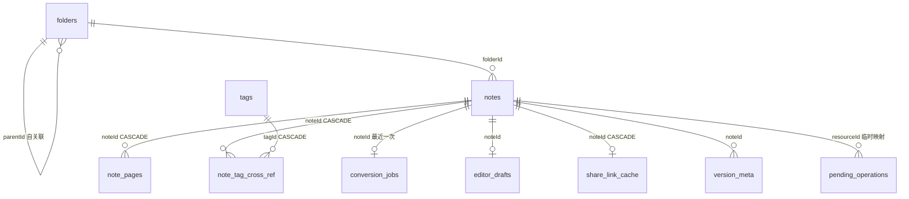
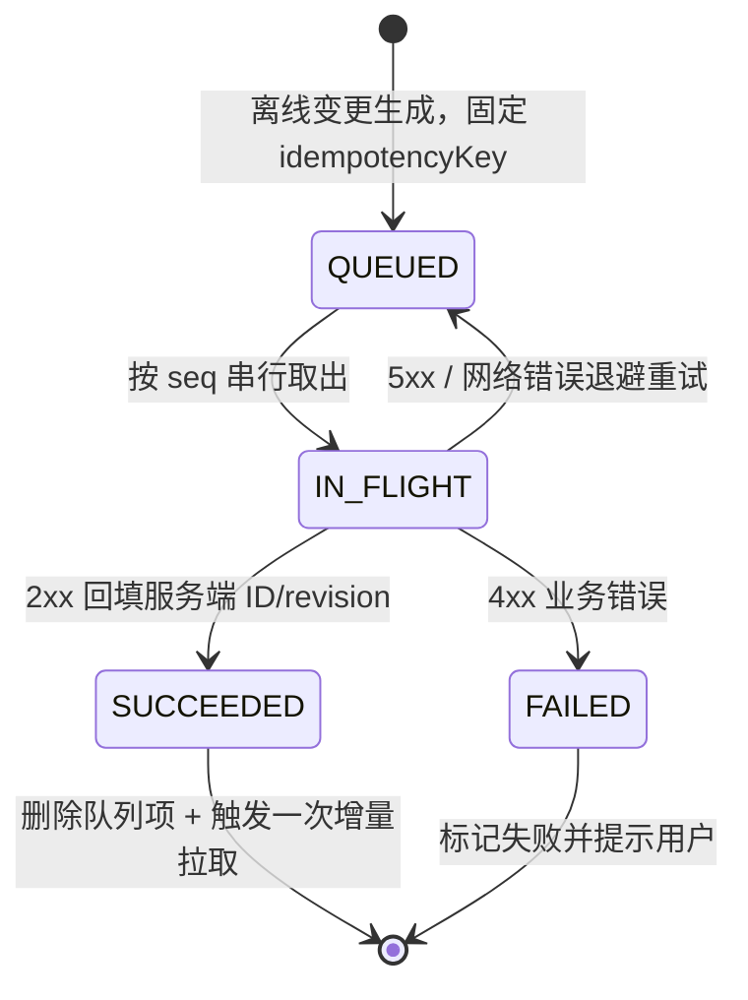

# 拾页笔记（GleanNote）Android 客户端本地数据库字典

> 客户端契约与数据角色产出 · 数据层编码输入（GN-CLIENT-003）
## 0. 文档信息

| 项目 | 内容 |
|---|---|
| 文档名称 | 拾页笔记 Android 客户端本地数据库字典 |
| 文档编号 | GN-CLIENT-003 |
| 版本 | v0.1 |
| 状态 | 草案（待评审） |
| 更新日期 | 2026-11-12 |
| 适用范围 | Android 客户端 `:core:database` 的 Room 实体、字段、索引、迁移与本地文件缓存口径；不含服务端库表结构与网络 DTO 定义 |
| 上级约束 | 客户端总纲：[A](CLIENT-ARCHITECTURE.md) v0.2 第 5 章（本地数据模型）、6.3 / 6.5 / 6.7、2.8；接口契约：[API.md v1.1](../../Server/docs/API.md)、[openapi.yaml 1.0.1](../../Server/docs/openapi.yaml)；产品限值：[PRD v1.2](../../PRD-拾页笔记-GleanNote.md) 第 5 章；服务端口径：[ARCHITECTURE.md v1.0](../../Server/docs/ARCHITECTURE.md) 第 8 章；写作规范：[CONVENTIONS.md v1.0](../../Server/docs/CONVENTIONS.md) 第 6 章 D-01~D-09 |
| 目标读者 | Android 客户端数据层与同步层研发、测试（迁移 / DAO 用例）、架构评审人 |
| 关联文档 | [主文档 A](CLIENT-ARCHITECTURE.md)（GN-CLIENT-001）、[接口封装与错误映射 002](GN-CLIENT-002.md)、[环境基线 ENVIRONMENT.md](ENVIRONMENT.md)（GN-CLIENT-007） |

### 0.1 文档定位

本文是 [A](CLIENT-ARCHITECTURE.md) 0.2 登记的「数据层编码启动前」拆分文档，把 A 5.2 的表设计展开为字段级字典。表、列、索引、迁移均为 `[建议]` 实现口径（PRD 0 节不约束实现方式），可由客户端评审替换，但**必须**保留 A 5.1 的单一数据源原则、服务端权威与三条持久化铁律（1.1）。字段来源一律指向 [openapi.yaml](../../Server/docs/openapi.yaml) 的 schema 或 [API.md](../../Server/docs/API.md) 的响应字段，**不得**凭记忆增列。本文不定义界面状态（归 GN-CLIENT-004）、不定义测试用例数据（归 GN-CLIENT-005）。

### 0.2 修订记录

| 版本 | 日期 | 修订人 | 说明 |
|---|---|---|---|
| v0.1 | 2026-11-12 | 客户端契约与数据角色 | 首版草案：按 A 5.2 展开 15 张表的字段字典、关系与隔离、待同步队列状态机、图片缓存、迁移与索引口径；明确 `revision` / `state` 字符串存、时间 UTC、短效 URL 不入库三条铁律 |
## 1. 表总览

全部表按 `userId` 分区或携带归属字段，切换账号时整体清理（A 5.1、PRD 5.7）。**必须**遵循 A 5.3 的 DTO 映射规则：网络响应先经 Repository 落库，UI 只观察 Room 的 `Flow`，**不得**直接渲染网络结果。

### 1.1 三条持久化铁律

| 铁律 | 口径 | 出处 | 本文呼应章节 |
|---|---|---|---|
| 字符串存且容忍未知值 | `revision` 与所有枚举类字段（`state` / `phase` / `kind` / `status` / `source` / `itemType` / `syncState` 等）一律以 `TEXT` 保存服务端原始值，未知值落「未知 / 待刷新」安全分支，**不得**抛异常或硬编码 Kotlin `enum` | A 5.2、5.3、API.md 7.4 | 2.2、2.6、2.8、2.9、3、6 |
| 时间统一存 UTC | 所有时间列以 `INTEGER`（UTC epoch millis）或 RFC 3339 UTC `TEXT` 保存，展示层按北京时间（UTC+8）换算，**不得**用本地时间戳裁决冲突 | API.md 2.1、ARCHITECTURE 8.5、PRD 5.8 | 全部表的时间列、5、7 |
| 短效 URL 一律不入库 | `thumbnailUrl` / `thumbUrl` / `originalUrl` / `downloadUrl` / `putUrl` / `shareLink.url` **不得**作为可复用持久地址入库；本地只存 `pageId` / `noteId` / `folderId` / `uploadId`，展示前重新签发，图片字节缓存 key 用资源 ID | A 1.5、5.3、API.md 5.4.4 / 5.11、ARCHITECTURE 8.16 | 2.3、2.8、2.15、5 |

### 1.2 表清单（15 张）

| 表名 | 用途 | 主键 | 归属模块 | 对应服务端对象 | 阶段 |
|---|---|---|---|---|---|
| `folders` | 目录树、面包屑派生路径、软删除标记 | `id` | `:core:database` | `Folder` / `FolderPath` / `DeleteResult` | P0 |
| `notes` | 笔记元数据与正文（列表项与详情合一） | `id` | `:core:database` | `NoteSummary` / `NoteDetail` | P0 |
| `note_pages` | 页面图片元数据与本地文件副本路径 | `id` | `:core:database`、`:core:media` | `Page` | P0 |
| `tags` | 账号级标签（P1） | `id` | `:core:database` | `Tag` | P1 |
| `note_tag_cross_ref` | 笔记与标签多对多（P1） | (`noteId`,`tagId`) | `:core:database` | `PUT /v1/notes/{id}/tags` | P1 |
| `conversion_jobs` | 每笔记只保留最近一次转换任务 | `id` | `:core:database`、`:core:sync` | `ConversionJob` | P0 |
| `trash_items` | 回收站批次聚合条目 | (`batchId`,`itemId`) | `:core:database` | `TrashEntry` | P0 |
| `upload_sessions` | 上传会话状态机与断点续传恢复 | `uploadId` | `:core:sync`、`:core:media` | `UploadSession` / `UploadedPage` | P0 |
| `pending_operations` | 离线变更待同步队列，按 `seq` 严格有序 | `opId` | `:core:sync` | 普通写接口重放（API.md 5.10 规则 5） | P0 |
| `sync_state` | 增量同步游标与上次同步结果 | `userId` | `:core:sync` | `SyncResponse` | P0 |
| `editor_drafts` | 编辑草稿，进程回收后恢复 | `noteId` | `:core:database` | 端上产生 | P0 |
| `quota_storage_cache` | 额度与云端容量展示缓存 | `userId` | `:core:database` | `Quota` | P0 |
| `search_history` | 最近搜索关键词（P1） | `id` | `:core:datastore` | 端上产生 | P1 |
| `version_meta` | 版本列表元数据，正文按需拉取（P1） | `versionId` | `:core:database` | `Version` | P1 |
| `share_link_cache` | 分享开关状态，不缓存链接地址（P1） | `noteId` | `:core:database` | `ShareLink` | P1 |
## 2. 逐表字段字典

六列口径：字段 | 类型 | 可空 | 默认值 | 约束 / 索引 | 来源 DTO。类型 `TEXT` / `INTEGER` 为 Room / SQLite 列类型；时间列统一 `INTEGER`（UTC epoch millis，API.md 2.1、ARCHITECTURE 8.5）；`INTEGER` 布尔列 0 / 1。`userId` 为分区键，所有表**必须**携带或以其它方式归属到账号（A 5.2）。
### 2.1 `folders`
设计意图：缓存服务端目录树与面包屑，供离线浏览；`deletedAt` / `purgeAt` 支撑本地软删除与回收站展示，`displayPath` 为服务端派生字段只作展示（A 5.3）。

| 字段 | 类型 | 可空 | 默认值 | 约束 / 索引 | 来源 DTO |
|---|---|---|---|---|---|
| `id` | `TEXT` | 否 | — | 主键，UUIDv7（API.md 2.1） | `Folder.id` |
| `userId` | `TEXT` | 否 | — | 分区键；与 `parentId` 建复合索引 | 本地注入 |
| `parentId` | `TEXT` | 是 | `NULL` | `NULL` 表示根级；自关联 FK → `folders.id` | `Folder.parentId` |
| `name` | `TEXT` | 否 | — | 1–50 字符、禁止非法字符（PRD 5.1） | `Folder.name` |
| `depth` | `INTEGER` | 否 | — | 1–5，根级 `depth=1`（PRD 5.2、API.md 5.2.2） | `Folder.depth` |
| `revision` | `TEXT` | 否 | — | 字符串存乐观锁原始值，容忍未知格式（A 5.3、API.md 2.3 `"rev-7"`） | `Folder.revision` |
| `childCount` | `INTEGER` | 否 | `0` | 服务端派生计数 | `Folder.childCount` |
| `noteCount` | `INTEGER` | 否 | `0` | 服务端派生计数 | `Folder.noteCount` |
| `displayPath` | `TEXT` | 是 | `NULL` | 派生展示，改名 / 移动后随刷新更新（A 5.3） | `FolderPath.displayPath` |
| `createdAt` | `INTEGER` | 否 | — | UTC epoch millis | `Folder.createdAt` |
| `updatedAt` | `INTEGER` | 否 | — | UTC epoch millis | `Folder.updatedAt` |
| `deletedAt` | `INTEGER` | 是 | `NULL` | 本地软删除标记（A 6.8） | `DeleteResult` / 本地 |
| `purgeAt` | `INTEGER` | 是 | `NULL` | 服务端给出，保留 30 天（PRD 5.4、API.md 5.2.7） | `DeleteResult.purgeAt` |
### 2.2 `notes`
设计意图：列表项与详情合一存储；`state` / `syncState` 为字符串枚举且容忍未知值，`revision` 以字符串持久化供乐观锁，`content` 仅详情接口返回（A 5.3、[002](GN-CLIENT-002.md) 2.2）。

| 字段 | 类型 | 可空 | 默认值 | 约束 / 索引 | 来源 DTO |
|---|---|---|---|---|---|
| `id` | `TEXT` | 否 | — | 主键，UUIDv7（API.md 2.1） | `NoteSummary.id` |
| `userId` | `TEXT` | 否 | — | 分区键；(`userId`,`folderId`,`updatedAt`) 复合索引 | 本地注入 |
| `folderId` | `TEXT` | 否 | — | FK → `folders.id`；索引 | `NoteSummary.folderId` |
| `folderPath` | `TEXT` | 是 | `NULL` | 派生展示，不参与裁决（A 5.3） | `NoteSummary.folderPath` |
| `title` | `TEXT` | 否 | `''` | ≤100 字符，空值展示「未命名笔记」（PRD 5.1） | `NoteSummary.title` |
| `content` | `TEXT` | 是 | `NULL` | ≤20 万字符（PRD 5.2）；列表接口不返回（API.md 5.3.1） | `NoteDetail.content` |
| `state` | `TEXT` | 否 | `'NORMAL'` | 字符串存 `DRAFT`/`NORMAL`/`DELETED`，容忍未知值（API.md 3.2、A 5.3） | `NoteSummary.state` |
| `revision` | `TEXT` | 否 | — | 字符串存原始值；每次 `PATCH` 成功后必须更新（A 2.5） | `NoteSummary.revision` |
| `charCount` | `INTEGER` | 否 | `0` | 服务端计数 | `NoteSummary.charCount` |
| `pageCount` | `INTEGER` | 否 | `0` | 服务端计数 | `NoteSummary.pageCount` |
| `isConflictCopy` | `INTEGER` | 否 | `0` | 布尔；按 `conflictCopyId` 落库后标记（A 2.5） | `NoteSummary.isConflictCopy` |
| `tagsJson` | `TEXT` | 是 | `NULL` | P1 可用 `note_tag_cross_ref` 替代，保留兼容 | `NoteSummary.tags` |
| `syncState` | `TEXT` | 否 | `'SYNCED'` | 字符串存、容忍未知值；离线标「待同步」（A 5.2、PRD FR-07） | 本地状态 |
| `createdAt` | `INTEGER` | 否 | — | UTC epoch millis | `NoteSummary.createdAt` |
| `updatedAt` | `INTEGER` | 否 | — | UTC epoch millis；排序默认 `updateTime desc`（API.md 2.5） | `NoteSummary.updatedAt` |
| `deletedAt` | `INTEGER` | 是 | `NULL` | 本地软删除标记（A 6.8） | `DeleteResult` / 本地 |
| `purgeAt` | `INTEGER` | 是 | `NULL` | 服务端给出（API.md 5.3.7） | `DeleteResult.purgeAt` |
### 2.3 `note_pages`
设计意图：只存页面元数据与本地原始副本 / 缩略图文件路径，**不得**存 `thumbUrl` / `originalUrl`（短效 URL，A 1.5、5.3）；展示前按 `pageId` 重新调用 `GET /v1/notes/{id}/pages/{pageId}` 签发（[002](GN-CLIENT-002.md) 9.1）。

| 字段 | 类型 | 可空 | 默认值 | 约束 / 索引 | 来源 DTO |
|---|---|---|---|---|---|
| `id` | `TEXT` | 否 | — | 主键，即 `pageId`，UUIDv7（API.md 2.1） | `Page.id` |
| `noteId` | `TEXT` | 否 | — | FK → `notes.id`，`ON DELETE CASCADE`；(`noteId`,`pageIndex`) 索引 | 路径参数 |
| `userId` | `TEXT` | 否 | — | 分区键（A 5.2） | 本地注入 |
| `pageIndex` | `INTEGER` | 否 | — | 从 1 开始，即用户排序（API.md 5.4.3、PRD FR-03） | `Page.index` |
| `width` | `INTEGER` | 是 | `NULL` | 像素 | `Page.width` |
| `height` | `INTEGER` | 是 | `NULL` | 像素 | `Page.height` |
| `bytes` | `INTEGER` | 是 | `NULL` | 原图字节；单张 ≤10MB（PRD 5.2） | `Page.bytes` |
| `localOriginalPath` | `TEXT` | 是 | `NULL` | 本地原始副本相对路径（PRD FR-04 `[Assumption]`） | 端上产生 |
| `localThumbPath` | `TEXT` | 是 | `NULL` | 本地缩略图相对路径，**不存 URL** | 端上产生 |
| `createdAt` | `INTEGER` | 否 | — | UTC epoch millis | `Page.createdAt` |
### 2.4 `tags`（P1）
设计意图：账号级共享标签，重命名后所有关联笔记随刷新展示新名称（API.md 5.7）。

| 字段 | 类型 | 可空 | 默认值 | 约束 / 索引 | 来源 DTO |
|---|---|---|---|---|---|
| `id` | `TEXT` | 否 | — | 主键 | `Tag.id` |
| `userId` | `TEXT` | 否 | — | 分区键；(`userId`,`name`) 唯一索引 | 本地注入 |
| `name` | `TEXT` | 否 | — | 1–20 字符、无首尾空格、账号内唯一（API.md 5.7） | `Tag.name` |
| `noteCount` | `INTEGER` | 否 | `0` | 默认按 `noteCount desc` 排序（API.md 2.5） | `Tag.noteCount` |
### 2.5 `note_tag_cross_ref`（P1）
设计意图：笔记与标签多对多，整体覆盖设置（≤10 个标签，API.md 5.7 / 6.2）。

| 字段 | 类型 | 可空 | 默认值 | 约束 / 索引 | 来源 DTO |
|---|---|---|---|---|---|
| `noteId` | `TEXT` | 否 | — | 联合主键；FK → `notes.id`，`ON DELETE CASCADE` | `PUT /v1/notes/{id}/tags` |
| `tagId` | `TEXT` | 否 | — | 联合主键；FK → `tags.id`，`ON DELETE CASCADE` | `PUT /v1/notes/{id}/tags` |
| `userId` | `TEXT` | 否 | — | 分区键（A 5.2） | 本地注入 |
### 2.6 `conversion_jobs`
设计意图：每笔记只保留最近一次任务（PRD 3.2）；`kind` / `state` / `phase` / `failureCode` 均以字符串存且容忍未知值（A 5.3、API.md 3.2）。

| 字段 | 类型 | 可空 | 默认值 | 约束 / 索引 | 来源 DTO |
|---|---|---|---|---|---|
| `id` | `TEXT` | 否 | — | 主键 | `ConversionJob.id` |
| `noteId` | `TEXT` | 否 | — | FK → `notes.id`；唯一索引保证「只保留最近一次」 | `ConversionJob.noteId` |
| `userId` | `TEXT` | 否 | — | 分区键 | 本地注入 |
| `kind` | `TEXT` | 否 | — | `CREATE` / `APPEND`，字符串存、容忍未知值（API.md 3.2） | `ConversionJob.kind` |
| `state` | `TEXT` | 否 | — | `QUEUED`/`RUNNING`/`SUCCEEDED`/`FAILED`/`CANCELED`，字符串存、容忍未知值 | `ConversionJob.state` |
| `phase` | `TEXT` | 否 | — | `QUEUED`/`RECOGNIZING`/`GENERATING`/`COMPLETED`，展示文案用（A 2.7） | `ConversionJob.phase` |
| `totalPages` | `INTEGER` | 否 | `0` | 单次 1–20（API.md 5.4.1） | `ConversionJob.totalPages` |
| `processedPages` | `INTEGER` | 否 | `0` | 用于「正在识别第 N/M 页」 | `ConversionJob.processedPages` |
| `failureCode` | `TEXT` | 是 | `NULL` | `JobFailureCode` 字符串存、容忍未知值（API.md 3.2 / 6.3） | `ConversionJob.failureCode` |
| `quotaCharged` | `INTEGER` | 否 | `0` | 扣减张数，失败 / 取消返还（PRD 5.3） | `ConversionJob.quotaCharged` |
| `createdAt` | `INTEGER` | 否 | — | UTC epoch millis | `ConversionJob.createdAt` |
| `finishedAt` | `INTEGER` | 是 | `NULL` | UTC epoch millis；终态后再拉详情（API.md 5.5.1） | `ConversionJob.finishedAt` |
### 2.7 `trash_items`
设计意图：按 `batchId` 聚合展示一条记录（PRD FR-09、ARCHITECTURE 8.10）；`itemType` 字符串存且容忍未知值，`remainingDays` 由服务端给出、端上只按自然日展示（PRD 5.8）。

| 字段 | 类型 | 可空 | 默认值 | 约束 / 索引 | 来源 DTO |
|---|---|---|---|---|---|
| `batchId` | `TEXT` | 否 | — | 联合主键；同一删除批次共享（API.md 5.6） | `TrashEntry.batchId` |
| `itemId` | `TEXT` | 否 | — | 联合主键 | `TrashEntry.itemId` |
| `userId` | `TEXT` | 否 | — | 分区键；(`userId`,`deletedAt`) 索引 | 本地注入 |
| `itemType` | `TEXT` | 否 | — | `FOLDER` / `NOTE`，字符串存、容忍未知值（API.md 3.2） | `TrashEntry.itemType` |
| `name` | `TEXT` | 否 | — | 展示名称 | `TrashEntry.name` |
| `originalPath` | `TEXT` | 是 | `NULL` | 原所在路径，派生展示 | `TrashEntry.originalPath` |
| `folderCount` | `INTEGER` | 否 | `0` | 用于删除确认文案（A 6.8） | `TrashEntry.folderCount` |
| `noteCount` | `INTEGER` | 否 | `0` | 同上 | `TrashEntry.noteCount` |
| `deletedAt` | `INTEGER` | 否 | — | UTC epoch millis；排序 `deleteTime desc`（API.md 2.5） | `TrashEntry.deletedAt` |
| `purgeAt` | `INTEGER` | 否 | — | UTC epoch millis，保留 30 天（PRD 5.4） | `TrashEntry.purgeAt` |
| `remainingDays` | `INTEGER` | 否 | — | 服务端给出，最少显示「今天到期」（PRD 5.8） | `TrashEntry.remainingDays` |
### 2.8 `upload_sessions`
设计意图：支撑断点续传与进程回收恢复（A 6.3）；`status` 字符串存且容忍未知值。按三条铁律，**不得**把 `putUrl` / `headers` / `thumbUrl` 落库——预签名地址仅在上传管线内存中持有，进程恢复时按 `uploadId` 重新申请会话或重新 `:complete`（A 6.3 第 10 条）。

| 字段 | 类型 | 可空 | 默认值 | 约束 / 索引 | 来源 DTO |
|---|---|---|---|---|---|
| `uploadId` | `TEXT` | 否 | — | 主键，UUIDv7（API.md 2.1） | `UploadSession.uploadId` |
| `userId` | `TEXT` | 否 | — | 分区键；(`userId`,`batchId`) 索引 | 本地注入 |
| `localFilePath` | `TEXT` | 否 | — | 预处理产物相对路径 | 端上产生 |
| `fileName` | `TEXT` | 否 | — | 原始文件名 | 请求 `items[].fileName` |
| `contentType` | `TEXT` | 否 | — | `image/jpeg` / `image/png` / `image/webp`（API.md 5.4.1） | 请求 `items[].contentType` |
| `bytes` | `INTEGER` | 否 | — | 声明字节；单张 ≤10MB（PRD 5.2） | 请求 `items[].bytes` |
| `sha256` | `TEXT` | 否 | — | `:complete` 校验用（API.md 5.4.2） | 请求 `items[].sha256` |
| `status` | `TEXT` | 否 | `'PENDING'` | `PENDING`/`UPLOADED`/`READY`/`EXPIRED`，字符串存、容忍未知值（API.md 3.2） | `UploadedPage.status` |
| `expiresAt` | `INTEGER` | 是 | `NULL` | UTC epoch millis；会话 30 分钟（API.md 2.9） | `UploadSession.expiresAt` |
| `batchId` | `TEXT` | 否 | — | 本次选择批次，供「仅重传失败项」（A 6.3） | 端上产生 |
| `pageIndex` | `INTEGER` | 否 | — | 用户确认顺序，1–20 项（API.md 5.4.1、PRD FR-03） | 端上产生 |
### 2.9 `pending_operations`
设计意图：离线变更按 `seq` 严格串行重放（A 5.4、API.md 5.10 规则 5）；`idempotencyKey` 生成时即固定并持久化，重试 / 进程恢复 / 离线重放复用同值（R-C05、[002](GN-CLIENT-002.md) 7.2）。

| 字段 | 类型 | 可空 | 默认值 | 约束 / 索引 | 来源 DTO |
|---|---|---|---|---|---|
| `opId` | `TEXT` | 否 | — | 主键，本地生成 | 端上产生 |
| `seq` | `INTEGER` | 否 | — | 严格递增；唯一索引，按 `seq` 扫描（A 5.4） | 端上产生 |
| `userId` | `TEXT` | 否 | — | 分区键；(`userId`,`seq`) 复合索引 | 本地注入 |
| `resourceType` | `TEXT` | 否 | — | `FOLDER`/`NOTE`/`TAG`/`PAGE`，字符串存、容忍未知值（API.md 3.2） | 端上产生 |
| `resourceId` | `TEXT` | 否 | — | 本地临时 ID，成功后回填服务端 UUIDv7（A 5.4） | 端上产生 |
| `method` | `TEXT` | 否 | — | `POST` / `PATCH` / `PUT` / `DELETE` | 端上产生 |
| `endpoint` | `TEXT` | 否 | — | 目标写接口路径（不含基址） | 端上产生 |
| `bodyJson` | `TEXT` | 是 | `NULL` | 请求体快照，**不得**含令牌等敏感项（CONVENTIONS G-10） | 端上产生 |
| `idempotencyKey` | `TEXT` | 否 | — | 8–64 位可见 ASCII、24 小时唯一（API.md 2.3 / 2.6） | 端上产生 |
| `clientCreatedAt` | `INTEGER` | 否 | — | UTC epoch millis，离线排序纠偏（API.md 5.3.3） | 端上产生 |
| `state` | `TEXT` | 否 | `'QUEUED'` | 字符串存、容忍未知值；状态机见第 4 章 | 端上产生 |
| `retryCount` | `INTEGER` | 否 | `0` | 5xx / 网络错误退避重试计数 | 端上产生 |
| `lastError` | `TEXT` | 是 | `NULL` | 记录 `code` 与 `requestId`，**不得**含 PII | `Problem.code` |
### 2.10 `sync_state`
设计意图：每账号一行；`cursor` 必须先落库再推进，**不得**先推进游标（A 2.8、API.md 5.10 规则 1）。

| 字段 | 类型 | 可空 | 默认值 | 约束 / 索引 | 来源 DTO |
|---|---|---|---|---|---|
| `userId` | `TEXT` | 否 | — | 主键、分区键 | 本地注入 |
| `cursor` | `INTEGER` | 否 | `0` | `nextCursor`，严格单调；`0` 表示全量初始化（API.md 5.10） | `SyncResponse.nextCursor` |
| `lastSyncAt` | `INTEGER` | 是 | `NULL` | UTC epoch millis | 端上产生 |
| `lastError` | `TEXT` | 是 | `NULL` | `410 SYNC_CURSOR_EXPIRED` 时清空游标并重初始化（C-09） | `Problem.code` |
### 2.11 `editor_drafts`
设计意图：编辑内容 2 秒自动保存的同时防抖落库（A 5.5），覆盖「应用被系统回收」恢复（PRD 2.2、FR-06）；`baseRevision` 用字符串存，恢复后判断是否需要走冲突分支。

| 字段 | 类型 | 可空 | 默认值 | 约束 / 索引 | 来源 DTO |
|---|---|---|---|---|---|
| `noteId` | `TEXT` | 否 | — | 主键；按 `noteId` 命中（第 7 章） | 路径参数 |
| `userId` | `TEXT` | 否 | — | 分区键 | 本地注入 |
| `title` | `TEXT` | 是 | `NULL` | 草稿标题 | 端上产生 |
| `content` | `TEXT` | 是 | `NULL` | ≤20 万字符（PRD 5.2） | 端上产生 |
| `baseRevision` | `TEXT` | 是 | `NULL` | 字符串存原始 `revision`（A 5.5） | `NoteSummary.revision` |
| `updatedAt` | `INTEGER` | 否 | — | UTC epoch millis；比服务端 `updatedAt` 新才恢复（A 5.5） | 端上产生 |
### 2.12 `quota_storage_cache`
设计意图：确认页与设置页展示，提交前**必须**刷新（A 6.9）；`resetAt` 为北京时间次日 0 点对应 UTC 时刻，端上只做 UTC+8 换算（API.md 5.1.7、PRD 5.8）。

| 字段 | 类型 | 可空 | 默认值 | 约束 / 索引 | 来源 DTO |
|---|---|---|---|---|---|
| `userId` | `TEXT` | 否 | — | 主键、分区键 | 本地注入 |
| `quotaDate` | `TEXT` | 否 | — | 北京时间日期 `YYYY-MM-DD`（API.md 5.1.7） | `Quota.quotaDate` |
| `dailyLimit` | `INTEGER` | 否 | `50` | 每日 50 张（PRD 5.3） | `Quota.dailyLimit` |
| `remaining` | `INTEGER` | 否 | — | 剩余张数；`remaining < 本次张数` 禁用开始转换（PRD 5.3） | `Quota.remaining` |
| `resetAt` | `INTEGER` | 否 | — | UTC epoch millis（API.md 5.1.7） | `Quota.resetAt` |
| `usedBytes` | `INTEGER` | 否 | `0` | 按页面原图 `bytes` 计（PRD 5.3.1） | `Quota.storage.usedBytes` |
| `limitBytes` | `INTEGER` | 否 | — | 200MB/账号（PRD 5.3.1） | `Quota.storage.limitBytes` |
| `usedPercent` | `INTEGER` | 否 | `0` | 0–100；≥90 提示、达 100 阻断新转换（PRD 5.3.1） | `Quota.storage.usedPercent` |
### 2.13 `search_history`（P1）
设计意图：最近 10 条搜索关键词（A 5.2、PRD FR-12），只存关键词与时间，不缓存结果集。

| 字段 | 类型 | 可空 | 默认值 | 约束 / 索引 | 来源 DTO |
|---|---|---|---|---|---|
| `id` | `TEXT` | 否 | — | 主键 | 端上产生 |
| `userId` | `TEXT` | 否 | — | 分区键；(`userId`,`createdAt`) 索引 | 本地注入 |
| `keyword` | `TEXT` | 否 | — | 1–100 字符（API.md 5.3.11） | 端上产生 |
| `createdAt` | `INTEGER` | 否 | — | UTC epoch millis；保留最近 10 条（A 5.2） | 端上产生 |
### 2.14 `version_meta`（P1）
设计意图：只缓存版本列表元数据，正文按需拉取、不长期缓存（A 5.2）；`source` 字符串存且容忍未知值。

| 字段 | 类型 | 可空 | 默认值 | 约束 / 索引 | 来源 DTO |
|---|---|---|---|---|---|
| `versionId` | `TEXT` | 否 | — | 主键 | `Version.versionId` |
| `noteId` | `TEXT` | 否 | — | FK → `notes.id`；(`noteId`,`createdAt`) 索引 | 路径参数 |
| `userId` | `TEXT` | 否 | — | 分区键 | 本地注入 |
| `source` | `TEXT` | 否 | — | `CONVERSION`/`MANUAL_SAVE`/`AUTO_SAVE`/`CONFLICT_COPY`/`RESTORE`，字符串存、容忍未知值（API.md 3.2） | `Version.source` |
| `charCount` | `INTEGER` | 否 | `0` | 版本字数 | `Version.charCount` |
| `createdAt` | `INTEGER` | 否 | — | UTC epoch millis；列表按 `createTime desc`（API.md 2.5） | `Version.createdAt` |
| `expiresAt` | `INTEGER` | 是 | `NULL` | UTC epoch millis，版本保留 90 天（PRD FR-16） | `Version.expiresAt` |
### 2.15 `share_link_cache`（P1）
设计意图：只缓存 `enabled` 开关状态，**不得**缓存 `url`（短效且关闭即失效，API.md 5.9、PRD 5.4）；笔记进入回收站时清掉「已分享」标识（A 6.8）。

| 字段 | 类型 | 可空 | 默认值 | 约束 / 索引 | 来源 DTO |
|---|---|---|---|---|---|
| `noteId` | `TEXT` | 否 | — | 主键；FK → `notes.id`，`ON DELETE CASCADE` | 路径参数 |
| `userId` | `TEXT` | 否 | — | 分区键 | 本地注入 |
| `enabled` | `INTEGER` | 否 | `0` | 布尔；`enabled=false` 表达未开启，不以 404 区分（API.md 5.9） | `ShareLink.enabled` |
| `createdAt` | `INTEGER` | 是 | `NULL` | UTC epoch millis | `ShareLink.createdAt` |
| `updatedAt` | `INTEGER` | 是 | `NULL` | UTC epoch millis | `ShareLink.updatedAt` |
## 3. 关系与隔离

| 事项 | 口径 | 出处 |
|---|---|---|
| 账号隔离 | 全部 15 张表携带 `userId` 分区键；任何按 ID 查询**必须**带 `userId` 条件（对齐 CONVENTIONS G-08）；用户基础信息不属于 Room，存 `:core:datastore`（A 5.2） | A 5.2、PRD 5.7 |
| 退出登录清理 | 清除该账号 Room 全部表、图片文件、DataStore 与内存态，**不做**跨账号残留（PRD 5.7、A 2.4） | A 2.4、6.8 |
| 注销账号清理 | 范围同退出登录，立即生效不可恢复（PRD FR-01） | A 6.1 |
| 外键 | 子表对 `notes` / `folders` 建 FK；删除笔记走软删除标记，**不立即**级联清除正文与页面文件（PRD FR-09、A 6.8） | A 6.8 |
| 级联策略 | 仅彻底删除（`:expunge`）时清理 `note_pages` / `version_meta` / `note_tag_cross_ref` / `share_link_cache` 与图片文件 | API.md 5.3.9、A 6.8 |
| 派生字段 | `folderPath` / `displayPath` / `originalPath` 为服务端派生值，本地只缓存展示，不参与冲突裁决（A 5.3） | A 5.3 |
## 4. 待同步队列与编辑草稿

| 机制 | 口径 | 出处 |
|---|---|---|
| 生成 | 每条离线变更写一条 `pending_operations`，`idempotencyKey` 与 `clientCreatedAt` 生成时即固定 | A 5.4、API.md 2.6 |
| 重放 | 联网后按 `seq` **串行**重放普通写接口并携带原幂等键；单条 `4xx` 标记失败并提示，`5xx` / 网络错误退避重试 | A 5.4、API.md 5.10 规则 5 |
| 成功后回填 | 删除队列项，触发 `sync:changes` 拉取，把服务端分配的 ID / `revision` / 更新时间回填本地；本地临时 ID 与 UUIDv7 映射在此完成 | A 5.4、[002](GN-CLIENT-002.md) 7.2 |
| 未回填展示 | 列表以「待同步」标签展示；退出登录前队列非空须提示「有内容尚未同步，退出后将丢失」 | A 5.4、PRD FR-01 |
| 草稿恢复 | 打开笔记时若 `editor_drafts.updatedAt` 比服务端 `updatedAt` 新，恢复并提示「已恢复未同步的编辑内容」 | A 5.5 |
| 草稿清理 | 保存成功后清理；用户主动放弃或笔记被删除时清理，避免误恢复；`baseRevision` 判断冲突分支 | A 5.5 |
| 防抖 | 编辑输入防抖（如 500ms）单独落草稿，与 2 秒自动保存 / 同步解耦（PRD FR-06、A 5.5） | A 5.5 |
## 5. 图片与缓存文件

| 事项 | 口径 | 出处 |
|---|---|---|
| 目录结构 | 按 `userId / noteId 或 batchId /` 分层；原始副本与预处理 JPEG 产物分别存放（PRD FR-04 `[Assumption]`、A 5.6） | A 5.6 |
| 只存资源 ID | 本地只存 `pageId` / `noteId` / `uploadId`，**不得**存 `originalUrl` / `thumbUrl` / `putUrl`；展示前重新签发（[002](GN-CLIENT-002.md) 9.1） | A 1.5、5.3 |
| 重新签发 | 原图按 `pageId` 调 `GET /v1/notes/{id}/pages/{pageId}`，`originalUrl` 有效期 10 分钟；加载失败展示占位图 + 重试（API.md 5.4.4、PRD FR-08） | API.md 5.4.4 |
| 缓存 key | 图片字节缓存 key 用资源 ID 而非 URL；Coil 内存 / 磁盘缓存可清理，原始副本仅在退出登录、彻底删除、用户主动清理时删除 | A 5.6、R-C04 |
| 统计与清理 | 设置页「本地缓存占用」遍历目录统计；清理前**必须**提示未同步内容影响，确认后执行（PRD FR-11、A 5.6） | A 5.6 |
| 退出清理 | 按用户目录整体清理，不做跨账号残留（PRD 5.7） | PRD 5.7 |
## 6. 迁移与兼容

| 规则 | 客户端必须做的事 | 出处 |
|---|---|---|
| 禁止破坏性迁移 | **不得**使用 `fallbackToDestructiveMigration`；每个 schema 变更提供显式 `Migration` 与迁移测试（A 9.1） | A 5.7、CONVENTIONS T-02 |
| 新增列 | 一律可空或带默认值，保证旧版本数据升级后不阻塞离线阅读 | A 5.7 |
| schema 导出 | `[建议]` 导出 Room schema 并纳入版本管理，任何实体变更必须提供显式迁移（A 4.3） | A 4.3 |
| 未知字段忽略 | 本地模型与服务端 DTO 解耦；服务端新增字段**不得**要求本地强制升级，未知字段与未知枚举忽略（API.md 7.4、A 5.7） | API.md 7.4、A 5.7 |
| 枚举与 `revision` | 一律字符串存且容忍未知值（1.1）；服务端改变既有枚举语义属禁止的兼容变更（API.md 7.3） | API.md 7.3、A 5.3 |
| 短效 URL | 迁移**不得**把任何历史 URL 列补回；已有 URL 列在迁移中清除，改存资源 ID | A 5.3、1.1 |
## 7. 索引与查询口径

| 查询 | 索引 / 口径 | 出处 |
|---|---|---|
| 笔记列表分页排序 | (`userId`,`folderId`,`updatedAt`) 复合索引；`pageSize=20`、`nextPageToken` 为空即停止，不依赖 `totalSize` | API.md 2.4 / 2.5、A 6.11 |
| 目录树 | (`userId`,`parentId`) 索引 + `depth` 1–5 约束；面包屑走 `GET /v1/folders/{id}/path` 刷新 `displayPath` | PRD 5.2、API.md 5.2.4 |
| 待同步队列扫描 | (`userId`,`seq`) 复合索引，`seq` 唯一；按序取 `state='QUEUED'` 的最小 `seq` | A 5.4 |
| 草稿按 `noteId` 命中 | `editor_drafts.noteId` 主键 + `userId` 分区，打开笔记时单行查询 | A 5.5 |
| 回收站 | (`userId`,`deletedAt`) 索引，按 `deleteTime desc`（API.md 2.5） | API.md 2.5 |
| 版本列表 | (`noteId`,`createdAt`) 索引，按 `createTime desc`（API.md 2.5） | API.md 2.5 |
| 标签列表 | (`userId`,`name`) 唯一索引，默认 `noteCount desc`（API.md 2.5） | API.md 2.5 |
## 8. 修订记录

| 版本 | 日期 | 修订人 | 说明 |
|---|---|---|---|
| v0.1 | 2026-11-12 | 客户端契约与数据角色 | 首版草案（待评审）：A 5.2 全部 15 张表字段字典、关系隔离、队列 / 草稿状态机、图片缓存、迁移与索引口径；明确 `revision` / 枚举字符串存、时间 UTC、短效 URL 不入库三条铁律；`upload_sessions` 不落 `putUrl` / `headers`（与 A 6.3 表述的口径差异待主代理确认） |
