# 拾页笔记（GleanNote）Android 客户端界面规格与状态清单

> 客户端 UI 设计子文档 · GN-CLIENT-004 · v0.1 · 草案（待评审）

## 0. 文档信息

| 项目 | 内容 |
|---|---|
| 文档编号 | GN-CLIENT-004 |
| 文档名称 | 拾页笔记 Android 客户端界面规格与状态清单 |
| 版本 | v0.2 |
| 状态 | 草案（待评审） |
| 更新日期 | 2026-11-12 |
| 适用范围 | Android 客户端 17 个界面的区域职责、状态覆盖、文案与线框引用；不含像素级视觉规范、不含可交互原型、不含业务代码 |
| 上级约束 | 界面区域与状态唯一来源 [PRD v1.2](../../PRD-拾页笔记-GleanNote.md) 第 6 章；客户端口径 [CLIENT-ARCHITECTURE.md v0.2](CLIENT-ARCHITECTURE.md)（下称「A」）；错误码文案 [API.md v1.1](../../Server/docs/API.md) 第 6 章；写作规范 [CONVENTIONS.md v1.0](../../Server/docs/CONVENTIONS.md) 第 6 章 D-01~D-09 |
| 目标读者 | Android 客户端研发、UI 设计、测试、产品与架构评审人 |
| 配套资产 | [assets/wireframes/](assets/wireframes/) 下 10 个 SVG：6 组线框 + 3 个状态机 + 1 个里程碑甘特图 |

### 0.1 定位与边界

本文档是 UI 编码输入，只回答四个问题：界面切成哪些区域、每区域承载哪些数据与交互、必须覆盖哪些状态、状态用哪些文案。区域与状态**逐字取自 PRD v1.2 第 6 章「关键界面清单」**，不得合并、不得删减、不得改名；文案取自 PRD、[API.md](../../Server/docs/API.md) 第 6 章 `userMessage` 与 [A](CLIENT-ARCHITECTURE.md) §6.10 的提示映射。

边界约定：

- 只做线框与规格，不做像素级视觉：不定义颜色、字号、间距、图标、动效参数与真实长文案；线框只标区域编号、组件名与状态角标。
- 本文档不得修改 PRD 已定的产品行为与限值；任何数值一律标注出处（D-05）。
- 界面 ID、状态 ID、文案 ID、组 ID、里程碑、用例、风险与未决编号一律取自全团统一编号登记表，不得自造；风险登记沿用 A §11.1 `R-C01`~`R-C15`。
- **状态差异登记**：A §7.2 把 SCR-17 设置页「云端空间即将用尽 / 已满」合并为一项（合计 5 项状态），PRD 第 6 章为 6 项（两项分开）。本文档按 PRD 第 6 章写 6 项；该差异**由主代理回写 A**，评审时一并核对（详见 §9 备注）。
- 本轮只产出 Markdown 文档与独立 SVG 图示资产，不得产出 `.kt` 源码、业务 Gradle 配置、可点击 HTML 原型或高保真视觉稿；当前 IDE 为 light 主题，SVG 一律浅色背景配深色文字。

### 0.2 修订记录

| 版本 | 日期 | 修订人 | 说明 |
|---|---|---|---|
| v0.1 | 2026-11-12 | 客户端 UI 设计角色 | 首版草案：按 PRD v1.2 第 6 章建立 17 界面四件套（区域规格表 / 状态清单表 / 文案表 / 线框引用），补全局规格、状态汇总、未决项回写与文案索引；同步产出 10 个 SVG 图示资产 |
| v0.2 | 2026-11-15 | 客户端实现 | SCR-03 增 R5「相册入口」与 ST-SCR03-04「相册模式（无相机权限）」；SCR-05 增 R7「从相册添加」与空态文案；同步 §9 汇总表 |

## 1. 导航图与界面索引

### 1.1 导航图

依据 A §7.1 按 17 界面 ID 重绘。登录态失效可在任意节点发生，由全局路由拦截并回原页面（PRD FR-01）；转换完成通知深链 `gleannote://note/{noteId}`（Q-12，见 §10）直接进入 SCR-07。

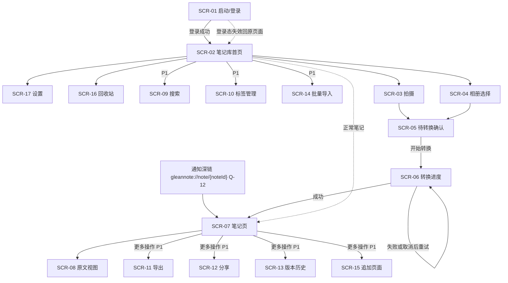

### 1.2 界面索引表

阶段列按 A §7.2 的 `(P1)` 标注；端点编号沿用 [API.md](../../Server/docs/API.md) §4 接口总览共 58 行（含 `50a`）；`SVG 文件` 列为相对链接（D-07）。

| SCR ID | 界面名 | 阶段 | 所在组 | 对应 FR | 主要端点 | SVG 文件 |
|---|---|---|---|---|---|---|
| SCR-01 | 启动 / 登录 | P0 | G1 | FR-01 | `auth:sendCode` / `auth:register` / `auth:login` / `auth:resetPassword` | [G1.svg](assets/wireframes/G1.svg) |
| SCR-02 | 笔记库首页 | P0 | G2 | FR-02 / FR-07 / FR-10 | `GET /v1/folders` / `GET /v1/notes` / `GET /v1/sync:changes` | [G2.svg](assets/wireframes/G2.svg) |
| SCR-03 | 拍摄 | P0 | G3 | FR-03 | 端上能力（CameraX / 系统照片选择器） | [G3.svg](assets/wireframes/G3.svg) |
| SCR-04 | 相册选择 | P0 | G3 | FR-03 | 系统照片选择器 | [G3.svg](assets/wireframes/G3.svg) |
| SCR-05 | 待转换确认 | P0 | G3 | FR-03 / FR-04 | `GET /v1/users/me/quota` / `POST /v1/uploads` / `:complete` / `:createFromPages` | [G3.svg](assets/wireframes/G3.svg) |
| SCR-06 | 转换进度 | P0 | G3 | FR-05 | `conversionJob` / `:cancel` / `:retry` | [G3.svg](assets/wireframes/G3.svg) |
| SCR-07 | 笔记页 | P0 | G4 | FR-06 / FR-08 | `GET /v1/notes/{noteId}` / `PATCH /v1/notes/{noteId}` | [G4.svg](assets/wireframes/G4.svg) |
| SCR-08 | 原文视图 | P0 | G4 | FR-08 | `pages` / `pages/{pageId}` | [G4.svg](assets/wireframes/G4.svg) |
| SCR-09 | 搜索 | P1 | G5 | FR-12 | `GET /v1/notes:search` | [G5.svg](assets/wireframes/G5.svg) |
| SCR-10 | 标签管理 | P1 | G5 | FR-13 | `GET /v1/tags` / `PATCH /v1/tags/{tagId}` / `DELETE /v1/tags/{tagId}` | [G5.svg](assets/wireframes/G5.svg) |
| SCR-11 | 导出 | P1 | G6 | FR-14 | `POST /v1/exports` / `GET /v1/exports/{exportId}` / SAF | [G6.svg](assets/wireframes/G6.svg) |
| SCR-12 | 分享 | P1 | G6 | FR-15 | `shareLink` / `public/shares/{token}` / `GET /s/{token}` | [G6.svg](assets/wireframes/G6.svg) |
| SCR-13 | 版本历史 | P1 | G5 | FR-16 | `versions` / `:restore` | [G5.svg](assets/wireframes/G5.svg) |
| SCR-14 | 批量导入 | P1 | G6 | FR-17 | `POST /v1/imports` / `GET /v1/imports/{importId}` | [G6.svg](assets/wireframes/G6.svg) |
| SCR-15 | 追加页面 | P1 | G6 | FR-18 | `:appendPages` / `conversionJob` | [G6.svg](assets/wireframes/G6.svg) |
| SCR-16 | 回收站 | P0 | G2 | FR-09 | `GET /v1/trash` / `:undelete` / `:expunge` | [G2.svg](assets/wireframes/G2.svg) |
| SCR-17 | 设置 | P0 | G2 | FR-01 / FR-10 / FR-11 | `GET /v1/users/me` / `GET /v1/users/me/quota` | [G2.svg](assets/wireframes/G2.svg) |

合计 17 界面，分 6 组：G1 = SCR-01；G2 = SCR-02 / 16 / 17；G3 = SCR-03 / 04 / 05 / 06；G4 = SCR-07 / 08；G5 = SCR-09 / 10 / 13；G6 = SCR-11 / 12 / 14 / 15。同组界面共引用一个组线框文件。

## 2. 全局规格

### 2.1 全局状态组件

统一组件取自 A §7.3，跨界面复用；只规定职责与承载信息，不规定视觉。

| 组件 | 触发条件 | 承载信息(字段) | 默认行为 | 出处 |
|---|---|---|---|---|
| 骨架屏 | 首次加载 / 分页加载 | 列表占位条数 | 不得展示空白页 | PRD FR-07、A §6.11 |
| 空态 | 数据为空 | 引导按钮文案 | 提供新建或清除筛选入口 | PRD FR-07 / FR-09 / FR-12 |
| 错误态 | 加载或请求失败 | `code` 对应 `userMessage` | 带「重试」，保留已有内容 | A §6.10 |
| 离线标识 | `isOffline = true` | 「离线模式」 | 顶部展示，不清空已输入内容 | PRD 5.6、A §6.11 |
| 同步状态条 | 同步中 / 已同步 / 同步失败 | `syncState` | 失败可重试，不阻塞本地编辑 | PRD FR-10、A §6.7 |
| 保存状态指示 | 编辑保存过程 | `saveState` | 已保存 / 保存中 / 未保存 / 待同步 | PRD FR-06、A §3.5 |
| 二次确认弹窗 | 见 §2.2 | 确认文案 + 计数 | 必须显式确认 | A §7.3 |
| 进度条 | 上传 / 转换 / 导入 / 导出 | 已完成数 / 总数 | 可取消场景提供取消入口 | PRD FR-04 / FR-05 |

全局状态机与时间计划图示（里程碑编号沿用统一登记表 `M0`~`M5`、`M6a`~`M6g`）：

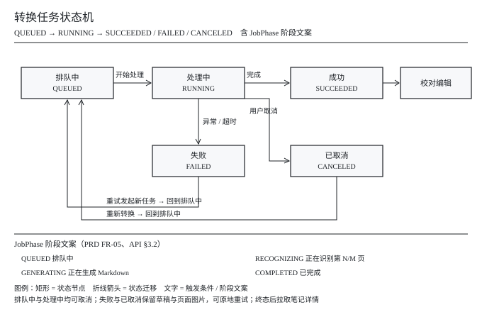 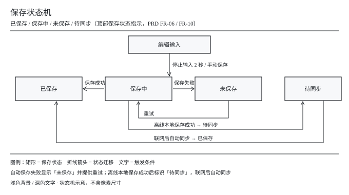 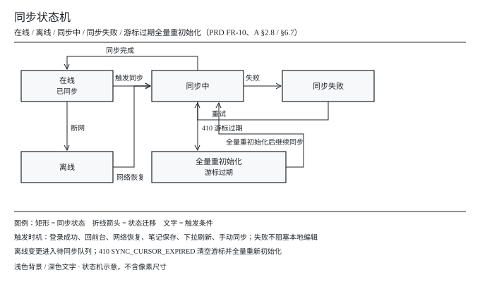 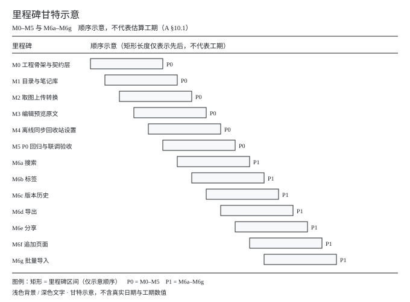

### 2.2 二次确认清单

| 操作 | 触发界面 | 确认文案要点 | 出处 |
|---|---|---|---|
| 退出登录 | SCR-17 | 有内容尚未同步，退出后将丢失 | PRD FR-01、A §7.3 |
| 注销账号 | SCR-17 | 立即生效、不可恢复 | PRD FR-01、A §7.3 |
| 删除目录 / 笔记 | SCR-02 / SCR-07 | `N 个子目录、M 篇笔记`（`folderCount` / `noteCount`） | PRD FR-02 / FR-09、A §6.8 |
| 彻底删除 | SCR-16 | 彻底删除后无法恢复 | PRD FR-09、A §7.3 |
| 开启分享（P1） | SCR-12 | 开启后任何获得链接的人都可以查看本篇内容与页面图片 | PRD FR-15、A §7.3 |
| 恢复版本（P1） | SCR-13 | 恢复将替换当前正文 | PRD FR-16、A §7.3 |
| 删除标签（P1） | SCR-10 | 提示关联的笔记数量 | PRD FR-13 |
| 清理缓存 | SCR-17 | 含未同步内容时先提示影响 | PRD FR-11、A §7.3 |

### 2.3 时间与文案口径

| 项 | 口径 | 出处 |
|---|---|---|
| 时间基准 | 全部时间按北京时间（UTC+8）展示；服务端只返回 RFC 3339 UTC | PRD 5.8、A §2.9 / §6.11 |
| 相对时间 | 1 分钟内「刚刚」；1 小时内「N 分钟前」；24 小时内「N 小时前」；本年内「M月D日」；跨年「YYYY年M月D日」 | PRD 5.8 |
| 额度重置 | 展示服务端 `resetAt`，不得用本地日期推算；北京时间次日 0 点 | PRD 5.3、A §2.9 |
| 回收站剩余天数 | 展示服务端 `remainingDays` / `purgeAt`，最少「今天到期」 | PRD 5.4 / 5.8、A §2.9 |
| 变量 | 文案变量只从 `metadata` 取，不得解析 `problem.detail` / `userMessage` 文本；如 `metadata.remaining`、`metadata.retryAfterSeconds`、`metadata.failureCode` | API §2.8 约束 1、A §1.5 / §6.10 |
| 排序展示 | 默认 `updateTime desc`，可切 `createTime desc` / `title asc`，本次会话内保持 | PRD FR-07、A §6.11 |
| 链接 | 一律系统浏览器打开，应用内不得内嵌网页 | PRD FR-08、A §7.3 |

### 2.4 状态角标图例

线框图（§3~§8）与 [assets/wireframes/](assets/wireframes/) 内 6 个组线框使用统一角标，与 §2.1 全局组件对应。

| 角标 | 含义 | 对应组件 | 典型状态 |
|---|---|---|---|
| 加载 | 首屏或进行中 | 骨架屏 / 进度条 | 加载中、上传中、排队中、进行中 |
| 空 | 无数据 | 空态 | 空库、空目录、空态、无可选图片、未选图片 |
| 错误 | 失败可重试 | 错误态 | 加载失败、密码错误、部分失败、生成失败 |
| 离线 | 断网或待同步 | 离线标识 / 同步状态条 | 离线、同步失败、离线待同步、离线仅缓存 |

## 3. G1 准入界面规格（SCR-01）

### SCR-01 启动 / 登录（G1 · P0 · FR-01 · 区域 6 / 状态 9 / 文案 5）

| 区域ID | 区域名称 | 组件/布局 | 承载数据(来源字段) | 交互与手势 | 跳转目标 | 关联状态ID |
|---|---|---|---|---|---|---|
| R1 | 邮箱 | `TextField` | `email` | 输入、格式即时校验 | — | ST-SCR01-01 / 02 / 03 / 04 |
| R2 | 密码 | `TextField`（掩码） | `password` | 输入、可见性切换 | — | ST-SCR01-01 / 07 |
| R3 | 登录 | `Button` | — | 点击提交；校验未过置灰 | SCR-02 | ST-SCR01-01 / 07 / 08 |
| R4 | 注册入口 | `TextButton` | `email` / `code` / `agreements` | 点击进入注册页，含 6 位验证码与 60 秒倒计时（PRD FR-01） | SCR-01 注册子页 | ST-SCR01-02 / 05 / 06 |
| R5 | 忘记密码 | `TextButton` | `email` / `code` | 点击进入找回密码页 | SCR-01 找回子页 | ST-SCR01-05 / 06 |
| R6 | 协议勾选 | `Checkbox` + 协议链接 | `agreements` | 勾选；链接系统浏览器打开 | 系统浏览器 | ST-SCR01-09 |

| 状态ID | 状态名 | 触发条件 | 区域可见性/文案 | 空错离线文案ID | 对应FR | 用例编号 |
|---|---|---|---|---|---|---|
| ST-SCR01-01 | 默认 | 首次启动或登录态失效进入 | R1~R6 全部可见，登录按钮可用 | — | FR-01 | C-14 |
| ST-SCR01-02 | 邮箱格式错误 | 邮箱输入不合法 | R1 下方行内提示，提交按钮不可用 | TXT-SCR01-05 | FR-01 | C-11 |
| ST-SCR01-03 | 已注册 | 注册页邮箱已存在 | R4 子页提示并提供跳转登录入口 | TXT-SCR01-01 | FR-01 | C-11 |
| ST-SCR01-04 | 未注册 | 登录页邮箱不存在 | R3 下方提示并提供跳转注册入口 | — | FR-01 | C-11 |
| ST-SCR01-05 | 验证码倒计时 | 点击发送验证码后 | R4 / R5 展示 60 秒倒计时，按钮禁用 | TXT-SCR01-04 | FR-01 | C-06 |
| ST-SCR01-06 | 验证码错误 | 验证码错误、过期或作废 | 保留邮箱、清空验证码框并提示原因 | TXT-SCR01-04 | FR-01 | C-07 |
| ST-SCR01-07 | 密码错误 | 返回 `AUTH_INVALID_CREDENTIALS` | R3 下方提示，不区分具体错误项 | TXT-SCR01-02 | FR-01 | C-06 |
| ST-SCR01-08 | 网络失败 | 请求失败或断网 | 停留当前页，不清空已输入内容 | TXT-SCR01-03 | FR-01 | C-14 |
| ST-SCR01-09 | 协议未勾选 | `agreements` 未全为 `true` | R6 提示，提交按钮不可用 | — | FR-01 | C-11 |

| 文案ID | 中文文案 | 使用场景 | 变量(仅 metadata) | 来源(PRD/API §6/A 章节) |
|---|---|---|---|---|
| TXT-SCR01-01 | 该邮箱已注册，请直接登录 | 已注册 | — | API §6.1 `AUTH_EMAIL_ALREADY_EXISTS`、PRD FR-01 |
| TXT-SCR01-02 | 邮箱或密码不正确 | 密码错误 | — | API §6.1 `AUTH_INVALID_CREDENTIALS`、PRD FR-01 |
| TXT-SCR01-03 | 网络异常，请检查网络 | 网络失败 | — | PRD FR-01、A §6.10 |
| TXT-SCR01-04 | 验证码已过期，请重新获取 | 验证码错误 / 倒计时 | `metadata.retryAfterSeconds` | API §6.1 `AUTH_CODE_EXPIRED` / `AUTH_CODE_RATE_LIMITED` |
| TXT-SCR01-05 | 输入内容有误，请检查后重试 | 邮箱格式错误 | — | API §6.2 `VALIDATION_FAILED` |

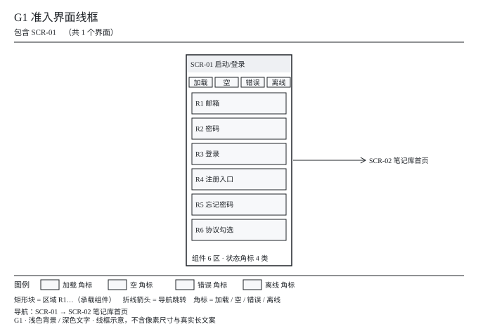
## 4. G2 库与配置界面规格（SCR-02、SCR-16、SCR-17）

### SCR-02 笔记库首页（G2 · P0 · FR-02 / FR-07 / FR-10 · 区域 9 / 状态 6 / 文案 4）

| 区域ID | 区域名称 | 组件/布局 | 承载数据(来源字段) | 交互与手势 | 跳转目标 | 关联状态ID |
|---|---|---|---|---|---|---|
| R1 | 目录树 | `NavigationDrawer` / 树列表 | `folderId` / `name` / `depth` / `childCount` | 点击切换、长按更多、拖拽移动 | SCR-02 切换目录 | ST-SCR02-01 / 02 |
| R2 | 标签入口 | 侧栏入口 | `tagIds`（P1） | 点击进入标签筛选 | SCR-10（P1） | ST-SCR02-01 |
| R3 | 搜索入口 | 顶部搜索框 | `keyword` | 点击展开 | SCR-09（P1） | ST-SCR02-01 |
| R4 | 面包屑 | 顶部路径条 | `displayPath` | 点击任一级返回 | SCR-02 | ST-SCR02-02 / 03 / 04 |
| R5 | 笔记列表 | `LazyColumn` 卡片 | `title` / `updatedAt` / `state` / `thumbnailUrl` / `nextPageToken` | 点击打开、长按更多、下拉刷新、滚动分页 | SCR-07 / SCR-06 | ST-SCR02-01 / 02 / 03 / 04 / 05 / 06 |
| R6 | 排序 | 下拉菜单 | `orderBy` | 选择排序，会话内保持 | — | ST-SCR02-01 |
| R7 | 新建入口 | `FloatingActionButton` 菜单 | — | 点击展开拍照 / 相册 / 批量导入 | SCR-03 / SCR-04 / SCR-14 | ST-SCR02-01 / 02 |
| R8 | 回收站入口 | 顶部图标 | — | 点击跳转 | SCR-16 | ST-SCR02-01 |
| R9 | 同步状态 | 顶部状态条 | `syncState` / `isOffline` | 点击重试同步 | — | ST-SCR02-05 / 06 |

| 状态ID | 状态名 | 触发条件 | 区域可见性/文案 | 空错离线文案ID | 对应FR | 用例编号 |
|---|---|---|---|---|---|---|
| ST-SCR02-01 | 空库 | 根级无任何笔记 | R5 展示空态与新建入口 | TXT-SCR02-01 | FR-07 | C-10 |
| ST-SCR02-02 | 空目录 | 当前目录无笔记 | R4 保留路径，R5 展示空态插画与引导按钮 | TXT-SCR02-01 | FR-07 | C-10 |
| ST-SCR02-03 | 加载中 | 首次加载或分页加载 | R5 展示骨架屏，不得空白 | — | FR-07 | C-11 |
| ST-SCR02-04 | 加载失败 | 列表请求失败 | R5 错误态 + 「重试」，保留 R4 目录信息 | — | FR-07 | C-11 |
| ST-SCR02-05 | 离线 | `isOffline = true` | 顶部「离线模式」标识，R5 展示本地缓存 | TXT-SCR02-03 | FR-07 / FR-10 | C-03 |
| ST-SCR02-06 | 同步失败 | 刷新或同步失败 | 顶部提示「同步失败，点击重试」，保留已有内容 | TXT-SCR02-02 | FR-07 / FR-10 | C-09 |

| 文案ID | 中文文案 | 使用场景 | 变量(仅 metadata) | 来源(PRD/API §6/A 章节) |
|---|---|---|---|---|
| TXT-SCR02-01 | 拍摄第一页纸质材料 | 空库 / 空目录引导按钮 | — | PRD FR-07、A §6.11 |
| TXT-SCR02-02 | 同步失败，点击重试 | 同步失败 / 刷新失败 | — | PRD FR-07、A §6.11 |
| TXT-SCR02-03 | 离线模式 | 离线顶部标识 | — | PRD 5.6、A §6.11 |
| TXT-SCR02-04 | 检测到编辑冲突，已保留副本 | 冲突副本生成提示 | — | PRD FR-10、A §2.5 |

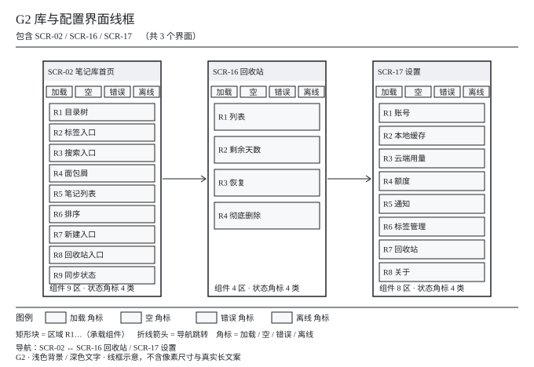
### SCR-16 回收站（G2 · P0 · FR-09 · 区域 4 / 状态 3 / 文案 3）

| 区域ID | 区域名称 | 组件/布局 | 承载数据(来源字段) | 交互与手势 | 跳转目标 | 关联状态ID |
|---|---|---|---|---|---|---|
| R1 | 列表 | `LazyColumn` 批次卡片 | `itemType` / `name` / `originalPath` / `deletedAt` | 滚动浏览 | — | ST-SCR16-01 / 03 |
| R2 | 剩余天数 | 卡片副标题 | `remainingDays` / `purgeAt` | 只读展示 | — | ST-SCR16-01 / 03 |
| R3 | 恢复 | `Button` | `itemId` | 点击恢复，二次确认 | SCR-02 | ST-SCR16-02 |
| R4 | 彻底删除 | `Button` | `itemId` | 点击后二次确认 | — | ST-SCR16-03 |

| 状态ID | 状态名 | 触发条件 | 区域可见性/文案 | 空错离线文案ID | 对应FR | 用例编号 |
|---|---|---|---|---|---|---|
| ST-SCR16-01 | 空态 | 回收站无项目 | R1 展示空态「回收站是空的」 | TXT-SCR16-01 | FR-09 | C-04 |
| ST-SCR16-02 | 恢复失败 | 恢复请求失败（网络异常） | 项目保留在回收站并提示重试 | — | FR-09 | C-04 |
| ST-SCR16-03 | 到期清理后 | 保留期 30 天到期或手动彻底删除后 | 项目从 R1 消失，刷新后展示实际结果 | TXT-SCR16-03 | FR-09 | C-04 |

| 文案ID | 中文文案 | 使用场景 | 变量(仅 metadata) | 来源(PRD/API §6/A 章节) |
|---|---|---|---|---|
| TXT-SCR16-01 | 回收站是空的 | 空态 | — | PRD FR-09 |
| TXT-SCR16-02 | 原目录已删除，已恢复到根目录 | 恢复到根级提示 | — | PRD FR-09、A §6.8 |
| TXT-SCR16-03 | 彻底删除后无法恢复 | 彻底删除二次确认 | — | PRD FR-09、A §2.2 |

### SCR-17 设置（G2 · P0 · FR-01 / FR-10 / FR-11 · 区域 8 / **状态 6（按 PRD 第 6 章拆分，见 §0.1 差异登记）** / 文案 4）

| 区域ID | 区域名称 | 组件/布局 | 承载数据(来源字段) | 交互与手势 | 跳转目标 | 关联状态ID |
|---|---|---|---|---|---|---|
| R1 | 账号 | 信息区 + 操作项 | `nickname` / 脱敏 `email` | 修改昵称、找回密码、退出登录、注销（二次确认） | SCR-01 | ST-SCR17-01 |
| R2 | 本地缓存 | 占用条 + 清理按钮 | 本地缓存占用（含页面图片） | 点击清理缓存，含未同步内容时二次确认 | — | ST-SCR17-02 / 03 |
| R3 | 云端用量 | 进度条 | `usedBytes` / `limitBytes` / `usedPercent` | 只读展示，达阈值提示 | — | ST-SCR17-04 / 05 |
| R4 | 额度 | 数值区 | `remaining` / `resetAt` | 只读展示 | — | ST-SCR17-06 |
| R5 | 通知 | 开关 | 转换完成通知开关 | 切换（默认开启） | — | ST-SCR17-01 |
| R6 | 标签管理 | 入口项 | — | 点击跳转（P1） | SCR-10 | ST-SCR17-01 |
| R7 | 回收站 | 入口项 | — | 点击跳转 | SCR-16 | ST-SCR17-01 |
| R8 | 关于 | 信息区 + 链接 | 版本号 / 用户协议 / 隐私政策 | 链接系统浏览器打开 | 系统浏览器 | ST-SCR17-01 |

| 状态ID | 状态名 | 触发条件 | 区域可见性/文案 | 空错离线文案ID | 对应FR | 用例编号 |
|---|---|---|---|---|---|---|
| ST-SCR17-01 | 默认 | 进入设置页 | R1~R8 全部可见 | — | FR-11 | C-11 |
| ST-SCR17-02 | 清理中 | 执行清理缓存 | R2 展示进度，清理按钮禁用 | — | FR-11 | C-11 |
| ST-SCR17-03 | 清理失败 | 清理缓存失败 | 保留原缓存并提示重试 | — | FR-11 | C-11 |
| ST-SCR17-04 | 云端空间即将用尽 | `usedPercent ≥ 90`（PRD 5.3.1） | R3 进度条提示 | TXT-SCR17-01 | FR-11 | C-12 |
| ST-SCR17-05 | 云端空间已满 | `usedBytes` 达上限（PRD 5.3.1） | R3 提示禁止新转换，编辑阅读不受影响 | TXT-SCR17-02 | FR-11 | C-12 |
| ST-SCR17-06 | 额度不足 | `remaining` 不足 | R4 展示剩余张数与重置时间 | TXT-SCR17-03 | FR-11 | C-12 |

| 文案ID | 中文文案 | 使用场景 | 变量(仅 metadata) | 来源(PRD/API §6/A 章节) |
|---|---|---|---|---|
| TXT-SCR17-01 | 云端空间即将用尽 | 云端空间即将用尽 | — | PRD 5.3.1、FR-11 |
| TXT-SCR17-02 | 云端空间不足，请清理后重试 | 云端空间已满 | — | API §6.2 `STORAGE_EXCEEDED` |
| TXT-SCR17-03 | 今日额度剩余 {remaining} 张，可减少图片后重试 | 额度不足 | `metadata.remaining` / `metadata.requested` / `metadata.resetAt` | API §6.2 `QUOTA_EXCEEDED` |
| TXT-SCR17-04 | 有内容尚未同步，退出后将丢失 | 退出登录二次确认 | — | PRD FR-01、A §2.4 |

## 5. G3 取图链路界面规格（SCR-03、SCR-04、SCR-05、SCR-06）

### SCR-03 拍摄（G3 · P0 · FR-03 · 区域 5 / 状态 4 / 文案 4）

| 区域ID | 区域名称 | 组件/布局 | 承载数据(来源字段) | 交互与手势 | 跳转目标 | 关联状态ID |
|---|---|---|---|---|---|---|
| R1 | 取景 | `PreviewView` 取景框 | 相机预览流 | 对焦、连续拍摄 | — | ST-SCR03-01 / 03 |
| R2 | 快门 | `Button` | 单张图片 | 点击拍摄；达上限置灰 | — | ST-SCR03-02 |
| R3 | 缩略图条 | `LazyRow` | 已拍图片本地副本 | 点击看大图、左右滑动、单张重拍或删除 | — | ST-SCR03-02 / 03 |
| R4 | 完成入口 | `Button` | 本次图片张数 | 点击进入确认页 | SCR-05 | ST-SCR03-01 |
| R5 | 相册入口 | 底部三栏左位 `Box` + 取景区顶部文字按钮 | 已选张数 / 上限 20 | 点击打开系统照片选择器（SCR-04），不依赖相机权限；达上限时提示并禁用 | SCR-04 | ST-SCR03-02 / 04 |

| 状态ID | 状态名 | 触发条件 | 区域可见性/文案 | 空错离线文案ID | 对应FR | 用例编号 |
|---|---|---|---|---|---|---|
| ST-SCR03-01 | 权限被拒 | `CAMERA` 权限被拒 | R1 替换为说明卡片 + 「去设置开启」，返回后重新检测；**R2 置灰、R5 与 R4 保持可用**（相册不依赖相机权限） | TXT-SCR03-01 | FR-03 | C-12 |
| ST-SCR03-02 | 达到 20 张上限 | 已拍张数达 20（PRD 5.2） | R2 与选择入口置灰，提示上限 | TXT-SCR03-02 | FR-03 | C-12 |
| ST-SCR03-03 | 本地存储不足 | 本机空间不足 | 提示清理空间，不进入后续流程 | TXT-SCR03-03 | FR-03 | C-12 |
| ST-SCR03-04 | 相册模式（无相机权限） | 权限被拒后从 R5 选入图片 | R3 展示缩略图条、R4 可进入确认页，R2 保持置灰 | TXT-SCR03-04 | FR-03 | C-12 |

| 文案ID | 中文文案 | 使用场景 | 变量(仅 metadata) | 来源(PRD/API §6/A 章节) |
|---|---|---|---|---|
| TXT-SCR03-01 | 去设置开启 | 相机权限被拒 | — | PRD FR-03、A §8.1 |
| TXT-SCR03-02 | 单次最多 20 张 | 达到 20 张上限 | — | PRD FR-03、5.2 |
| TXT-SCR03-03 | 清理空间 | 本地存储不足 | — | PRD FR-03 |
| TXT-SCR03-04 | 已从相册添加 {n} 张 | 相册导入完成后 | `n`（端上计数，非服务端 metadata） | PRD FR-03 |

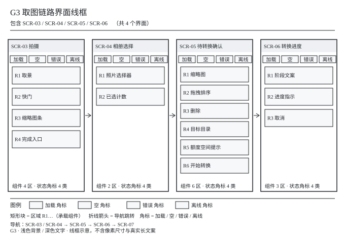
### SCR-04 相册选择（G3 · P0 · FR-03 · 区域 2 / 状态 2 / 文案 2）

| 区域ID | 区域名称 | 组件/布局 | 承载数据(来源字段) | 交互与手势 | 跳转目标 | 关联状态ID |
|---|---|---|---|---|---|---|
| R1 | 系统照片选择器 | 系统 Photo Picker | 选中图片 URI 列表 | 多选，不申请整相册权限 | SCR-05 | ST-SCR04-01 / 02 |
| R2 | 已选计数 | 顶部计数标签 | 已选张数 | 只读展示 | — | ST-SCR04-02 |

| 状态ID | 状态名 | 触发条件 | 区域可见性/文案 | 空错离线文案ID | 对应FR | 用例编号 |
|---|---|---|---|---|---|---|
| ST-SCR04-01 | 无可选图片 | 选择器无图片或访问被拒 | R1 展示空态，提示改用选择器或前往设置 | TXT-SCR04-02 | FR-03 | C-12 |
| ST-SCR04-02 | 超限提示 | 选择超过 20 张（PRD 5.2） | R2 提示并截断到上限 | TXT-SCR04-01 | FR-03 | C-12 |

| 文案ID | 中文文案 | 使用场景 | 变量(仅 metadata) | 来源(PRD/API §6/A 章节) |
|---|---|---|---|---|
| TXT-SCR04-01 | 单次最多 20 张 | 超限提示 | — | PRD FR-03、5.2 |
| TXT-SCR04-02 | 没有可选图片 | 无可选图片空态 | — | PRD FR-03、A §7.3 |

### SCR-05 待转换确认（G3 · P0 · FR-03 / FR-04 · 区域 7 / 状态 6 / 文案 4）

| 区域ID | 区域名称 | 组件/布局 | 承载数据(来源字段) | 交互与手势 | 跳转目标 | 关联状态ID |
|---|---|---|---|---|---|---|
| R1 | 缩略图 | `LazyRow` / 网格 | `uploadId` / 本地副本 | 点击查看大图、标记「无法读取」 | — | ST-SCR05-01 / 02 / 06 |
| R2 | 拖拽排序 | 可拖拽列表 | `uploadIds` 顺序即页面顺序 | 拖拽调整，结果即时可见 | — | ST-SCR05-01 |
| R3 | 删除 | 缩略图删除按钮 | `uploadId` | 单张删除 | — | ST-SCR05-01 / 02 |
| R4 | 目标目录 | 选择器 | `folderId` / `displayPath` | 点击切换（默认当前目录） | — | ST-SCR05-01 |
| R5 | 额度与空间提示 | 提示条 | `remaining` / `usedBytes` / `limitBytes` | 只读展示，提交前刷新 `quota` | — | ST-SCR05-03 / 04 |
| R6 | 开始转换 | `Button` + 上传进度区 | 本次张数 / 已完成 N / 总张数 | 点击提交；加载态禁止重复点击 | SCR-06 | ST-SCR05-01 / 02 / 03 / 04 / 05 / 06 |
| R7 | 从相册添加 | 缩略图区下方 `TextButton` | 已选张数 / 上限 20 | 点击追加选图（SCR-04），新图接在末尾；达上限时提示并禁用 | SCR-04 | ST-SCR05-01 / 02 |

| 状态ID | 状态名 | 触发条件 | 区域可见性/文案 | 空错离线文案ID | 对应FR | 用例编号 |
|---|---|---|---|---|---|---|
| ST-SCR05-01 | 默认 | 已选 1~20 张且额度空间充足 | R1~R7 全部可用 | — | FR-03 | C-12 |
| ST-SCR05-02 | 未选图片 | 本次选择为空 | R6 不可用，R7 仍可用（可先添加图片） | TXT-SCR05-05 | FR-03 | C-12 |
| ST-SCR05-03 | 额度不足 | `remaining` 小于本次张数 | R5 提示剩余张数，R6 不可用 | TXT-SCR05-01 | FR-03 / 5.3 | C-12 |
| ST-SCR05-04 | 云端空间不足 | 预计占用加 `usedBytes` 超过 `limitBytes` | R5 提示前往回收站释放空间，R6 不可用 | TXT-SCR05-02 | FR-03 / 5.3.1 | C-12 |
| ST-SCR05-05 | 上传中 | 点击开始转换后 | R6 展示「已完成 N / 总张数」与百分比 | TXT-SCR05-03 | FR-04 | C-02 |
| ST-SCR05-06 | 部分失败 | 单张上传重试 1 次仍失败 | R6 列出失败图片 + 「重传失败图片」 | TXT-SCR05-04 | FR-04 | C-02 |

| 文案ID | 中文文案 | 使用场景 | 变量(仅 metadata) | 来源(PRD/API §6/A 章节) |
|---|---|---|---|---|
| TXT-SCR05-01 | 今日额度剩余 {remaining} 张，可减少图片后重试 | 额度不足 | `metadata.remaining` / `metadata.requested` | API §6.2 `QUOTA_EXCEEDED` |
| TXT-SCR05-02 | 云端空间不足，请清理后重试 | 云端空间不足 | — | API §6.2 `STORAGE_EXCEEDED` |
| TXT-SCR05-03 | 网络已断开，恢复后自动继续 | 上传中断网 | — | PRD FR-04、A §6.3 |
| TXT-SCR05-04 | 重传失败图片 | 部分失败 | `metadata.uploadId` | PRD FR-04、A §6.10 |
| TXT-SCR05-05 | 还没有图片，可从相册添加后开始转换 | 未选图片空态 | — | PRD FR-03 |

### SCR-06 转换进度（G3 · P0 · FR-05 · 区域 3 / 状态 5 / 文案 4）

| 区域ID | 区域名称 | 组件/布局 | 承载数据(来源字段) | 交互与手势 | 跳转目标 | 关联状态ID |
|---|---|---|---|---|---|---|
| R1 | 阶段文案 | 文本区 | `JobPhase` / `processedPages` / `totalPages` / `metadata.failureCode` | 只读，按阶段刷新 | — | ST-SCR06-01 / 02 / 04 |
| R2 | 进度指示 | 不确定进度动画 / 进度条 | `processedPages` / `totalPages` | 只读 | — | ST-SCR06-01 / 02 |
| R3 | 取消 | `Button` | `noteId` | 点击取消（排队中 / 处理中可用） | — | ST-SCR06-01 / 02 / 05 |

| 状态ID | 状态名 | 触发条件 | 区域可见性/文案 | 空错离线文案ID | 对应FR | 用例编号 |
|---|---|---|---|---|---|---|
| ST-SCR06-01 | 排队中 | 任务 `QUEUED` | R1「排队中」+ R2 不确定进度动画，R3 可用 | TXT-SCR06-01 | FR-05 | C-01 |
| ST-SCR06-02 | 处理中 | 任务 `RUNNING`（`RECOGNIZING` / `GENERATING`） | R1 阶段文案随 `JobPhase` 更新，R3 可用 | TXT-SCR06-02 / 03 | FR-05 | C-01 |
| ST-SCR06-03 | 成功跳转 | 任务 `SUCCEEDED` | 拉取笔记详情后进入编辑视图 | — | FR-05 | C-01 |
| ST-SCR06-04 | 失败 | 任务 `FAILED` 或超时 | R1 展示失败原因 + 重试入口 | TXT-SCR06-04 | FR-05 | C-01 |
| ST-SCR06-05 | 已取消 | 任务 `CANCELED` | 草稿保留，列表标签「已取消」，提供重新转换 | — | FR-05 | C-01 |

| 文案ID | 中文文案 | 使用场景 | 变量(仅 metadata) | 来源(PRD/API §6/A 章节) |
|---|---|---|---|---|
| TXT-SCR06-01 | 排队中 | 排队中 | — | PRD FR-05、API §3.2 `JobPhase = QUEUED` |
| TXT-SCR06-02 | 正在识别第 N/M 页 | 处理中 `RECOGNIZING` | `metadata.processedPages` / `totalPages` | PRD FR-05、A §6.4 |
| TXT-SCR06-03 | 正在生成 Markdown | 处理中 `GENERATING` | — | PRD FR-05、A §6.4 |
| TXT-SCR06-04 | 转换失败，请重试 | 失败 | `metadata.failureCode` | API §6.3 `CONVERSION_FAILED` |

## 6. G4 笔记主态界面规格（SCR-07、SCR-08）

### SCR-07 笔记页（G4 · P0 · FR-06 / FR-08 · 区域 8 / 状态 7 / 文案 4）

| 区域ID | 区域名称 | 组件/布局 | 承载数据(来源字段) | 交互与手势 | 跳转目标 | 关联状态ID |
|---|---|---|---|---|---|---|
| R1 | 标题 | 顶部 `TextField` | `title` / `revision` | 独立编辑，留空保存后显示「未命名笔记」 | — | ST-SCR07-01 / 02 / 03 / 04 / 05 |
| R2 | 标签 | 标签 chips（P1） | `tagIds` | 点击添加 / 单个移除 | — | ST-SCR07-01 |
| R3 | 编辑/预览切换 | 顶部切换控件 | 当前视图 | 同一页内切换，不产生独立阅读页 | — | ST-SCR07-01 / 02 |
| R4 | 正文 | Markdown 编辑区 / 渲染区 | `content` / `charCount` / `revision` | 输入、轻量语法高亮、点击图片进原文视图 | SCR-08 | ST-SCR07-01 / 02 / 05 |
| R5 | 工具栏 | 底部工具栏 | 语法变换命令 | H1–H3、加粗、斜体、列表、待办、引用、代码块、分割线、撤销、重做 | — | ST-SCR07-01 |
| R6 | 保存状态 | 顶部指示 | `saveState` / `updatedAt` | 自动 / 手动保存触发，失败可重试 | — | ST-SCR07-03 / 04 / 06 |
| R7 | 原文入口 | 顶部入口 | `pageCount` | 点击进入原文视图 | SCR-08 | ST-SCR07-01 / 02 |
| R8 | 更多操作（分享/导出/版本/追加） | 菜单（P1 后四项） | `noteId` | 重命名、移动到、删除、复制 Markdown 全文；P1 分享 / 导出 / 版本 / 追加 | SCR-11 / 12 / 13 / 15 | ST-SCR07-01 / 07 |

| 状态ID | 状态名 | 触发条件 | 区域可见性/文案 | 空错离线文案ID | 对应FR | 用例编号 |
|---|---|---|---|---|---|---|
| ST-SCR07-01 | 编辑视图 | 转换完成后首次进入默认编辑 | R3 切到编辑，R4 可输入，R5 可用 | — | FR-06 | C-05 |
| ST-SCR07-02 | 预览视图 | 打开默认或手动切换预览 | R3 切到预览，R4 渲染正文，R5 隐藏 | — | FR-06 / FR-08 | C-13 |
| ST-SCR07-03 | 保存中 | 停止输入 2 秒自动保存 / 手动保存 | R6 展示「保存中」 | TXT-SCR07-01 | FR-06 | C-03 |
| ST-SCR07-04 | 未保存 | 自动保存失败 | R6 展示「未保存」并提供重试，不阻塞编辑 | TXT-SCR07-01 | FR-06 | C-03 |
| ST-SCR07-05 | 超限 | 正文达 20 万字符（PRD 5.2） | R4 输入位置提示上限，已输入内容不丢失 | TXT-SCR07-02 | FR-06 / 5.2 | C-12 |
| ST-SCR07-06 | 离线待同步 | 离线本地保存成功 | R6 标识「待同步」，入待同步队列 | TXT-SCR07-03 | FR-06 / FR-10 | C-03 / C-08 |
| ST-SCR07-07 | 笔记已删除 | 笔记在其他设备被删除 | 全页展示提示，提供返回列表与前往回收站 | TXT-SCR07-04 | FR-08 | C-14 |

| 文案ID | 中文文案 | 使用场景 | 变量(仅 metadata) | 来源(PRD/API §6/A 章节) |
|---|---|---|---|---|
| TXT-SCR07-01 | 已保存 / 保存中 / 未保存 | 保存状态指示 | — | PRD FR-06、A §3.5 |
| TXT-SCR07-02 | 正文已达上限，无法继续输入 | 超限 | — | API §6.2 `NOTE_TOO_LARGE`、PRD 5.2 |
| TXT-SCR07-03 | 待同步 | 离线待同步 | — | PRD FR-06 / FR-10、A §6.5 |
| TXT-SCR07-04 | 该笔记已被删除 | 笔记已删除 | — | PRD FR-08、A §6.6 |

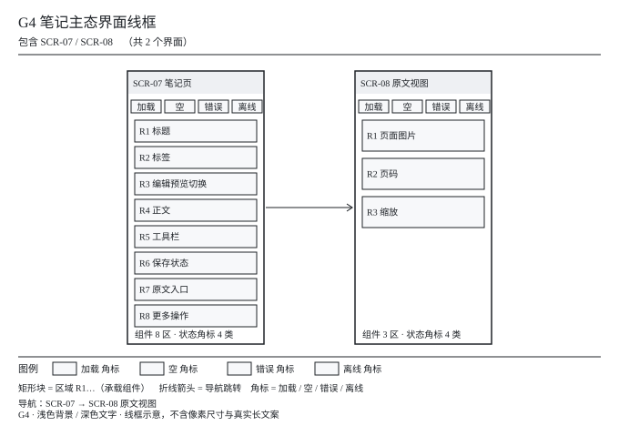
### SCR-08 原文视图（G4 · P0 · FR-08 · 区域 3 / 状态 2 / 文案 2）

| 区域ID | 区域名称 | 组件/布局 | 承载数据(来源字段) | 交互与手势 | 跳转目标 | 关联状态ID |
|---|---|---|---|---|---|---|
| R1 | 页面图片 | `HorizontalPager` 图片页 | `pageId` / `originalUrl` | 左右滑动、双击放大、点击全屏 | — | ST-SCR08-01 / 02 |
| R2 | 页码 | 页码指示 | `pageIndex` / `pageCount` | 只读展示「第 N / M 页」 | — | ST-SCR08-01 |
| R3 | 缩放 | 手势层 | 缩放比例 | 双指缩放、双击放大 | — | ST-SCR08-01 |

| 状态ID | 状态名 | 触发条件 | 区域可见性/文案 | 空错离线文案ID | 对应FR | 用例编号 |
|---|---|---|---|---|---|---|
| ST-SCR08-01 | 正常 | 页面图片可用 | R1 正常渲染，R2 / R3 可用 | — | FR-08 | C-13 |
| ST-SCR08-02 | 图片缺失 | 原图缺失或签发失败 | 该页显示「图片不可用」，其余页面正常浏览 | TXT-SCR08-01 | FR-08 | C-13 |

| 文案ID | 中文文案 | 使用场景 | 变量(仅 metadata) | 来源(PRD/API §6/A 章节) |
|---|---|---|---|---|
| TXT-SCR08-01 | 图片不可用 | 图片缺失 | — | PRD FR-08、A §6.6 |
| TXT-SCR08-02 | 重试加载 | 预览图片加载失败 | — | PRD FR-08 |

## 7. G5 检索组织界面规格（SCR-09、SCR-10、SCR-13）

### SCR-09 搜索（G5 · P1 · FR-12 · 区域 4 / 状态 4 / 文案 3）

| 区域ID | 区域名称 | 组件/布局 | 承载数据(来源字段) | 交互与手势 | 跳转目标 | 关联状态ID |
|---|---|---|---|---|---|---|
| R1 | 关键词 | 搜索输入框 | `keyword` | 输入，停止 300ms 自动搜索（PRD FR-12） | — | ST-SCR09-01 / 02 / 03 / 04 |
| R2 | 搜索历史 | 历史列表 | 最近 10 条（PRD FR-12） | 点击重搜、单条删除、一键清空 | — | ST-SCR09-01 |
| R3 | 目录与标签筛选 | 筛选面板 | `folderId` / `tagIds` | 目录单选含子目录、标签多选取交集 | — | ST-SCR09-01 / 02 |
| R4 | 结果列表 | `LazyColumn` | `title` / `snippet` / `displayPath` / `updatedAt` | 点击打开并定位首次命中位置 | SCR-07 | ST-SCR09-01 / 02 / 04 |

| 状态ID | 状态名 | 触发条件 | 区域可见性/文案 | 空错离线文案ID | 对应FR | 用例编号 |
|---|---|---|---|---|---|---|
| ST-SCR09-01 | 默认 | 进入搜索页或命中结果 | R1~R4 可见，`snippet` 剥离 `<em>` 后高亮 | — | FR-12 | P1-01 |
| ST-SCR09-02 | 无结果 | 无匹配笔记 | R4 展示「没有找到相关笔记」与清除筛选入口 | TXT-SCR09-01 | FR-12 | P1-01 |
| ST-SCR09-03 | 离线仅缓存 | `isOffline = true` | 顶部提示仅搜索已缓存内容 | TXT-SCR09-02 | FR-12 | P1-02 |
| ST-SCR09-04 | 搜索失败 | 搜索请求失败 | R4 错误态 + 「重试」，保留已输入关键词 | TXT-SCR09-03 | FR-12 | P1-02 |

| 文案ID | 中文文案 | 使用场景 | 变量(仅 metadata) | 来源(PRD/API §6/A 章节) |
|---|---|---|---|---|
| TXT-SCR09-01 | 没有找到相关笔记 | 无结果 | — | PRD FR-12 |
| TXT-SCR09-02 | 离线模式，仅搜索已缓存内容 | 离线仅缓存 | — | PRD FR-12、5.6 |
| TXT-SCR09-03 | 服务异常，请稍后重试 | 搜索失败 | — | API §6.4 `INTERNAL`、A §6.10 |

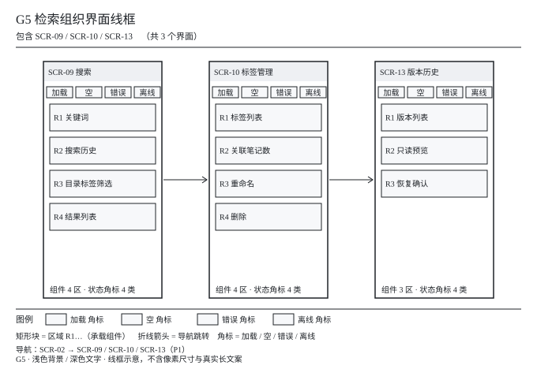
### SCR-10 标签管理（G5 · P1 · FR-13 · 区域 4 / 状态 4 / 文案 3）

| 区域ID | 区域名称 | 组件/布局 | 承载数据(来源字段) | 交互与手势 | 跳转目标 | 关联状态ID |
|---|---|---|---|---|---|---|
| R1 | 标签列表 | `LazyColumn`（按 `noteCount` 倒序） | `tagId` / `name` | 滚动浏览 | — | ST-SCR10-01 / 02 / 03 / 04 |
| R2 | 关联笔记数 | 列表副标题 | `noteCount` | 只读展示 | — | ST-SCR10-01 / 03 |
| R3 | 重命名 | 编辑弹窗 | `name` | 输入校验（1–20 字符、无首尾空格，PRD FR-13） | — | ST-SCR10-04 |
| R4 | 删除 | `Button` + 二次确认 | `tagId` / `noteCount` | 点击后二次确认 | — | ST-SCR10-03 |

| 状态ID | 状态名 | 触发条件 | 区域可见性/文案 | 空错离线文案ID | 对应FR | 用例编号 |
|---|---|---|---|---|---|---|
| ST-SCR10-01 | 空态 | 账号下无标签 | R1 展示空态 | — | FR-13 | P1-03 |
| ST-SCR10-02 | 数量超限 | 单笔记标签超过 10 个（PRD FR-13） | 禁止继续添加并提示 | TXT-SCR10-01 | FR-13 | P1-03 |
| ST-SCR10-03 | 删除确认 | 点击删除标签 | 弹窗提示关联笔记数量 | TXT-SCR10-03 | FR-13 | P1-04 |
| ST-SCR10-04 | 同步失败 | 标签变更同步失败 | 保留本地变更并提示重试 | TXT-SCR10-02 | FR-13 / FR-10 | P1-04 |

| 文案ID | 中文文案 | 使用场景 | 变量(仅 metadata) | 来源(PRD/API §6/A 章节) |
|---|---|---|---|---|
| TXT-SCR10-01 | 每篇笔记最多 10 个标签 | 数量超限 | — | PRD FR-13、API §6.2 `TAG_LIMIT_EXCEEDED` |
| TXT-SCR10-02 | 内容已更新，请刷新后重试 | 同步失败 | — | API §6.2 `REVISION_MISMATCH`、A §6.10 |
| TXT-SCR10-03 | 从全部笔记移除该标签，笔记本身不受影响 | 删除确认 | `metadata.noteCount` | PRD FR-13、A §7.3 |

### SCR-13 版本历史（G5 · P1 · FR-16 · 区域 3 / 状态 3 / 文案 3）

| 区域ID | 区域名称 | 组件/布局 | 承载数据(来源字段) | 交互与手势 | 跳转目标 | 关联状态ID |
|---|---|---|---|---|---|---|
| R1 | 版本列表 | `LazyColumn`（时间倒序） | `versionId` / 生成时间 / 来源 / 字数 | 点击进只读预览 | SCR-13 R2 | ST-SCR13-01 / 02 |
| R2 | 只读预览 | 正文渲染区 | `content` | 只读，不提供逐行对比 | — | ST-SCR13-02 |
| R3 | 恢复确认 | 二次确认弹窗 | `versionId` | 确认后替换正文并生成新版本 | SCR-07 | ST-SCR13-03 |

| 状态ID | 状态名 | 触发条件 | 区域可见性/文案 | 空错离线文案ID | 对应FR | 用例编号 |
|---|---|---|---|---|---|---|
| ST-SCR13-01 | 空态 | 笔记暂无版本 | R1 展示空态 | — | FR-16 | P1-09 |
| ST-SCR13-02 | 加载失败 | 版本列表或正文加载失败 | R1 错误态 + 「重试」；预览缺失提示该版本不可用 | TXT-SCR13-01 | FR-16 | P1-09 |
| ST-SCR13-03 | 恢复失败 | 恢复请求失败 | 保留当前正文不变，提示重试 | TXT-SCR13-02 | FR-16 | P1-10 |

| 文案ID | 中文文案 | 使用场景 | 变量(仅 metadata) | 来源(PRD/API §6/A 章节) |
|---|---|---|---|---|
| TXT-SCR13-01 | 该版本不可用 | 版本预览内容缺失 | — | PRD FR-16 |
| TXT-SCR13-02 | 服务异常，请稍后重试 | 加载失败 / 恢复失败 | — | API §6.4 `INTERNAL`、A §6.10 |
| TXT-SCR13-03 | 以该版本正文替换当前正文 | 恢复确认 | — | PRD FR-16、A §7.3 |

## 8. G6 输出扩展界面规格（SCR-11、SCR-12、SCR-14、SCR-15）

### SCR-11 导出（G6 · P1 · FR-14 · 区域 4 / 状态 4 / 文案 3）

| 区域ID | 区域名称 | 组件/布局 | 承载数据(来源字段) | 交互与手势 | 跳转目标 | 关联状态ID |
|---|---|---|---|---|---|---|
| R1 | 格式选择 | 单选项 | Markdown / PDF | 选择导出格式 | — | ST-SCR11-01 |
| R2 | 导出范围 | 选择项 | `noteId` / `folderId` | 选单篇或目录 | — | ST-SCR11-01 / 03 |
| R3 | 保存位置 | 系统文件保存器（SAF） | `downloadUrl` | 选择保存位置 | 系统文件保存器 | ST-SCR11-01 / 02 |
| R4 | 进度 | 进度条 + 取消 | 已处理篇数 / 总篇数 | 目录导出展示整体进度，支持取消 | — | ST-SCR11-01 / 02 / 04 |

| 状态ID | 状态名 | 触发条件 | 区域可见性/文案 | 空错离线文案ID | 对应FR | 用例编号 |
|---|---|---|---|---|---|---|
| ST-SCR11-01 | 进行中 | 导出任务执行中 | R4 展示「已处理 / 总篇数」，可取消 | — | FR-14 | P1-05 |
| ST-SCR11-02 | 中断失败 | 导出中断 | 提示失败原因，可重新导出 | — | FR-14 | P1-05 |
| ST-SCR11-03 | 本地空间不足 | 导出前空间校验不足 | 提示所需空间并禁止开始 | TXT-SCR11-01 | FR-14 | P1-06 |
| ST-SCR11-04 | 离线缺图 | 离线且图片未全部缓存 | 提示联网后重试或取消 | TXT-SCR11-02 | FR-14 | P1-06 |

| 文案ID | 中文文案 | 使用场景 | 变量(仅 metadata) | 来源(PRD/API §6/A 章节) |
|---|---|---|---|---|
| TXT-SCR11-01 | 导出前提示所需空间 | 本地空间不足 | — | PRD FR-14 |
| TXT-SCR11-02 | 联网后重试或取消 | 离线缺图 | — | PRD FR-14 |
| TXT-SCR11-03 | 草稿需完成转换后才能导出 | 导出范围受限 | — | PRD FR-14 |

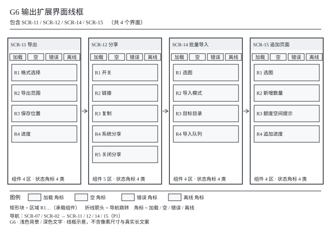
### SCR-12 分享（G6 · P1 · FR-15 · 区域 5 / 状态 4 / 文案 4）

| 区域ID | 区域名称 | 组件/布局 | 承载数据(来源字段) | 交互与手势 | 跳转目标 | 关联状态ID |
|---|---|---|---|---|---|---|
| R1 | 开关 | 分享设置面板开关 | `enabled` | 首次开启需二次确认 | — | ST-SCR12-01 / 02 / 03 |
| R2 | 链接 | 只读链接文本 | `token` / 分享链接 | 展示链接 | 系统浏览器 | ST-SCR12-02 / 04 |
| R3 | 复制 | `Button` | 链接 | 点击复制到剪贴板 | — | ST-SCR12-02 |
| R4 | 系统分享 | `Button` | 链接 | 调起系统分享面板 | 系统分享面板 | ST-SCR12-02 |
| R5 | 关闭分享 | `Button` | `enabled` | 点击立即关闭 | — | ST-SCR12-01 / 04 |

| 状态ID | 状态名 | 触发条件 | 区域可见性/文案 | 空错离线文案ID | 对应FR | 用例编号 |
|---|---|---|---|---|---|---|
| ST-SCR12-01 | 未开启 | 笔记未开启分享 | R1 关闭，R2 隐藏，笔记页无「已分享」标识 | — | FR-15 | P1-07 |
| ST-SCR12-02 | 已开启 | 开启分享成功 | R2~R4 可用，笔记页显示「已分享」 | TXT-SCR12-04 | FR-15 | P1-07 |
| ST-SCR12-03 | 生成失败 | 链接生成失败 | 提示重试，不改变原有分享状态 | — | FR-15 | P1-08 |
| ST-SCR12-04 | 链接已失效 | 关闭分享或笔记被删除后访问 | 展示失效提示页，不泄露标题与内容 | TXT-SCR12-02 | FR-15 | P1-08 |

| 文案ID | 中文文案 | 使用场景 | 变量(仅 metadata) | 来源(PRD/API §6/A 章节) |
|---|---|---|---|---|
| TXT-SCR12-01 | 开启后任何获得链接的人都可以查看本篇内容与页面图片 | 首次开启二次确认 | — | PRD FR-15、A §8.2 |
| TXT-SCR12-02 | 内容已失效 | 链接已失效 | — | API §6.4 `SHARE_LINK_INACTIVE`、PRD FR-15 |
| TXT-SCR12-03 | 请先完成转换再分享 | 草稿不可分享 | — | API §6.4 `SHARE_NOTE_NOT_READY` |
| TXT-SCR12-04 | 已分享 | 已开启标识 | — | PRD FR-15 |

### SCR-14 批量导入（G6 · P1 · FR-17 · 区域 4 / 状态 4 / 文案 3）

| 区域ID | 区域名称 | 组件/布局 | 承载数据(来源字段) | 交互与手势 | 跳转目标 | 关联状态ID |
|---|---|---|---|---|---|---|
| R1 | 选图 | 系统照片选择器 | 最多 50 张（PRD FR-17） | 一次多选，超限截断 | — | ST-SCR14-01 / 02 |
| R2 | 导入模式 | 单选项 | 逐张 / 合并 | 选择模式（默认逐张） | — | ST-SCR14-01 |
| R3 | 目标目录 | 选择器 | `folderId` | 点击切换（默认当前目录） | — | ST-SCR14-01 |
| R4 | 导入队列 | `LazyColumn` 逐篇状态 | `importId` / 逐篇状态 / 整体进度 | 取消未开始项、单篇重试 | — | ST-SCR14-01 / 02 / 03 / 04 |

| 状态ID | 状态名 | 触发条件 | 区域可见性/文案 | 空错离线文案ID | 对应FR | 用例编号 |
|---|---|---|---|---|---|---|
| ST-SCR14-01 | 默认 | 进入并完成选图 | R1~R4 可用，按可支持张数限制 | — | FR-17 | P1-11 |
| ST-SCR14-02 | 额度或空间不足 | 当日额度或云端容量不足 | 提示实际可导入张数与原因 | TXT-SCR14-01 / 02 | FR-17 | P1-11 |
| ST-SCR14-03 | 部分失败 | 单篇转换失败或图片无法读取 | 队列标记跳过 / 失败，可单独重试 | TXT-SCR14-03 | FR-17 | P1-12 |
| ST-SCR14-04 | 取消 | 用户取消未开始任务 | 已完成笔记保留，未开始项移除 | — | FR-17 | P1-12 |

| 文案ID | 中文文案 | 使用场景 | 变量(仅 metadata) | 来源(PRD/API §6/A 章节) |
|---|---|---|---|---|
| TXT-SCR14-01 | 今日额度剩余 {remaining} 张，可减少图片后重试 | 额度或空间不足 | `metadata.remaining` | API §6.2 `QUOTA_EXCEEDED` |
| TXT-SCR14-02 | 云端空间不足，请清理后重试 | 空间不足 | — | API §6.2 `STORAGE_EXCEEDED` |
| TXT-SCR14-03 | 部分图片无法读取，在队列中标记跳过 | 部分失败 | — | PRD FR-17 |

### SCR-15 追加页面（G6 · P1 · FR-18 · 区域 4 / 状态 3 / 文案 3）

| 区域ID | 区域名称 | 组件/布局 | 承载数据(来源字段) | 交互与手势 | 跳转目标 | 关联状态ID |
|---|---|---|---|---|---|---|
| R1 | 选图 | 拍摄 / 相册选择 | `uploadId` / 新增图片 | 选择并排序，单次最多 20 张（PRD 5.2） | — | ST-SCR15-01 |
| R2 | 新增数量 | 计数标签 | 新增张数 / `pageCount` | 只读展示 | — | ST-SCR15-01 |
| R3 | 额度与空间提示 | 提示条 | `remaining` / `usedBytes` | 只读，提交前刷新 `quota` | — | ST-SCR15-01 |
| R4 | 追加进度 | 进度指示 | `processedPages` / `totalPages` | 只读；失败原地重试 | — | ST-SCR15-02 / 03 |

| 状态ID | 状态名 | 触发条件 | 区域可见性/文案 | 空错离线文案ID | 对应FR | 用例编号 |
|---|---|---|---|---|---|---|
| ST-SCR15-01 | 达到 50 张上限 | 笔记累计页面图片达 50 张（PRD 5.2） | 禁止追加并提示上限 | TXT-SCR15-01 | FR-18 | P1-13 |
| ST-SCR15-02 | 部分未识别 | 新增页面未识别到文字 | 正文追加位置插入占位并提示未识别页数 | TXT-SCR15-02 | FR-18 | P1-13 |
| ST-SCR15-03 | 失败重试 | 追加任务失败 | 已有正文不变，新增图片保留，可原地重试 | TXT-SCR15-03 | FR-18 | P1-14 |

| 文案ID | 中文文案 | 使用场景 | 变量(仅 metadata) | 来源(PRD/API §6/A 章节) |
|---|---|---|---|---|
| TXT-SCR15-01 | 单篇笔记最多 50 张图片 | 达到 50 张上限 | — | API §6.2 `NOTE_PAGE_LIMIT_EXCEEDED`、PRD 5.2 |
| TXT-SCR15-02 | （第 N 页未识别到文字） | 部分未识别占位 | `metadata.processedPages` | PRD FR-05 / FR-18 |
| TXT-SCR15-03 | 转换失败，请重试 | 失败重试 | `metadata.failureCode` | API §6.3 `CONVERSION_FAILED` |

## 9. 状态清单汇总

17 界面共 75 项状态，状态名逐字取自 PRD v1.2 第 6 章；状态 ID 按 `ST-<SCRxx>-<NN>` 编号。用例编号沿用统一登记表 `C-01`~`C-14`（P0）与 `P1-01`~`P1-14`（P1），不新增编号。

| SCR ID | 界面名 | 状态数 | 状态 ID → 状态名（逐字） | 触发条件摘要 | 对应 FR | 用例编号 | 备注 |
|---|---|---|---|---|---|---|---|
| SCR-01 | 启动 / 登录 | 9 | ST-SCR01-01 默认；02 邮箱格式错误；03 已注册；04 未注册；05 验证码倒计时；06 验证码错误；07 密码错误；08 网络失败；09 协议未勾选 | 输入校验、发码、登录返回码、断网、协议勾选 | FR-01 | C-06 / 07 / 11 / 14 | — |
| SCR-02 | 笔记库首页 | 6 | ST-SCR02-01 空库；02 空目录；03 加载中；04 加载失败；05 离线；06 同步失败 | 数据为空、加载、刷新、网络状态 | FR-02 / 07 / 10 | C-03 / 08 / 09 / 10 / 11 | — |
| SCR-03 | 拍摄 | 4 | ST-SCR03-01 权限被拒；02 达到 20 张上限；03 本地存储不足；04 相册模式（无相机权限） | 权限、张数上限、本机空间、相册导入 | FR-03 | C-12 | — |
| SCR-04 | 相册选择 | 2 | ST-SCR04-01 无可选图片；02 超限提示 | 选择器为空、张数超限 | FR-03 | C-12 | — |
| SCR-05 | 待转换确认 | 6 | ST-SCR05-01 默认；02 未选图片；03 额度不足；04 云端空间不足；05 上传中；06 部分失败 | 选图、额度 / 容量校验、上传结果 | FR-03 / 04 | C-01 / 02 / 12 | — |
| SCR-06 | 转换进度 | 5 | ST-SCR06-01 排队中；02 处理中；03 成功跳转；04 失败；05 已取消 | `conversionJob` 状态迁移 | FR-05 | C-01 | — |
| SCR-07 | 笔记页 | 7 | ST-SCR07-01 编辑视图；02 预览视图；03 保存中；04 未保存；05 超限；06 离线待同步；07 笔记已删除 | 视图切换、保存、正文上限、离线、跨设备删除 | FR-06 / 08 | C-03 / 05 / 08 / 12 / 13 / 14 | — |
| SCR-08 | 原文视图 | 2 | ST-SCR08-01 正常；02 图片缺失 | 图片可用性与签发 | FR-08 | C-13 | — |
| SCR-09 | 搜索 | 4 | ST-SCR09-01 默认；02 无结果；03 离线仅缓存；04 搜索失败 | 命中、无结果、离线、请求失败 | FR-12 | P1-01 / 02 | P1 |
| SCR-10 | 标签管理 | 4 | ST-SCR10-01 空态；02 数量超限；03 删除确认；04 同步失败 | 标签数量、删除确认、同步 | FR-13 | P1-03 / 04 | P1 |
| SCR-11 | 导出 | 4 | ST-SCR11-01 进行中；02 中断失败；03 本地空间不足；04 离线缺图 | 导出进度、中断、空间、缺图 | FR-14 | P1-05 / 06 | P1 |
| SCR-12 | 分享 | 4 | ST-SCR12-01 未开启；02 已开启；03 生成失败；04 链接已失效 | 开关、链接生成、链接访问 | FR-15 | P1-07 / 08 | P1 |
| SCR-13 | 版本历史 | 3 | ST-SCR13-01 空态；02 加载失败；03 恢复失败 | 版本列表、预览、恢复 | FR-16 | P1-09 / 10 | P1 |
| SCR-14 | 批量导入 | 4 | ST-SCR14-01 默认；02 额度或空间不足；03 部分失败；04 取消 | 选图、额度 / 容量、队列、取消 | FR-17 | P1-11 / 12 | P1 |
| SCR-15 | 追加页面 | 3 | ST-SCR15-01 达到 50 张上限；02 部分未识别；03 失败重试 | 页数上限、识别结果、重试 | FR-18 | P1-13 / 14 | P1 |
| SCR-16 | 回收站 | 3 | ST-SCR16-01 空态；02 恢复失败；03 到期清理后 | 空列表、恢复、到期 | FR-09 | C-04 | — |
| SCR-17 | 设置 | 6 | ST-SCR17-01 默认；02 清理中；03 清理失败；04 云端空间即将用尽；05 云端空间已满；06 额度不足 | 清理、容量阈值、额度 | FR-01 / 10 / 11 | C-09 / 11 / 12 | **PRD 6 项；A §7.2 合并「即将用尽 / 已满」为 5 项，差异由主代理回写 A** |

注：A §7.2 与 PRD 第 6 章的状态差异仅出现在 SCR-17；本文档按 PRD 拆分，已在 §0.1 登记。其余 16 界面两处口径一致。

## 10. 未决项回写

仅列对 UI 有直接影响的 5 项（编号取自统一登记表 `Q-01`~`Q-14`，详见 A §11.3）；未决口径由产品 / 服务端给出前，客户端不得单方面假定。

| 编号 | 事项 | 对 UI 的影响 | 本文档当前口径 | 关联界面 / 文案 ID |
|---|---|---|---|---|
| Q-05 | 公式渲染 | SCR-07 预览视图 R4 的公式渲染方式；降级时 R4 展示源码文本 | 暂按源码文本降级展示，是否引入 WebView / KaTeX 待产品与性能评审 | SCR-07 R4、ST-SCR07-02 |
| Q-10 | 分享打开方式 | SCR-12 R2 链接的打开位置；是否在应用内处理 | 客户端只做复制与系统分享，链接一律系统浏览器打开，应用内不内嵌网页 | SCR-12 R2、§2.3 |
| Q-11 | 搜索 `<em>` 高亮 | SCR-09 R4 `snippet` 的渲染：不得当 HTML 直接渲染 | 剥离 `<em>` 标签后按关键词重新高亮 | SCR-09 R4、ST-SCR09-01、A §2.3 |
| Q-12 | 通知深链 `gleannote://note/{noteId}` | 转换完成通知点击后的路由入口，需登记进 §1.1 导航图 | 客户端内部深链 `gleannote://note/{noteId}`，点击直接进入 SCR-07 并定位 `noteId`；与服务端无关，按 A §11.3 记录于本文档 | §1.1、SCR-07 |
| Q-14 | 额度返还后的刷新时机 | SCR-05 / SCR-15 / SCR-17 的额度展示更新点 | 任务终态与设置页进入时刷新 `GET /v1/users/me/quota`，刷新后更新「额度不足」相关状态 | SCR-05 R5、SCR-15 R3、SCR-17 R4、TXT-SCR17-03 |

## 11. 附录 A 文案索引

全量文案按 `TXT-<SCRxx>-<NN>` 编号，中文文案逐字取自 PRD / [API.md](../../Server/docs/API.md) 第 6 章 `userMessage` / [A](CLIENT-ARCHITECTURE.md) 提示映射；变量列口径见 §2.3。

| TXT 编号段 | 界面 | 中文文案（逐条） | 出处 |
|---|---|---|---|
| TXT-SCR01-01~05 | SCR-01 启动 / 登录 | 该邮箱已注册，请直接登录；邮箱或密码不正确；网络异常，请检查网络；验证码已过期，请重新获取；输入内容有误，请检查后重试 | API §6.1 / §6.2、PRD FR-01、A §6.10 |
| TXT-SCR02-01~04 | SCR-02 笔记库首页 | 拍摄第一页纸质材料；同步失败，点击重试；离线模式；检测到编辑冲突，已保留副本 | PRD FR-07 / FR-10、A §2.5 / §6.11 |
| TXT-SCR03-01~03 | SCR-03 拍摄 | 去设置开启；单次最多 20 张；清理空间 | PRD FR-03 / 5.2、A §8.1 |
| TXT-SCR04-01~02 | SCR-04 相册选择 | 单次最多 20 张；没有可选图片 | PRD FR-03 / 5.2、A §7.3 |
| TXT-SCR05-01~04 | SCR-05 待转换确认 | 今日额度剩余 {remaining} 张，可减少图片后重试；云端空间不足，请清理后重试；网络已断开，恢复后自动继续；重传失败图片 | API §6.2、PRD FR-04、A §6.3 / §6.10 |
| TXT-SCR06-01~04 | SCR-06 转换进度 | 排队中；正在识别第 N/M 页；正在生成 Markdown；转换失败，请重试 | PRD FR-05、API §3.2 / §6.3、A §6.4 |
| TXT-SCR07-01~04 | SCR-07 笔记页 | 已保存 / 保存中 / 未保存；正文已达上限，无法继续输入；待同步；该笔记已被删除 | PRD FR-06 / FR-08、API §6.2、A §3.5 / §6.5 / §6.6 |
| TXT-SCR08-01~02 | SCR-08 原文视图 | 图片不可用；重试加载 | PRD FR-08、A §6.6 |
| TXT-SCR09-01~03 | SCR-09 搜索 | 没有找到相关笔记；离线模式，仅搜索已缓存内容；服务异常，请稍后重试 | PRD FR-12、API §6.4、A §6.10 |
| TXT-SCR10-01~03 | SCR-10 标签管理 | 每篇笔记最多 10 个标签；内容已更新，请刷新后重试；从全部笔记移除该标签，笔记本身不受影响 | PRD FR-13、API §6.2、A §6.10 / §7.3 |
| TXT-SCR11-01~03 | SCR-11 导出 | 导出前提示所需空间；联网后重试或取消；草稿需完成转换后才能导出 | PRD FR-14 |
| TXT-SCR12-01~04 | SCR-12 分享 | 开启后任何获得链接的人都可以查看本篇内容与页面图片；内容已失效；请先完成转换再分享；已分享 | PRD FR-15、API §6.4、A §8.2 |
| TXT-SCR13-01~03 | SCR-13 版本历史 | 该版本不可用；服务异常，请稍后重试；以该版本正文替换当前正文 | PRD FR-16、API §6.4、A §6.10 / §7.3 |
| TXT-SCR14-01~03 | SCR-14 批量导入 | 今日额度剩余 {remaining} 张，可减少图片后重试；云端空间不足，请清理后重试；部分图片无法读取，在队列中标记跳过 | API §6.2、PRD FR-17 |
| TXT-SCR15-01~03 | SCR-15 追加页面 | 单篇笔记最多 50 张图片；（第 N 页未识别到文字）；转换失败，请重试 | API §6.2 / §6.3、PRD FR-18 / 5.2 |
| TXT-SCR16-01~03 | SCR-16 回收站 | 回收站是空的；原目录已删除，已恢复到根目录；彻底删除后无法恢复 | PRD FR-09 / 5.4、A §6.8 / §2.2 |
| TXT-SCR17-01~04 | SCR-17 设置 | 云端空间即将用尽；云端空间不足，请清理后重试；今日额度剩余 {remaining} 张，可减少图片后重试；有内容尚未同步，退出后将丢失 | PRD 5.3.1 / FR-01 / FR-11、API §6.2、A §2.4 |

## 12. 修订记录

| 版本 | 日期 | 修订人 | 说明 |
|---|---|---|---|
| v0.1 | 2026-11-12 | 客户端 UI 设计角色 | 首版草案（与 §0.2 一致）：17 界面四件套、10 个 SVG 图示资产、全局规格、状态汇总、未决项回写与文案索引；状态版本按 PRD v1.2 第 6 章，SCR-17 差异登记待主代理回写 A |
| v0.2 | 2026-11-15 | 客户端实现 | SCR-03 增 R5 相册入口与 ST-SCR03-04；SCR-05 增 R7 从相册添加与空态文案；§9 汇总表同步 |

