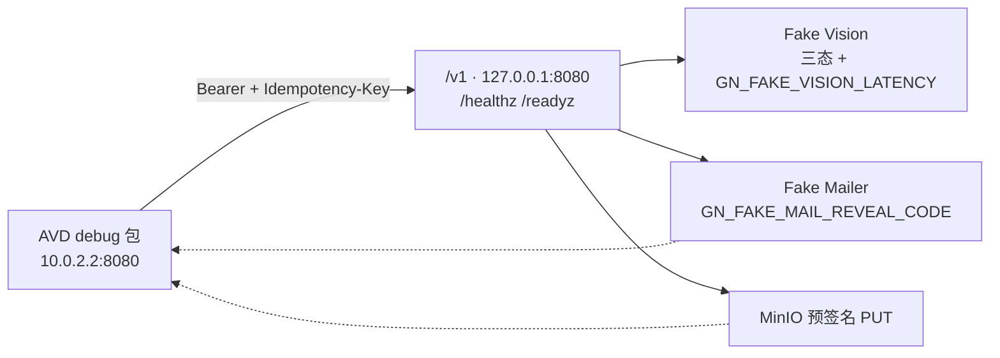
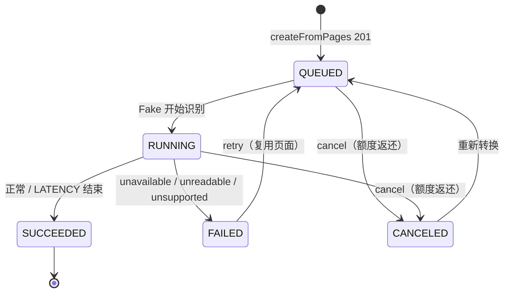

# 拾页笔记（GleanNote）Android 客户端测试计划与用例清单

> 客户端 5 号文档（GN-CLIENT-005） · 测试角色交付 · 草案（待评审）

---

## 0. 文档信息

| 项目 | 内容 |
|---|---|
| 文档名称 | 拾页笔记 Android 客户端测试计划与用例清单 |
| 文档编号 | GN-CLIENT-005 |
| 版本 | v0.1 |
| 状态 | 草案（待评审） |
| 更新日期 | 2026-11-12 |
| 适用范围 | Android 客户端 P0 必测用例、P1 增量用例、契约夹具、联调故障注入、验收记录与回归核对；不含测试用例代码实现与服务端测试实现 |
| 上级约束 | 产品行为唯一来源 [PRD v1.2](../../PRD-拾页笔记-GleanNote.md)；接口契约 [API.md v1.1](../../Server/docs/API.md) 与 [openapi.yaml 1.0.1](../../Server/docs/openapi.yaml)；客户端总纲 [A（GN-CLIENT-001）](CLIENT-ARCHITECTURE.md) v0.2；环境基线 [007（GN-CLIENT-007）](ENVIRONMENT.md) v0.1；服务端口径 [TEST-REPORT.md](../../Server/docs/TEST-REPORT.md) 与 [Server/README.md](../../Server/README.md)；文档写作 [CONVENTIONS.md v1.0](../../Server/docs/CONVENTIONS.md) 第 6 章 |
| 目标读者 | Android 客户端测试、研发、产品、WBS / 开发计划角色、服务端联调接口人、架构评审人 |

### 0.1 定位与边界

本文是 [A](CLIENT-ARCHITECTURE.md) §9「测试策略与联调」的**可执行展开**：把 §9.2 定稿的 `C-01`~`C-14` 逐条写成可运行用例，并按 §9.1 的分层补齐夹具、环境与验收记录。本文**不得**改动 `C-01`~`C-14` 的编号与标题；**不得**修改 PRD 已定的产品行为与限值；凡与契约不一致的判断以 [API.md](../../Server/docs/API.md) / [PRD v1.2](../../PRD-拾页笔记-GleanNote.md) 为准并登记为待确认（[A](CLIENT-ARCHITECTURE.md) §11.3 的 `Q-01`~`Q-14`）。

本轮为文档交付，本地**零源码**（[A](CLIENT-ARCHITECTURE.md) §0），故所有用例均为「待执行」状态，结果与通过判据分离；本文**不得**把任何用例写成已通过。编号登记表沿用全团统一口径：001 主文档 / [002 接口](GN-CLIENT-002.md) / [003 数据库](GN-CLIENT-003.md) / [004 界面](GN-CLIENT-004.md) / **005 本文档** / GN-CLIENT-006 兼容发布（本次不补） / [007 环境](ENVIRONMENT.md) / [008 开发计划](DEVELOPMENT-PLAN.md)。里程碑 `M0`~`M5` 与 P1 七批 `M6a`~`M6g`、任务 ID 格式 `T-<M>-<FRxx|CR|INF>-<NN>` 均以 [A](CLIENT-ARCHITECTURE.md) §10.1 与全团登记表为准，**不得自造**。

### 0.2 修订记录

| 版本 | 日期 | 修订人 | 说明 |
|---|---|---|---|
| v0.1 | 2026-11-12 | 客户端测试组 | 首版草案：展开 [A](CLIENT-ARCHITECTURE.md) §9.2 的 `C-01`~`C-14`；自定义 `P1-01`~`P1-14` 覆盖 FR-12~FR-18 七批；建立夹具、故障注入、17 项验收记录与回归核对 |

---

## 1. 测试分层与环境

### 1.1 分层测试

依据 [A](CLIENT-ARCHITECTURE.md) §9.1，六层范围、工具与用例承接如下；契约夹具**必须**取自 [openapi.yaml](../../Server/docs/openapi.yaml) 与 [API.md](../../Server/docs/API.md) 示例，**不得**手写「看起来像」的响应（[A](CLIENT-ARCHITECTURE.md) §9.1）。

| 层次 | 范围 | 工具 `[建议]` | 承接用例 | 依据 |
|---|---|---|---|---|
| 单元测试 | ViewModel / UseCase、`ErrorMapper`、时间格式化、限额与命名校验、压缩参数 | JUnit、Turbine、Truth | `C-10`、`C-12`、§5 限值边界 | [A](CLIENT-ARCHITECTURE.md) §9.1；CONVENTIONS T-01 |
| 契约测试 | Problem 解析、分页终止、401 刷新单飞、幂等键复用、未知字段 / 枚举容忍、`orderBy` 白名单 | MockWebServer + 固定 JSON 夹具 | `C-06`、`C-10`、`C-11`；§3 全表 | [A](CLIENT-ARCHITECTURE.md) §9.1、§9.2；[API.md](../../Server/docs/API.md) §7 |
| 数据层测试 | Room DAO、迁移、待同步队列顺序、游标推进、草稿恢复 | Room Migration Test、内存数据库 | `C-03`、`C-05`、`C-09` | [A](CLIENT-ARCHITECTURE.md) §9.1；CONVENTIONS T-02 精神 |
| UI 测试 | [A](CLIENT-ARCHITECTURE.md) §7.2 每界面状态覆盖、二次确认、导航回原页面 | Compose Test | `C-04`、`C-14`；§5 各界面状态 | [A](CLIENT-ARCHITECTURE.md) §9.1；[PRD v1.2](../../PRD-拾页笔记-GleanNote.md) 第 6 章 |
| 端到端 | 真机 + 本地服务端，跑 P0 闭环与恢复路径 | 手动 + 自动化冒烟 | §6 全部 17 项 | [A](CLIENT-ARCHITECTURE.md) §9.1、§9.4 |
| 安全与兼容 | 日志脱敏、退出登录清理、未知错误码不崩溃、不同 Android 版本取图 | 静态检查 + 设备矩阵 | `C-07`、`C-11`、`C-14` | [A](CLIENT-ARCHITECTURE.md) §9.1；[PRD v1.2](../../PRD-拾页笔记-GleanNote.md) 5.7 |

CONVENTIONS T-03「必测三件套」的越权、冲突、额度边界用例**必须**落到 `C-08`（冲突）、`C-12`（额度 / 限值边界）与跨账号 404（[API.md](../../Server/docs/API.md) §2.8 约束 4）用例中；各层引用的用例编号**应当**与 §8 索引保持一致，不得重复登记。

### 1.2 本机工具链与 AVD

依据 [007](ENVIRONMENT.md) §1、§3、§9 的 2026-11-11 实测值；联调前**必须**先按 [007](ENVIRONMENT.md) §8 跑通构建验证序列。

| 项 | 基线值 | 出处 |
|---|---|---|
| JDK | Oracle 21.0.10，`D:/DevelopmentTools/Java`；由 `gradle.properties` 的 `org.gradle.java.home` 覆盖失效的系统 `JAVA_HOME` | [007](ENVIRONMENT.md) §1、§2 |
| Gradle / AGP | 8.7 / 8.4.2 | [007](ENVIRONMENT.md) §1 |
| Kotlin / Compose Compiler | 1.9.24 / 1.5.14（**不得单独升级其一**） | [007](ENVIRONMENT.md) §1.1、§5 |
| `compileSdk` / `targetSdk` / `minSdk` | 34 / 34 / 26 `[建议]`；本机仅装 SDK Platform 34 与 Build Tools 34.0.0 | [007](ENVIRONMENT.md) §1、§5 |
| 构建方式 | 命令行 `gradlew`；本机未检测到 Android Studio | [007](ENVIRONMENT.md) §1、§8 |
| 依赖仓库 | 必须保留阿里云 google / public / gradle-plugin 镜像 | [007](ENVIRONMENT.md) §4、§9 |
| 首次构建 | Kotlin / Compose 依赖未缓存，**必须联网**下载 | [007](ENVIRONMENT.md) §1、§9 |
| AVD | `hw2avd`，Pixel 5 / API 34 / x86_64 / RAM 1536M | [007](ENVIRONMENT.md) §1、§3 |
| 常用命令 | `gradlew --version`、`sdkmanager --list_installed`、`adb devices`、`emulator -avd hw2avd` | [007](ENVIRONMENT.md) §10 |
| 排障 | `JAVA_HOME` 失效、明文未放开、AVD 符号链接、OOM 提升 `-Xmx2048m` | [007](ENVIRONMENT.md) §11 |

### 1.3 联调环境

按 [Server/README.md](../../Server/README.md) 快速开始启动，客户端 `debug` 包通过 `network_security_config` 放开明文，`release` 包**仅** HTTPS（[API.md](../../Server/docs/API.md) §2.1、[A](CLIENT-ARCHITECTURE.md) §4.3）。

| 项 | 口径 | 出处 |
|---|---|---|
| 启动 | `cp .env.example .env` → `docker compose up -d --build` | [Server/README.md](../../Server/README.md) 快速开始 |
| 服务地址 | 宿主 `http://127.0.0.1:8080`；模拟器内 `http://10.0.2.2:8080` | [A](CLIENT-ARCHITECTURE.md) §9.3；[007](ENVIRONMENT.md) §3 |
| 探针 | `/healthz` 存活、`/readyz` 就绪（`vision` / `mailer` / `objectStore`），仅回环开放 | [API.md](../../Server/docs/API.md) §5.12 |
| 视觉适配器 | `GN_VISION_PROVIDER=fake`；`GN_FAKE_VISION_LATENCY` 模拟「处理中」 | [A](CLIENT-ARCHITECTURE.md) §9.3、§10.2 |
| 视觉失败注入 | `GN_FAKE_VISION_FAILURE` = `unavailable` \| `unreadable` \| `unsupported` | [A](CLIENT-ARCHITECTURE.md) §9.3 |
| 邮件适配器 | `GN_MAILER_PROVIDER=fake`、`GN_FAKE_MAIL_REVEAL_CODE=true`，从 dev 日志读取明文验证码 | [A](CLIENT-ARCHITECTURE.md) §9.3；[TEST-REPORT.md](../../Server/docs/TEST-REPORT.md) §5 |
| 分享前缀 | `GN_PUBLIC_BASE_URL` 决定 `{base}/s/{token}`，**必须**设为设备可达地址 | [A](CLIENT-ARCHITECTURE.md) §9.3 |
| 验证码 | 6 位数字、10 分钟有效、同邮箱 60 秒一次、连续错 5 次作废 | [PRD v1.2](../../PRD-拾页笔记-GleanNote.md) FR-01；[A](CLIENT-ARCHITECTURE.md) §6.1 |
| 契约一致性 | DTO 与错误码以 [openapi.yaml](../../Server/docs/openapi.yaml) / [API.md](../../Server/docs/API.md) 为准，字段改动**必须**同步夹具 | [API.md](../../Server/docs/API.md) §7.5 |

### 1.4 服务端遗留对测试的影响

依据 [TEST-REPORT.md](../../Server/docs/TEST-REPORT.md) §5（2026-11-01 报告）：以下四项**均未在修复后代码上重跑**，相关用例必须标记「**待真实环境验证**」，**不得**写成已通过。

| 遗留项 | 对客户端测试的影响 | 本文处置 |
|---|---|---|
| 真实依赖 HTTP E2E 与性能压测未重跑；历史基线（132 例 E2E）产生于修复前代码，认证 / 限流 / 事务边界 / 任务状态机均已变更，旧数据不再适用 | 旧 E2E / 压测基线**不得**沿用；读 p95 ≤ 300ms、写 p95 ≤ 500ms、100 RPS 需在合并前重新采样 | §7 全部标「待真实环境验证」 |
| 真实 DeepSeek 识图仅有历史基线（2 页 24s、追加 1 页 2s、并发 6/6），本次未消耗外部调用额度 | 转换正确性由 Fake 提供者 + 用例覆盖，真实识别效果另行验收 | `C-01`、`C-02`、§4 标「待真实环境验证」 |
| 真实邮件供应商未接入，仅 `fake` 适配器 | 验证码**只能**从 dev 日志读取，不做真实收件 | §1.3、§4 |
| MinIO 适配器无独立单测，由 E2E 覆盖 | 图片直传三步协议（[API.md](../../Server/docs/API.md) §2.9）需重点验证 | `C-02`、`C-13`、§4 |

---

## 2. P0 必测用例 C-01~C-14

编号与标题**逐字沿用** [A](CLIENT-ARCHITECTURE.md) §9.2，**不得改动**；每条按固定 11 字段展开为可执行用例。所有用例关联任务 ID 采用 `T-<M>-<FRxx|CR|INF>-<NN>`。除特别标注外，环境均为 §1.3 的 Fake 联调栈 + `debug` 包。

#### C-01 转换失败后原地重试
- **用例编号** `C-01`；**标题** 转换失败后原地重试；**对应 FR** FR-05；**关联任务 / 模块** `T-M2-FR05-01`（`feature:conversion`、`core:sync`）；**前置条件** 已登录且当日额度充足（[PRD v1.2](../../PRD-拾页笔记-GleanNote.md) 5.3），存在一篇由 3 张页面图片生成的 `DRAFT` 草稿（[API.md](../../Server/docs/API.md) §5.3.4 的 1–20 项）；**数据准备** 注入 `GN_FAKE_VISION_FAILURE=unavailable`（§1.3）令首次任务 `FAILED`；**环境要求** Fake 视觉 + 探针 `/readyz` 全 `ok`。
- **操作步骤** ① 提交转换并等待失败结果页；② 记录草稿 `noteId` 与页面 `index`；③ 点击「重试」；④ 抓取 `POST /v1/notes/{noteId}/conversionJob:retry` 请求（[API.md](../../Server/docs/API.md) §5.5.3）。
- **期望结果** 不新建笔记、不重新选图，复用已上传页面；额度按提交张数重新扣减、再次失败后自动返还（[PRD v1.2](../../PRD-拾页笔记-GleanNote.md) 5.3）；响应 `202` 返回新任务且 `kind=CREATE`；**待真实环境验证**（§1.4）。**关联风险** R-C12（真实 AI 与 Fake 行为差异，[A](CLIENT-ARCHITECTURE.md) §11.1）；**依据章节** [PRD v1.2](../../PRD-拾页笔记-GleanNote.md) 2.2 / FR-05、[A](CLIENT-ARCHITECTURE.md) §9.2 / §6.4、[API.md](../../Server/docs/API.md) §5.5.3 / §6.3。

#### C-02 上传中断仅重传失败图片
- **用例编号** `C-02`；**标题** 上传中断仅重传失败图片；**对应 FR** FR-04；**关联任务 / 模块** `T-M2-FR04-01`（`core:sync`、`core:media`）；**前置条件** 已选 5 张图片（[PRD v1.2](../../PRD-拾页笔记-GleanNote.md) 5.2 单次 20 张内），确认页额度与空间充足；**数据准备** 用 MockWebServer 令第 3 张 `:complete` 返回 `409 UPLOAD_HASH_MISMATCH`（[API.md](../../Server/docs/API.md) §5.4.2），并在直传中切飞行模式；**环境要求** `upload_sessions` 落库可查（[A](CLIENT-ARCHITECTURE.md) §6.3）。
- **操作步骤** ① 开始转换至第 3 张失败；② 观察失败列表仅含第 3 张；③ 恢复网络；④ 点击「重传失败图片」；⑤ 上传阶段取消另跑一次。
- **期望结果** 已成功项不重复 `PUT`；断网恢复后自动续传（[PRD v1.2](../../PRD-拾页笔记-GleanNote.md) FR-04 `[Assumption]`）；取消上传不创建笔记、丢弃本次选择；全部 `READY` 才提交 `createFromPages`（[API.md](../../Server/docs/API.md) §2.9）；**待真实环境验证**（§1.4 MinIO 适配器）。**关联风险** R-C02（大图内存峰值）、R-C15（AVD 1536M 内存，[A](CLIENT-ARCHITECTURE.md) §11.1）；**依据章节** [PRD v1.2](../../PRD-拾页笔记-GleanNote.md) 2.2 / FR-04、[A](CLIENT-ARCHITECTURE.md) §9.2 / §6.3、[API.md](../../Server/docs/API.md) §2.9 / §5.4.2。

#### C-03 断网阅读与编辑，联网自动同步
- **用例编号** `C-03`；**标题** 断网阅读与编辑，联网自动同步；**对应 FR** FR-10；**关联任务 / 模块** `T-M4-FR10-01`（`core:sync`、`core:database`）；**前置条件** 已缓存 2 篇 `NORMAL` 笔记与目录树、登录态有效；**数据准备** 新建 1 个目录 + 1 篇空白笔记 + 编辑 1 篇正文，均离线产生并落 `pending_operations`（[A](CLIENT-ARCHITECTURE.md) §5.4）；**环境要求** `NetworkMonitor` 可模拟断网 / 恢复。
- **操作步骤** ① 断网阅读与编辑并观察顶部「待同步」；② 联网；③ 抓取按 `seq` 串行重放的写接口与 `Idempotency-Key`；④ 观察 `sync:changes` 回填（[API.md](../../Server/docs/API.md) §5.10 规则 5）。
- **期望结果** 本地保存成功并标「待同步」；联网后用户无需手动操作、按发生顺序重放；成功后回填服务端 ID / `revision` / 时间并删除队列项；同步失败不清空本地内容（[PRD v1.2](../../PRD-拾页笔记-GleanNote.md) FR-10）。**关联风险** R-C05（队列重放顺序与幂等键丢失）、R-C06（自动保存与 `revision` 竞争）；**依据章节** [PRD v1.2](../../PRD-拾页笔记-GleanNote.md) 2.2 / FR-10 / 5.6、[A](CLIENT-ARCHITECTURE.md) §9.2 / §6.7、[API.md](../../Server/docs/API.md) §5.10。

#### C-04 误删目录或笔记后恢复
- **用例编号** `C-04`；**标题** 误删目录或笔记后恢复；**对应 FR** FR-09；**关联任务 / 模块** `T-M4-FR09-01`（`feature:trash`、`feature:library`）；**前置条件** 存在 3 层目录树，内含子目录与笔记（[PRD v1.2](../../PRD-拾页笔记-GleanNote.md) 5.2 的 5 层内）；**数据准备** 删除中间目录记录 `folderCount` / `noteCount`（[API.md](../../Server/docs/API.md) §5.2.7），另造「原目录已彻底删除」场景；**环境要求** 回收站保留期 30 天（[PRD v1.2](../../PRD-拾页笔记-GleanNote.md) 5.4）。
- **操作步骤** ① 二次确认删除目录；② 进回收站核对批次聚合记录；③ 调用 `:undelete` 恢复；④ 核对子树层级、顺序与同名 ` (2)`；⑤ 对「原目录已删」场景再恢复一次。
- **期望结果** 整棵子树层级与顺序还原；原目录已彻底删除时恢复到根级并提示「原目录已删除，已恢复到根目录」（[PRD v1.2](../../PRD-拾页笔记-GleanNote.md) FR-09）；`restoredToRoot` 以响应体字段为准（[API.md](../../Server/docs/API.md) §5.2.8）。**关联风险** R-C10（回原页面遇资源已删）；**依据章节** [PRD v1.2](../../PRD-拾页笔记-GleanNote.md) 2.2 / FR-09 / 5.4、[A](CLIENT-ARCHITECTURE.md) §9.2 / §6.8、[API.md](../../Server/docs/API.md) §5.3.9 / §5.6。

#### C-05 应用被系统回收后恢复编辑
- **用例编号** `C-05`；**标题** 应用被系统回收后恢复编辑；**对应 FR** FR-06；**关联任务 / 模块** `T-M3-FR06-01`（`feature:editor`、`core:database`）；**前置条件** 打开一篇 `NORMAL` 笔记并输入未提交正文；**数据准备** 触发停止输入 2 秒自动保存（[PRD v1.2](../../PRD-拾页笔记-GleanNote.md) FR-06）与更短防抖的 `editor_drafts` 落库（[A](CLIENT-ARCHITECTURE.md) §5.5）；**环境要求** 可 `adb shell am kill` 模拟进程回收。
- **操作步骤** ① 输入后不手动保存；② 回收进程；③ 重新进入该笔记；④ 核对正文与 `baseRevision`；⑤ 保存成功后重启核对草稿已清理。
- **期望结果** 重新进入恢复到最后一次本地保存内容并提示「已恢复未同步的编辑内容」（[PRD v1.2](../../PRD-拾页笔记-GleanNote.md) 2.2）；已输入内容不丢失；保存成功或用户放弃后清理草稿（[A](CLIENT-ARCHITECTURE.md) §5.5）。**关联风险** R-C05、R-C06；**依据章节** [PRD v1.2](../../PRD-拾页笔记-GleanNote.md) 2.2 / FR-06 / 5.6、[A](CLIENT-ARCHITECTURE.md) §9.2 / §5.5 / §6.5。

#### C-06 多请求同时 401
- **用例编号** `C-06`；**标题** 多请求同时 401；**对应 FR** FR-01；**关联任务 / 模块** `T-M0-CR-01`（`core:network` 的 `AuthInterceptor`）；**前置条件** Access Token 已过期（有效期 15 分钟，[API.md](../../Server/docs/API.md) §2.2），同时发起 ≥3 个需鉴权请求；**数据准备** MockWebServer 对 3 个请求返回 `401 AUTH_TOKEN_EXPIRED`，对 `POST /v1/auth:refresh` 返回 `200` 新令牌（[API.md](../../Server/docs/API.md) §5.1.4）；**环境要求** 契约层测试，无需真机。
- **操作步骤** ① 并发 3 个请求；② 统计 `:refresh` 调用次数；③ 核对 3 个原请求是否用新令牌重放成功。
- **期望结果** 只发起**一次** `auth:refresh`，其余请求等待并成功重放（[A](CLIENT-ARCHITECTURE.md) §2.4「并发单飞」）；Refresh Token 每次使用即轮换，新值必须与持久化成功绑定（[API.md](../../Server/docs/API.md) §2.2）。**关联风险** R-C05（令牌持久化丢失）；**依据章节** [A](CLIENT-ARCHITECTURE.md) §9.2 / §2.4 / §6.1、[API.md](../../Server/docs/API.md) §2.2 / §5.1.4 / §6.1。

#### C-07 Refresh Token 复用 / 吊销
- **用例编号** `C-07`；**标题** Refresh Token 复用 / 吊销；**对应 FR** FR-01；**关联任务 / 模块** `T-M0-CR-02`（`TokenManager`、DataStore）；**前置条件** 已登录，构造旧 Refresh Token 复用场景；**数据准备** MockWebServer 返回 `401 AUTH_REFRESH_REUSED`（[API.md](../../Server/docs/API.md) §5.1.4 / §6.1）；**环境要求** 本地 Room + 图片文件 + 偏好均可查（[PRD v1.2](../../PRD-拾页笔记-GleanNote.md) 5.7）。
- **操作步骤** ① 触发复用检测；② 观察是否自动重试；③ 检查本地令牌、笔记缓存、图片文件；④ 核对登录页是否残留上一账号数据。
- **期望结果** 立即清空本地登录态并跳登录页，**不自动重试、不残留本地数据**（[A](CLIENT-ARCHITECTURE.md) §2.4）；退出 / 注销同样清除该账号全部本地数据。**关联风险** R-C10、`Q-08`（`X-Device-Id` 生成与重置，[A](CLIENT-ARCHITECTURE.md) §11.3）；**依据章节** [A](CLIENT-ARCHITECTURE.md) §9.2 / §2.4 / §8.2、[API.md](../../Server/docs/API.md) §5.1.4 / §6.1。

#### C-08 两设备离线编辑同一笔记
- **用例编号** `C-08`；**标题** 两设备离线编辑同一笔记；**对应 FR** FR-10；**关联任务 / 模块** `T-M4-CR-01`（`core:sync`、冲突副本处理）；**前置条件** 两台设备（或双实例）登录同账号并缓存同一笔记 `revision=8`；**数据准备** 两端分别离线编辑不同段落，联网后先后提交 `PATCH` 携带旧 `revision`（[API.md](../../Server/docs/API.md) §2.7）；**环境要求** 本地服务端真实 PostgreSQL / Redis（[TEST-REPORT.md](../../Server/docs/TEST-REPORT.md) §3 的 15/15 集成口径）。
- **操作步骤** ① A 端先提交；② B 端后提交；③ 观察响应 `200` + `conflictCopyId`（**不返回 412**）；④ 按 ID 拉取副本并核对列表顶部提示。
- **期望结果** 后提交覆盖、先提交内容另存为冲突副本，列表顶部提示「检测到编辑冲突，已保留副本」，内容无静默丢失（[PRD v1.2](../../PRD-拾页笔记-GleanNote.md) 5.5）；副本标题由服务端生成，客户端**不得**自行拼接（[A](CLIENT-ARCHITECTURE.md) §2.5、`Q-09`）。**关联风险** R-C06、R-C05；**依据章节** [PRD v1.2](../../PRD-拾页笔记-GleanNote.md) 5.5 / FR-10、[A](CLIENT-ARCHITECTURE.md) §9.2 / §2.5 / §2.7、[API.md](../../Server/docs/API.md) §2.7 / §5.3.6。

#### C-09 增量同步游标
- **用例编号** `C-09`；**标题** 增量同步游标；**对应 FR** FR-10；**关联任务 / 模块** `T-M4-FR10-02`（`sync_state`、墓碑处理）；**前置条件** 本地 `cursor` 有效，服务端有多页变更；**数据准备** 夹具含 `op=UPDATE`（`payload`）、`op=DELETE`（`payload=null`）、`hasMore=true` 连续页、`410 SYNC_CURSOR_EXPIRED`（[API.md](../../Server/docs/API.md) §5.10）；**环境要求** 变更日志保留 90 天（[API.md](../../Server/docs/API.md) §5.10 规则 4）。
- **操作步骤** ① `since=0` 全量初始化；② 逐条落库后推进游标；③ `hasMore=true` 立即拉下一页且 `pageSize` 不变；④ 构造 `410` 观察全量重初始化。
- **期望结果** 先落库再推进游标、`nextCursor` 严格单调；墓碑清本地缓存而非报错；`410` 清空游标并全量重新初始化、提示「数据已更新，请重新同步」（[A](CLIENT-ARCHITECTURE.md) §2.8）。**关联风险** R-C05；**依据章节** [A](CLIENT-ARCHITECTURE.md) §9.2 / §2.8 / §6.7、[API.md](../../Server/docs/API.md) §5.10 / §6.4。

#### C-10 分页与排序
- **用例编号** `C-10`；**标题** 分页与排序；**对应 FR** FR-07；**关联任务 / 模块** `T-M1-FR07-01`（`feature:library`）；**前置条件** 目录下笔记数超过单页 20 条（[PRD v1.2](../../PRD-拾页笔记-GleanNote.md) FR-07 `[Assumption]`、[API.md](../../Server/docs/API.md) §2.4）；**数据准备** 夹具故意给偏大的 `totalSize` 与 `nextPageToken=""` 的末页，覆盖 `orderBy` 白名单外取值（[API.md](../../Server/docs/API.md) §2.5）；**环境要求** 契约层 + UI 层。
- **操作步骤** ① 滚动到底自动加载；② 切换 3 种白名单排序；③ 发送非法 `orderBy`；④ 观察是否用 `totalSize` 跳页。
- **期望结果** `nextPageToken` 为空即停止翻页（唯一依据）；**不依赖 `totalSize`** 计算页数或跳页（[API.md](../../Server/docs/API.md) §2.4）；非法 `orderBy` 由端上白名单拦截，服务端返回 `400 VALIDATION_FAILED`；每页 20、上限 100（[API.md](../../Server/docs/API.md) §2.4）。**关联风险** R-C01（长列表首屏）；**依据章节** [A](CLIENT-ARCHITECTURE.md) §9.2 / §6.11、[API.md](../../Server/docs/API.md) §2.4 / §2.5 / §7.4。

#### C-11 未知枚举 / 未知字段 / 未知错误码
- **用例编号** `C-11`；**标题** 未知枚举 / 未知字段 / 未知错误码；**对应 FR** FR-01（错误映射）；**关联任务 / 模块** `T-M5-INF-01`（`ErrorMapper`、序列化配置）；**前置条件** 序列化必须关闭「未知键报错」（[A](CLIENT-ARCHITECTURE.md) §4.1）；**数据准备** 夹具注入未知 `NoteState` 值、未知响应字段、`metadata` 新增键、未知 `code`（`retryable=true` / `false` 各一）；**环境要求** 契约层 + 安全兼容层。
- **操作步骤** ① 解析含未知字段的 `NoteDetail`；② 解析未知枚举；③ 分别触发可重试 / 不可重试的未知 `code`；④ 观察 UI 状态。
- **期望结果** 界面不崩溃、不空白页，落到安全默认分支与通用提示；未知 `code` 依据 `retryable` 决定是否给重试入口（[API.md](../../Server/docs/API.md) §2.8 约束 1、§7.4）；**不得**解析 `detail` / `userMessage` 取变量。**关联风险** R-C09（渲染库能力）、`Q-11`（`<em>` 剥离）；**依据章节** [A](CLIENT-ARCHITECTURE.md) §9.2 / §2.10 / §6.10、`C-11`、[API.md](../../Server/docs/API.md) §2.8 / §7.4。

#### C-12 边界限值
- **用例编号** `C-12`；**标题** 边界限值；**对应 FR** FR-03 / FR-04 / FR-06；**关联任务 / 模块** `T-M2-INF-01`（`core:common`、`core:media`）；**前置条件** 端上校验只为即时反馈，服务端为最终裁决（[A](CLIENT-ARCHITECTURE.md) §8.3）；**数据准备** 逐项构造临界值：20 张（[PRD v1.2](../../PRD-拾页笔记-GleanNote.md) 5.2）、50 张 / 页（PRD 5.2）、10MB（PRD 5.2）、20 万字符（PRD 5.2）、5 层（PRD 5.2）、10 个标签（[PRD v1.2](../../PRD-拾页笔记-GleanNote.md) FR-13）、200MB（PRD 5.3.1）、50 张日额度（PRD 5.3）；**环境要求** 进入确认页前刷新 `GET /v1/users/me/quota`（[API.md](../../Server/docs/API.md) §5.1.7）。
- **操作步骤** ① 逐项取 `n-1` / `n` / `n+1`；② 核对提交前拦截与提示；③ 用 MockWebServer 强制服务端返回 `413 NOTE_TOO_LARGE`、`409 QUOTA_EXCEEDED`、`409 STORAGE_EXCEEDED`（[API.md](../../Server/docs/API.md) §6.2）。
- **期望结果** 全部限值在提交前即可拦截；达上限禁止继续输入且已输入内容不丢失（[PRD v1.2](../../PRD-拾页笔记-GleanNote.md) FR-06）；`4xx` 时**必须**以服务端错误码为准更新界面，不得沿用端上「已通过」结论。**关联风险** R-C01、R-C08（20 张压缩耗时）、R-C11（本地时区算重置）；**依据章节** [A](CLIENT-ARCHITECTURE.md) §9.2 / §1.4 / §6.9 / §8.3、[PRD v1.2](../../PRD-拾页笔记-GleanNote.md) 5.1–5.3.1、[API.md](../../Server/docs/API.md) §6.2。

#### C-13 短效 URL 过期
- **用例编号** `C-13`；**标题** 短效 URL 过期；**对应 FR** FR-08；**关联任务 / 模块** `T-M3-INF-01`（`feature:editor` 原文视图、`FileStore`）；**前置条件** 笔记含 ≥2 张页面图片，本地只存 `pageId`，**不得**存任何短效 URL（[A](CLIENT-ARCHITECTURE.md) §5.3）；**数据准备** 令第 1 张 `originalUrl` 过期（有效期 10 分钟，[API.md](../../Server/docs/API.md) §5.4.4），第 2 张正常；**环境要求** 短效 URL 口径：`originalUrl` 10 分钟、`downloadUrl` 1 小时、预签名缺省 15 分钟（[A](CLIENT-ARCHITECTURE.md) §2.3）。
- **操作步骤** ① 进原文视图；② 观察是否重新调用 `GET /v1/notes/{id}/pages/{pageId}`；③ 令该页图片缺失；④ 左右滑动检查其余页面。
- **期望结果** 不复用过期 `originalUrl` / `thumbUrl`，展示前重新签发；图片缺失仅该页显示「图片不可用」，其余页面正常浏览（[PRD v1.2](../../PRD-拾页笔记-GleanNote.md) FR-08）；缓存 key 用资源 ID 而非 URL（[A](CLIENT-ARCHITECTURE.md) §5.3）。**关联风险** R-C04（短效 URL 被误当持久数据）、R-C02；**依据章节** [A](CLIENT-ARCHITECTURE.md) §9.2 / §2.3 / §5.3 / §6.6、[API.md](../../Server/docs/API.md) §5.4.4 / §5.11。

#### C-14 登录态失效回原页面
- **用例编号** `C-14`；**标题** 登录态失效回原页面；**对应 FR** FR-01 / FR-08；**关联任务 / 模块** `T-M5-CR-01`（全局路由拦截器）；**前置条件** 停在笔记页 / 设置页 / 回收站等任意节点；**数据准备** MockWebServer 返回 `401 AUTH_TOKEN_INVALID`（[API.md](../../Server/docs/API.md) §6.1），另造「原路由笔记已被删除」场景（[PRD v1.2](../../PRD-拾页笔记-GleanNote.md) FR-08）；**环境要求** 登录态失效后须记录当前路由（[A](CLIENT-ARCHITECTURE.md) §7.1）。
- **操作步骤** ① 在任意页面触发失效；② 观察暂停同步与跳登录；③ 登录成功；④ 核对是否回到原路由；⑤ 对已删除笔记核对提示。
- **期望结果** 任意页面跳登录，成功后回到原路由；笔记已被删除时给出「该笔记已被删除」并提供返回列表 / 前往回收站（[PRD v1.2](../../PRD-拾页笔记-GleanNote.md) FR-08）；登录页不缓存上一账号正文（[A](CLIENT-ARCHITECTURE.md) §8.2）。**关联风险** R-C10；**依据章节** [PRD v1.2](../../PRD-拾页笔记-GleanNote.md) FR-01 / FR-08、[A](CLIENT-ARCHITECTURE.md) §9.2 / §2.4 / §6.1 / §7.1、[API.md](../../Server/docs/API.md) §6.1。

---

## 3. 契约夹具与 MockWebServer

### 3.1 夹具来源

夹具**必须**来自 [openapi.yaml](../../Server/docs/openapi.yaml) 的 `components.schemas`（约 28 个 schema；实际条目以该文件为准，含 `Problem`、`AuthSession`、`Quota`、`Folder`、`NoteSummary`、`NoteDetail`、`ConversionJob`、`UploadSession`、`PageOriginal`、`SyncResponse`、`Export`、`Import` 等）与 [API.md](../../Server/docs/API.md) §5 各端点的请求 / 响应示例；覆盖 [API.md](../../Server/docs/API.md) §4 的 58 行端点（编号 1–57 与 `50a`，[A](CLIENT-ARCHITECTURE.md) §2.1）。DTO 与错误映射的字段级定义见 [002](GN-CLIENT-002.md)，本地落库字段见 [003](GN-CLIENT-003.md)。契约变更时夹具**必须**随动更新（[API.md](../../Server/docs/API.md) §7.5）。

### 3.2 必做夹具表

| 夹具组 | 必须覆盖的响应 / 请求 | 对应错误码或字段 | 承接用例 | 出处 |
|---|---|---|---|---|
| 正常响应 | `201 createFromPages`、`200 NoteDetail`、`200 SyncResponse`、`200 Quota`、集合 `items` + `nextPageToken` | `revision`、`conflictCopyId`、`nextCursor` | `C-08`、`C-09`、`C-10` | [API.md](../../Server/docs/API.md) §5.3.4 / §5.3.6 / §5.10 / §5.1.7 |
| 401 刷新单飞 | 并发 `401 AUTH_TOKEN_EXPIRED` + 单次 `200 auth:refresh` | `AUTH_TOKEN_EXPIRED`、`Retry-After` | `C-06` | [API.md](../../Server/docs/API.md) §2.2 / §5.1.4 |
| 幂等键复用 | 同键同体返回首次响应；同键异体 `409`；键非法 `400` | `IDEMPOTENCY_KEY_REUSED`、`VALIDATION_FAILED` | `C-03`、`C-08` | [API.md](../../Server/docs/API.md) §2.6 / §6.4 |
| Problem 组 6.1 认证与账号 | `AUTH_INVALID_CREDENTIALS`、`AUTH_CODE_EXPIRED`、`AUTH_REFRESH_REUSED` 等 | `retryAfterSeconds`、`metadata` | `C-06`、`C-07`、`C-14` | [API.md](../../Server/docs/API.md) §6.1 |
| Problem 组 6.2 资源与校验 | `VALIDATION_FAILED`、`RESOURCE_NOT_FOUND`、`REVISION_MISMATCH`、`QUOTA_EXCEEDED`、`STORAGE_EXCEEDED`、`NOTE_TOO_LARGE` | `remaining` / `requested` / `resetAt` | `C-10`、`C-12` | [API.md](../../Server/docs/API.md) §6.2 / §2.8 |
| Problem 组 6.3 上传与转换 | `UPLOAD_EXPIRED`(410)、`UPLOAD_HASH_MISMATCH`、`CONVERSION_FAILED`、`EMPTY_RESULT`、`NOTE_MODIFIED` | `metadata.failureCode` | `C-01`、`C-02`、`C-13` | [API.md](../../Server/docs/API.md) §6.3 / §3.2 |
| Problem 组 6.4 分享同步通用 | `SYNC_CURSOR_EXPIRED`(410)、`INVALID_PAGE_TOKEN`、`IDEMPOTENCY_KEY_REUSED`、`RATE_LIMITED`、`INTERNAL` / `UNAVAILABLE` / `TIMEOUT` | 5xx 一律 `retryable=true` | `C-09`、`C-10`、`C-11` | [API.md](../../Server/docs/API.md) §6.4 / §2.8 约束 3 |
| 分页终止 | `nextPageToken=""` 末页；`totalSize` 故意偏大；`pageSize` 默认 20、上限 100 | `INVALID_PAGE_TOKEN`(400) | `C-10` | [API.md](../../Server/docs/API.md) §2.4 / §7.4 |
| 未知枚举与未知字段 | 未知 `NoteState` / `JobState` 值、新增响应字段、`metadata` 新增键 | `snippet` 仅 `<em>`（[API.md](../../Server/docs/API.md) §5.3.11） | `C-11` | [API.md](../../Server/docs/API.md) §7.4 / §2.3 |
| 未知错误码 | `code` 取未登记值，`retryable=true` / `false` 各一 | 通用提示 + 可重试判定 | `C-11` | [A](CLIENT-ARCHITECTURE.md) §2.10 / §6.10 |

### 3.3 禁止手写「看起来像」的响应

MockWebServer 的每条响应**必须**可追溯到 [openapi.yaml](../../Server/docs/openapi.yaml) 的 schema 或 [API.md](../../Server/docs/API.md) §5 示例：**不得**凭记忆拼字段、**不得**省略 `required` 字段、**不得**杜撰错误码。夹具文件与契约的版本对应关系**应当**登记在 [002](GN-CLIENT-002.md)；[openapi.yaml](../../Server/docs/openapi.yaml) 或 [API.md](../../Server/docs/API.md) 变更时**必须**同步夹具并复核本表（[A](CLIENT-ARCHITECTURE.md) §9.1）。

---

## 4. 联调与故障注入用例

依据 [A](CLIENT-ARCHITECTURE.md) §9.3 与 [TEST-REPORT.md](../../Server/docs/TEST-REPORT.md) §5。验证码**必须**从 dev 日志读取（`GN_FAKE_MAIL_REVEAL_CODE=true`），**不得**依赖真实邮件。以下涉及真实 DeepSeek 识图、真实邮件、E2E 与压测的场景一律标记「**待真实环境验证**」，**不得**写成已通过；Fake 栈用例**可以**先执行以覆盖状态机与错误分支。

| 场景 | 注入 / 操作 | 期望结果 | 标记 | 出处 |
|---|---|---|---|---|
| Fake 视觉正常 | `GN_VISION_PROVIDER=fake`，无失败注入 | `QUEUED → RUNNING(RECOGNIZING/GENERATING) → SUCCEEDED`，终态后再拉笔记详情（[API.md](../../Server/docs/API.md) §5.5.1） | 联调可执行 | [A](CLIENT-ARCHITECTURE.md) §9.3 |
| Fake 延迟 | `GN_FAKE_VISION_LATENCY` 设较大值 | 进度页「正在识别第 N/M 页」持续，轮询间隔 2 秒（[API.md](../../Server/docs/API.md) §5.5.1）；超过 5 分钟（[PRD v1.2](../../PRD-拾页笔记-GleanNote.md) FR-05）只提示不改写状态 | 待真实环境验证 | [A](CLIENT-ARCHITECTURE.md) §9.3 / §6.4 |
| unavailable | `GN_FAKE_VISION_FAILURE=unavailable` | `PROVIDER_UNAVAILABLE`(503) → 失败结果页「当前使用人数较多，请稍后重试」+ 原地重试 | 待真实环境验证 | [API.md](../../Server/docs/API.md) §6.3 |
| unreadable / unsupported | `=unreadable` / `=unsupported` | `IMAGE_UNREADABLE`(422) / `CONTENT_UNSUPPORTED`(422) 分别给「建议重拍」/「暂不支持」文案；未识别页插入占位（[PRD v1.2](../../PRD-拾页笔记-GleanNote.md) FR-05） | 待真实环境验证 | [API.md](../../Server/docs/API.md) §6.3 |
| 转换取消与返还 | `QUEUED` / `RUNNING` 调 `:cancel` | `state=CANCELED`，额度自动返还、页面图片保留，列表标签「已取消」（[API.md](../../Server/docs/API.md) §5.5.2） | 联调可执行 | [PRD v1.2](../../PRD-拾页笔记-GleanNote.md) 3.4 / 5.3 |
| 重试复用图片 | 失败后 `:retry` | 创建新任务、复用已有页面、不重新选图；额度与容量重新校验 | 联调可执行 | [API.md](../../Server/docs/API.md) §5.5.3 |
| 上传会话过期 | 令 `:complete` 超过 30 分钟（[API.md](../../Server/docs/API.md) §2.9） | `410 UPLOAD_EXPIRED` → 仅对过期项重新申请会话并直传，**不要求重新选图**（[A](CLIENT-ARCHITECTURE.md) §6.3） | 待真实环境验证（MinIO） | [API.md](../../Server/docs/API.md) §6.3 |
| 公开分享 410 | 关闭分享 / 删除笔记后访问 `GET /v1/public/shares/{token}` 或 `GET /s/{token}` | `410 SHARE_LINK_INACTIVE`，响应体**不含**标题与内容，且 `Cache-Control: no-store`（[API.md](../../Server/docs/API.md) §5.9） | 联调可执行 | [TEST-REPORT.md](../../Server/docs/TEST-REPORT.md) §1 第三轮 |
| 验证码读取 | `auth:sendCode` 后读 dev 日志明文验证码 | 注册 / 找回密码 / 注销链路可闭环；日志**不得**含完整邮箱与明文验证码（[TEST-REPORT.md](../../Server/docs/TEST-REPORT.md) §3 `bootstrap/worker_test.go`） | 联调可执行（fake） | [A](CLIENT-ARCHITECTURE.md) §9.3 |

---

## 5. P1 增量用例 P1-01~P1-14

编号由本文自定义，连续不跳号，覆盖 FR-12~FR-18 全部 7 项、对应 P1 七批 `M6a`~`M6g`（[A](CLIENT-ARCHITECTURE.md) §10.3 交付顺序建议）。每批 2 条，含离线与限值边界。字段级 DTO 见 [002](GN-CLIENT-002.md)，界面状态见 [004](GN-CLIENT-004.md)，排期见 [008](DEVELOPMENT-PLAN.md)。

| 编号 | 一句话标题 | 对应 FR / 里程碑 / 任务 | 主要校验点 | 离线与限值边界 | 关联风险 / 未决 | 依据章节 |
|---|---|---|---|---|---|---|
| `P1-01` | 在线全文搜索排序与筛选 | FR-12 / `M6a` / `T-M6a-FR12-01` | 标题命中优先于正文、同级按更新时间倒序；目录筛选含子树、标签多选取「同时包含」交集；`<em>` 剥离后高亮；`nextPageToken` 空即停止 | 关键词 1–100 字符（[PRD v1.2](../../PRD-拾页笔记-GleanNote.md) FR-12）；停止输入 300ms 自动搜索 | `Q-11` | [PRD v1.2](../../PRD-拾页笔记-GleanNote.md) FR-12；[API.md](../../Server/docs/API.md) §5.3.11 |
| `P1-02` | 搜索离线、历史与异常边界 | FR-12 / `M6a` / `T-M6a-FR12-02` | 无结果 / 搜索失败保留关键词 / 结果笔记已删除提示；离开搜索页清除筛选 | **离线**仅搜本地缓存并提示「离线模式，仅搜索已缓存内容」；搜索历史最近 10 条（[PRD v1.2](../../PRD-拾页笔记-GleanNote.md) FR-12）、单条删除与一键清空 | R-C01 | [PRD v1.2](../../PRD-拾页笔记-GleanNote.md) FR-12 / 5.6；[004](GN-CLIENT-004.md) |
| `P1-03` | 标签 CRUD 与关联同步 | FR-13 / `M6b` / `T-M6b-FR13-01` | 输入联想复用、账号内唯一、重命名后全部关联笔记同步、`PUT /notes/{id}/tags` 整体覆盖、删除二次确认并解除全部关联 | 标签名 1–20 字符、无首尾空格（[PRD v1.2](../../PRD-拾页笔记-GleanNote.md) FR-13）；`409 NAME_DUPLICATED`（[API.md](../../Server/docs/API.md) §5.7） | R-C05 | [PRD v1.2](../../PRD-拾页笔记-GleanNote.md) FR-13；[API.md](../../Server/docs/API.md) §5.7 |
| `P1-04` | 标签限值与离线队列 | FR-13 / `M6b` / `T-M6b-FR13-02` | 「部分标签已失效」提示；侧栏多选标签取交集 | **离线**可增删并进入待同步队列；每篇笔记最多 10 个标签（[PRD v1.2](../../PRD-拾页笔记-GleanNote.md) FR-13）→ `409 TAG_LIMIT_EXCEEDED`（[API.md](../../Server/docs/API.md) §6.2） | R-C05 | [PRD v1.2](../../PRD-拾页笔记-GleanNote.md) FR-13 / 5.6；[API.md](../../Server/docs/API.md) §6.2 |
| `P1-05` | 版本生成与恢复 | FR-16 / `M6c` / `T-M6c-FR16-01` | 五类 `VersionSource`；`MANUAL_SAVE` / 恢复总生成版本；恢复二次确认、只替换正文、生成 `RESTORE` 新版本且不删历史（[API.md](../../Server/docs/API.md) §5.8） | 同一笔记两次自动版本间隔不少于 5 分钟（[PRD v1.2](../../PRD-拾页笔记-GleanNote.md) FR-16） | R-C06 | [PRD v1.2](../../PRD-拾页笔记-GleanNote.md) FR-16；[API.md](../../Server/docs/API.md) §5.8 |
| `P1-06` | 版本限值、异常与并发 | FR-16 / `M6c` / `T-M6c-FR16-02` | 列表加载失败 / 预览缺失 / 恢复失败保留当前正文不变；多设备同时恢复按 5.5 冲突副本处理 | 保留最近 50 个版本且仅 90 天内（[PRD v1.2](../../PRD-拾页笔记-GleanNote.md) FR-16 `[Assumption]`）；版本正文不计入 200MB（PRD 5.3.1） | R-C06 | [PRD v1.2](../../PRD-拾页笔记-GleanNote.md) FR-16 / 5.5；[A](CLIENT-ARCHITECTURE.md) §11.2 |
| `P1-07` | 导出 Markdown / PDF / 目录 | FR-14 / `M6d` / `T-M6d-FR14-01` | 单篇 `.md` + `images` 相对路径 zip、PDF A4、目录 zip 保留层级与空文件夹；文件名非法字符替换、同名追加序号；SAF 保存、进度与取消 | 仅 `NORMAL` 可导出，草稿拦截（[PRD v1.2](../../PRD-拾页笔记-GleanNote.md) FR-14）；导出不消耗额度、不受 200MB 限制 | `Q-04` | [PRD v1.2](../../PRD-拾页笔记-GleanNote.md) FR-14；[API.md](../../Server/docs/API.md) §5.11 |
| `P1-08` | 导出离线与短效地址边界 | FR-14 / `M6d` / `T-M6d-FR14-02` | 本地空间不足前置提示；导出中断可重导；切后台完成通知 | **离线**图片均缓存时可导 Markdown，PDF / 目录导出缺图时提示联网重试（[PRD v1.2](../../PRD-拾页笔记-GleanNote.md) FR-14）；`downloadUrl` 有效期 1 小时（[API.md](../../Server/docs/API.md) §5.11）不得复用 | R-C04、`Q-04` | [PRD v1.2](../../PRD-拾页笔记-GleanNote.md) FR-14；[API.md](../../Server/docs/API.md) §5.11 |
| `P1-09` | 分享开启与公开只读 | FR-15 / `M6e` / `T-M6e-FR15-01` | 首次开启二次确认；链接复制 / 系统分享；分享页仅标题、正文、页面图片；内容随最新同步；关闭后立即失效 | 分享不消耗额度、不计入导出；`GN_PUBLIC_BASE_URL` 决定 `{base}/s/{token}`（§1.3） | `Q-10` | [PRD v1.2](../../PRD-拾页笔记-GleanNote.md) FR-15；[API.md](../../Server/docs/API.md) §5.9 |
| `P1-10` | 分享失效、限流与离线边界 | FR-15 / `M6e` / `T-M6e-FR15-02` | 草稿 `409 SHARE_NOTE_NOT_READY`；失效链接不泄露标题与内容；笔记入回收站链接立即失效、恢复需重新开启（[PRD v1.2](../../PRD-拾页笔记-GleanNote.md) 5.4） | **离线不得**开启分享（[PRD v1.2](../../PRD-拾页笔记-GleanNote.md) 5.6）；匿名端点限流 60 次 / 分钟 / IP（[API.md](../../Server/docs/API.md) §5.9）；链接走系统浏览器 | `Q-10`、R-C10 | [PRD v1.2](../../PRD-拾页笔记-GleanNote.md) FR-15 / 5.4 / 5.6；[API.md](../../Server/docs/API.md) §5.9 |
| `P1-11` | 追加页面正常链路 | FR-18 / `M6f` / `T-M6f-FR18-01` | 仅 `NORMAL` 可追加；结果追加到正文末尾不覆盖、不重排；原文视图页数增加；追加期间保持可编辑；不改标题 / 标签 / 目录；失败原地重试复用新增图片 | 单次追加 ≤20 张（[PRD v1.2](../../PRD-拾页笔记-GleanNote.md) FR-18、[API.md](../../Server/docs/API.md) §5.3.10） | R-C12 | [PRD v1.2](../../PRD-拾页笔记-GleanNote.md) FR-18；[API.md](../../Server/docs/API.md) §5.3.10 |
| `P1-12` | 追加页面限值与冲突边界 | FR-18 / `M6f` / `T-M6f-FR18-02` | 部分新增页未识别插入占位并提示页数；追加期间笔记被删除则任务取消；多设备编辑生成冲突副本；期间改正文触发 `NOTE_MODIFIED`（[API.md](../../Server/docs/API.md) §6.3） | 累计页面上限 50 张（[PRD v1.2](../../PRD-拾页笔记-GleanNote.md) FR-18 `[Assumption]`）→ `409 NOTE_PAGE_LIMIT_EXCEEDED`；提交前刷新额度 / 容量（PRD 5.3 / 5.3.1） | R-C06、R-C12 | [PRD v1.2](../../PRD-拾页笔记-GleanNote.md) FR-18 / 5.5；[API.md](../../Server/docs/API.md) §6.2 / §6.3 |
| `P1-13` | 批量导入正常队列 | FR-17 / `M6g` / `T-M6g-FR17-01` | `PER_IMAGE` / `MERGE` 两模式；串行队列逐篇状态；已完成项不受后续失败影响；可取消未开始项；单篇失败重试复用图片；切后台完成通知 | 一次最多选择 50 张（[PRD v1.2](../../PRD-拾页笔记-GleanNote.md) FR-17 `[Assumption]`、[API.md](../../Server/docs/API.md) §5.11 的 ≤50）；`MERGE` 单篇 >20 张提示改逐张 | R-C05 | [PRD v1.2](../../PRD-拾页笔记-GleanNote.md) FR-17；[API.md](../../Server/docs/API.md) §5.11 |
| `P1-14` | 批量导入边界与进程回收 | FR-17 / `M6g` / `T-M6g-FR17-02` | 部分图片无法读取标记跳过；额度 / 空间中途耗尽剩余转失败、已完成项保留；中途取消移除未开始项 | 导入前按可支持张数限制选择（[PRD v1.2](../../PRD-拾页笔记-GleanNote.md) FR-17）；超 50 张截断提示；**进程被回收**后可查结果、未完成项按草稿展示；离线 `imports` 不可用 | R-C05、R-C15 | [PRD v1.2](../../PRD-拾页笔记-GleanNote.md) FR-17 / 5.6；[A](CLIENT-ARCHITECTURE.md) §6.12 |

七批覆盖核对（供 [008](DEVELOPMENT-PLAN.md) 的 WBS 直接引用）：

| 里程碑 | 对应 FR | 端点（[API.md](../../Server/docs/API.md) §4） | 本文用例 |
|---|---|---|---|
| `M6a` 搜索 | FR-12 | 30 | `P1-01`、`P1-02` |
| `M6b` 标签 | FR-13 | 39–43 | `P1-03`、`P1-04` |
| `M6c` 版本 | FR-16 | 44–46 | `P1-05`、`P1-06` |
| `M6d` 导出 | FR-14 | 52、53 | `P1-07`、`P1-08` |
| `M6e` 分享 | FR-15 | 47–50、`50a` | `P1-09`、`P1-10` |
| `M6f` 追加页面 | FR-18 | 29 | `P1-11`、`P1-12` |
| `M6g` 批量导入 | FR-17 | 54、55 | `P1-13`、`P1-14` |

---

## 6. 验收记录表

依据 [A](CLIENT-ARCHITECTURE.md) §9.4：P0 交付以 [PRD v1.2](../../PRD-拾页笔记-GleanNote.md) 1.4 四条可观察结果、2.1 八条闭环、2.2 五条恢复路径逐条验收，共 **17 项**，全部通过方可视为闭环完成。**结果列留空，供执行时填写**；P0 自测通过后须与服务端在联调环境重跑端到端用例（[TEST-REPORT.md](../../Server/docs/TEST-REPORT.md) §5）。

### 6.1 PRD 1.4 四条可观察结果

| 验收项 | 可观察结果 | 关联用例 | 通过判据 | 结果 | 备注 |
|---|---|---|---|---|---|
| 1.4 #1 | 选图到拿到可编辑 Markdown 全程不离开应用，不借助其他工具转格式 | `C-01`、`C-02`、`C-05`、`C-12` | 取图 → 压缩 → 上传 → 2 秒轮询 → 编辑在同一导航图内完成，无外部跳转 |  | 对应 [A](CLIENT-ARCHITECTURE.md) §7.1 导航图 |
| 1.4 #2 | 转换失败时可在原草稿上重试，无需重新拍照或重新上传 | `C-01`、`C-02` | 草稿 `noteId` 不变、页面图片复用、`:retry` 不携带新选图 |  | Fake 视觉注入；真实 AI 待验证 |
| 1.4 #3 | 同一账号任意 Android 设备登录后看到相同目录结构与笔记内容 | `C-03`、`C-08`、`C-09` | 双设备同步后目录树与正文一致，冲突不静默丢弃任何一方 |  | 服务端权威（[A](CLIENT-ARCHITECTURE.md) §1.4） |
| 1.4 #4 | 误删笔记后可在回收站内自行恢复，无需联系支持 | `C-04`、`C-14` | `:undelete` 后回到原位置，子树完整、提示准确 |  | 保留期 30 天（[PRD v1.2](../../PRD-拾页笔记-GleanNote.md) 5.4） |

### 6.2 PRD 2.1 八条 P0 闭环

| 验收项 | 可观察结果 | 关联用例 | 通过判据 | 结果 | 备注 |
|---|---|---|---|---|---|
| 2.1 #1 | 注册、登录、退出登录 | `C-06`、`C-07`、`C-14` | 验证码链路可闭环；退出后本地无该账号数据；令牌刷新单飞生效 |  | 验证码从 dev 日志读取 |
| 2.1 #2 | 创建目录与子目录、重命名、移动、删除 | `C-04`、`C-10`、`C-12` | 5 层上限（[PRD v1.2](../../PRD-拾页笔记-GleanNote.md) 5.2）、环检测、重名校验、面包屑更新 |  | `FOLDER_CYCLE` / `FOLDER_DEPTH_EXCEEDED` |
| 2.1 #3 | 相机拍摄或相册多选页面图片 | `C-02`、`C-12` | 单次 ≤20 张（[PRD v1.2](../../PRD-拾页笔记-GleanNote.md) 5.2）、HEIC 转 JPEG、顺序可拖拽 |  | 权限被拒有说明页 |
| 2.1 #4 | 上传图片并提交 AI 转换，查看转换进度 | `C-01`、`C-02` | 三步直传（[API.md](../../Server/docs/API.md) §2.9）、阶段文案、2 秒轮询、5 分钟超时提示 |  | 真实识图待验证 |
| 2.1 #5 | 转换结果校对与编辑，手动保存与自动保存 | `C-05`、`C-08`、`C-12` | 停止输入 2 秒自动保存、`revision` 更新、冲突副本提示、20 万字符上限 |  | [PRD v1.2](../../PRD-拾页笔记-GleanNote.md) FR-06 |
| 2.1 #6 | 笔记列表浏览、打开、移动、删除 | `C-04`、`C-10`、`C-13` | 每页 20 条（[PRD v1.2](../../PRD-拾页笔记-GleanNote.md) FR-07）、状态标签、原文视图可用 |  | 列表不返回正文（[API.md](../../Server/docs/API.md) §5.3.1） |
| 2.1 #7 | 多设备云端同步 | `C-03`、`C-08`、`C-09` | 先落库再推进游标、墓碑清缓存、`410` 全量重初始化 |  | 离线队列按 `seq` 串行重放 |
| 2.1 #8 | 回收站恢复与彻底删除 | `C-04` | 二次确认、批次聚合、`purgeAt` / `remainingDays` 按服务端值展示 |  | 北京时间换算（[PRD v1.2](../../PRD-拾页笔记-GleanNote.md) 5.8） |

### 6.3 PRD 2.2 五条恢复路径

| 验收项 | 可观察结果 | 关联用例 | 通过判据 | 结果 | 备注 |
|---|---|---|---|---|---|
| 2.2 #1 | 转换失败后原地重试，复用已上传图片 | `C-01` | 不新建笔记、不重新选图，额度重扣与失败返还正确 |  | 不可裁剪（[A](CLIENT-ARCHITECTURE.md) §9.2） |
| 2.2 #2 | 上传中断后仅重传失败图片，不必重新选图 | `C-02` | 已成功项不重复上传、断网恢复自动续传、取消不创建笔记 |  | 不可裁剪 |
| 2.2 #3 | 断网时可阅读与编辑已缓存笔记，联网后自动同步 | `C-03` | 本地保存标「待同步」，联网后按序重放、用户无需手动操作 |  | 不可裁剪 |
| 2.2 #4 | 误删目录或笔记后可从回收站恢复 | `C-04` | 整棵子树层级与顺序还原，原目录已删则恢复根级并提示 |  | 不可裁剪 |
| 2.2 #5 | 应用被系统回收后，未提交的编辑内容可恢复 | `C-05` | 重新进入恢复到最后一次本地保存内容并提示 |  | 不可裁剪 |

---

## 7. 回归与性能核对

**旧 E2E / 压测基线不可沿用**：历史 132 例 E2E 与读 p95 ≤ 300ms、写 p95 ≤ 500ms、100 RPS 等采样值产生于修复前代码，认证、限流、事务边界与任务状态机均已变更（[TEST-REPORT.md](../../Server/docs/TEST-REPORT.md) §5）。客户端性能验收**必须**与服务端重跑同批执行（[A](CLIENT-ARCHITECTURE.md) §9.4）。以下各项**结果列留空**并统一标记「**待真实环境验证**」，**不得**写成已通过。

| 核对项 | 口径 / 数值 | 关联用例 | 通过判据 | 结果 | 标记 |
|---|---|---|---|---|---|
| 20 万字符正文 | 20 万字符（[PRD v1.2](../../PRD-拾页笔记-GleanNote.md) 5.2、[API.md](../../Server/docs/API.md) §5.3.3 的 `maxLength: 200000`） | `C-12`、[A](CLIENT-ARCHITECTURE.md) §1.4 质量目标 4 | 编辑与预览不出现长时间白屏或崩溃 / OOM |  | 待真实环境验证 |
| 20 张图片压缩 | 20 张（[PRD v1.2](../../PRD-拾页笔记-GleanNote.md) 5.2）、长边 ≤ 1600px / Q85（FR-04） | `C-02`、`C-12` | 后台线程并行、进度提示，不阻塞确认页 UI |  | 待真实环境验证 |
| AVD 内存 | 1536M（[007](ENVIRONMENT.md) §3 / [A](CLIENT-ARCHITECTURE.md) R-C15） | `C-02`、`C-13` | 不触发内存压力；必要时提到 2048M 或改真机 |  | 待真实环境验证 |
| 列表首屏 | 每页 20 条（[PRD v1.2](../../PRD-拾页笔记-GleanNote.md) FR-07）、骨架屏（§6 界面清单） | `C-10`、`C-11` | 首屏骨架屏、无空白页、滚动不并发拉全量原图 |  | 待真实环境验证 |
| 2 秒轮询耗电 | 2 秒（[API.md](../../Server/docs/API.md) §5.5.1）、前台服务（[A](CLIENT-ARCHITECTURE.md) §6.12） | `C-01`、`C-02` | 切后台继续、通知可达；验证 OEM 省电策略，不得高频轮询补偿 |  | 待真实环境验证 |
| 真实 AI / 邮件 / E2E / 压测 | 真实 DeepSeek 识图、真实邮件、E2E 与压测均未在修复后代码上重跑（[TEST-REPORT.md](../../Server/docs/TEST-REPORT.md) §5） | §4 全表 | 需在真实适配器与合并前重跑后另行验收 |  | **待真实环境验证** |

限值出处核对表（本文出现的全部限值，**每个数值标注出处**，[CONVENTIONS.md](../../Server/docs/CONVENTIONS.md) D-05）：

| 限值 | 出处 |
|---|---|
| 50 张（每日免费额度） | [PRD v1.2](../../PRD-拾页笔记-GleanNote.md) 5.3；[API.md](../../Server/docs/API.md) §5.1.7 `dailyLimit: 50` |
| 50 页 / 张（单笔记累计页面图片上限） | [PRD v1.2](../../PRD-拾页笔记-GleanNote.md) 5.2 / FR-18；[API.md](../../Server/docs/API.md) §6.2 `NOTE_PAGE_LIMIT_EXCEEDED` |
| 50 张（批量导入单次上限） | [PRD v1.2](../../PRD-拾页笔记-GleanNote.md) FR-17；[API.md](../../Server/docs/API.md) §5.11 |
| 200MB（每账号云端容量） | [PRD v1.2](../../PRD-拾页笔记-GleanNote.md) 5.3.1；[API.md](../../Server/docs/API.md) §5.1.7 `limitBytes: 209715200` |
| 20 万字符（笔记正文上限） | [PRD v1.2](../../PRD-拾页笔记-GleanNote.md) 5.2 / FR-06；[openapi.yaml](../../Server/docs/openapi.yaml) `NoteDetail.content.maxLength` |
| 1–20 张（单批上传 / `uploadIds`） | [API.md](../../Server/docs/API.md) §5.4.1 / §5.3.4 |
| 5 层（目录层级上限） | [PRD v1.2](../../PRD-拾页笔记-GleanNote.md) 5.2 / FR-02；[API.md](../../Server/docs/API.md) §6.2 `FOLDER_DEPTH_EXCEEDED` |
| 10 标签（每篇笔记上限） | [PRD v1.2](../../PRD-拾页笔记-GleanNote.md) FR-13；[API.md](../../Server/docs/API.md) §6.2 `TAG_LIMIT_EXCEEDED` |
| 12MB（最大请求体） | [API.md](../../Server/docs/API.md) §2.1；[A](CLIENT-ARCHITECTURE.md) §1.3 |
| 30 天（回收站保留期 / Refresh Token 有效期） | [PRD v1.2](../../PRD-拾页笔记-GleanNote.md) 5.4 / [A](CLIENT-ARCHITECTURE.md) §2.4；[API.md](../../Server/docs/API.md) §5.6 |
| 90 天（版本保留 / 变更日志回溯） | [PRD v1.2](../../PRD-拾页笔记-GleanNote.md) FR-16；[API.md](../../Server/docs/API.md) §5.10 规则 4 |
| 2s（轮询间隔 / 自动保存防抖） | [API.md](../../Server/docs/API.md) §5.5.1；[PRD v1.2](../../PRD-拾页笔记-GleanNote.md) FR-06 |
| 5min（单任务超时 / 自动版本最小间隔） | [PRD v1.2](../../PRD-拾页笔记-GleanNote.md) FR-05 `[Assumption]` / FR-16 |
| 30min（上传会话有效期） | [API.md](../../Server/docs/API.md) §2.9 / §6.3 `UPLOAD_EXPIRED` |
| 10MB（单张图片上限） | [PRD v1.2](../../PRD-拾页笔记-GleanNote.md) 5.2；[API.md](../../Server/docs/API.md) §2.9 / §5.4.1 |
| 北京时间（UTC+8 展示与重置口径） | [PRD v1.2](../../PRD-拾页笔记-GleanNote.md) 5.8；[API.md](../../Server/docs/API.md) §5.1.7 `resetAt` |

---

## 8. 用例编号索引

`C-01`~`C-14` 编号与标题沿用 [A](CLIENT-ARCHITECTURE.md) §9.2；`P1-01`~`P1-14` 由本文定义。规格文档列指向同目录 [002](GN-CLIENT-002.md) / [003](GN-CLIENT-003.md) / [004](GN-CLIENT-004.md) 与 [A](CLIENT-ARCHITECTURE.md) 章节，供 [008](DEVELOPMENT-PLAN.md) 建立 WBS 追溯。

| 用例编号 | 标题 | 里程碑 | 对应 FR | 规格文档 |
|---|---|---|---|---|
| `C-01` | 转换失败后原地重试 | `M2` | FR-05 | [002](GN-CLIENT-002.md)、[004](GN-CLIENT-004.md)、[A](CLIENT-ARCHITECTURE.md) §6.4 |
| `C-02` | 上传中断仅重传失败图片 | `M2` | FR-04 | [002](GN-CLIENT-002.md)、[003](GN-CLIENT-003.md)、[A](CLIENT-ARCHITECTURE.md) §6.3 |
| `C-03` | 断网阅读与编辑，联网自动同步 | `M4` | FR-10 | [003](GN-CLIENT-003.md)、[A](CLIENT-ARCHITECTURE.md) §5.4 / §6.7 |
| `C-04` | 误删目录或笔记后恢复 | `M4` | FR-09 | [004](GN-CLIENT-004.md)、[A](CLIENT-ARCHITECTURE.md) §6.8 |
| `C-05` | 应用被系统回收后恢复编辑 | `M3` | FR-06 | [003](GN-CLIENT-003.md)、[A](CLIENT-ARCHITECTURE.md) §5.5 |
| `C-06` | 多请求同时 401 | `M0` | FR-01 | [002](GN-CLIENT-002.md)、[A](CLIENT-ARCHITECTURE.md) §2.4 |
| `C-07` | Refresh Token 复用 / 吊销 | `M0` | FR-01 | [002](GN-CLIENT-002.md)、[003](GN-CLIENT-003.md)、[A](CLIENT-ARCHITECTURE.md) §8.2 |
| `C-08` | 两设备离线编辑同一笔记 | `M4` | FR-10 | [002](GN-CLIENT-002.md)、[003](GN-CLIENT-003.md)、[A](CLIENT-ARCHITECTURE.md) §2.5 |
| `C-09` | 增量同步游标 | `M4` | FR-10 | [003](GN-CLIENT-003.md)、[A](CLIENT-ARCHITECTURE.md) §2.8 |
| `C-10` | 分页与排序 | `M1` | FR-07 | [004](GN-CLIENT-004.md)、[A](CLIENT-ARCHITECTURE.md) §6.11 |
| `C-11` | 未知枚举 / 未知字段 / 未知错误码 | `M5` | FR-01 | [002](GN-CLIENT-002.md)、GN-CLIENT-006（本次不补）、[A](CLIENT-ARCHITECTURE.md) §2.10 |
| `C-12` | 边界限值 | `M2` | FR-03 / FR-04 / FR-06 | [004](GN-CLIENT-004.md)、[A](CLIENT-ARCHITECTURE.md) §6.9 / §8.3 |
| `C-13` | 短效 URL 过期 | `M3` | FR-08 | [003](GN-CLIENT-003.md)、[004](GN-CLIENT-004.md)、[A](CLIENT-ARCHITECTURE.md) §5.3 |
| `C-14` | 登录态失效回原页面 | `M5` | FR-01 / FR-08 | [004](GN-CLIENT-004.md)、[A](CLIENT-ARCHITECTURE.md) §7.1 |
| `P1-01` | 在线全文搜索排序与筛选 | `M6a` | FR-12 | [002](GN-CLIENT-002.md)、[004](GN-CLIENT-004.md) |
| `P1-02` | 搜索离线、历史与异常边界 | `M6a` | FR-12 | [003](GN-CLIENT-003.md)、[004](GN-CLIENT-004.md) |
| `P1-03` | 标签 CRUD 与关联同步 | `M6b` | FR-13 | [002](GN-CLIENT-002.md)、[003](GN-CLIENT-003.md) |
| `P1-04` | 标签限值与离线队列 | `M6b` | FR-13 | [003](GN-CLIENT-003.md)、[004](GN-CLIENT-004.md) |
| `P1-05` | 版本生成与恢复 | `M6c` | FR-16 | [002](GN-CLIENT-002.md)、[004](GN-CLIENT-004.md) |
| `P1-06` | 版本限值、异常与并发 | `M6c` | FR-16 | [002](GN-CLIENT-002.md)、[004](GN-CLIENT-004.md) |
| `P1-07` | 导出 Markdown / PDF / 目录 | `M6d` | FR-14 | [002](GN-CLIENT-002.md)、[004](GN-CLIENT-004.md) |
| `P1-08` | 导出离线与短效地址边界 | `M6d` | FR-14 | [002](GN-CLIENT-002.md)、[004](GN-CLIENT-004.md) |
| `P1-09` | 分享开启与公开只读 | `M6e` | FR-15 | [002](GN-CLIENT-002.md)、[004](GN-CLIENT-004.md) |
| `P1-10` | 分享失效、限流与离线边界 | `M6e` | FR-15 | [002](GN-CLIENT-002.md)、[004](GN-CLIENT-004.md) |
| `P1-11` | 追加页面正常链路 | `M6f` | FR-18 | [002](GN-CLIENT-002.md)、[004](GN-CLIENT-004.md) |
| `P1-12` | 追加页面限值与冲突边界 | `M6f` | FR-18 | [002](GN-CLIENT-002.md)、[004](GN-CLIENT-004.md) |
| `P1-13` | 批量导入正常队列 | `M6g` | FR-17 | [002](GN-CLIENT-002.md)、[004](GN-CLIENT-004.md) |
| `P1-14` | 批量导入边界与进程回收 | `M6g` | FR-17 | [003](GN-CLIENT-003.md)、[004](GN-CLIENT-004.md) |

---

## 9. 修订记录

| 版本 | 日期 | 修订人 | 说明 |
|---|---|---|---|
| v0.1 | 2026-11-12 | 客户端测试组 | 首版草案（待评审）：展开 [A](CLIENT-ARCHITECTURE.md) §9.2 的 `C-01`~`C-14`（编号与标题逐字沿用）；自定义 `P1-01`~`P1-14` 覆盖 FR-12~FR-18 七批 `M6a`~`M6g`；建立契约夹具、故障注入、PRD 1.4 / 2.1 / 2.2 共 17 项验收记录、回归与性能核对及用例编号索引 |

> 后续动作：评审通过后关闭 [A](CLIENT-ARCHITECTURE.md) §11.3 的 `Q-01`~`Q-14` 中与测试口径相关项；在联调环境按 §1.3 启动服务端后执行 §2、§4、§5 用例并填写 §6 结果列；按 [TEST-REPORT.md](../../Server/docs/TEST-REPORT.md) §5 重跑 E2E 与压测后，方可撤销 §7 的「待真实环境验证」标记。
